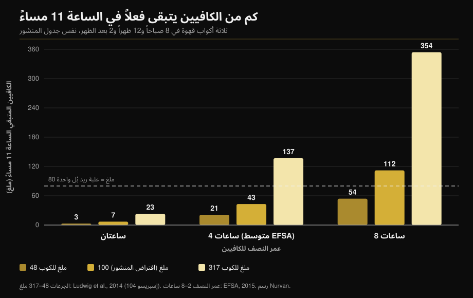

# الكافيين والنوم: متى يجب أن تتوقف فعلاً

بقلم [Giammaria Loi](/autore/giammaria-loi) · مُحدَّث في 11 أكتوبر 2026

رسم بياني واسع الانتشار يرسم ثلاثة أكواب قهوة — الثامنة صباحاً، الظهر، الثانية بعد الظهر — ويخلص إلى أنه عند الحادية عشرة ليلاً ما زال في جسمك 87 ملغ من الكافيين: أكثر من علبة ريد بُل. الحساب صحيح. المشكلة في الرقمين اللذين يغذّيانه: كم كافيين في الكوب، وكم تستغرق للتخلص منه. قِس الاثنين ولن تبقى الإجابة رقماً، بل مدى واسعاً جداً. إليك الحساب معاداً، والساعة الفاصلة التي تدعمها التحليلات البعدية فعلاً.

## باختصار

- **حساب المنشور صامد.** بافتراضاته (100 ملغ للكوب، عمر نصف 6 ساعات) يتبقى نحو 81 ملغ عند الحادية عشرة، قريباً من الـ87 ملغ المعروضة. ونعم، هذا أكثر من نحو 80 ملغ في علبة مشروب طاقة سعة 250 مل (EFSA، 2015).
- **لكن «كوب = 100 ملغ» غير موجود.** في 104 أكواب إسبريسو اشتُريت من مقاهٍ في إيطاليا واسكتلندا وإسبانيا، تراوح الكافيين بين **48 و317 ملغ للحصة** (Ludwig وآخرون، 2014). فارق ستة أضعاف ونصف بين كوب وآخر.
- **و«عمر نصف 6 ساعات» غير موجود أيضاً.** تحدد الهيئة الأوروبية لسلامة الغذاء متوسطاً قريباً من 4 ساعات بمدى من **ساعتين إلى 8 ساعات**، ونشاط الإنزيم الذي يتخلص من الكافيين يتفاوت بين الأشخاص بمقدار **5 إلى 6 أضعاف** (Grzegorzewski وآخرون، 2022).
- **بإعادة الحساب بالقيم المقيسة**، يتراوح الكافيين المتبقي عند الحادية عشرة بين **3 ملغ و354 ملغ**: مدى بمئة ضعف، لا رقماً واحداً. الرسم أدناه يوضح ذلك.
- **خلاصة المنشور صحيحة وأكثر صرامة مما يبدو.** كي لا تخسر دقائق من نومك، يُشرب كوب بـ107 ملغ قبل النوم بـ**8.8 ساعة** على الأقل، وحصة مكمل ما قبل التمرين بـ217 ملغ قبل النوم بـ**13.2 ساعة** على الأقل (Gardiner وآخرون، 2023).

## النموذج سليم، أما مدخلاته فلا

يستخدم المنشور المقاربة المعيارية: الكافيين ينخفض إلى النصف على فترات ثابتة، وكل جرعة جديدة تُضاف إلى ما تبقّى من السابقة. ثلاثة أكواب بـ100 ملغ عند الثامنة والثانية عشرة والثانية، بعمر نصف 6 ساعات، تترك نحو 81 ملغ عند الحادية عشرة. إذاً الـ87 ملغ في الرسم ضمن رتبة المقدار الصحيحة.

ليست هذه هي المشكلة. نموذج كهذا يعيد لك بالضبط ما تُدخله إليه، وهنا أُدخل إليه متوسطان سكانيان بثوب ثوابت. وأيٌّ منهما ليس ثابتاً.

## ماذا يقول البحث حقاً

### «كوب القهوة فيه 100 ملغ كافيين» — **مفنَّد**

هذه أضعف حلقة في الاستدلال كله. اشترى فريق من جامعة غلاسكو **104 أكواب إسبريسو** من مقاهٍ في اسكتلندا وإيطاليا وإسبانيا وحلّلها: تراوح الكافيين بين **48 و317 ملغ للحصة**. خلاصة الباحثين أن «كوب قهوة» ليس وحدة قياس قابلة للتكرار — ومع ذلك هي الوحدة التي تقيس بها الدراسات الوبائية الاستهلاك (Ludwig وآخرون، 2014).

ومسح أسبق لإسبريسو من 20 محلاً بريطانياً وجد فروقاً بمقدار **ستة أضعاف**، مع كوب إسبريسو واحد يحتوي **322 ملغ** (Crozier وآخرون، 2012). المتغير الأثقل ليس الخلطة ولا درجة التحميص، بل كمية البن المطحون التي تُكبس في الحامل.

أي أن كوبك قد يساوي أقل من نصف الكوب المفترض في المنشور أو أكثر من ثلاثة أضعافه، ولا سبيل لديك لمعرفة ذلك.

### «عمر النصف للكافيين 5 إلى 6 ساعات» — **يحتاج تدقيقاً**

في رأيها حول سلامة الكافيين، تعطي الهيئة الأوروبية لسلامة الغذاء عمر نصف متوسطاً يقارب **4 ساعات لدى البالغين الأصحاء، بمدى من ساعتين إلى 8 ساعات** (EFSA، 2015). الساعات الست المستخدمة في المنشور تقع في أعلى هذا المدى، لا في وسطه.

سبب هذا التشتت هو إنزيم الكبد CYP1A2، المسؤول عن 80–90% من تحويل الكافيين. يتفاوت نشاطه بين الأشخاص بمقدار **5 إلى 6 أضعاف** لأسباب جينية وفوق-جينية وبيئية. وفي التحليل المنهجي لـ141 منشوراً في الحرائك الدوائية، يسرّع **التدخين** التخلص من الكافيين بثبات، بينما تبطئه **موانع الحمل الفموية**، وهو أثر قابل للتكرار عبر أكثر من خمسين عاماً من الأبحاث (Grzegorzewski وآخرون، 2022). وبيان موقف الجمعية الدولية لتغذية الرياضة يقول الشيء نفسه: الاستجابة الفردية للكافيين، والنوم ضمنها، تعتمد جزئياً على التباين الجيني في استقلابه (Guest وآخرون، 2021).

*النموذج نفسه والمواعيد نفسها، لكن بالقيم المقيسة في الأدبيات بدل متوسطين. النتيجة ليست 87 ملغ، بل مدى من 3 إلى 354 ملغ. الجرعات من Ludwig وآخرون، 2014؛ أعمار النصف من مدى EFSA 2015. حساب ورسم Nurvan.*

يفسّر الرسم لماذا ينام زميلان يشربان العدد نفسه من الأكواب بشكل مختلف، ولماذا قد تكون عبارة «القهوة بعد العشاء لا تؤثر فيّ» صحيحة حرفياً لمن يقع في العمود الأيسر.

### «عند الحادية عشرة لديك كافيين أكثر من ريد بُل» — **مؤكَّد**

المقارنة صامدة. تقدّر الهيئة الأوروبية مشروبات الطاقة بـ320 ملغ لكل لتر، أي نحو **80 ملغ في علبة 250 مل** (EFSA، 2015). بافتراضات المنشور تبقى فوق هذه العتبة بقليل. ومع كوب أثقل أو استقلاب بطيء، تبقى فوقها بكثير.

### «قهوة بعد الظهر تفسد النوم» — **مؤكَّد، والعتبة أصرم**

هنا المنشور محق، لكنه يتوقف قبل الرقم الأنفع. جمع التحليل البعدي المرجعي 24 دراسة وقاس أن الكافيين **يقلّص زمن النوم الكلي 45 دقيقة** وكفاءة النوم 7%، ويطيل زمن الخلود إلى النوم 9 دقائق وزمن اليقظة بعده 12 دقيقة. والأهم أن الباحثين حسبوا المهلة اللازمة: **كوب بـ107 ملغ قبل النوم بـ8.8 ساعة** على الأقل، و**حصة قياسية من مكمل ما قبل التمرين بـ217.5 ملغ قبل النوم بـ13.2 ساعة** على الأقل (Gardiner وآخرون، 2023).

| تنام الساعة | آخر قهوة (107 ملغ) | آخر مكمل ما قبل التمرين (217 ملغ) |
|---|---|---|
| 22:00 | 13:12 | 08:48 |
| 23:00 | 14:12 | 09:48 |
| 00:00 | 15:12 | 10:48 |

*حساب Nurvan بتطبيق عتبتي 8.8 و13.2 ساعة المنشورتين في Gardiner وآخرون، 2023. هذه متوسطات أدبيات، لا وصفات فردية.*

وكانت تجربة ميدانية مضبوطة قد أظهرت الأمر نفسه بشكل أصرح: 400 ملغ كافيين قبل النوم بـ**6 ساعات** تقلّل النوم بفارق معتد به مقارنة بالدواء الوهمي، بقياس جهاز مُعتمد في منازل المشاركين (Drake وآخرون، 2013).

في جدول المنشور آخر قهوة عند الثانية بعد الظهر لنوم عند الحادية عشرة: تسع ساعات، فوق عتبة **كوب واحد** بقليل. لكن مجموع اليوم كان ثلاثة أكواب.

### «ما دمت أنام على أي حال فلا بأس» — **مفنَّد**

هذه ليست من كلام المنشور، لكنها أكثر رد يتكرر تحت هذا النوع من المحتوى، والبحث يفككها. في التحليل البعدي نفسه، يزيد الكافيين النوم الخفيف (+6.1 دقيقة من الطور N1) و**يقلّص النوم العميق 11.4 دقيقة** (Gardiner وآخرون، 2023). ويؤكد ذلك تحليل بعدي لاحق شمل 22 تجربة مضبوطة بتخطيط النوم و956 مشاركاً: −34.7 دقيقة من النوم الكلي، −4.7% من الكفاءة، +8.4 دقيقة للخلود إلى النوم، وانخفاض في نسبة النوم العميق يزداد وضوحاً مع الجرعات العالية (Chang وآخرون، 2025).

الخلود إلى النوم ليس كل المهمة. إن كنت تتمرن، فالجزء العميق من الليل هو ما يستحق الحماية.

وعند الرياضيين للصورة منعطف لافت. عشر دراسات على من يتناول الكافيين قبل تمرين أو منافسة مسائية تُظهر انخفاضاً صغيراً في كفاءة النوم (−4.87%) واتجاهاً غير معتد به في الزمن الكلي، لكن الرياضيين **يبلّغون باستمرار عن نوم أسوأ بوضوح** (Kocak وآخرون، 2025). الإحساس يسبق القياس: مع قلة الليالي وقلة المشاركين، هذا سبب للحذر لا للاطمئنان.

### «الكافيين أداة أداء» — **مؤكَّد**

هنا يتوافق المنشور مع الأدبيات. يورد بيان موقف الجمعية الدولية لتغذية الرياضة فوائد ثابتة على التحمل والقوة وسرعة الحركة والحركات النوعية لكل رياضة، بجرعات **3–6 ملغ لكل كيلوغرام من وزن الجسم**، تُؤخذ عادة قبل 60 دقيقة؛ أما الجرعات العالية جداً مثل 9 ملغ/كغ فلا تضيف فائدة بل آثاراً جانبية (Guest وآخرون، 2021). لوزن 75 كغ يعني ذلك 225–450 ملغ: في أسوأ الحالات، كافيين إسبريسو شديد التركيز مضافاً إليه مكمل ما قبل التمرين. وإن كنت تفضّل تقييم المكملات بالأدلة لا بالتسويق، فقد أنجزنا العمل نفسه في [تصنيف مكملات القوة](/ar/blog/tasnif-mukammilat-alquwa).

## كيف تطبّق هذا

1. **حدّد ساعة، لا كمية.** خذ موعد نومك واطرح 9 ساعات: تلك آخر قهوة عادية في يومك. ولمكمل ما قبل التمرين اطرح 13 ساعة.
2. **إن كنت تتمرن مساءً، غيّر الأداة.** جرعة كاملة من مكمل ما قبل التمرين عند السابعة مساءً لا تتعايش مع نوم عند الحادية عشرة. اقسمها نصفين، أو انتقل إلى خيار بلا كافيين، أو انقل الكافيين إلى حصة الصباح.
3. **احسب الحصص لا الأكواب.** قد يساوي إسبريسوك من 48 إلى 317 ملغ. وإن كنت تجهل تركيزه، افترض أن كوبين في الخارج قد يمثلان نصف الحد اليومي.
4. **ابقَ دون حدود الأمان.** تعتبر الهيئة الأوروبية أن حتى 400 ملغ يومياً و200 ملغ في الجرعة الواحدة لا تثير قلقاً للبالغ السليم (EFSA، 2015). وفي الحمل أو مع مرض أو دواء قائم تتغير الحدود: هذا سؤال للطبيب لا لآلة حاسبة.
5. **جرّب على نفسك أسبوعين.** سجّل وقت وجرعة كل مصدر كافيين وكيف نمت. بعد عشرة أيام يظهر مداك الشخصي: وهو السبيل الوحيد لمعرفة أي عمود من الرسم يخصّك.
6. **لا تعوّض بمزيد من الكافيين.** أن تنام سيئاً ثم ترفع الجرعة في اليوم التالي هو الحلقة التي تصفها الأدبيات بأنها بداية المشكلة، لا حلّها.

> ### 💡 مع Nurvan
> **للمكملات ساعة، لا جرعة فقط.** في Nurvan تسجّل كل مكمل بكميته ووقت تناوله — والكافيين ومكمل ما قبل التمرين ضمنها — إلى جانب حصة التدريب في اليوم نفسه. فإذا كنت تنام سيئاً بعد الحصص المسائية، لن تحتاج إلى استعادة ذلك من الذاكرة: البيانات موجودة أصلاً، ساعة بساعة. [جرّب Nurvan](https://nurvan.app)

## أسئلة شائعة

**كم ساعة قبل النوم يجب أن أتوقف عن شرب القهوة؟**
8.8 ساعة على الأقل لقهوة بنحو 107 ملغ، و13.2 ساعة لحصة مكمل ما قبل التمرين بـ217 ملغ، إن كان الهدف ألا تخسر دقائق من النوم الكلي (Gardiner وآخرون، 2023). لنوم عند الحادية عشرة، يعني ذلك آخر قهوة نحو الثانية بعد الظهر. وهذه متوسطات: من يتخلص من الكافيين ببطء يحتاج هامشاً أكبر.

**كم كافيين في الإسبريسو فعلاً؟**
من 48 إلى 317 ملغ للحصة، في 104 أكواب إسبريسو قيست في مقاهٍ بإيطاليا واسكتلندا وإسبانيا (Ludwig وآخرون، 2014). العامل الأهم هو كمية البن المطحون التي يستخدمها الباريستا، لا الخلطة.

**إن كنت أنام سريعاً بعد القهوة، هل أشربها ليلاً؟**
النوم السريع لا يعني النوم الجيد. يدفع الكافيين النوم نحو الأطوار الخفيفة ويقلّص النوم العميق نحو 11 دقيقة في الليلة (Gardiner وآخرون، 2023؛ Chang وآخرون، 2025). الأثر قائم سواء شعرت به أم لا.

**هل يستحق الكافيين قبل التمرين المسائي؟**
يعتمد على ما تريده من تلك الليلة. الفائدة على الأداء عند 3–6 ملغ/كغ موثقة جيداً (Guest وآخرون، 2021)، لكن الرياضيين الذين يتناولونه قبل الحصص المسائية يبلّغون عن نوم أسوأ (Kocak وآخرون، 2025). لتمرين عادي نادراً ما تستقيم المعادلة؛ ولمنافسة قد تستقيم.

## اقرأ أيضاً

- [تصنيف مكملات القوة: ماذا يقول البحث العلمي](/ar/blog/tasnif-mukammilat-alquwa)
- [الكرياتين بلا تمرين بعد الخامسة والأربعين: ماذا تقول الدراسة](/ar/blog/creatine-bidun-tamarin-baad-45)
- [كم تكرار لبناء العضلات؟ خرافة الـ 8-12](/ar/blog/kam-takrar-lilkutla-aladalia)

## المصادر

1. Gardiner C, Weakley J, Burke LM, Roach GD, Sargent C, Maniar N, Townshend A, Halson SL, 2023. *The effect of caffeine on subsequent sleep: A systematic review and meta-analysis.* Sleep Med Rev 69:101764. PMID 36870101 — [doi:10.1016/j.smrv.2023.101764](https://doi.org/10.1016/j.smrv.2023.101764)
2. Chang YH, Cheng YC, Cheng WJ, 2025. *Age- and dose-specific effects of caffeine on sleep: A meta-analysis of controlled crossover trials.* Sleep Med 136:106874. PMID 41124973 — [doi:10.1016/j.sleep.2025.106874](https://doi.org/10.1016/j.sleep.2025.106874)
3. Drake C, Roehrs T, Shambroom J, Roth T, 2013. *Caffeine effects on sleep taken 0, 3, or 6 hours before going to bed.* J Clin Sleep Med 9(11):1195–1200. PMID 24235903 — [doi:10.5664/jcsm.3170](https://doi.org/10.5664/jcsm.3170)
4. Ludwig IA, Mena P, Calani L, Cid C, Del Rio D, Lean MEJ, Crozier A, 2014. *Variations in caffeine and chlorogenic acid contents of coffees: what are we drinking?* Food Funct 5(8):1718–1726. PMID 25014672 — [doi:10.1039/c4fo00290c](https://doi.org/10.1039/c4fo00290c)
5. Crozier TWM, Stalmach A, Lean MEJ, Crozier A, 2012. *Espresso coffees, caffeine and chlorogenic acid intake: potential health implications.* Food Funct 3(1):30–33. PMID 22130653 — [doi:10.1039/c1fo10240k](https://doi.org/10.1039/c1fo10240k)
6. Grzegorzewski J, Bartsch F, Köller A, König M, 2022. *Pharmacokinetics of Caffeine: A Systematic Analysis of Reported Data for Application in Metabolic Phenotyping and Liver Function Testing.* Front Pharmacol 12:752826. PMID 35280254 — [doi:10.3389/fphar.2021.752826](https://doi.org/10.3389/fphar.2021.752826)
7. Kocak A, Georgousopoulou E, Knight-Agarwal CR, Matthews R, Minehan M, 2025. *The Effect of Consuming Caffeine Before Late Afternoon/Evening Training or Competition on Sleep: A Systematic Review with Meta-Analysis.* Sports (Basel) 13(9):317. PMID 41003623 — [doi:10.3390/sports13090317](https://doi.org/10.3390/sports13090317)
8. Guest NS, VanDusseldorp TA, Nelson MT, et al., 2021. *International society of sports nutrition position stand: caffeine and exercise performance.* J Int Soc Sports Nutr 18(1):1. PMID 33388079 — [doi:10.1186/s12970-020-00383-4](https://doi.org/10.1186/s12970-020-00383-4)
9. EFSA Panel on Dietetic Products, Nutrition and Allergies, 2015. *Scientific Opinion on the safety of caffeine.* EFSA Journal 13(5):4102. — [doi:10.2903/j.efsa.2015.4102](https://doi.org/10.2903/j.efsa.2015.4102)

البيانات الوصفية والملخصات من PubMed. نقطة الانطلاق: منشور [Todd Anderson (@toddanderson42_)](https://www.instagram.com/p/DdNDHgthiYV/) بتاريخ 13 سبتمبر 2026. لم يُستنسخ أي نص أو صورة أو بنية من المنشور: استُخلصت الادعاءات وأُعيدت صياغتها وتُحقق منها بشكل مستقل.

---

**Giammaria Loi** هو مؤسس Nurvan. يتمرن بالأثقال منذ 2012، ويعمل مدرباً شخصياً ومدرباً معتمداً من FIPE منذ 2013، وينافس في رفع الأثقال القوة (powerlifting) على المستوى الوطني منذ 2018. كل مقال يوقّعه ينطلق من الدراسات العلمية وينتهي عند ما ينفع فعلاً في الصالة.

> ملاحظة: محتوى تعليمي لا يغني عن رأي طبيب أو مختص. إن كنتِ حاملاً أو مرضعاً، أو كنت تتناول أدوية، أو لديك اضطرابات نوم أو قلب أو قلق، فاستشر طبيبك قبل تغيير استهلاكك من الكافيين.
