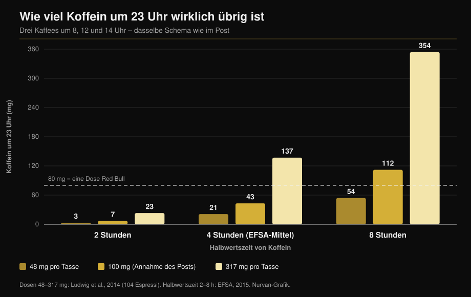

# Koffein und Schlaf: wann du wirklich aufhören musst

Von [Giammaria Loi](/autore/giammaria-loi) · aktualisiert am 11. Oktober 2026

Eine viel geteilte Grafik zeichnet drei Kaffees ein — 8 Uhr, 12 Uhr, 14 Uhr — und kommt zu dem Schluss, dass um 23 Uhr noch 87 mg Koffein im Körper sind: mehr als eine Dose Red Bull. Die Rechnung stimmt. Das Problem sind die beiden Zahlen, die sie füttern: wie viel Koffein in einer Tasse steckt und wie schnell du es abbaust. Misst man beides, ist die Antwort keine Zahl mehr, sondern eine sehr breite Spanne. Hier ist die Rechnung neu gemacht — und die Uhrzeit, die die Meta-Analysen wirklich hergeben.

## Kurz gefasst

- **Die Arithmetik des Posts hält.** Mit seinen Annahmen (100 mg pro Tasse, 6 Stunden Halbwertszeit) bleiben um 23 Uhr rund 81 mg übrig, nahe an den gezeigten 87 mg. Und ja, das sind mehr als die etwa 80 mg einer 250-ml-Dose Energydrink (EFSA, 2015).
- **Aber „eine Tasse = 100 mg" gibt es nicht.** In 104 Espressi aus Cafés in Italien, Schottland und Spanien reichte der Koffeingehalt von **48 bis 317 mg pro Portion** (Ludwig et al., 2014). Faktor 6,5 zwischen zwei Tassen.
- **„Halbwertszeit 6 Stunden" gibt es ebenso wenig.** Die EFSA nennt im Mittel rund 4 Stunden mit einer Spanne von **2 bis 8 Stunden**, und die Aktivität des abbauenden Enzyms schwankt zwischen Menschen um das **5- bis 6-Fache** (Grzegorzewski et al., 2022).
- **Rechnet man mit gemessenen Werten**, liegt das Restkoffein um 23 Uhr zwischen **3 mg und 354 mg**: eine hundertfache Spanne statt einer Zahl. Die Grafik unten zeigt es.
- **Die Schlussfolgerung des Posts stimmt und ist strenger, als er zugibt.** Wer keine Schlafzeit verlieren will, sollte einen Kaffee mit 107 mg mindestens **8,8 Stunden** vor dem Zubettgehen trinken und eine Pre-Workout-Portion mit 217 mg mindestens **13,2 Stunden** vorher (Gardiner et al., 2023).

## Das Modell ist richtig. Die Eingaben sind es nicht

Der Post nutzt den Standardansatz: Koffein halbiert sich in festen Abständen, und jede neue Dosis addiert sich auf den Rest der vorherigen. Drei Tassen à 100 mg um 8, 12 und 14 Uhr, Halbwertszeit 6 Stunden, ergeben um 23 Uhr etwa 81 mg. Die 87 mg der Grafik liegen also in der richtigen Größenordnung.

Das ist nicht das Problem. Ein solches Modell gibt genau das zurück, was man hineingibt — und hier bekommt es zwei Bevölkerungsmittelwerte, die als Konstanten auftreten. Keiner von beiden ist eine.

## Was die Forschung wirklich sagt

### „Eine Tasse Kaffee enthält 100 mg Koffein" — **Widerlegt**

Das ist das schwächste Glied der ganzen Argumentation. Ein Team der Universität Glasgow kaufte und analysierte **104 Espressi** in Cafés in Schottland, Italien und Spanien: Der Koffeingehalt reichte von **48 bis 317 mg pro Portion**. Ihr Fazit: „eine Tasse Kaffee" ist keine reproduzierbare Maßeinheit — und doch ist sie die Einheit, mit der die Epidemiologie den Konsum misst (Ludwig et al., 2014).

Eine frühere Erhebung an Espressi aus 20 britischen Lokalen fand Unterschiede um den **Faktor sechs**, mit einem einzelnen Espresso von **322 mg** (Crozier et al., 2012). Die stärkste Variable ist weder Mischung noch Röstung, sondern wie viel gemahlener Kaffee im Siebträger landet.

Dein Espresso kann also weniger als die Hälfte oder mehr als das Dreifache der im Post angenommenen Tasse enthalten — und du hast keine Möglichkeit, es zu wissen.

### „Die Halbwertszeit von Koffein beträgt 5 bis 6 Stunden" — **Zu präzisieren**

In ihrer Stellungnahme zur Sicherheit von Koffein nennt die EFSA eine mittlere Halbwertszeit von etwa **4 Stunden bei gesunden Erwachsenen, mit einer Spanne von 2 bis 8 Stunden** (EFSA, 2015). Die 6 Stunden des Posts liegen am oberen Rand dieser Spanne, nicht in der Mitte.

Grund für die Streuung ist das Leberenzym CYP1A2, das 80–90 % des Koffeinabbaus übernimmt. Seine Aktivität schwankt zwischen Menschen um das **5- bis 6-Fache**, aus genetischen, epigenetischen und umweltbedingten Gründen. In der systematischen Auswertung von 141 pharmakokinetischen Publikationen beschleunigt **Rauchen** die Koffeinausscheidung konsistent, während **orale Kontrazeptiva** sie verlangsamen — ein über mehr als fünfzig Jahre Forschung reproduzierbarer Effekt (Grzegorzewski et al., 2022). Das ISSN-Positionspapier sagt dasselbe: Die individuelle Reaktion auf Koffein, Schlaf eingeschlossen, hängt teils von genetischen Unterschieden im Stoffwechsel ab (Guest et al., 2021).

*Dasselbe Modell wie im Post, dieselben Uhrzeiten, aber mit den in der Literatur gemessenen Werten statt zwei Mittelwerten. Das Ergebnis ist nicht 87 mg, sondern eine Spanne von 3 bis 354 mg. Dosen nach Ludwig et al., 2014; Halbwertszeiten aus der EFSA-Spanne 2015. Berechnung und Grafik von Nurvan.*

Die Grafik erklärt, warum zwei Kollegen mit gleich vielen Kaffees unterschiedlich schlafen — und warum „mir macht Kaffee nach dem Abendessen nichts aus" für jemanden in der linken Spalte buchstäblich zutreffen kann.

### „Um 23 Uhr hast du mehr Koffein als ein Red Bull" — **Bestätigt**

Der Vergleich hält. Die EFSA setzt Energydrinks bei 320 mg pro Liter an, also rund **80 mg in einer 250-ml-Dose** (EFSA, 2015). Mit den Annahmen des Posts liegt man knapp darüber. Mit einer stärkeren Tasse oder langsamem Stoffwechsel deutlich darüber.

### „Nachmittagskaffee stört den Schlaf" — **Bestätigt, und die Schwelle ist strenger**

Hier hat der Post recht, hört aber vor der nützlichsten Zahl auf. Die maßgebliche Meta-Analyse fasste 24 Studien zusammen: Koffein **verkürzt die Gesamtschlafzeit um 45 Minuten** und die Schlafeffizienz um 7 %, verlängert das Einschlafen um 9 Minuten und die Wachzeit danach um 12 Minuten. Vor allem errechneten die Autoren den nötigen Vorlauf: ein **Kaffee mit 107 mg mindestens 8,8 Stunden vor** dem Zubettgehen, eine **Standardportion Pre-Workout mit 217,5 mg mindestens 13,2 Stunden vorher** (Gardiner et al., 2023).

| Zubettgehen um | Letzter Kaffee (107 mg) | Letztes Pre-Workout (217 mg) |
|---|---|---|
| 22:00 | 13:12 | 08:48 |
| 23:00 | 14:12 | 09:48 |
| 00:00 | 15:12 | 10:48 |

*Berechnung von Nurvan mit den in Gardiner et al., 2023 veröffentlichten Schwellen von 8,8 und 13,2 Stunden. Es sind Literaturmittelwerte, keine individuellen Vorgaben.*

Eine kontrollierte Feldstudie hatte dasselbe schon direkter gezeigt: 400 mg Koffein **6 Stunden vor** dem Zubettgehen reduzieren den Schlaf signifikant gegenüber Placebo, gemessen mit einem validierten Gerät bei den Teilnehmenden zu Hause (Drake et al., 2013).

Im Schema des Posts fällt der letzte Kaffee auf 14 Uhr bei Bettzeit 23 Uhr: neun Stunden, knapp über der Schwelle für **einen** Kaffee. Die Tagesbilanz waren allerdings drei Tassen.

### „Wenn ich trotzdem einschlafe, ist es egal" — **Widerlegt**

Das steht nicht im Post, ist aber die häufigste Antwort unter solchen Inhalten — und die Forschung zerlegt sie. In derselben Meta-Analyse erhöht Koffein den Leichtschlaf (+6,1 Minuten Stadium N1) und **verkürzt den Tiefschlaf um 11,4 Minuten** (Gardiner et al., 2023). Eine spätere Meta-Analyse über 22 kontrollierte Polysomnographie-Studien mit 956 Teilnehmenden bestätigt das: −34,7 Minuten Gesamtschlaf, −4,7 % Effizienz, +8,4 Minuten bis zum Einschlafen und ein geringerer Tiefschlafanteil, deutlicher bei hohen Dosen (Chang et al., 2025).

Einschlafen ist nicht die ganze Arbeit. Wer trainiert, will genau den tiefen Teil der Nacht schützen.

Bei Sportlern hat das Bild eine kuriose Wendung. Zehn Studien zu Koffein vor Training oder Wettkampf am späten Nachmittag oder Abend zeigen eine kleine Abnahme der Schlafeffizienz (−4,87 %) und einen nicht signifikanten Trend bei der Gesamtschlafzeit — die Athletinnen und Athleten **berichten jedoch durchweg von deutlich schlechterem Schlaf** (Kocak et al., 2025). Die Wahrnehmung läuft der Messung voraus. Bei wenigen Nächten und wenigen Teilnehmenden ist das ein Grund zur Vorsicht, nicht zur Entwarnung.

### „Koffein ist ein Leistungswerkzeug" — **Bestätigt**

Hier liegt der Post auf einer Linie mit der Literatur. Das ISSN-Positionspapier berichtet konsistente Vorteile für Ausdauer, Kraft, Bewegungsgeschwindigkeit und sportartspezifische Aktionen bei **3–6 mg pro kg Körpergewicht**, üblicherweise 60 Minuten vorher; sehr hohe Dosen wie 9 mg/kg bringen nichts zusätzlich, nur mehr Nebenwirkungen (Guest et al., 2021). Bei 75 kg sind das 225–450 mg: im Extremfall das Koffein eines sehr starken Espresso plus ein Pre-Workout. Wer Supplemente lieber nach Evidenz als nach Marketing beurteilt: dieselbe Arbeit haben wir in unserer [Supplement-Tier-List für Kraft](/de/blog/kraftsport-supplemente-tier-list) gemacht.

## So setzt du es um

1. **Leg eine Uhrzeit fest, keine Menge.** Nimm deine Bettzeit und zieh 9 Stunden ab: Das ist dein letzter normaler Kaffee. Beim Pre-Workout zieh 13 ab.
2. **Wenn du abends trainierst, wechsle das Werkzeug.** Eine volle Pre-Workout-Dosis um 19 Uhr verträgt sich nicht mit Bettzeit 23 Uhr. Halbiere sie, nimm eine koffeinfreie Variante oder verschiebe das Koffein auf die Morgeneinheit.
3. **Zähl Portionen, nicht Tassen.** Dein Espresso kann 48 bis 317 mg haben. Wenn du die Stärke nicht kennst, rechne damit, dass zwei auswärts schon die Hälfte des Tageslimits sein können.
4. **Bleib unter den Sicherheitsgrenzen.** Die EFSA hält bis zu 400 mg pro Tag und 200 mg als Einzeldosis für gesunde Erwachsene für unbedenklich (EFSA, 2015). In der Schwangerschaft sowie bei Erkrankungen oder laufender Medikation gelten andere Grenzen: eine Frage für die Ärztin, nicht für einen Rechner.
5. **Teste dich zwei Wochen lang selbst.** Notiere Uhrzeit und Dosis jeder Koffeinquelle und wie du geschlafen hast. Nach zehn Tagen zeigt sich deine persönliche Spanne — der einzige Weg herauszufinden, in welcher Spalte der Grafik du stehst.
6. **Kompensiere nicht mit mehr Koffein.** Schlecht schlafen und am nächsten Tag die Dosis erhöhen ist genau der Kreislauf, den die Literatur als Anfang des Problems beschreibt, nicht als Lösung.

> ### 💡 Mit Nurvan
> **Supplemente haben eine Uhrzeit, nicht nur eine Dosis.** In Nurvan trägst du jedes Supplement mit Menge und Einnahmezeit ein — Koffein und Pre-Workout eingeschlossen — direkt neben der Trainingseinheit desselben Tages. Wenn du nach Abendeinheiten schlecht schläfst, musst du es also nicht aus dem Gedächtnis rekonstruieren: Die Daten sind schon da, Stunde für Stunde. [Nurvan ausprobieren](https://nurvan.app)

## Häufige Fragen

**Wie viele Stunden vor dem Schlafen sollte ich keinen Kaffee mehr trinken?**
Mindestens 8,8 Stunden bei einem Kaffee mit rund 107 mg und 13,2 Stunden bei einer Pre-Workout-Portion mit 217 mg, wenn du keine Gesamtschlafzeit verlieren willst (Gardiner et al., 2023). Bei Bettzeit 23 Uhr heißt das: letzter Kaffee gegen 14 Uhr. Das sind Mittelwerte — wer langsam abbaut, braucht mehr Puffer.

**Wie viel Koffein steckt wirklich in einem Espresso?**
Zwischen 48 und 317 mg pro Portion, in den 104 gemessenen Espressi aus Cafés in Italien, Schottland und Spanien (Ludwig et al., 2014). Entscheidend ist die Menge gemahlenen Kaffees, nicht die Mischung.

**Wenn ich nach Kaffee gut einschlafe, darf ich ihn abends trinken?**
Schnell einschlafen heißt nicht gut schlafen. Koffein verschiebt den Schlaf in die leichten Stadien und verkürzt den Tiefschlaf um etwa 11 Minuten pro Nacht (Gardiner et al., 2023; Chang et al., 2025). Der Effekt ist da, ob du ihn merkst oder nicht.

**Lohnt sich Koffein vor dem Abendtraining?**
Kommt darauf an, worum es an diesem Abend geht. Der Leistungsvorteil bei 3–6 mg/kg ist gut belegt (Guest et al., 2021), aber Athletinnen und Athleten, die vor Abendeinheiten Koffein nehmen, berichten von schlechterem Schlaf (Kocak et al., 2025). Für ein normales Training geht die Rechnung selten auf, für einen Wettkampf kann sie es.

## Weiterlesen

- [Supplement-Tier-List für Kraft: was die Studien sagen](/de/blog/kraftsport-supplemente-tier-list)
- [Kreatin ohne Training ab 45: was die Studie zeigt](/de/blog/kreatin-ohne-training-ab-45)
- [Wie viele Wiederholungen für Muskelaufbau? Der 8-12-Mythos](/de/blog/wie-viele-wiederholungen-muskelaufbau)

## Quellen

1. Gardiner C, Weakley J, Burke LM, Roach GD, Sargent C, Maniar N, Townshend A, Halson SL, 2023. *The effect of caffeine on subsequent sleep: A systematic review and meta-analysis.* Sleep Med Rev 69:101764. PMID 36870101 — [doi:10.1016/j.smrv.2023.101764](https://doi.org/10.1016/j.smrv.2023.101764)
2. Chang YH, Cheng YC, Cheng WJ, 2025. *Age- and dose-specific effects of caffeine on sleep: A meta-analysis of controlled crossover trials.* Sleep Med 136:106874. PMID 41124973 — [doi:10.1016/j.sleep.2025.106874](https://doi.org/10.1016/j.sleep.2025.106874)
3. Drake C, Roehrs T, Shambroom J, Roth T, 2013. *Caffeine effects on sleep taken 0, 3, or 6 hours before going to bed.* J Clin Sleep Med 9(11):1195–1200. PMID 24235903 — [doi:10.5664/jcsm.3170](https://doi.org/10.5664/jcsm.3170)
4. Ludwig IA, Mena P, Calani L, Cid C, Del Rio D, Lean MEJ, Crozier A, 2014. *Variations in caffeine and chlorogenic acid contents of coffees: what are we drinking?* Food Funct 5(8):1718–1726. PMID 25014672 — [doi:10.1039/c4fo00290c](https://doi.org/10.1039/c4fo00290c)
5. Crozier TWM, Stalmach A, Lean MEJ, Crozier A, 2012. *Espresso coffees, caffeine and chlorogenic acid intake: potential health implications.* Food Funct 3(1):30–33. PMID 22130653 — [doi:10.1039/c1fo10240k](https://doi.org/10.1039/c1fo10240k)
6. Grzegorzewski J, Bartsch F, Köller A, König M, 2022. *Pharmacokinetics of Caffeine: A Systematic Analysis of Reported Data for Application in Metabolic Phenotyping and Liver Function Testing.* Front Pharmacol 12:752826. PMID 35280254 — [doi:10.3389/fphar.2021.752826](https://doi.org/10.3389/fphar.2021.752826)
7. Kocak A, Georgousopoulou E, Knight-Agarwal CR, Matthews R, Minehan M, 2025. *The Effect of Consuming Caffeine Before Late Afternoon/Evening Training or Competition on Sleep: A Systematic Review with Meta-Analysis.* Sports (Basel) 13(9):317. PMID 41003623 — [doi:10.3390/sports13090317](https://doi.org/10.3390/sports13090317)
8. Guest NS, VanDusseldorp TA, Nelson MT, et al., 2021. *International society of sports nutrition position stand: caffeine and exercise performance.* J Int Soc Sports Nutr 18(1):1. PMID 33388079 — [doi:10.1186/s12970-020-00383-4](https://doi.org/10.1186/s12970-020-00383-4)
9. EFSA Panel on Dietetic Products, Nutrition and Allergies, 2015. *Scientific Opinion on the safety of caffeine.* EFSA Journal 13(5):4102. — [doi:10.2903/j.efsa.2015.4102](https://doi.org/10.2903/j.efsa.2015.4102)

Metadaten und Abstracts aus PubMed. Ausgangspunkt: ein Beitrag von [Todd Anderson (@toddanderson42_)](https://www.instagram.com/p/DdNDHgthiYV/) vom 13. September 2026. Weder Text noch Bild noch Struktur des Beitrags wurden übernommen: Die Aussagen wurden extrahiert, neu geschrieben und unabhängig überprüft.

---

**Giammaria Loi** ist der Gründer von Nurvan. Er trainiert seit 2012 mit Gewichten, arbeitet seit 2013 als FIPE-zertifizierter Personal Trainer und Coach und tritt seit 2018 auf nationaler Ebene im Powerlifting an. Jeder Artikel, den er zeichnet, beginnt bei den Studien und endet bei dem, was im Studio wirklich funktioniert.

> Hinweis: informativer Inhalt, ersetzt nicht die Einschätzung einer Ärztin, eines Arztes oder einer qualifizierten Fachkraft. Bei Schwangerschaft oder Stillzeit, laufender Medikation oder Schlaf-, Herz- oder Angststörungen sprich mit deiner Ärztin, bevor du deinen Koffeinkonsum änderst.
