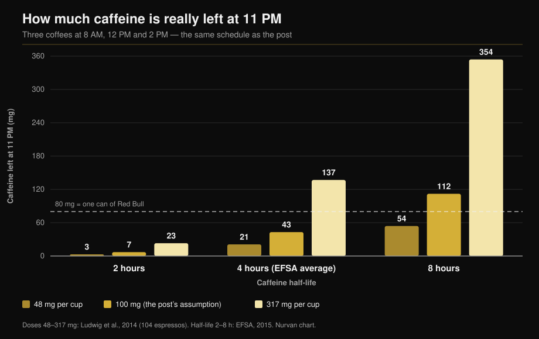

# Caffeine and sleep: when you actually need to stop

By [Giammaria Loi](/autore/giammaria-loi) · updated 11 October 2026

A widely shared chart plots three coffees — 8 AM, noon, 2 PM — and lands on 87 mg of caffeine still in your body at 11 PM, more than a can of Red Bull. The arithmetic is right. The trouble is the two numbers feeding it: how much caffeine is in a cup, and how fast you clear it. Measure both and the answer stops being a number and becomes a very wide range. Here is the calculation redone, plus the cut-off time the meta-analyses actually support.

## Key points

- **The post's maths holds up.** On its own assumptions (100 mg a cup, a 6-hour half-life) about 81 mg is left at 11 PM, close enough to the 87 mg shown. And yes, that beats the roughly 80 mg in a 250 ml energy drink (EFSA, 2015).
- **But "a cup = 100 mg" is not a thing.** Across 104 espressos bought in coffee shops in Italy, Scotland and Spain, caffeine ranged from **48 to 317 mg per serving** (Ludwig et al., 2014). A 6.5-fold spread, cup to cup.
- **Neither is "a 6-hour half-life".** EFSA puts the average near 4 hours with a range of **2 to 8 hours**, and the activity of the enzyme that clears caffeine varies **5- to 6-fold** between people (Grzegorzewski et al., 2022).
- **Rerun the model with measured values** and the caffeine left at 11 PM runs from **3 mg to 354 mg** — a hundredfold range, not a single figure. The chart below shows it.
- **The post's conclusion is right, and stricter than it lets on.** To avoid losing sleep time, a 107 mg coffee should be drunk at least **8.8 hours** before bed, and a 217 mg serving of pre-workout at least **13.2 hours** before (Gardiner et al., 2023).

## The model is fine. Its inputs are not

The post uses the standard approach: caffeine halves at a fixed interval, and each new dose stacks on what's left of the last. Three 100 mg cups at 8 AM, noon and 2 PM, with a 6-hour half-life, leave about 81 mg at 11 PM. So the 87 mg on the graphic is the right order of magnitude.

That isn't the problem. A model like this returns exactly what you feed it, and here it is fed two population averages dressed up as constants. Neither one is.

## What the research actually says

### "A cup of coffee has 100 mg of caffeine" — **Busted**

This is the weakest link in the whole argument. A University of Glasgow team bought and analysed **104 espressos** from coffee shops in Scotland, Italy and Spain. Caffeine ran from **48 to 317 mg per serving**. Their conclusion: "one cup of coffee" is not a reproducible unit — and yet it is the unit epidemiology uses to measure intake (Ludwig et al., 2014).

An earlier survey of espressos from 20 British high-street outlets found **sixfold** differences, with one single espresso carrying **322 mg** (Crozier et al., 2012). The dominant variable isn't the blend or the roast: it's how much ground coffee the barista packs into the basket.

So your coffee may hold less than half, or more than three times, the cup the post assumes — and you have no way of knowing which.

### "Caffeine's half-life is 5 to 6 hours" — **Needs qualifying**

In its opinion on caffeine safety, EFSA gives an average half-life of about **4 hours in healthy adults, ranging from 2 to 8 hours** (EFSA, 2015). The 6 hours used in the post sits at the upper end of that range, not in the middle.

The reason for the spread is the liver enzyme CYP1A2, which handles 80–90% of caffeine breakdown. Its activity varies **5- to 6-fold** between people for genetic, epigenetic and environmental reasons. In a systematic analysis of 141 pharmacokinetic publications, **smoking** consistently speeds caffeine clearance while **oral contraceptives** slow it, an effect reproducible across more than fifty years of research (Grzegorzewski et al., 2022). The ISSN position stand makes the same point: individual responses to caffeine, sleep included, are partly down to genetic variation in how you metabolise it (Guest et al., 2021).

*Same model as the post, same coffee times, but using measured values instead of two averages. The answer isn't 87 mg: it's anywhere from 3 to 354 mg. Doses from Ludwig et al., 2014; half-lives from the EFSA 2015 range. Nurvan calculation and chart.*

That chart explains why two colleagues on the same number of coffees sleep differently, and why "coffee after dinner does nothing to me" can be literally true for anyone sitting in the left-hand column.

### "At 11 PM you've got more caffeine than a Red Bull" — **Confirmed**

The comparison stands. EFSA puts energy drinks at 320 mg per litre, so roughly **80 mg in a 250 ml can** (EFSA, 2015). On the post's assumptions you end up just above that line. With a stronger cup or a slow metabolism, far above it.

### "Afternoon coffee disrupts sleep" — **Confirmed, and the threshold is tighter**

The post is right here, but stops short of the most useful number. The reference meta-analysis pooled 24 studies and found caffeine **cuts total sleep time by 45 minutes** and sleep efficiency by 7%, adds 9 minutes to the time it takes to fall asleep and 12 minutes of wakefulness afterwards. Crucially, the authors worked out the lead time required: a **107 mg coffee at least 8.8 hours before bed**, and a **standard 217.5 mg serving of pre-workout at least 13.2 hours before** (Gardiner et al., 2023).

| Bedtime | Last coffee (107 mg) | Last pre-workout (217 mg) |
|---|---|---|
| 10:00 PM | 1:12 PM | 8:48 AM |
| 11:00 PM | 2:12 PM | 9:48 AM |
| 12:00 AM | 3:12 PM | 10:48 AM |

*Nurvan calculation applying the 8.8-hour and 13.2-hour thresholds published in Gardiner et al., 2023. These are literature averages, not individual prescriptions.*

A field trial had already shown the same thing more bluntly: 400 mg of caffeine taken **6 hours before** bed significantly reduced sleep versus placebo, measured with a validated monitor in participants' own homes (Drake et al., 2013).

In the post's schedule the last coffee is at 2 PM for an 11 PM bedtime — nine hours, just inside the threshold for **one** coffee. The day's total, though, was three cups.

### "If I fall asleep anyway, it's fine" — **Busted**

The post doesn't say this, but it's the most common reply under content like it, and the research takes it apart. In the same meta-analysis, caffeine increases light sleep (+6.1 minutes of N1) and **cuts deep sleep by 11.4 minutes** (Gardiner et al., 2023). A later meta-analysis of 22 controlled polysomnography trials in 956 participants agrees: −34.7 minutes of total sleep, −4.7% efficiency, +8.4 minutes to fall asleep, and a drop in the share of deep sleep that is sharper at higher doses (Chang et al., 2025).

Falling asleep is not the whole job. If you train, the deep part of the night is the part worth protecting.

In athletes there's a twist. Ten studies of caffeine before late-afternoon or evening sessions show a small drop in sleep efficiency (−4.87%) and a non-significant trend on total sleep time — but the athletes **consistently report markedly worse sleep** (Kocak et al., 2025). Perception runs ahead of the measurement. With few nights and few participants, that's a reason to be careful, not relaxed.

### "Caffeine is a performance tool" — **Confirmed**

Here the post matches the literature. The ISSN position stand reports consistent benefits for endurance, strength, movement velocity and sport-specific actions at **3–6 mg per kg of body mass**, usually taken 60 minutes beforehand; very high doses such as 9 mg/kg add side effects without adding benefit (Guest et al., 2021). For a 75 kg lifter that's 225–450 mg — at the top end, one very strong espresso plus a pre-workout. If you like weighing supplements by the evidence rather than the marketing, we did the same job in our [strength supplement tier list](/en/blog/strength-supplements-tier-list-evidence).

## How to apply it

1. **Set a time, not a quantity.** Take your bedtime and subtract 9 hours: that's your last ordinary coffee. For pre-workout, subtract 13.
2. **If you train in the evening, change the tool.** A full pre-workout scoop at 7 PM does not coexist with an 11 PM bedtime. Halve it, switch to a caffeine-free option, or move the caffeine to your morning session.
3. **Count servings, not cups.** Your espresso can be anything from 48 to 317 mg. If you don't know how strong it is, assume two out can already be half the daily ceiling.
4. **Stay under the safety limits.** EFSA considers up to 400 mg a day and 200 mg in a single dose to be of no concern for healthy adults (EFSA, 2015). In pregnancy, or with a medical condition or medication, the limits change — that's a question for your doctor, not a calculator.
5. **Run a two-week test on yourself.** Log the time and dose of every caffeine source and how you slept. After ten days your own range shows up: it's the only way to find out which column of the chart you're in.
6. **Don't patch it with more caffeine.** Sleeping badly and raising the dose the next day is the loop the literature describes as the start of the problem, not the fix.

> ### 💡 With Nurvan
> **Supplements have a clock, not just a dose.** Nurvan logs every supplement with its amount and the time you took it — caffeine and pre-workout included — alongside that day's training session. So if you sleep badly after evening workouts, you don't have to reconstruct it from memory: the data is already there, hour by hour. [Try Nurvan](https://nurvan.app)

## FAQ

**How many hours before bed should I stop drinking coffee?**
At least 8.8 hours for a coffee of around 107 mg, and 13.2 hours for a 217 mg pre-workout serving, if the goal is not to lose total sleep time (Gardiner et al., 2023). For an 11 PM bedtime that puts your last coffee around 2 PM. These are averages: if you clear caffeine slowly, give yourself more room.

**How much caffeine is really in an espresso?**
Between 48 and 317 mg per serving, across the 104 espressos measured in coffee shops in Italy, Scotland and Spain (Ludwig et al., 2014). The biggest factor is how much ground coffee the barista uses, not the blend.

**If I fall asleep fine after coffee, can I drink it at night?**
Falling asleep quickly isn't the same as sleeping well. Caffeine shifts sleep towards the lighter stages and cuts deep sleep by about 11 minutes a night (Gardiner et al., 2023; Chang et al., 2025). The effect is there whether or not you notice it.

**Is caffeine worth it before an evening workout?**
It depends what that evening is for. The performance benefit at 3–6 mg/kg is well documented (Guest et al., 2021), but athletes who take caffeine before evening sessions report worse sleep (Kocak et al., 2025). For an ordinary training day the trade rarely pays; for a competition it can.

## Read next

- [Strength supplement tier list: what research says](/en/blog/strength-supplements-tier-list-evidence)
- [Creatine without the gym after 45: what the study shows](/en/blog/creatine-without-training-over-45)
- [How many reps build muscle? The 8-12 myth](/en/blog/how-many-reps-build-muscle)

## Sources

1. Gardiner C, Weakley J, Burke LM, Roach GD, Sargent C, Maniar N, Townshend A, Halson SL, 2023. *The effect of caffeine on subsequent sleep: A systematic review and meta-analysis.* Sleep Med Rev 69:101764. PMID 36870101 — [doi:10.1016/j.smrv.2023.101764](https://doi.org/10.1016/j.smrv.2023.101764)
2. Chang YH, Cheng YC, Cheng WJ, 2025. *Age- and dose-specific effects of caffeine on sleep: A meta-analysis of controlled crossover trials.* Sleep Med 136:106874. PMID 41124973 — [doi:10.1016/j.sleep.2025.106874](https://doi.org/10.1016/j.sleep.2025.106874)
3. Drake C, Roehrs T, Shambroom J, Roth T, 2013. *Caffeine effects on sleep taken 0, 3, or 6 hours before going to bed.* J Clin Sleep Med 9(11):1195–1200. PMID 24235903 — [doi:10.5664/jcsm.3170](https://doi.org/10.5664/jcsm.3170)
4. Ludwig IA, Mena P, Calani L, Cid C, Del Rio D, Lean MEJ, Crozier A, 2014. *Variations in caffeine and chlorogenic acid contents of coffees: what are we drinking?* Food Funct 5(8):1718–1726. PMID 25014672 — [doi:10.1039/c4fo00290c](https://doi.org/10.1039/c4fo00290c)
5. Crozier TWM, Stalmach A, Lean MEJ, Crozier A, 2012. *Espresso coffees, caffeine and chlorogenic acid intake: potential health implications.* Food Funct 3(1):30–33. PMID 22130653 — [doi:10.1039/c1fo10240k](https://doi.org/10.1039/c1fo10240k)
6. Grzegorzewski J, Bartsch F, Köller A, König M, 2022. *Pharmacokinetics of Caffeine: A Systematic Analysis of Reported Data for Application in Metabolic Phenotyping and Liver Function Testing.* Front Pharmacol 12:752826. PMID 35280254 — [doi:10.3389/fphar.2021.752826](https://doi.org/10.3389/fphar.2021.752826)
7. Kocak A, Georgousopoulou E, Knight-Agarwal CR, Matthews R, Minehan M, 2025. *The Effect of Consuming Caffeine Before Late Afternoon/Evening Training or Competition on Sleep: A Systematic Review with Meta-Analysis.* Sports (Basel) 13(9):317. PMID 41003623 — [doi:10.3390/sports13090317](https://doi.org/10.3390/sports13090317)
8. Guest NS, VanDusseldorp TA, Nelson MT, et al., 2021. *International society of sports nutrition position stand: caffeine and exercise performance.* J Int Soc Sports Nutr 18(1):1. PMID 33388079 — [doi:10.1186/s12970-020-00383-4](https://doi.org/10.1186/s12970-020-00383-4)
9. EFSA Panel on Dietetic Products, Nutrition and Allergies, 2015. *Scientific Opinion on the safety of caffeine.* EFSA Journal 13(5):4102. — [doi:10.2903/j.efsa.2015.4102](https://doi.org/10.2903/j.efsa.2015.4102)

Metadata and abstracts retrieved from PubMed. Starting point: a post by [Todd Anderson (@toddanderson42_)](https://www.instagram.com/p/DdNDHgthiYV/) from 13 September 2026. No text, image or structure from the post was reproduced: the claims were extracted, rewritten and verified independently.

---

**Giammaria Loi** is the founder of Nurvan. He has been lifting since 2012, has worked as a FIPE-certified personal trainer and coach since 2013, and has competed in powerlifting at national level since 2018. Every article he writes starts from the research and ends with what actually works in the gym.

> Note: this is educational content and does not replace advice from a doctor or qualified professional. If you are pregnant or breastfeeding, take medication, or have a sleep, heart or anxiety disorder, talk to your doctor before changing your caffeine intake.
