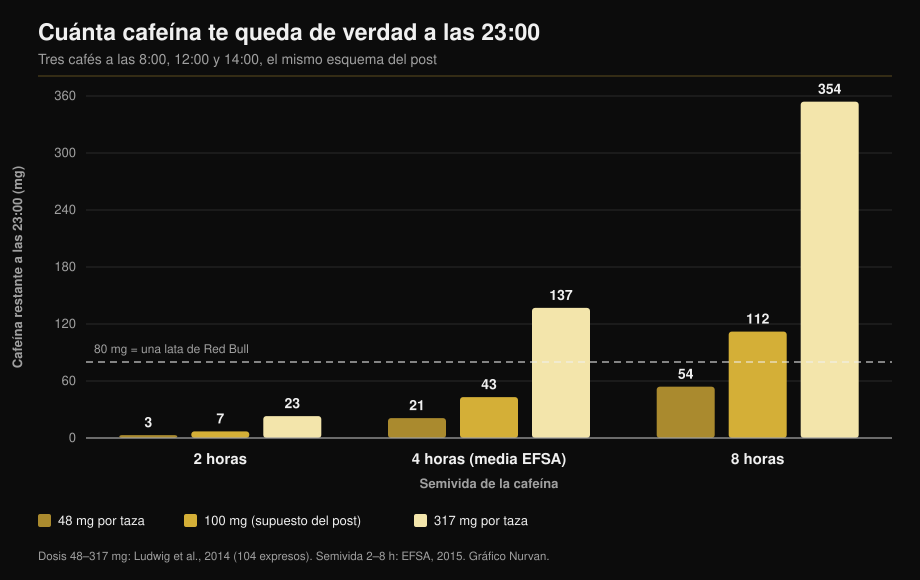

# Cafeína y sueño: a qué hora tienes que dejarlo de verdad

Por [Giammaria Loi](/autore/giammaria-loi) · actualizado el 11 de octubre de 2026

Un gráfico muy compartido dibuja tres cafés —a las 8, a mediodía y a las 14— y concluye que a las 23:00 todavía te quedan 87 mg de cafeína en el cuerpo: más que una lata de Red Bull. La cuenta es correcta. El problema son los dos datos que la alimentan: cuánta cafeína lleva una taza y cuánto tardas en eliminarla. Mide los dos y la respuesta deja de ser un número y pasa a ser un intervalo enorme. Aquí tienes el cálculo rehecho y la hora límite que sí respaldan los metaanálisis.

## En resumen

- **La aritmética del post se sostiene.** Con sus supuestos (100 mg por taza, semivida de 6 horas) quedan unos 81 mg a las 23:00, muy cerca de los 87 mg que muestra. Y sí, superan los aproximadamente 80 mg de una lata de 250 ml de bebida energética (EFSA, 2015).
- **Pero "una taza = 100 mg" no existe.** En 104 cafés solos comprados en cafeterías de Italia, Escocia y España, la cafeína iba de **48 a 317 mg por ración** (Ludwig et al., 2014). Seis veces y media de diferencia entre una taza y otra.
- **Tampoco existe "semivida de 6 horas".** La EFSA sitúa la media en torno a 4 horas con un intervalo de **2 a 8 horas**, y la actividad de la enzima que elimina la cafeína varía hasta **5-6 veces** entre personas (Grzegorzewski et al., 2022).
- **Rehaciendo el cálculo con valores medidos**, la cafeína que queda a las 23:00 va de **3 mg a 354 mg**: un intervalo de cien veces, no una cifra. El gráfico de abajo lo enseña.
- **La conclusión del post es correcta y más exigente de lo que parece.** Para no perder minutos de sueño, un café de 107 mg debería tomarse al menos **8,8 horas** antes de acostarse, y una ración de preentreno de 217 mg al menos **13,2 horas** antes (Gardiner et al., 2023).

## El modelo está bien. Lo que le metes dentro, no

El post usa el planteamiento estándar: la cafeína se reduce a la mitad a intervalos fijos y cada dosis nueva se suma a lo que queda de la anterior. Tres tazas de 100 mg a las 8, las 12 y las 14, con semivida de 6 horas, dejan unos 81 mg a las 23:00. Los 87 mg del gráfico están, por tanto, en el orden de magnitud correcto.

El problema es otro. Un modelo así devuelve exactamente lo que le das, y aquí recibe dos medias poblacionales disfrazadas de constantes. Ninguna de las dos lo es.

## Qué dice de verdad la investigación

### "Una taza de café tiene 100 mg de cafeína" — **Desmentido**

Es el eslabón más débil de todo el razonamiento. Un equipo de la Universidad de Glasgow compró y analizó **104 cafés espresso** en cafeterías de Escocia, Italia y España: la cafeína iba de **48 a 317 mg por ración**. Su conclusión es que "una taza de café" no es una unidad de medida reproducible, y sin embargo es con la que se mide el consumo en los estudios epidemiológicos (Ludwig et al., 2014).

Un trabajo anterior sobre los espressos de 20 locales británicos encontró diferencias de **seis veces**, con un solo café que contenía **322 mg** (Crozier et al., 2012). La variable que más pesa no es la mezcla ni el tueste: es cuánto café molido acaba en el portafiltros.

Tu cortado de la mañana puede valer menos de la mitad o más del triple de la taza que supone el post, y no tienes forma de saberlo.

### "La semivida de la cafeína es de 5-6 horas" — **Matizable**

La EFSA, en su dictamen sobre la seguridad de la cafeína, indica una semivida media de unas **4 horas en adultos sanos, con un intervalo de 2 a 8 horas** (EFSA, 2015). Las 6 horas del post están en la parte alta del intervalo, no en el centro.

El motivo de esa dispersión es la enzima hepática CYP1A2, responsable del 80-90% de la transformación de la cafeína. Su actividad varía entre personas en un factor de **5-6 veces** por causas genéticas, epigenéticas y ambientales. En el análisis sistemático de 141 publicaciones de farmacocinética, el **tabaco** acelera de forma consistente la eliminación de la cafeína mientras que los **anticonceptivos orales** la frenan, un efecto reproducible a lo largo de más de cincuenta años de estudios (Grzegorzewski et al., 2022). El documento de posición de la ISSN apunta lo mismo: la respuesta individual a la cafeína, sueño incluido, depende en parte de la variación genética en su metabolismo (Guest et al., 2021).

*El mismo modelo del post y los mismos horarios, pero con los valores medidos en la literatura en lugar de dos medias. El resultado no es 87 mg: es un intervalo que va de 3 a 354 mg. Dosis de Ludwig et al., 2014; semividas del intervalo EFSA 2015. Cálculo y gráfico de Nurvan.*

El gráfico explica por qué dos compañeros que toman el mismo número de cafés duermen distinto, y por qué "a mí el café después de cenar no me hace nada" puede ser literalmente cierto para quien está en la columna de la izquierda.

### "A las 23:00 tienes más cafeína que un Red Bull" — **Confirmado**

La comparación aguanta. La EFSA cifra las bebidas energéticas en 320 mg por litro, es decir unos **80 mg en una lata de 250 ml** (EFSA, 2015). Con los supuestos del post te quedas justo por encima de ese umbral. Con una taza más cargada o un metabolismo lento, mucho más arriba.

### "El café de la tarde estropea el sueño" — **Confirmado, y el umbral es más estricto**

Aquí el post acierta, pero se queda corto en el dato más útil. El metaanálisis de referencia reunió 24 estudios y midió que la cafeína **reduce el tiempo total de sueño en 45 minutos** y la eficiencia del sueño un 7%, alarga 9 minutos el tiempo que tardas en dormirte y 12 minutos el tiempo despierto después. Sobre todo, los autores calcularon la antelación necesaria: un **café de 107 mg al menos 8,8 horas antes** de acostarse, y una **ración estándar de preentreno de 217,5 mg al menos 13,2 horas antes** (Gardiner et al., 2023).

| Te acuestas a las | Último café (107 mg) | Último preentreno (217 mg) |
|---|---|---|
| 22:00 | 13:12 | 08:48 |
| 23:00 | 14:12 | 09:48 |
| 00:00 | 15:12 | 10:48 |

*Cálculo de Nurvan aplicando los umbrales de 8,8 y 13,2 horas publicados en Gardiner et al., 2023. Son medias de literatura, no prescripciones individuales.*

Un ensayo controlado de campo ya lo había mostrado de forma más directa: 400 mg de cafeína tomados **6 horas antes** de acostarse reducen el sueño de forma significativa frente al placebo, medido con un dispositivo validado en casa de los participantes (Drake et al., 2013).

En el esquema del post el último café es a las 14 para una cama a las 23: nueve horas, justo por encima del umbral para **un** café. El total del día, sin embargo, eran tres tazas.

### "Si me duermo igual, no pasa nada" — **Desmentido**

No es una afirmación del post, pero es la respuesta más habitual bajo este tipo de contenidos, y la investigación la desmonta. En el mismo metaanálisis, la cafeína aumenta el sueño ligero (+6,1 minutos de fase N1) y **reduce el sueño profundo en 11,4 minutos** (Gardiner et al., 2023). Un metaanálisis posterior sobre 22 estudios controlados con polisomnografía y 956 participantes lo confirma: −34,7 minutos de sueño total, −4,7% de eficiencia, +8,4 minutos para dormirse y una caída del porcentaje de sueño profundo, más marcada con dosis altas (Chang et al., 2025).

Dormirse no es lo único que cuenta. Si entrenas, la parte profunda de la noche es la que quieres proteger.

En deportistas el cuadro tiene un giro curioso. Diez estudios sobre quienes toman cafeína antes de un entrenamiento o una competición vespertina muestran una reducción pequeña de la eficiencia del sueño (−4,87%) y una tendencia no significativa en el tiempo total, pero los deportistas **refieren de forma constante un empeoramiento claro** de su descanso (Kocak et al., 2025). La percepción va por delante de la medida: con pocas noches y pocos participantes, eso es motivo para ser prudente, no para relajarse.

### "La cafeína es una herramienta de rendimiento" — **Confirmado**

Aquí el post va alineado con la literatura. El documento de posición de la ISSN recoge beneficios consistentes en resistencia, fuerza, velocidad de movimiento y acciones específicas de cada deporte, con dosis de **3-6 mg por kg de peso corporal**, normalmente 60 minutos antes; dosis muy altas como 9 mg/kg no aportan más y sí más efectos adversos (Guest et al., 2021). Para 75 kg son 225-450 mg: en el peor de los casos, la cafeína de un espresso muy cargado sumada a un preentreno. Si te interesa valorar los suplementos por la evidencia y no por el marketing, hicimos ese mismo trabajo en la [tier list de suplementos para la fuerza](/es/blog/clasificacion-suplementos-fuerza-tier-list).

## Cómo aplicarlo

1. **Fija una hora, no una cantidad.** Coge la hora a la que te acuestas y réstale 9 horas: ese es tu último café normal del día. Para el preentreno, réstale 13.
2. **Si entrenas por la tarde-noche, cambia de herramienta.** Una dosis completa de preentreno a las 19:00 no es compatible con dormir a las 23:00. Pártela, pasa a una opción sin cafeína o mueve la cafeína a la sesión de la mañana.
3. **Cuenta raciones, no tazas.** Tu café solo puede valer de 48 a 317 mg. Si no sabes cuán cargado está, asume que dos en la calle ya pueden ser la mitad del límite diario.
4. **No pases de los límites de seguridad.** La EFSA considera sin riesgo para el adulto sano hasta 400 mg al día y 200 mg en dosis única (EFSA, 2015). En el embarazo y con patologías o tratamientos en curso los límites cambian: eso se pregunta al médico, no a una calculadora.
5. **Haz una prueba de dos semanas contigo.** Anota hora y dosis de cada fuente de cafeína y cómo has dormido. A los diez días tu intervalo personal se ve: es la única manera de saber en qué columna del gráfico estás.
6. **No lo compenses con más cafeína.** Dormir peor y subir la dosis al día siguiente es el bucle que la literatura describe como el origen del problema, no como la solución.

> ### 💡 Con Nurvan
> **Los suplementos tienen hora, no solo dosis.** En Nurvan registras cada suplemento con su cantidad y la hora de toma, cafeína y preentreno incluidos, y los ves junto a la sesión de entrenamiento de ese mismo día. Así, si después de entrenar por la noche duermes mal, no tienes que reconstruirlo de memoria: el dato ya está ahí, hora a hora. [Prueba Nurvan](https://nurvan.app)

## Preguntas frecuentes

**¿Cuántas horas antes de dormir hay que dejar el café?**
Al menos 8,8 horas para un café de unos 107 mg y 13,2 horas para una ración de preentreno de 217 mg, si el objetivo es no perder minutos de sueño total (Gardiner et al., 2023). Para acostarte a las 23:00, el último café hacia las 14:00. Son medias: si eliminas la cafeína despacio, necesitas más margen.

**¿Cuánta cafeína tiene realmente un café solo?**
De 48 a 317 mg por ración, en los 104 espressos medidos en cafeterías de Italia, Escocia y España (Ludwig et al., 2014). Lo que más pesa es la cantidad de café molido que usa el barista, no la mezcla.

**Si me duermo rápido después de un café, ¿puedo tomarlo de noche?**
Dormirte rápido no significa haber dormido bien. La cafeína desplaza el sueño hacia las fases ligeras y reduce el sueño profundo unos 11 minutos por noche (Gardiner et al., 2023; Chang et al., 2025). El efecto existe aunque no lo notes.

**¿Merece la pena la cafeína antes de entrenar por la noche?**
Depende de para qué sea esa noche. El beneficio en rendimiento a 3-6 mg/kg está bien documentado (Guest et al., 2021), pero los deportistas que la toman antes de sesiones vespertinas refieren peor descanso (Kocak et al., 2025). Para un entrenamiento cualquiera rara vez compensa; para una competición puede valerlo.

## Lee también

- [Tier list de suplementos para la fuerza: la evidencia](/es/blog/clasificacion-suplementos-fuerza-tier-list)
- [Creatina sin entrenar después de los 45: qué dice el estudio](/es/blog/creatina-sin-entrenar-mas-de-45)
- [Cuántas repeticiones para masa muscular: el mito del 8-12](/es/blog/cuantas-repeticiones-masa-muscular)

## Fuentes

1. Gardiner C, Weakley J, Burke LM, Roach GD, Sargent C, Maniar N, Townshend A, Halson SL, 2023. *The effect of caffeine on subsequent sleep: A systematic review and meta-analysis.* Sleep Med Rev 69:101764. PMID 36870101 — [doi:10.1016/j.smrv.2023.101764](https://doi.org/10.1016/j.smrv.2023.101764)
2. Chang YH, Cheng YC, Cheng WJ, 2025. *Age- and dose-specific effects of caffeine on sleep: A meta-analysis of controlled crossover trials.* Sleep Med 136:106874. PMID 41124973 — [doi:10.1016/j.sleep.2025.106874](https://doi.org/10.1016/j.sleep.2025.106874)
3. Drake C, Roehrs T, Shambroom J, Roth T, 2013. *Caffeine effects on sleep taken 0, 3, or 6 hours before going to bed.* J Clin Sleep Med 9(11):1195–1200. PMID 24235903 — [doi:10.5664/jcsm.3170](https://doi.org/10.5664/jcsm.3170)
4. Ludwig IA, Mena P, Calani L, Cid C, Del Rio D, Lean MEJ, Crozier A, 2014. *Variations in caffeine and chlorogenic acid contents of coffees: what are we drinking?* Food Funct 5(8):1718–1726. PMID 25014672 — [doi:10.1039/c4fo00290c](https://doi.org/10.1039/c4fo00290c)
5. Crozier TWM, Stalmach A, Lean MEJ, Crozier A, 2012. *Espresso coffees, caffeine and chlorogenic acid intake: potential health implications.* Food Funct 3(1):30–33. PMID 22130653 — [doi:10.1039/c1fo10240k](https://doi.org/10.1039/c1fo10240k)
6. Grzegorzewski J, Bartsch F, Köller A, König M, 2022. *Pharmacokinetics of Caffeine: A Systematic Analysis of Reported Data for Application in Metabolic Phenotyping and Liver Function Testing.* Front Pharmacol 12:752826. PMID 35280254 — [doi:10.3389/fphar.2021.752826](https://doi.org/10.3389/fphar.2021.752826)
7. Kocak A, Georgousopoulou E, Knight-Agarwal CR, Matthews R, Minehan M, 2025. *The Effect of Consuming Caffeine Before Late Afternoon/Evening Training or Competition on Sleep: A Systematic Review with Meta-Analysis.* Sports (Basel) 13(9):317. PMID 41003623 — [doi:10.3390/sports13090317](https://doi.org/10.3390/sports13090317)
8. Guest NS, VanDusseldorp TA, Nelson MT, et al., 2021. *International society of sports nutrition position stand: caffeine and exercise performance.* J Int Soc Sports Nutr 18(1):1. PMID 33388079 — [doi:10.1186/s12970-020-00383-4](https://doi.org/10.1186/s12970-020-00383-4)
9. EFSA Panel on Dietetic Products, Nutrition and Allergies, 2015. *Scientific Opinion on the safety of caffeine.* EFSA Journal 13(5):4102. — [doi:10.2903/j.efsa.2015.4102](https://doi.org/10.2903/j.efsa.2015.4102)

Metadatos y resúmenes recuperados de PubMed. Punto de partida: publicación de [Todd Anderson (@toddanderson42_)](https://www.instagram.com/p/DdNDHgthiYV/) del 13 de septiembre de 2026. No se ha reproducido ningún texto, imagen o estructura de la publicación: las afirmaciones se extrajeron, reescribieron y verificaron de forma independiente.

---

**Giammaria Loi** es el fundador de Nurvan. Entrena con pesas desde 2012, trabaja como entrenador personal y coach certificado FIPE desde 2013 y compite en powerlifting a nivel nacional desde 2018. Cada artículo que firma parte de los estudios científicos y llega a lo que funciona de verdad en el gimnasio.

> Nota: contenido informativo, no sustituye la opinión de un médico o profesional. Si estás embarazada o en lactancia, tomas medicación o tienes trastornos del sueño, cardíacos o de ansiedad, consulta con tu médico antes de cambiar tu consumo de cafeína.
