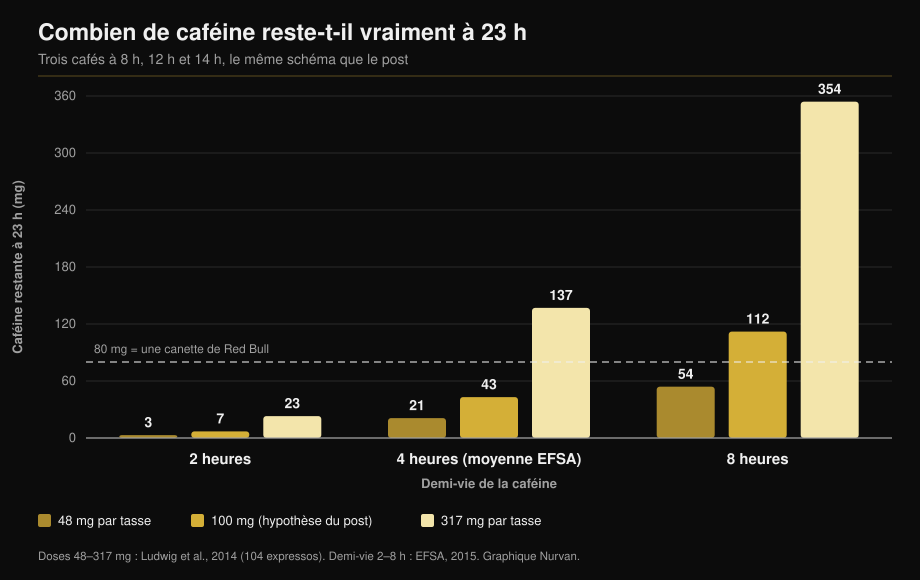

# Caféine et sommeil : à quelle heure il faut vraiment arrêter

Par [Giammaria Loi](/autore/giammaria-loi) · mis à jour le 11 octobre 2026

Un graphique très partagé trace trois cafés — 8 h, midi, 14 h — et conclut qu'à 23 h il vous reste 87 mg de caféine dans le corps, plus qu'une canette de Red Bull. Le calcul est exact. Le problème, ce sont les deux chiffres qui l'alimentent : la quantité de caféine dans une tasse et la vitesse à laquelle vous l'éliminez. Mesurez-les et la réponse cesse d'être un nombre pour devenir un intervalle très large. Voici le calcul refait, et l'heure limite que les méta-analyses soutiennent réellement.

## L'essentiel

- **L'arithmétique du post tient.** Avec ses hypothèses (100 mg par tasse, demi-vie de 6 heures), il reste environ 81 mg à 23 h, proche des 87 mg affichés. Et oui, c'est plus que les quelque 80 mg d'une canette de 250 ml de boisson énergisante (EFSA, 2015).
- **Mais « une tasse = 100 mg » n'existe pas.** Sur 104 expressos achetés dans des cafés d'Italie, d'Écosse et d'Espagne, la caféine allait de **48 à 317 mg par portion** (Ludwig et al., 2014). Un rapport de 6,5 entre une tasse et une autre.
- **« Demi-vie de 6 heures » n'existe pas non plus.** L'EFSA situe la moyenne autour de 4 heures, avec un intervalle de **2 à 8 heures**, et l'activité de l'enzyme qui élimine la caféine varie d'un facteur **5 à 6** d'une personne à l'autre (Grzegorzewski et al., 2022).
- **En refaisant le calcul avec les valeurs mesurées**, la caféine restante à 23 h passe de **3 mg à 354 mg** : un intervalle de cent fois, pas un chiffre. Le graphique ci-dessous le montre.
- **La conclusion du post est juste, et plus exigeante qu'elle n'en a l'air.** Pour ne pas perdre de minutes de sommeil, un café de 107 mg devrait être bu au moins **8,8 heures** avant le coucher, et une portion de pre-workout à 217 mg au moins **13,2 heures** avant (Gardiner et al., 2023).

## Le modèle est bon. Ce qu'on lui donne ne l'est pas

Le post utilise l'approche standard : la caféine diminue de moitié à intervalle fixe, et chaque nouvelle dose s'ajoute à ce qui reste de la précédente. Trois tasses de 100 mg à 8 h, midi et 14 h, avec une demi-vie de 6 heures, laissent environ 81 mg à 23 h. Les 87 mg du graphique sont donc du bon ordre de grandeur.

Ce n'est pas là qu'est le problème. Un tel modèle restitue exactement ce qu'on lui donne, et ici on lui donne deux moyennes de population déguisées en constantes. Aucune des deux n'en est une.

## Ce que dit vraiment la recherche

### « Une tasse de café contient 100 mg de caféine » — **Démenti**

C'est le maillon le plus faible de tout le raisonnement. Une équipe de l'université de Glasgow a acheté et analysé **104 expressos** dans des cafés d'Écosse, d'Italie et d'Espagne : la caféine allait de **48 à 317 mg par portion**. Leur conclusion : « une tasse de café » n'est pas une unité de mesure reproductible — et c'est pourtant celle avec laquelle l'épidémiologie mesure la consommation (Ludwig et al., 2014).

Une enquête antérieure sur les expressos de 20 établissements britanniques avait trouvé des écarts de **six fois**, avec un seul expresso contenant **322 mg** (Crozier et al., 2012). La variable qui pèse le plus n'est ni le mélange ni la torréfaction : c'est la quantité de café moulu tassée dans le porte-filtre.

Votre expresso peut donc valoir moins de la moitié ou plus du triple de la tasse supposée dans le post, sans que vous puissiez le savoir.

### « La demi-vie de la caféine est de 5 à 6 heures » — **À préciser**

Dans son avis sur la sécurité de la caféine, l'EFSA indique une demi-vie moyenne d'environ **4 heures chez l'adulte en bonne santé, avec un intervalle de 2 à 8 heures** (EFSA, 2015). Les 6 heures du post se situent en haut de cet intervalle, pas au milieu.

La raison de cette dispersion est l'enzyme hépatique CYP1A2, qui assure 80 à 90 % de la transformation de la caféine. Son activité varie d'un facteur **5 à 6** entre individus, pour des raisons génétiques, épigénétiques et environnementales. Dans l'analyse systématique de 141 publications de pharmacocinétique, le **tabac** accélère de façon constante l'élimination de la caféine tandis que les **contraceptifs oraux** la ralentissent, un effet reproductible sur plus de cinquante ans de travaux (Grzegorzewski et al., 2022). La prise de position de l'ISSN dit la même chose : la réponse individuelle à la caféine, sommeil compris, dépend en partie de la variation génétique de son métabolisme (Guest et al., 2021).

*Même modèle que le post, mêmes horaires, mais avec les valeurs mesurées dans la littérature au lieu de deux moyennes. Le résultat n'est pas 87 mg : c'est un intervalle de 3 à 354 mg. Doses d'après Ludwig et al., 2014 ; demi-vies d'après l'intervalle EFSA 2015. Calcul et graphique Nurvan.*

Ce graphique explique pourquoi deux collègues qui boivent le même nombre de cafés ne dorment pas pareil, et pourquoi « le café après le dîner ne me fait rien » peut être littéralement vrai pour qui se trouve dans la colonne de gauche.

### « À 23 h, vous avez plus de caféine qu'un Red Bull » — **Confirmé**

La comparaison tient. L'EFSA situe les boissons énergisantes à 320 mg par litre, soit environ **80 mg dans une canette de 250 ml** (EFSA, 2015). Avec les hypothèses du post, on reste juste au-dessus de ce seuil. Avec une tasse plus chargée ou un métabolisme lent, bien au-dessus.

### « Le café de l'après-midi perturbe le sommeil » — **Confirmé, et le seuil est plus strict**

Ici le post a raison, mais il s'arrête avant le chiffre le plus utile. La méta-analyse de référence a réuni 24 études et mesuré que la caféine **réduit le temps de sommeil total de 45 minutes** et l'efficacité du sommeil de 7 %, allonge de 9 minutes l'endormissement et de 12 minutes le temps d'éveil ensuite. Surtout, les auteurs ont calculé le délai nécessaire : un **café de 107 mg au moins 8,8 heures avant** le coucher, et une **portion standard de pre-workout de 217,5 mg au moins 13,2 heures avant** (Gardiner et al., 2023).

| Coucher à | Dernier café (107 mg) | Dernier pre-workout (217 mg) |
|---|---|---|
| 22 h | 13 h 12 | 8 h 48 |
| 23 h | 14 h 12 | 9 h 48 |
| 0 h | 15 h 12 | 10 h 48 |

*Calcul Nurvan appliquant les seuils de 8,8 et 13,2 heures publiés dans Gardiner et al., 2023. Ce sont des moyennes de littérature, pas des prescriptions individuelles.*

Un essai contrôlé en conditions réelles l'avait déjà montré plus directement : 400 mg de caféine pris **6 heures avant** le coucher réduisent significativement le sommeil par rapport au placebo, mesuré avec un dispositif validé au domicile des participants (Drake et al., 2013).

Dans le schéma du post, le dernier café est à 14 h pour un coucher à 23 h : neuf heures, juste au-dessus du seuil pour **un** café. Le total de la journée, lui, était de trois tasses.

### « Si je m'endors quand même, c'est bon » — **Démenti**

Ce n'est pas une affirmation du post, mais c'est la réponse la plus fréquente sous ce type de contenus, et la recherche la démonte. Dans la même méta-analyse, la caféine augmente le sommeil léger (+6,1 minutes de stade N1) et **réduit le sommeil profond de 11,4 minutes** (Gardiner et al., 2023). Une méta-analyse plus récente, sur 22 essais contrôlés avec polysomnographie et 956 participants, confirme : −34,7 minutes de sommeil total, −4,7 % d'efficacité, +8,4 minutes pour s'endormir et une baisse de la part de sommeil profond, plus marquée aux doses élevées (Chang et al., 2025).

S'endormir n'est pas tout le travail. Si vous vous entraînez, c'est la partie profonde de la nuit qu'il faut protéger.

Chez les sportifs, le tableau prend un tour curieux. Dix études sur la caféine avant un entraînement ou une compétition en soirée montrent une petite baisse de l'efficacité du sommeil (−4,87 %) et une tendance non significative sur le temps total, mais les athlètes **rapportent systématiquement une dégradation nette** de leur sommeil (Kocak et al., 2025). La perception devance la mesure : avec peu de nuits et peu de participants, c'est une raison d'être prudent, pas de se rassurer.

### « La caféine est un outil de performance » — **Confirmé**

Sur ce point, le post colle à la littérature. La prise de position de l'ISSN rapporte des bénéfices constants sur l'endurance, la force, la vitesse de mouvement et les actions spécifiques à chaque sport, à des doses de **3 à 6 mg par kg de masse corporelle**, généralement 60 minutes avant ; les doses très élevées comme 9 mg/kg n'apportent rien de plus et multiplient les effets indésirables (Guest et al., 2021). Pour 75 kg, cela fait 225 à 450 mg : au pire, la caféine d'un expresso très chargé ajoutée à un pre-workout. Si vous aimez juger les compléments sur les preuves plutôt que sur le marketing, nous avons fait le même travail dans notre [tier list des compléments pour la force](/fr/blog/classement-complements-force-tier-list).

## Comment l'appliquer

1. **Fixez une heure, pas une quantité.** Prenez votre heure de coucher et retirez 9 heures : c'est votre dernier café ordinaire. Pour le pre-workout, retirez-en 13.
2. **Si vous vous entraînez le soir, changez d'outil.** Une dose complète de pre-workout à 19 h est incompatible avec un coucher à 23 h. Divisez-la par deux, passez à une option sans caféine, ou déplacez la caféine vers la séance du matin.
3. **Comptez des portions, pas des tasses.** Votre expresso peut valoir de 48 à 317 mg. Si vous ignorez sa charge, partez du principe que deux au comptoir peuvent déjà représenter la moitié du plafond quotidien.
4. **Restez sous les seuils de sécurité.** L'EFSA considère sans risque pour l'adulte en bonne santé jusqu'à 400 mg par jour et 200 mg en une seule prise (EFSA, 2015). En cas de grossesse, de pathologie ou de traitement en cours, les limites changent : c'est une question pour votre médecin, pas pour une calculette.
5. **Faites un test de deux semaines sur vous.** Notez l'heure et la dose de chaque source de caféine, et comment vous avez dormi. Au bout de dix jours, votre intervalle personnel apparaît : c'est le seul moyen de savoir dans quelle colonne du graphique vous êtes.
6. **Ne compensez pas avec plus de caféine.** Mal dormir puis augmenter la dose le lendemain, c'est la boucle que la littérature décrit comme le début du problème, pas comme la solution.

> ### 💡 Avec Nurvan
> **Les compléments ont une heure, pas seulement une dose.** Dans Nurvan, vous enregistrez chaque complément avec sa quantité et son heure de prise — caféine et pre-workout compris — à côté de la séance d'entraînement du même jour. Ainsi, si vous dormez mal après les séances du soir, pas besoin de le reconstituer de mémoire : la donnée est déjà là, heure par heure. [Essayer Nurvan](https://nurvan.app)

## Questions fréquentes

**Combien d'heures avant de dormir faut-il arrêter le café ?**
Au moins 8,8 heures pour un café d'environ 107 mg et 13,2 heures pour une portion de pre-workout de 217 mg, si l'objectif est de ne pas perdre de minutes de sommeil total (Gardiner et al., 2023). Pour un coucher à 23 h, cela place le dernier café vers 14 h. Ce sont des moyennes : si vous éliminez lentement, prévoyez plus de marge.

**Combien de caféine y a-t-il vraiment dans un expresso ?**
De 48 à 317 mg par portion, sur les 104 expressos mesurés dans des cafés d'Italie, d'Écosse et d'Espagne (Ludwig et al., 2014). Le facteur dominant est la quantité de café moulu utilisée par le barista, pas le mélange.

**Si je m'endors bien après un café, puis-je en boire le soir ?**
S'endormir vite ne veut pas dire bien dormir. La caféine déplace le sommeil vers les stades légers et réduit le sommeil profond d'environ 11 minutes par nuit (Gardiner et al., 2023 ; Chang et al., 2025). L'effet est là, que vous le sentiez ou non.

**La caféine vaut-elle le coup avant un entraînement du soir ?**
Cela dépend de l'enjeu de cette soirée. Le bénéfice sur la performance à 3-6 mg/kg est bien documenté (Guest et al., 2021), mais les athlètes qui en prennent avant des séances du soir rapportent un moins bon sommeil (Kocak et al., 2025). Pour un entraînement ordinaire, le compte est rarement bon ; pour une compétition, il peut l'être.

## À lire aussi

- [Tier list des compléments pour la force : la science](/fr/blog/classement-complements-force-tier-list)
- [Créatine sans musculation après 45 ans : ce que dit l'étude](/fr/blog/creatine-sans-musculation-apres-45-ans)
- [Combien de répétitions pour la masse : le mythe du 8-12](/fr/blog/combien-de-repetitions-masse-musculaire)

## Sources

1. Gardiner C, Weakley J, Burke LM, Roach GD, Sargent C, Maniar N, Townshend A, Halson SL, 2023. *The effect of caffeine on subsequent sleep: A systematic review and meta-analysis.* Sleep Med Rev 69:101764. PMID 36870101 — [doi:10.1016/j.smrv.2023.101764](https://doi.org/10.1016/j.smrv.2023.101764)
2. Chang YH, Cheng YC, Cheng WJ, 2025. *Age- and dose-specific effects of caffeine on sleep: A meta-analysis of controlled crossover trials.* Sleep Med 136:106874. PMID 41124973 — [doi:10.1016/j.sleep.2025.106874](https://doi.org/10.1016/j.sleep.2025.106874)
3. Drake C, Roehrs T, Shambroom J, Roth T, 2013. *Caffeine effects on sleep taken 0, 3, or 6 hours before going to bed.* J Clin Sleep Med 9(11):1195–1200. PMID 24235903 — [doi:10.5664/jcsm.3170](https://doi.org/10.5664/jcsm.3170)
4. Ludwig IA, Mena P, Calani L, Cid C, Del Rio D, Lean MEJ, Crozier A, 2014. *Variations in caffeine and chlorogenic acid contents of coffees: what are we drinking?* Food Funct 5(8):1718–1726. PMID 25014672 — [doi:10.1039/c4fo00290c](https://doi.org/10.1039/c4fo00290c)
5. Crozier TWM, Stalmach A, Lean MEJ, Crozier A, 2012. *Espresso coffees, caffeine and chlorogenic acid intake: potential health implications.* Food Funct 3(1):30–33. PMID 22130653 — [doi:10.1039/c1fo10240k](https://doi.org/10.1039/c1fo10240k)
6. Grzegorzewski J, Bartsch F, Köller A, König M, 2022. *Pharmacokinetics of Caffeine: A Systematic Analysis of Reported Data for Application in Metabolic Phenotyping and Liver Function Testing.* Front Pharmacol 12:752826. PMID 35280254 — [doi:10.3389/fphar.2021.752826](https://doi.org/10.3389/fphar.2021.752826)
7. Kocak A, Georgousopoulou E, Knight-Agarwal CR, Matthews R, Minehan M, 2025. *The Effect of Consuming Caffeine Before Late Afternoon/Evening Training or Competition on Sleep: A Systematic Review with Meta-Analysis.* Sports (Basel) 13(9):317. PMID 41003623 — [doi:10.3390/sports13090317](https://doi.org/10.3390/sports13090317)
8. Guest NS, VanDusseldorp TA, Nelson MT, et al., 2021. *International society of sports nutrition position stand: caffeine and exercise performance.* J Int Soc Sports Nutr 18(1):1. PMID 33388079 — [doi:10.1186/s12970-020-00383-4](https://doi.org/10.1186/s12970-020-00383-4)
9. EFSA Panel on Dietetic Products, Nutrition and Allergies, 2015. *Scientific Opinion on the safety of caffeine.* EFSA Journal 13(5):4102. — [doi:10.2903/j.efsa.2015.4102](https://doi.org/10.2903/j.efsa.2015.4102)

Métadonnées et résumés récupérés sur PubMed. Point de départ : publication de [Todd Anderson (@toddanderson42_)](https://www.instagram.com/p/DdNDHgthiYV/) du 13 septembre 2026. Aucun texte, image ou structure de la publication n'a été reproduit : les affirmations ont été extraites, réécrites et vérifiées de façon indépendante.

---

**Giammaria Loi** est le fondateur de Nurvan. Il soulève des poids depuis 2012, travaille comme entraîneur personnel et coach certifié FIPE depuis 2013 et participe à des compétitions de powerlifting au niveau national depuis 2018. Chaque article qu'il signe part des études scientifiques et aboutit à ce qui fonctionne vraiment en salle.

> Note : contenu informatif, ne remplace pas l'avis d'un médecin ou d'un professionnel. En cas de grossesse ou d'allaitement, de traitement médicamenteux ou de troubles du sommeil, cardiaques ou anxieux, parlez-en à votre médecin avant de modifier votre consommation de caféine.
