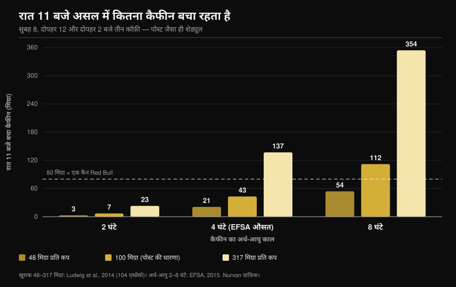

# कैफीन और नींद: असल में कब रुकना चाहिए

लेखक: [Giammaria Loi](/autore/giammaria-loi) · अपडेट 11 अक्टूबर 2026

एक ख़ूब शेयर हुआ ग्राफ़ तीन कॉफ़ी दिखाता है — सुबह 8, दोपहर 12 और दोपहर 2 बजे — और निष्कर्ष निकालता है कि रात 11 बजे आपके शरीर में अब भी 87 मिग्रा कैफीन है: एक कैन Red Bull से ज़्यादा। गणित सही है। दिक्कत उन दो आँकड़ों में है जो उसे चलाते हैं: एक कप में कितना कैफीन है, और आप उसे कितनी तेज़ी से निकालते हैं। दोनों को नापिए और जवाब एक संख्या नहीं रह जाता, एक बहुत चौड़ा दायरा बन जाता है। यहाँ वही हिसाब दोबारा है, और वह समय-सीमा जो मेटा-विश्लेषण वाक़ई बताते हैं।

## संक्षेप में

- **पोस्ट का गणित टिकता है।** उसकी अपनी मान्यताओं पर (प्रति कप 100 मिग्रा, अर्ध-आयु 6 घंटे) रात 11 बजे लगभग 81 मिग्रा बचता है, दिखाए गए 87 मिग्रा के क़रीब। और हाँ, यह 250 मिली एनर्जी ड्रिंक के लगभग 80 मिग्रा से ज़्यादा है (EFSA, 2015)।
- **पर "एक कप = 100 मिग्रा" जैसी कोई चीज़ नहीं है।** इटली, स्कॉटलैंड और स्पेन के कैफ़े से ख़रीदे गए 104 एस्प्रेसो में कैफीन **48 से 317 मिग्रा प्रति सर्विंग** तक था (Ludwig et al., 2014)। एक कप से दूसरे कप में साढ़े छह गुना फ़र्क़।
- **"अर्ध-आयु 6 घंटे" भी नहीं।** EFSA औसत लगभग 4 घंटे बताता है, दायरा **2 से 8 घंटे**, और कैफीन निकालने वाले एंज़ाइम की सक्रियता लोगों के बीच **5-6 गुना** तक बदलती है (Grzegorzewski et al., 2022)।
- **मापे गए आँकड़ों से हिसाब दोबारा करें** तो रात 11 बजे बचा कैफीन **3 मिग्रा से 354 मिग्रा** के बीच आता है: एक संख्या नहीं, सौ गुने का दायरा। नीचे का ग्राफ़ यही दिखाता है।
- **पोस्ट का निष्कर्ष सही है और उसके कहे से ज़्यादा सख़्त है।** नींद के मिनट न गँवाने हों तो 107 मिग्रा वाली कॉफ़ी सोने से कम से कम **8.8 घंटे** पहले और 217 मिग्रा की प्री-वर्कआउट सर्विंग कम से कम **13.2 घंटे** पहले लेनी चाहिए (Gardiner et al., 2023)।

## मॉडल ठीक है, उसमें डाले गए आँकड़े नहीं

पोस्ट मानक तरीक़ा अपनाता है: कैफीन तय अंतराल पर आधा होता है, और हर नई खुराक पिछली के बचे हिस्से पर जुड़ जाती है। 8, 12 और 2 बजे 100-100 मिग्रा के तीन कप, 6 घंटे की अर्ध-आयु के साथ, रात 11 बजे लगभग 81 मिग्रा छोड़ते हैं। यानी ग्राफ़ के 87 मिग्रा सही परिमाण में हैं।

समस्या यह नहीं है। ऐसा मॉडल ठीक वही लौटाता है जो आप उसे देते हैं, और यहाँ उसे दो जनसंख्या-औसत स्थिरांक के भेस में दिए गए हैं। इनमें से कोई भी स्थिरांक नहीं है।

## रिसर्च असल में क्या कहती है

### "एक कप कॉफ़ी में 100 मिग्रा कैफीन होता है" — **ग़लत**

पूरे तर्क की यह सबसे कमज़ोर कड़ी है। ग्लासगो विश्वविद्यालय की एक टीम ने स्कॉटलैंड, इटली और स्पेन के कैफ़े से **104 एस्प्रेसो** ख़रीदकर उनका विश्लेषण किया: कैफीन **48 से 317 मिग्रा प्रति सर्विंग** तक निकला। उनका निष्कर्ष यह कि "एक कप कॉफ़ी" कोई दोहराने योग्य माप इकाई नहीं है — और फिर भी महामारी-विज्ञान इसी इकाई से सेवन नापता है (Ludwig et al., 2014)।

इससे पहले ब्रिटेन के 20 आउटलेट के एस्प्रेसो पर हुए सर्वे में **छह गुना** अंतर मिला था, जिसमें एक अकेले एस्प्रेसो में **322 मिग्रा** था (Crozier et al., 2012)। सबसे भारी चर न ब्लेंड है न रोस्ट: यह है कि बरिस्ता पोर्टाफ़िल्टर में कितनी पिसी कॉफ़ी भरता है।

यानी आपका एस्प्रेसो पोस्ट में मानी गई कप से आधे से भी कम या तीन गुने से ज़्यादा हो सकता है, और आपके पास जानने का कोई तरीक़ा नहीं।

### "कैफीन की अर्ध-आयु 5-6 घंटे है" — **स्पष्ट करने लायक़**

कैफीन की सुरक्षा पर अपनी राय में EFSA **स्वस्थ वयस्कों में लगभग 4 घंटे की औसत अर्ध-आयु बताता है, जिसका दायरा 2 से 8 घंटे** है (EFSA, 2015)। पोस्ट में इस्तेमाल हुए 6 घंटे इस दायरे के ऊपरी सिरे पर हैं, बीच में नहीं।

इस बिखराव की वजह है लिवर का एंज़ाइम CYP1A2, जो कैफीन के 80–90% रूपांतरण का ज़िम्मा उठाता है। आनुवंशिक, एपिजेनेटिक और पर्यावरणीय कारणों से इसकी सक्रियता लोगों के बीच **5-6 गुना** तक बदलती है। फ़ार्माकोकाइनेटिक्स के 141 प्रकाशनों के व्यवस्थित विश्लेषण में **धूम्रपान** कैफीन का निष्कासन लगातार तेज़ करता है जबकि **मौखिक गर्भनिरोधक** उसे धीमा करते हैं, और यह असर पचास साल से ज़्यादा के शोध में दोहराया जा सका है (Grzegorzewski et al., 2022)। ISSN का पोज़ीशन स्टैंड भी यही कहता है: कैफीन पर व्यक्तिगत प्रतिक्रिया, नींद सहित, कुछ हद तक उसके चयापचय में आनुवंशिक भिन्नता पर निर्भर है (Guest et al., 2021)।

*पोस्ट जैसा ही मॉडल और वही समय, पर दो औसतों की जगह साहित्य में मापे गए मान। नतीजा 87 मिग्रा नहीं है: यह 3 से 354 मिग्रा का दायरा है। खुराक Ludwig et al., 2014 से; अर्ध-आयु EFSA 2015 के दायरे से। गणना और ग्राफ़ Nurvan।*

यह ग्राफ़ बताता है कि बराबर कॉफ़ी पीने वाले दो सहकर्मी अलग-अलग क्यों सोते हैं, और "मुझे तो रात के खाने के बाद कॉफ़ी से कुछ नहीं होता" बाएँ कॉलम वाले के लिए शब्दशः सच क्यों हो सकता है।

### "रात 11 बजे आपके भीतर Red Bull से ज़्यादा कैफीन है" — **पुष्ट**

तुलना टिकती है। EFSA एनर्जी ड्रिंक के लिए 320 मिग्रा प्रति लीटर बताता है, यानी **250 मिली कैन में लगभग 80 मिग्रा** (EFSA, 2015)। पोस्ट की मान्यताओं पर आप इस रेखा से थोड़ा ऊपर रहते हैं। तेज़ कप या धीमे चयापचय के साथ, कहीं ज़्यादा ऊपर।

### "दोपहर की कॉफ़ी नींद ख़राब करती है" — **पुष्ट, और सीमा और सख़्त है**

यहाँ पोस्ट सही है, पर सबसे काम के आँकड़े से पहले रुक जाता है। संदर्भ मेटा-विश्लेषण ने 24 अध्ययनों को जोड़ा और पाया कि कैफीन **कुल नींद का समय 45 मिनट** और नींद की दक्षता 7% घटाता है, नींद आने में 9 मिनट और उसके बाद जागे रहने में 12 मिनट जोड़ता है। सबसे अहम, लेखकों ने ज़रूरी अग्रिम समय निकाला: **107 मिग्रा की कॉफ़ी सोने से कम से कम 8.8 घंटे पहले**, और **217.5 मिग्रा की मानक प्री-वर्कआउट सर्विंग कम से कम 13.2 घंटे पहले** (Gardiner et al., 2023)।

| सोने का समय | आख़िरी कॉफ़ी (107 मिग्रा) | आख़िरी प्री-वर्कआउट (217 मिग्रा) |
|---|---|---|
| 22:00 | 13:12 | 08:48 |
| 23:00 | 14:12 | 09:48 |
| 00:00 | 15:12 | 10:48 |

*Gardiner et al., 2023 में प्रकाशित 8.8 और 13.2 घंटे की सीमाओं को लागू करते हुए Nurvan की गणना। ये साहित्य के औसत हैं, व्यक्तिगत नुस्खे नहीं।*

एक नियंत्रित फ़ील्ड परीक्षण यह पहले ही और सीधे दिखा चुका था: सोने से **6 घंटे पहले** लिए गए 400 मिग्रा कैफीन प्लेसीबो की तुलना में नींद को उल्लेखनीय रूप से घटाते हैं, और माप प्रतिभागियों के अपने घर में एक मान्य उपकरण से हुआ (Drake et al., 2013)।

पोस्ट के शेड्यूल में आख़िरी कॉफ़ी दोपहर 2 बजे है और सोना रात 11 बजे: नौ घंटे, **एक** कॉफ़ी की सीमा से बस ऊपर। पर उस दिन का कुल तीन कप था।

### "अगर मुझे नींद तो आ ही जाती है, फिर ठीक है" — **ग़लत**

यह पोस्ट की बात नहीं है, पर ऐसे कंटेंट के नीचे सबसे आम जवाब यही होता है, और शोध इसे तोड़ देता है। उसी मेटा-विश्लेषण में कैफीन हल्की नींद बढ़ाता है (N1 चरण में +6.1 मिनट) और **गहरी नींद 11.4 मिनट घटाता है** (Gardiner et al., 2023)। 956 प्रतिभागियों पर 22 नियंत्रित पॉलीसोम्नोग्राफ़ी अध्ययनों के बाद के मेटा-विश्लेषण से यही पुष्ट होता है: कुल नींद −34.7 मिनट, दक्षता −4.7%, नींद आने में +8.4 मिनट, और गहरी नींद के अनुपात में गिरावट, जो ऊँची खुराक पर और तीखी है (Chang et al., 2025)।

सो जाना पूरा काम नहीं है। अगर आप ट्रेनिंग करते हैं, तो रात का गहरा हिस्सा ही बचाने लायक़ है।

एथलीटों में तस्वीर में एक दिलचस्प मोड़ है। शाम की ट्रेनिंग या मुक़ाबले से पहले कैफीन लेने पर हुए दस अध्ययन नींद की दक्षता में छोटी गिरावट (−4.87%) और कुल समय पर सांख्यिकीय रूप से महत्वहीन रुझान दिखाते हैं, पर एथलीट **लगातार साफ़ तौर पर ख़राब नींद बताते हैं** (Kocak et al., 2025)। अनुभूति माप से आगे चल रही है: कम रातों और कम प्रतिभागियों के साथ, यह सतर्क रहने की वजह है, निश्चिंत होने की नहीं।

### "कैफीन एक परफ़ॉर्मेंस टूल है" — **पुष्ट**

यहाँ पोस्ट साहित्य के साथ है। ISSN का पोज़ीशन स्टैंड **शरीर के वज़न के प्रति किलो 3–6 मिग्रा** की खुराक पर सहनशक्ति, ताक़त, गति की रफ़्तार और खेल-विशिष्ट क्रियाओं में लगातार लाभ बताता है, आम तौर पर 60 मिनट पहले लेने पर; 9 मिग्रा/किग्रा जैसी बहुत ऊँची खुराक कुछ नहीं जोड़तीं, बस दुष्प्रभाव बढ़ाती हैं (Guest et al., 2021)। 75 किग्रा के लिए यह 225–450 मिग्रा है: सबसे बुरी सूरत में, एक बहुत तेज़ एस्प्रेसो का कैफीन और ऊपर से प्री-वर्कआउट। अगर आप सप्लीमेंट को मार्केटिंग से नहीं, सबूत से तौलना पसंद करते हैं, तो वही काम हमने [स्ट्रेंथ सप्लीमेंट टियर लिस्ट](/hi/blog/strength-supplements-tier-list-hindi) में किया है।

## इसे कैसे लागू करें

1. **समय तय करें, मात्रा नहीं।** अपने सोने के समय में से 9 घंटे घटाइए: वही दिन की आख़िरी सामान्य कॉफ़ी है। प्री-वर्कआउट के लिए 13 घंटे घटाइए।
2. **शाम को ट्रेनिंग करते हैं तो औज़ार बदलिए।** शाम 7 बजे प्री-वर्कआउट की पूरी स्कूप और रात 11 बजे सोना — ये साथ नहीं चलते। आधा कीजिए, कैफीन-मुक्त विकल्प लीजिए, या कैफीन को सुबह के सेशन पर खिसकाइए।
3. **सर्विंग गिनिए, कप नहीं।** आपका एस्प्रेसो 48 से 317 मिग्रा तक कुछ भी हो सकता है। तेज़ी पता न हो तो मान लीजिए कि बाहर के दो कप ही दैनिक सीमा का आधा हो सकते हैं।
4. **सुरक्षा सीमाओं के भीतर रहिए।** EFSA स्वस्थ वयस्क के लिए प्रतिदिन 400 मिग्रा तक और एक बार में 200 मिग्रा तक को चिंता का विषय नहीं मानता (EFSA, 2015)। गर्भावस्था में, या किसी बीमारी या दवा के साथ, सीमाएँ बदल जाती हैं: यह सवाल डॉक्टर से है, कैलकुलेटर से नहीं।
5. **दो हफ़्ते ख़ुद पर परखिए।** हर कैफीन स्रोत का समय और खुराक लिखिए, और यह भी कि नींद कैसी रही। दस दिन में आपका अपना दायरा दिखने लगेगा: यही जानने का इकलौता तरीक़ा है कि आप ग्राफ़ के किस कॉलम में हैं।
6. **ज़्यादा कैफीन से भरपाई मत कीजिए।** ख़राब सोना और अगले दिन खुराक बढ़ा देना — साहित्य इसी चक्र को समस्या की शुरुआत बताता है, समाधान नहीं।

> ### 💡 Nurvan के साथ
> **सप्लीमेंट की एक घड़ी होती है, सिर्फ़ खुराक नहीं।** Nurvan में आप हर सप्लीमेंट को मात्रा और लेने के समय के साथ दर्ज करते हैं — कैफीन और प्री-वर्कआउट समेत — और उसी दिन के ट्रेनिंग सेशन के साथ देखते हैं। इसलिए अगर शाम की ट्रेनिंग के बाद आपकी नींद ख़राब होती है, तो याददाश्त से जोड़-घटाव नहीं करना पड़ेगा: आँकड़ा पहले से मौजूद है, घंटे-दर-घंटे। [Nurvan आज़माएँ](https://nurvan.app)

## अक्सर पूछे जाने वाले सवाल

**सोने से कितने घंटे पहले कॉफ़ी बंद कर देनी चाहिए?**
अगर मक़सद कुल नींद के मिनट न गँवाना है, तो लगभग 107 मिग्रा वाली कॉफ़ी के लिए कम से कम 8.8 घंटे और 217 मिग्रा की प्री-वर्कआउट सर्विंग के लिए 13.2 घंटे (Gardiner et al., 2023)। रात 11 बजे सोने पर आख़िरी कॉफ़ी दोपहर 2 बजे के आसपास। ये औसत हैं: धीरे चयापचय करने वालों को ज़्यादा गुंजाइश चाहिए।

**एस्प्रेसो में असल में कितना कैफीन होता है?**
इटली, स्कॉटलैंड और स्पेन के कैफ़े में मापे गए 104 एस्प्रेसो में प्रति सर्विंग 48 से 317 मिग्रा (Ludwig et al., 2014)। सबसे बड़ा कारक बरिस्ता द्वारा इस्तेमाल की गई पिसी कॉफ़ी की मात्रा है, ब्लेंड नहीं।

**कॉफ़ी के बाद भी नींद आ जाती है, तो क्या रात में पी सकता हूँ?**
जल्दी सो जाना और अच्छी नींद लेना एक बात नहीं। कैफीन नींद को हल्के चरणों की ओर खिसकाता है और हर रात लगभग 11 मिनट गहरी नींद घटाता है (Gardiner et al., 2023; Chang et al., 2025)। असर रहता है, चाहे आप महसूस करें या नहीं।

**शाम की ट्रेनिंग से पहले कैफीन लेना फ़ायदे का सौदा है?**
यह उस शाम के मक़सद पर निर्भर है। 3–6 मिग्रा/किग्रा पर परफ़ॉर्मेंस का लाभ अच्छी तरह दर्ज है (Guest et al., 2021), पर शाम के सेशन से पहले कैफीन लेने वाले एथलीट ख़राब नींद बताते हैं (Kocak et al., 2025)। आम ट्रेनिंग के लिए हिसाब शायद ही बैठता है; किसी मुक़ाबले के लिए बैठ सकता है।

## यह भी पढ़ें

- [स्ट्रेंथ सप्लीमेंट टियर लिस्ट: रिसर्च क्या कहती है](/hi/blog/strength-supplements-tier-list-hindi)
- [45 के बाद बिना जिम क्रिएटिन: अध्ययन क्या कहता है](/hi/blog/creatine-bina-vyayam-45-ke-baad)
- [मसल्स के लिए कितने रेप्स? 8-12 का मिथक](/hi/blog/kitne-reps-muscle-ke-liye)

## स्रोत

1. Gardiner C, Weakley J, Burke LM, Roach GD, Sargent C, Maniar N, Townshend A, Halson SL, 2023. *The effect of caffeine on subsequent sleep: A systematic review and meta-analysis.* Sleep Med Rev 69:101764. PMID 36870101 — [doi:10.1016/j.smrv.2023.101764](https://doi.org/10.1016/j.smrv.2023.101764)
2. Chang YH, Cheng YC, Cheng WJ, 2025. *Age- and dose-specific effects of caffeine on sleep: A meta-analysis of controlled crossover trials.* Sleep Med 136:106874. PMID 41124973 — [doi:10.1016/j.sleep.2025.106874](https://doi.org/10.1016/j.sleep.2025.106874)
3. Drake C, Roehrs T, Shambroom J, Roth T, 2013. *Caffeine effects on sleep taken 0, 3, or 6 hours before going to bed.* J Clin Sleep Med 9(11):1195–1200. PMID 24235903 — [doi:10.5664/jcsm.3170](https://doi.org/10.5664/jcsm.3170)
4. Ludwig IA, Mena P, Calani L, Cid C, Del Rio D, Lean MEJ, Crozier A, 2014. *Variations in caffeine and chlorogenic acid contents of coffees: what are we drinking?* Food Funct 5(8):1718–1726. PMID 25014672 — [doi:10.1039/c4fo00290c](https://doi.org/10.1039/c4fo00290c)
5. Crozier TWM, Stalmach A, Lean MEJ, Crozier A, 2012. *Espresso coffees, caffeine and chlorogenic acid intake: potential health implications.* Food Funct 3(1):30–33. PMID 22130653 — [doi:10.1039/c1fo10240k](https://doi.org/10.1039/c1fo10240k)
6. Grzegorzewski J, Bartsch F, Köller A, König M, 2022. *Pharmacokinetics of Caffeine: A Systematic Analysis of Reported Data for Application in Metabolic Phenotyping and Liver Function Testing.* Front Pharmacol 12:752826. PMID 35280254 — [doi:10.3389/fphar.2021.752826](https://doi.org/10.3389/fphar.2021.752826)
7. Kocak A, Georgousopoulou E, Knight-Agarwal CR, Matthews R, Minehan M, 2025. *The Effect of Consuming Caffeine Before Late Afternoon/Evening Training or Competition on Sleep: A Systematic Review with Meta-Analysis.* Sports (Basel) 13(9):317. PMID 41003623 — [doi:10.3390/sports13090317](https://doi.org/10.3390/sports13090317)
8. Guest NS, VanDusseldorp TA, Nelson MT, et al., 2021. *International society of sports nutrition position stand: caffeine and exercise performance.* J Int Soc Sports Nutr 18(1):1. PMID 33388079 — [doi:10.1186/s12970-020-00383-4](https://doi.org/10.1186/s12970-020-00383-4)
9. EFSA Panel on Dietetic Products, Nutrition and Allergies, 2015. *Scientific Opinion on the safety of caffeine.* EFSA Journal 13(5):4102. — [doi:10.2903/j.efsa.2015.4102](https://doi.org/10.2903/j.efsa.2015.4102)

अध्ययनों के मेटाडेटा और सार PubMed से लिए गए। शुरुआती सूत्र: [Todd Anderson (@toddanderson42_)](https://www.instagram.com/p/DdNDHgthiYV/) की 13 सितंबर 2026 की पोस्ट। पोस्ट का कोई पाठ, चित्र या ढाँचा दोहराया नहीं गया: दावों को निकालकर, नए सिरे से लिखकर और स्वतंत्र रूप से जाँचकर प्रस्तुत किया गया है।

---

**Giammaria Loi** Nurvan के संस्थापक हैं। वे 2012 से वेट ट्रेनिंग कर रहे हैं, 2013 से FIPE-प्रमाणित पर्सनल ट्रेनर और कोच के रूप में काम करते हैं, और 2018 से राष्ट्रीय स्तर पर पावरलिफ़्टिंग में प्रतिस्पर्धा करते हैं। उनके हर लेख की शुरुआत शोध से होती है और अंत इस बात पर कि जिम में असल में क्या काम करता है।

> नोट: यह जानकारीपरक सामग्री है, किसी डॉक्टर या योग्य पेशेवर की राय का विकल्प नहीं। अगर आप गर्भवती हैं या स्तनपान करा रही हैं, कोई दवा लेते हैं, या आपको नींद, हृदय या चिंता से जुड़ी समस्या है, तो कैफीन का सेवन बदलने से पहले अपने डॉक्टर से बात करें।
