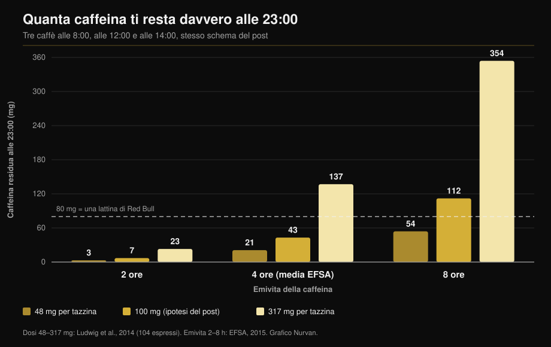

# Caffeina e sonno: a che ora devi smettere davvero

Di [Giammaria Loi](/autore/giammaria-loi) · aggiornato il 11 ottobre 2026

Un grafico molto condiviso mostra tre caffè presi alle 8, a mezzogiorno e alle 14, e conclude che alle 23 hai ancora 87 mg di caffeina in corpo: più di una lattina di Red Bull. Il conto è corretto. Il problema è che poggia su due numeri — quanta caffeina c'è in una tazzina e quanto ci metti a smaltirla — che nella realtà variano così tanto da ribaltare il risultato. Qui trovi il calcolo rifatto con i dati misurati, e l'ora limite che le meta-analisi indicano davvero.

## In breve

- **Il calcolo del post regge.** Con le sue assunzioni (100 mg a tazzina, emivita 6 ore) alle 23 restano circa 81 mg: in linea con gli 87 mg indicati. Ed è vero che sono più degli 80 mg di una lattina da 250 ml di energy drink (EFSA, 2015).
- **Ma "una tazzina = 100 mg" non esiste.** Su 104 espressi comprati in bar di Italia, Scozia e Spagna, la caffeina andava da **48 a 317 mg a porzione** (Ludwig et al., 2014). Sei volte e mezzo di differenza fra una tazzina e l'altra.
- **Nemmeno "emivita 6 ore" esiste.** L'EFSA indica una media di circa 4 ore con un intervallo da **2 a 8 ore**, e l'attività dell'enzima che smaltisce la caffeina varia fino a **5-6 volte** fra persone (Grzegorzewski et al., 2022).
- **Rifacendo il conto con i valori reali**, la caffeina residua alle 23 passa da **3 mg a 354 mg**: non un numero, un intervallo di cento volte. Il grafico qui sotto lo mostra.
- **La conclusione del post è giusta e va presa più sul serio di così.** Per non perdere minuti di sonno, un caffè da 107 mg andrebbe bevuto almeno **8,8 ore** prima di andare a letto, e una porzione di pre-workout da 217 mg almeno **13,2 ore** prima (Gardiner et al., 2023).

## Il conto è giusto, i numeri che ci entrano no

Il modello usato nel post è quello standard: la caffeina si dimezza a intervalli regolari, e le dosi successive si sommano a quello che è rimasto delle precedenti. Con una tazzina da 100 mg alle 8, alle 12 e alle 14, e un'emivita di 6 ore, alle 23 restano circa 81 mg. Gli 87 mg mostrati nel grafico sono quindi corretti nell'ordine di grandezza.

Il punto è un altro. Un modello del genere restituisce esattamente quello che gli dai in pasto, e qui gli vengono dati due valori medi presentati come se fossero costanti. Nessuno dei due lo è.

## Cosa dice davvero la ricerca

### "Una tazza di caffè contiene 100 mg di caffeina" — **Smentito**

È l'assunzione più fragile di tutto il ragionamento. Un gruppo dell'Università di Glasgow ha comprato e analizzato **104 caffè espresso** nei bar di Scozia, Italia e Spagna: il contenuto di caffeina andava da **48 a 317 mg per porzione**. Gli autori concludono che "una tazza di caffè" non è un'unità di misura riproducibile, eppure è quella con cui si misura il consumo negli studi epidemiologici (Ludwig et al., 2014).

Un'indagine precedente sugli espressi di 20 bar britannici aveva trovato differenze di **sei volte** nel contenuto di caffeina, con un singolo espresso che ne conteneva **322 mg** (Crozier et al., 2012). La variabile che pesa di più non è la miscela né la tostatura: è quanto caffè macinato finisce nel portafiltro.

Tradotto per chi legge in Italia: il tuo espresso al bar può valere meno della metà o più del triplo della tazzina ipotizzata nel post, e tu non hai modo di saperlo.

### "L'emivita della caffeina è di 5-6 ore" — **Da precisare**

L'EFSA, nel suo parere sulla sicurezza della caffeina, indica un'emivita media di circa **4 ore negli adulti sani, con un intervallo fra 2 e 8 ore** (EFSA, 2015). Il valore di 6 ore usato nel post sta nella parte alta dell'intervallo, non al centro.

Il motivo di questa dispersione è l'enzima epatico CYP1A2, che si occupa dell'80-90% della trasformazione della caffeina. La sua attività varia fra le persone di un fattore **5-6 volte**, per cause genetiche, epigenetiche e ambientali. Nell'analisi sistematica di 141 pubblicazioni di farmacocinetica, il **fumo** accelera in modo consistente l'eliminazione della caffeina, mentre i **contraccettivi orali** la rallentano, e l'effetto è riproducibile su più di cinquant'anni di studi (Grzegorzewski et al., 2022). Anche il position stand dell'ISSN riconosce che la risposta alla caffeina, sonno incluso, dipende in parte dalla variazione genetica nel suo metabolismo (Guest et al., 2021).

*Stesso modello del post, stesso orario dei caffè, ma con i valori misurati in letteratura invece di due medie. Il risultato non è 87 mg: è un intervallo che va da 3 a 354 mg. Dosi da Ludwig et al., 2014; emivite dall'intervallo EFSA 2015. Calcolo e grafico Nurvan.*

Il grafico spiega perché due colleghi che bevono lo stesso numero di caffè dormono in modo diverso, e perché la risposta "a me il caffè dopo cena non fa niente" può essere letteralmente vera per chi sta nella colonna di sinistra.

### "Alle 23 hai più caffeina di un Red Bull" — **Confermato**

Il confronto regge. L'EFSA indica per gli energy drink una concentrazione di 320 mg per litro, cioè circa **80 mg in una lattina da 250 ml** (EFSA, 2015). Con le assunzioni del post si resta appena sopra quella soglia. Con una tazzina più carica o un metabolismo lento, si arriva molto più in alto.

### "Il caffè del pomeriggio disturba il sonno" — **Confermato, e la soglia è più severa**

Qui il post ha ragione, ma si ferma prima del dato più utile. La meta-analisi di riferimento ha riunito 24 studi e misurato che la caffeina **riduce il tempo totale di sonno di 45 minuti** e l'efficienza del sonno del 7%, allunga di 9 minuti il tempo per addormentarsi e di 12 minuti il tempo passato svegli dopo essersi addormentati. Soprattutto, gli autori hanno calcolato le ore di anticipo necessarie: un **caffè da 107 mg va bevuto almeno 8,8 ore prima** di andare a letto, una **porzione standard di pre-workout da 217,5 mg almeno 13,2 ore prima** (Gardiner et al., 2023).

| Vai a letto alle | Ultimo caffè (107 mg) | Ultimo pre-workout (217 mg) |
|---|---|---|
| 22:00 | 13:12 | 08:48 |
| 23:00 | 14:12 | 09:48 |
| 00:00 | 15:12 | 10:48 |

*Calcolo Nurvan applicando le soglie di 8,8 e 13,2 ore pubblicate in Gardiner et al., 2023. Sono soglie medie di letteratura, non prescrizioni individuali.*

Una sperimentazione controllata sul campo aveva già mostrato la stessa cosa in modo più diretto: 400 mg di caffeina presi **6 ore prima** di coricarsi riducono il sonno in misura significativa rispetto al placebo, misurato con un dispositivo validato a casa dei partecipanti (Drake et al., 2013).

Nello schema del post l'ultimo caffè è alle 14 per un letto alle 23: nove ore di distanza, appena sopra la soglia per **un** caffè. Il totale della giornata, però, era di tre tazzine.

### "Se mi addormento lo stesso, allora va bene" — **Smentito**

Non è un'affermazione del post, ma è la replica più comune sotto a questo tipo di contenuti, e la ricerca la smonta. Nella stessa meta-analisi, la caffeina aumenta il sonno leggero (+6,1 minuti di fase N1) e **riduce il sonno profondo di 11,4 minuti** (Gardiner et al., 2023). Una meta-analisi successiva su 22 studi controllati con polisonnografia e 956 partecipanti conferma: −34,7 minuti di sonno totale, −4,7% di efficienza, +8,4 minuti per addormentarsi e una riduzione della percentuale di sonno profondo, più marcata alle dosi alte (Chang et al., 2025).

Addormentarsi non è l'unica cosa che conta. Se ti alleni, è la parte profonda della notte quella che vuoi proteggere.

Negli atleti il quadro ha una piega curiosa. Dieci studi su chi assume caffeina prima di un allenamento o di una gara serale mostrano una riduzione piccola dell'efficienza del sonno (−4,87%) e una tendenza non significativa sul tempo totale, ma gli atleti **riferiscono in modo costante un peggioramento netto** del proprio sonno (Kocak et al., 2025). La percezione è più severa della misura: con poche notti e pochi partecipanti, questa è una ragione per essere prudenti, non per rilassarsi.

### "La caffeina è uno strumento di prestazione" — **Confermato**

Su questo il post è allineato alla letteratura. Il position stand dell'ISSN riporta benefici consistenti su resistenza, forza, velocità di movimento e azioni specifiche di sport, con dosi di **3-6 mg per kg di peso corporeo**, assunte di norma 60 minuti prima; dosi molto alte come 9 mg/kg non servono e portano più effetti collaterali (Guest et al., 2021). Per 75 kg sono 225-450 mg: cioè, nel caso peggiore, la caffeina di un solo espresso molto carico sommata a un pre-workout. Se trovi utile ragionare in termini di evidenze su cosa funziona e cosa no, abbiamo fatto lo stesso lavoro nella [tier list degli integratori per la forza](/blog/classifica-integratori-forza-tier-list).

## Come applicarlo

1. **Fissa l'ora, non la quantità.** Scegli l'orario in cui vai a letto e togli 9 ore: quello è l'ultimo caffè normale della giornata. Per il pre-workout togline 13.
2. **Se ti alleni la sera, cambia strumento.** Una dose piena di pre-workout alle 19 è incompatibile con un letto alle 23. Dimezza la dose, passa a una fonte senza caffeina o sposta la caffeina alla seduta del mattino.
3. **Conta le porzioni, non le tazzine.** Il tuo espresso può valere da 48 a 317 mg. Se non sai quanto è carico, considera che due al bar possono già essere la metà del limite giornaliero.
4. **Resta sotto le soglie di sicurezza.** L'EFSA considera senza rischi per l'adulto sano fino a 400 mg al giorno e 200 mg in singola dose (EFSA, 2015). In gravidanza e in caso di patologie o terapie in corso i limiti cambiano: è una cosa da chiedere al medico, non a un calcolatore.
5. **Testa su di te, per due settimane.** Annota orario e dose di ogni fonte di caffeina e come hai dormito. Dopo dieci giorni il tuo intervallo personale si vede: è l'unico modo per sapere in quale colonna del grafico sei.
6. **Non compensare con più caffeina.** Dormire peggio e aumentare la dose il giorno dopo è il circolo che la letteratura descrive come punto di partenza del problema, non come soluzione.

> ### 💡 Con Nurvan
> **Gli integratori hanno un orario, non solo una dose.** In Nurvan registri ogni integratore con quantità e ora di assunzione, caffeina e pre-workout compresi, e li vedi affiancati alla scheda di allenamento della stessa giornata. Così, se dopo le sedute serali dormi male, non devi ricostruirlo a memoria: il dato è già lì, ora per ora. [Prova Nurvan](https://nurvan.app)

## Domande frequenti

**Quante ore prima di dormire devo smettere di bere caffè?**
Almeno 8,8 ore per un caffè da circa 107 mg e 13,2 ore per una porzione di pre-workout da 217 mg, se l'obiettivo è non perdere minuti di sonno totale (Gardiner et al., 2023). Per un letto alle 23 significa ultimo caffè verso le 14. Sono medie: se smaltisci la caffeina lentamente ti serve più margine.

**Quanta caffeina c'è davvero in un espresso?**
Da 48 a 317 mg a porzione, nei 104 espressi misurati in bar di Italia, Scozia e Spagna (Ludwig et al., 2014). Il fattore che conta di più è la quantità di caffè macinato usata dal barista, non la miscela.

**Se mi addormento subito dopo un caffè, posso berlo la sera?**
Addormentarsi in fretta non vuol dire aver dormito bene. La caffeina sposta il sonno verso le fasi leggere e riduce il sonno profondo di circa 11 minuti a notte (Gardiner et al., 2023; Chang et al., 2025). L'effetto c'è anche quando non lo percepisci.

**La caffeina prima dell'allenamento serale vale la pena?**
Dipende da cosa ti serve quella sera. Il beneficio sulla prestazione a 3-6 mg/kg è ben documentato (Guest et al., 2021), ma gli atleti che la prendono prima di sedute serali riferiscono un sonno peggiore (Kocak et al., 2025). Per un allenamento qualunque il conto raramente torna; per una gara può valerlo.

## Leggi anche

- [Tier list integratori forza: cosa dice la ricerca](/blog/classifica-integratori-forza-tier-list)
- [Creatina senza allenamento dopo i 45 anni: serve?](/blog/creatina-senza-allenamento-over-45)
- [Ripetizioni, serie e recupero: cosa serve davvero per l'ipertrofia](/blog/ripetizioni-serie-recupero-ipertrofia)

## Fonti

1. Gardiner C, Weakley J, Burke LM, Roach GD, Sargent C, Maniar N, Townshend A, Halson SL, 2023. *The effect of caffeine on subsequent sleep: A systematic review and meta-analysis.* Sleep Med Rev 69:101764. PMID 36870101 — [doi:10.1016/j.smrv.2023.101764](https://doi.org/10.1016/j.smrv.2023.101764)
2. Chang YH, Cheng YC, Cheng WJ, 2025. *Age- and dose-specific effects of caffeine on sleep: A meta-analysis of controlled crossover trials.* Sleep Med 136:106874. PMID 41124973 — [doi:10.1016/j.sleep.2025.106874](https://doi.org/10.1016/j.sleep.2025.106874)
3. Drake C, Roehrs T, Shambroom J, Roth T, 2013. *Caffeine effects on sleep taken 0, 3, or 6 hours before going to bed.* J Clin Sleep Med 9(11):1195–1200. PMID 24235903 — [doi:10.5664/jcsm.3170](https://doi.org/10.5664/jcsm.3170)
4. Ludwig IA, Mena P, Calani L, Cid C, Del Rio D, Lean MEJ, Crozier A, 2014. *Variations in caffeine and chlorogenic acid contents of coffees: what are we drinking?* Food Funct 5(8):1718–1726. PMID 25014672 — [doi:10.1039/c4fo00290c](https://doi.org/10.1039/c4fo00290c)
5. Crozier TWM, Stalmach A, Lean MEJ, Crozier A, 2012. *Espresso coffees, caffeine and chlorogenic acid intake: potential health implications.* Food Funct 3(1):30–33. PMID 22130653 — [doi:10.1039/c1fo10240k](https://doi.org/10.1039/c1fo10240k)
6. Grzegorzewski J, Bartsch F, Köller A, König M, 2022. *Pharmacokinetics of Caffeine: A Systematic Analysis of Reported Data for Application in Metabolic Phenotyping and Liver Function Testing.* Front Pharmacol 12:752826. PMID 35280254 — [doi:10.3389/fphar.2021.752826](https://doi.org/10.3389/fphar.2021.752826)
7. Kocak A, Georgousopoulou E, Knight-Agarwal CR, Matthews R, Minehan M, 2025. *The Effect of Consuming Caffeine Before Late Afternoon/Evening Training or Competition on Sleep: A Systematic Review with Meta-Analysis.* Sports (Basel) 13(9):317. PMID 41003623 — [doi:10.3390/sports13090317](https://doi.org/10.3390/sports13090317)
8. Guest NS, VanDusseldorp TA, Nelson MT, et al., 2021. *International society of sports nutrition position stand: caffeine and exercise performance.* J Int Soc Sports Nutr 18(1):1. PMID 33388079 — [doi:10.1186/s12970-020-00383-4](https://doi.org/10.1186/s12970-020-00383-4)
9. EFSA Panel on Dietetic Products, Nutrition and Allergies, 2015. *Scientific Opinion on the safety of caffeine.* EFSA Journal 13(5):4102. — [doi:10.2903/j.efsa.2015.4102](https://doi.org/10.2903/j.efsa.2015.4102)

Metadati e abstract degli studi recuperati da PubMed. Spunto iniziale: post di [Todd Anderson (@toddanderson42_)](https://www.instagram.com/p/DdNDHgthiYV/) del 13 settembre 2026. Nessun testo, immagine o struttura del post è stato riprodotto: le affermazioni sono state estratte, riscritte e verificate in modo indipendente.

---

**Giammaria Loi** è il fondatore di Nurvan. Si allena con i pesi dal 2012, lavora come personal trainer e coach certificato FIPE dal 2013 e gareggia nel powerlifting a livello nazionale dal 2018. Ogni articolo che firma parte dagli studi scientifici e arriva a ciò che funziona davvero in palestra.

> Nota: contenuto informativo, non sostituisce il parere di un medico o professionista. Se sei in gravidanza o allattamento, assumi farmaci o hai disturbi del sonno, cardiaci o d'ansia, parla con il tuo medico prima di modificare l'assunzione di caffeina.
