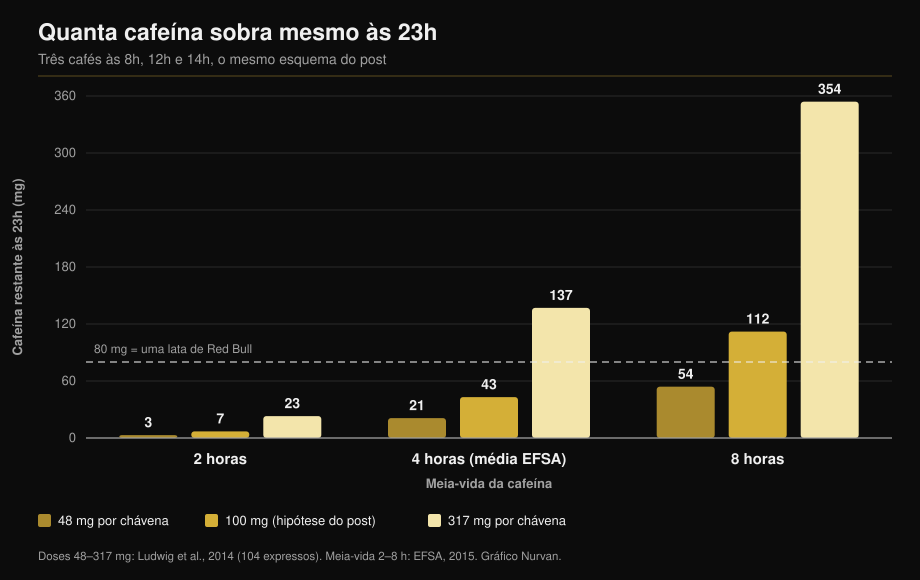

# Cafeína e sono: a que horas tens mesmo de parar

Por [Giammaria Loi](/autore/giammaria-loi) · atualizado a 11 de outubro de 2026

Um gráfico muito partilhado desenha três cafés — às 8h, ao meio-dia e às 14h — e conclui que às 23h ainda tens 87 mg de cafeína no corpo: mais do que uma lata de Red Bull. A conta está certa. O problema são os dois números que a alimentam: quanta cafeína tem uma chávena e quanto tempo demoras a eliminá-la. Medindo os dois, a resposta deixa de ser um número e passa a ser um intervalo enorme. Aqui está o cálculo refeito e a hora limite que as meta-análises de facto sustentam.

## Em resumo

- **A aritmética do post resiste.** Com os seus pressupostos (100 mg por chávena, meia-vida de 6 horas) sobram cerca de 81 mg às 23h, perto dos 87 mg mostrados. E sim, são mais do que os cerca de 80 mg de uma lata de 250 ml de bebida energética (EFSA, 2015).
- **Mas "uma chávena = 100 mg" não existe.** Em 104 cafés expresso comprados em cafés de Itália, Escócia e Espanha, a cafeína ia de **48 a 317 mg por dose** (Ludwig et al., 2014). Seis vezes e meia de diferença entre uma chávena e outra.
- **"Meia-vida de 6 horas" também não existe.** A EFSA aponta uma média próxima de 4 horas, com um intervalo de **2 a 8 horas**, e a atividade da enzima que elimina a cafeína varia **5 a 6 vezes** entre pessoas (Grzegorzewski et al., 2022).
- **Refazendo a conta com valores medidos**, a cafeína que resta às 23h vai de **3 mg a 354 mg**: um intervalo de cem vezes, não um número. O gráfico abaixo mostra-o.
- **A conclusão do post está certa e é mais exigente do que parece.** Para não perder minutos de sono, um café de 107 mg deveria ser bebido pelo menos **8,8 horas** antes de deitar, e uma dose de pré-treino de 217 mg pelo menos **13,2 horas** antes (Gardiner et al., 2023).

## O modelo está bem. O que lhe pões dentro, não

O post usa a abordagem clássica: a cafeína reduz-se a metade em intervalos fixos e cada nova dose soma-se ao que resta da anterior. Três chávenas de 100 mg às 8h, 12h e 14h, com meia-vida de 6 horas, deixam cerca de 81 mg às 23h. Os 87 mg do gráfico estão, portanto, na ordem de grandeza correta.

O problema é outro. Um modelo destes devolve exatamente aquilo que lhe damos, e aqui recebe duas médias populacionais disfarçadas de constantes. Nenhuma das duas o é.

## O que diz mesmo a investigação

### "Uma chávena de café tem 100 mg de cafeína" — **Desmentido**

É o elo mais frágil de todo o raciocínio. Uma equipa da Universidade de Glasgow comprou e analisou **104 cafés expresso** em estabelecimentos da Escócia, Itália e Espanha: a cafeína ia de **48 a 317 mg por dose**. A conclusão dos autores é que "uma chávena de café" não é uma unidade de medida reproduzível — e, ainda assim, é com ela que a epidemiologia mede o consumo (Ludwig et al., 2014).

Um levantamento anterior sobre expressos de 20 estabelecimentos britânicos encontrou diferenças de **seis vezes**, com um único expresso a conter **322 mg** (Crozier et al., 2012). A variável que mais pesa não é a mistura nem a torra: é quanto café moído acaba no porta-filtros.

O teu expresso pode valer menos de metade ou mais do triplo da chávena assumida no post — e não tens como saber.

### "A meia-vida da cafeína é de 5 a 6 horas" — **A precisar**

No seu parecer sobre a segurança da cafeína, a EFSA indica uma meia-vida média de cerca de **4 horas em adultos saudáveis, com um intervalo de 2 a 8 horas** (EFSA, 2015). As 6 horas usadas no post estão na parte alta desse intervalo, não no centro.

A razão da dispersão é a enzima hepática CYP1A2, responsável por 80-90% da transformação da cafeína. A sua atividade varia entre pessoas num fator de **5 a 6 vezes**, por causas genéticas, epigenéticas e ambientais. Na análise sistemática de 141 publicações de farmacocinética, o **tabaco** acelera de forma consistente a eliminação da cafeína enquanto os **contracetivos orais** a travam, um efeito reproduzível ao longo de mais de cinquenta anos de estudos (Grzegorzewski et al., 2022). O documento de posição da ISSN diz o mesmo: a resposta individual à cafeína, sono incluído, depende em parte da variação genética no seu metabolismo (Guest et al., 2021).

*O mesmo modelo do post e os mesmos horários, mas com os valores medidos na literatura em vez de duas médias. O resultado não é 87 mg: é um intervalo de 3 a 354 mg. Doses de Ludwig et al., 2014; meias-vidas do intervalo EFSA 2015. Cálculo e gráfico Nurvan.*

O gráfico explica porque é que dois colegas com o mesmo número de cafés dormem de forma diferente, e porque "a mim o café depois de jantar não me faz nada" pode ser literalmente verdade para quem está na coluna da esquerda.

### "Às 23h tens mais cafeína do que um Red Bull" — **Confirmado**

A comparação aguenta. A EFSA situa as bebidas energéticas em 320 mg por litro, ou seja cerca de **80 mg numa lata de 250 ml** (EFSA, 2015). Com os pressupostos do post fica-se mesmo acima desse limiar. Com uma chávena mais carregada ou um metabolismo lento, muito acima.

### "O café da tarde estraga o sono" — **Confirmado, e o limiar é mais apertado**

Aqui o post tem razão, mas para antes do dado mais útil. A meta-análise de referência juntou 24 estudos e mediu que a cafeína **reduz o tempo total de sono em 45 minutos** e a eficiência do sono em 7%, aumenta em 9 minutos o tempo para adormecer e em 12 minutos o tempo acordado depois. Sobretudo, os autores calcularam a antecedência necessária: um **café de 107 mg pelo menos 8,8 horas antes** de deitar, e uma **dose padrão de pré-treino de 217,5 mg pelo menos 13,2 horas antes** (Gardiner et al., 2023).

| Deitas-te às | Último café (107 mg) | Último pré-treino (217 mg) |
|---|---|---|
| 22:00 | 13:12 | 08:48 |
| 23:00 | 14:12 | 09:48 |
| 00:00 | 15:12 | 10:48 |

*Cálculo Nurvan aplicando os limiares de 8,8 e 13,2 horas publicados em Gardiner et al., 2023. São médias de literatura, não prescrições individuais.*

Um ensaio controlado no terreno já tinha mostrado o mesmo de forma mais direta: 400 mg de cafeína tomados **6 horas antes** de deitar reduzem o sono de forma significativa face ao placebo, medido com um dispositivo validado em casa dos participantes (Drake et al., 2013).

No esquema do post o último café é às 14h para uma cama às 23h: nove horas, mesmo acima do limiar para **um** café. O total do dia, porém, eram três chávenas.

### "Se adormeço na mesma, não faz mal" — **Desmentido**

Não é uma afirmação do post, mas é a resposta mais comum debaixo deste tipo de conteúdos, e a investigação desmonta-a. Na mesma meta-análise, a cafeína aumenta o sono leve (+6,1 minutos de fase N1) e **reduz o sono profundo em 11,4 minutos** (Gardiner et al., 2023). Uma meta-análise posterior sobre 22 estudos controlados com polissonografia e 956 participantes confirma: −34,7 minutos de sono total, −4,7% de eficiência, +8,4 minutos para adormecer e uma queda na percentagem de sono profundo, mais marcada em doses altas (Chang et al., 2025).

Adormecer não é o trabalho todo. Se treinas, é a parte profunda da noite que queres proteger.

Nos atletas o quadro tem uma reviravolta curiosa. Dez estudos sobre quem toma cafeína antes de um treino ou prova ao fim do dia mostram uma redução pequena da eficiência do sono (−4,87%) e uma tendência não significativa no tempo total, mas os atletas **relatam de forma consistente um sono claramente pior** (Kocak et al., 2025). A perceção vai à frente da medição: com poucas noites e poucos participantes, isso é motivo para prudência, não para descontração.

### "A cafeína é uma ferramenta de desempenho" — **Confirmado**

Aqui o post está alinhado com a literatura. O documento de posição da ISSN descreve benefícios consistentes em resistência, força, velocidade de movimento e ações específicas de cada modalidade, com doses de **3-6 mg por kg de peso corporal**, normalmente 60 minutos antes; doses muito altas como 9 mg/kg não acrescentam nada e trazem mais efeitos adversos (Guest et al., 2021). Para 75 kg são 225-450 mg: no pior cenário, a cafeína de um expresso muito carregado somada a um pré-treino. Se gostas de avaliar suplementos pela evidência e não pelo marketing, fizemos esse mesmo trabalho na [tier list de suplementos para força](/pt/blog/ranking-suplementos-forca-tier-list).

## Como aplicar

1. **Define uma hora, não uma quantidade.** Pega na hora a que te deitas e tira 9 horas: é esse o teu último café normal do dia. Para o pré-treino, tira 13.
2. **Se treinas ao fim do dia, muda de ferramenta.** Uma dose completa de pré-treino às 19h não é compatível com dormir às 23h. Corta-a a meio, passa a uma opção sem cafeína ou muda a cafeína para o treino da manhã.
3. **Conta doses, não chávenas.** O teu expresso pode valer de 48 a 317 mg. Se não sabes quão carregado está, assume que dois na rua já podem ser metade do limite diário.
4. **Fica abaixo dos limites de segurança.** A EFSA considera sem risco para o adulto saudável até 400 mg por dia e 200 mg numa dose única (EFSA, 2015). Na gravidez e com patologias ou medicação em curso os limites mudam: isso pergunta-se ao médico, não a uma calculadora.
5. **Faz um teste de duas semanas contigo.** Regista a hora e a dose de cada fonte de cafeína e como dormiste. Ao fim de dez dias o teu intervalo pessoal aparece: é a única forma de saber em que coluna do gráfico estás.
6. **Não compenses com mais cafeína.** Dormir mal e subir a dose no dia seguinte é o ciclo que a literatura descreve como o início do problema, não como a solução.

> ### 💡 Com a Nurvan
> **Os suplementos têm hora, não só dose.** Na Nurvan registas cada suplemento com a quantidade e a hora da toma — cafeína e pré-treino incluídos — ao lado do treino desse mesmo dia. Assim, se dormes mal depois dos treinos ao fim do dia, não tens de reconstruir de memória: o dado já lá está, hora a hora. [Experimenta a Nurvan](https://nurvan.app)

## Perguntas frequentes

**Quantas horas antes de dormir devo parar de tomar café?**
Pelo menos 8,8 horas para um café de cerca de 107 mg e 13,2 horas para uma dose de pré-treino de 217 mg, se o objetivo for não perder minutos de sono total (Gardiner et al., 2023). Para deitar às 23h, isso põe o último café por volta das 14h. São médias: se eliminas a cafeína devagar, precisas de mais margem.

**Quanta cafeína tem mesmo um expresso?**
De 48 a 317 mg por dose, nos 104 expressos medidos em cafés de Itália, Escócia e Espanha (Ludwig et al., 2014). O fator que mais conta é a quantidade de café moído usada pelo barista, não a mistura.

**Se adormeço bem depois de um café, posso bebê-lo à noite?**
Adormecer depressa não é o mesmo que dormir bem. A cafeína empurra o sono para as fases leves e reduz o sono profundo em cerca de 11 minutos por noite (Gardiner et al., 2023; Chang et al., 2025). O efeito existe mesmo quando não o notas.

**Vale a pena cafeína antes do treino da noite?**
Depende do que está em jogo nessa noite. O benefício no desempenho a 3-6 mg/kg está bem documentado (Guest et al., 2021), mas os atletas que a tomam antes de sessões ao fim do dia relatam pior sono (Kocak et al., 2025). Para um treino normal raramente compensa; para uma prova pode compensar.

## Lê também

- [Tier list de suplementos para força: a evidência](/pt/blog/ranking-suplementos-forca-tier-list)
- [Creatina sem treino depois dos 45: o que diz o estudo](/pt/blog/creatina-sem-treino-depois-dos-45)
- [Quantas repetições para massa muscular? O mito do 8-12](/pt/blog/quantas-repeticoes-massa-muscular)

## Fontes

1. Gardiner C, Weakley J, Burke LM, Roach GD, Sargent C, Maniar N, Townshend A, Halson SL, 2023. *The effect of caffeine on subsequent sleep: A systematic review and meta-analysis.* Sleep Med Rev 69:101764. PMID 36870101 — [doi:10.1016/j.smrv.2023.101764](https://doi.org/10.1016/j.smrv.2023.101764)
2. Chang YH, Cheng YC, Cheng WJ, 2025. *Age- and dose-specific effects of caffeine on sleep: A meta-analysis of controlled crossover trials.* Sleep Med 136:106874. PMID 41124973 — [doi:10.1016/j.sleep.2025.106874](https://doi.org/10.1016/j.sleep.2025.106874)
3. Drake C, Roehrs T, Shambroom J, Roth T, 2013. *Caffeine effects on sleep taken 0, 3, or 6 hours before going to bed.* J Clin Sleep Med 9(11):1195–1200. PMID 24235903 — [doi:10.5664/jcsm.3170](https://doi.org/10.5664/jcsm.3170)
4. Ludwig IA, Mena P, Calani L, Cid C, Del Rio D, Lean MEJ, Crozier A, 2014. *Variations in caffeine and chlorogenic acid contents of coffees: what are we drinking?* Food Funct 5(8):1718–1726. PMID 25014672 — [doi:10.1039/c4fo00290c](https://doi.org/10.1039/c4fo00290c)
5. Crozier TWM, Stalmach A, Lean MEJ, Crozier A, 2012. *Espresso coffees, caffeine and chlorogenic acid intake: potential health implications.* Food Funct 3(1):30–33. PMID 22130653 — [doi:10.1039/c1fo10240k](https://doi.org/10.1039/c1fo10240k)
6. Grzegorzewski J, Bartsch F, Köller A, König M, 2022. *Pharmacokinetics of Caffeine: A Systematic Analysis of Reported Data for Application in Metabolic Phenotyping and Liver Function Testing.* Front Pharmacol 12:752826. PMID 35280254 — [doi:10.3389/fphar.2021.752826](https://doi.org/10.3389/fphar.2021.752826)
7. Kocak A, Georgousopoulou E, Knight-Agarwal CR, Matthews R, Minehan M, 2025. *The Effect of Consuming Caffeine Before Late Afternoon/Evening Training or Competition on Sleep: A Systematic Review with Meta-Analysis.* Sports (Basel) 13(9):317. PMID 41003623 — [doi:10.3390/sports13090317](https://doi.org/10.3390/sports13090317)
8. Guest NS, VanDusseldorp TA, Nelson MT, et al., 2021. *International society of sports nutrition position stand: caffeine and exercise performance.* J Int Soc Sports Nutr 18(1):1. PMID 33388079 — [doi:10.1186/s12970-020-00383-4](https://doi.org/10.1186/s12970-020-00383-4)
9. EFSA Panel on Dietetic Products, Nutrition and Allergies, 2015. *Scientific Opinion on the safety of caffeine.* EFSA Journal 13(5):4102. — [doi:10.2903/j.efsa.2015.4102](https://doi.org/10.2903/j.efsa.2015.4102)

Metadados e resumos obtidos no PubMed. Ponto de partida: publicação de [Todd Anderson (@toddanderson42_)](https://www.instagram.com/p/DdNDHgthiYV/) de 13 de setembro de 2026. Nenhum texto, imagem ou estrutura da publicação foi reproduzido: as afirmações foram extraídas, reescritas e verificadas de forma independente.

---

**Giammaria Loi** é o fundador da Nurvan. Treina com pesos desde 2012, trabalha como personal trainer e coach certificado FIPE desde 2013 e compete em powerlifting a nível nacional desde 2018. Cada artigo que assina parte dos estudos científicos e chega ao que funciona mesmo no ginásio.

> Nota: conteúdo informativo, não substitui a opinião de um médico ou profissional. Se estás grávida ou a amamentar, tomas medicação ou tens perturbações do sono, cardíacas ou de ansiedade, fala com o teu médico antes de mudares o consumo de cafeína.
