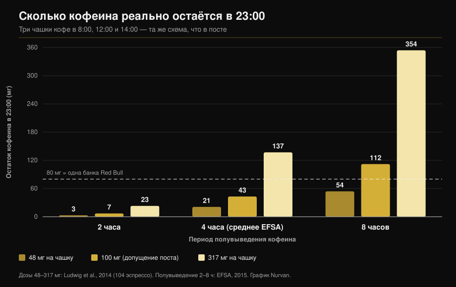

# Кофеин и сон: когда на самом деле пора остановиться

Автор: [Giammaria Loi](/autore/giammaria-loi) · обновлено 11 октября 2026

Популярный график рисует три чашки кофе — в 8:00, в полдень и в 14:00 — и приходит к выводу, что в 23:00 в организме ещё 87 мг кофеина: больше, чем в банке Red Bull. Арифметика верна. Проблема в двух числах, которые в неё заложены: сколько кофеина в чашке и как быстро вы его выводите. Измерьте оба — и ответ перестанет быть числом и превратится в очень широкий диапазон. Ниже пересчёт и то время, которое реально подтверждается мета-анализами.

## Коротко

- **Арифметика поста выдерживает проверку.** При его допущениях (100 мг на чашку, период полувыведения 6 часов) к 23:00 остаётся около 81 мг — близко к показанным 87 мг. И да, это больше примерно 80 мг в банке энергетика на 250 мл (EFSA, 2015).
- **Но «чашка = 100 мг» не существует.** В 104 порциях эспрессо, купленных в кофейнях Италии, Шотландии и Испании, кофеин колебался от **48 до 317 мг на порцию** (Ludwig et al., 2014). Разница в 6,5 раза между чашками.
- **«Период полувыведения 6 часов» тоже не существует.** EFSA указывает среднее около 4 часов с диапазоном **от 2 до 8 часов**, а активность фермента, выводящего кофеин, различается между людьми в **5–6 раз** (Grzegorzewski et al., 2022).
- **Если пересчитать с измеренными значениями**, остаток кофеина в 23:00 составит от **3 мг до 354 мг**: не одно число, а стократный диапазон. График ниже это показывает.
- **Вывод поста верен и строже, чем кажется.** Чтобы не терять минуты сна, кофе на 107 мг стоит выпить минимум за **8,8 часа** до сна, а порцию предтренировочного комплекса на 217 мг — минимум за **13,2 часа** (Gardiner et al., 2023).

## Модель правильная. Исходные данные — нет

Пост использует стандартный подход: кофеин уменьшается вдвое через равные промежутки, и каждая новая доза складывается с остатком предыдущей. Три чашки по 100 мг в 8:00, 12:00 и 14:00 при периоде полувыведения 6 часов оставляют к 23:00 около 81 мг. Так что 87 мг на графике — верный порядок величины.

Проблема не в этом. Такая модель возвращает ровно то, что в неё заложили, а сюда заложены два популяционных средних, выданных за константы. Ни одно из них константой не является.

## Что на самом деле говорит наука

### «В чашке кофе 100 мг кофеина» — **Опровергнуто**

Это самое слабое звено всего рассуждения. Команда Университета Глазго купила и проанализировала **104 порции эспрессо** в кофейнях Шотландии, Италии и Испании: кофеин варьировал от **48 до 317 мг на порцию**. Вывод авторов: «чашка кофе» — не воспроизводимая единица измерения, и при этом именно ею эпидемиология измеряет потребление (Ludwig et al., 2014).

Более раннее исследование эспрессо из 20 британских заведений нашло различия в **шесть раз**, причём один эспрессо содержал **322 мг** (Crozier et al., 2012). Решающая переменная — не сорт и не обжарка, а сколько молотого кофе бариста кладёт в холдер.

То есть ваш эспрессо может содержать меньше половины или больше трёх объёмов той чашки, что заложена в посте, и узнать это вы никак не можете.

### «Период полувыведения кофеина — 5–6 часов» — **Требует уточнения**

В заключении о безопасности кофеина EFSA указывает средний период полувыведения около **4 часов у здоровых взрослых, с диапазоном от 2 до 8 часов** (EFSA, 2015). Шесть часов из поста находятся в верхней части диапазона, а не в середине.

Причина разброса — печёночный фермент CYP1A2, на который приходится 80–90% превращения кофеина. Его активность различается между людьми в **5–6 раз** по генетическим, эпигенетическим и средовым причинам. В систематическом анализе 141 публикации по фармакокинетике **курение** стабильно ускоряет выведение кофеина, а **оральные контрацептивы** его замедляют, и этот эффект воспроизводится на материале более чем пятидесяти лет исследований (Grzegorzewski et al., 2022). Позиционный документ ISSN говорит о том же: индивидуальная реакция на кофеин, включая сон, отчасти определяется генетическими различиями в его метаболизме (Guest et al., 2021).

*Та же модель и то же расписание, что в посте, но с измеренными в литературе значениями вместо двух средних. Ответ не 87 мг, а диапазон от 3 до 354 мг. Дозы по Ludwig et al., 2014; периоды полувыведения из диапазона EFSA 2015. Расчёт и график Nurvan.*

График объясняет, почему два коллеги при одинаковом числе чашек спят по-разному и почему «мне кофе после ужина вообще не мешает» может быть буквальной правдой для того, кто находится в левом столбце.

### «В 23:00 у вас кофеина больше, чем в Red Bull» — **Подтверждено**

Сравнение корректно. EFSA оценивает энергетики в 320 мг на литр, то есть около **80 мг в банке 250 мл** (EFSA, 2015). При допущениях поста вы оказываетесь чуть выше этого порога. При более крепкой чашке или медленном метаболизме — намного выше.

### «Дневной кофе мешает спать» — **Подтверждено, и порог жёстче**

Здесь пост прав, но останавливается, не дойдя до самого полезного числа. Ключевой мета-анализ объединил 24 исследования: кофеин **сокращает общее время сна на 45 минут** и эффективность сна на 7%, удлиняет засыпание на 9 минут и время бодрствования после засыпания на 12 минут. Главное — авторы рассчитали необходимый запас времени: кофе на **107 мг минимум за 8,8 часа** до сна, стандартная порция предтренировочного комплекса на **217,5 мг минимум за 13,2 часа** (Gardiner et al., 2023).

| Ложитесь в | Последний кофе (107 мг) | Последний предтрен (217 мг) |
|---|---|---|
| 22:00 | 13:12 | 08:48 |
| 23:00 | 14:12 | 09:48 |
| 00:00 | 15:12 | 10:48 |

*Расчёт Nurvan с применением порогов 8,8 и 13,2 часа, опубликованных в Gardiner et al., 2023. Это средние по литературе, а не индивидуальные предписания.*

Контролируемое полевое исследование показало то же самое прямее: 400 мг кофеина **за 6 часов** до сна значимо сокращают сон по сравнению с плацебо, по данным валидированного прибора у участников дома (Drake et al., 2013).

В схеме поста последний кофе — в 14:00 при отбое в 23:00: девять часов, чуть выше порога для **одной** чашки. Но за день их было три.

### «Если я всё равно засыпаю, значит нормально» — **Опровергнуто**

Этого в посте нет, но это самый частый комментарий под таким контентом, и наука его разбирает. В том же мета-анализе кофеин увеличивает поверхностный сон (+6,1 минуты стадии N1) и **сокращает глубокий сон на 11,4 минуты** (Gardiner et al., 2023). Более поздний мета-анализ 22 контролируемых исследований с полисомнографией и 956 участниками это подтверждает: −34,7 минуты общего сна, −4,7% эффективности, +8,4 минуты на засыпание и снижение доли глубокого сна, более выраженное при высоких дозах (Chang et al., 2025).

Заснуть — ещё не вся работа. Если вы тренируетесь, защищать нужно именно глубокую часть ночи.

У спортсменов картина с любопытным поворотом. Десять исследований приёма кофеина перед вечерней тренировкой или стартом показывают небольшое снижение эффективности сна (−4,87%) и незначимую тенденцию по общему времени сна, но сами спортсмены **стабильно сообщают о заметно худшем сне** (Kocak et al., 2025). Субъективная оценка опережает измерение: при малом числе ночей и участников это повод для осторожности, а не для спокойствия.

### «Кофеин — инструмент работоспособности» — **Подтверждено**

Здесь пост совпадает с литературой. Позиционный документ ISSN сообщает о стабильной пользе для выносливости, силы, скорости движения и специфических для вида спорта действий при дозах **3–6 мг на кг массы тела**, обычно за 60 минут; очень высокие дозы вроде 9 мг/кг ничего не добавляют, но добавляют побочных эффектов (Guest et al., 2021). Для 75 кг это 225–450 мг: в худшем случае — кофеин одного очень крепкого эспрессо плюс предтрен. Если вам ближе оценивать добавки по доказательствам, а не по маркетингу, ту же работу мы проделали в [тир-листе добавок для силы](/ru/blog/reyting-sportivnykh-dobavok-dlya-sily).

## Как это применить

1. **Назначьте время, а не количество.** Возьмите время отбоя и отнимите 9 часов — это ваш последний обычный кофе. Для предтренировочного комплекса отнимите 13.
2. **Тренируетесь вечером — смените инструмент.** Полная порция предтрена в 19:00 несовместима с отбоем в 23:00. Уменьшите вдвое, перейдите на вариант без кофеина или перенесите кофеин на утреннюю тренировку.
3. **Считайте порции, а не чашки.** Ваш эспрессо может быть от 48 до 317 мг. Если крепость неизвестна, исходите из того, что две чашки вне дома уже могут составить половину дневного потолка.
4. **Не выходите за пределы безопасности.** EFSA считает безопасными для здорового взрослого до 400 мг в сутки и 200 мг за один приём (EFSA, 2015). При беременности, заболеваниях или приёме лекарств пределы другие: это вопрос к врачу, а не к калькулятору.
5. **Проведите двухнедельный тест на себе.** Записывайте время и дозу каждого источника кофеина и то, как вы спали. Через десять дней проявится ваш личный диапазон: это единственный способ понять, в каком столбце графика вы находитесь.
6. **Не компенсируйте новой дозой.** Плохо поспать и на следующий день увеличить дозу — это тот самый круг, который литература описывает как начало проблемы, а не как решение.

> ### 💡 С Nurvan
> **У добавок есть время приёма, а не только доза.** В Nurvan вы записываете каждую добавку с количеством и временем приёма — включая кофеин и предтренировочный комплекс — рядом с тренировкой того же дня. Если после вечерних занятий вы плохо спите, восстанавливать это по памяти не придётся: данные уже есть, час за часом. [Попробовать Nurvan](https://nurvan.app)

## Частые вопросы

**За сколько часов до сна надо перестать пить кофе?**
Минимум за 8,8 часа для кофе примерно на 107 мг и за 13,2 часа для порции предтрена на 217 мг, если цель — не терять общее время сна (Gardiner et al., 2023). При отбое в 23:00 последний кофе приходится примерно на 14:00. Это средние значения: если вы выводите кофеин медленно, запас нужен больше.

**Сколько кофеина на самом деле в эспрессо?**
От 48 до 317 мг на порцию — по 104 порциям эспрессо, измеренным в кофейнях Италии, Шотландии и Испании (Ludwig et al., 2014). Больше всего влияет количество молотого кофе, которое использует бариста, а не сорт.

**Если я хорошо засыпаю после кофе, можно пить его вечером?**
Быстро заснуть не значит хорошо выспаться. Кофеин смещает сон в сторону поверхностных стадий и сокращает глубокий сон примерно на 11 минут за ночь (Gardiner et al., 2023; Chang et al., 2025). Эффект есть независимо от того, замечаете вы его или нет.

**Стоит ли принимать кофеин перед вечерней тренировкой?**
Зависит от того, ради чего этот вечер. Польза для работоспособности при 3–6 мг/кг хорошо задокументирована (Guest et al., 2021), но спортсмены, принимающие кофеин перед вечерними занятиями, сообщают о худшем сне (Kocak et al., 2025). Для обычной тренировки размен редко оправдан, для соревнования — может быть.

## Читайте также

- [Тир-лист добавок для силы: что говорит наука](/ru/blog/reyting-sportivnykh-dobavok-dlya-sily)
- [Креатин без тренировок после 45: что показало исследование](/ru/blog/kreatin-bez-trenirovok-posle-45)
- [Сколько повторений нужно для роста мышц: миф 8-12](/ru/blog/skolko-povtoreniy-dlya-massy)

## Источники

1. Gardiner C, Weakley J, Burke LM, Roach GD, Sargent C, Maniar N, Townshend A, Halson SL, 2023. *The effect of caffeine on subsequent sleep: A systematic review and meta-analysis.* Sleep Med Rev 69:101764. PMID 36870101 — [doi:10.1016/j.smrv.2023.101764](https://doi.org/10.1016/j.smrv.2023.101764)
2. Chang YH, Cheng YC, Cheng WJ, 2025. *Age- and dose-specific effects of caffeine on sleep: A meta-analysis of controlled crossover trials.* Sleep Med 136:106874. PMID 41124973 — [doi:10.1016/j.sleep.2025.106874](https://doi.org/10.1016/j.sleep.2025.106874)
3. Drake C, Roehrs T, Shambroom J, Roth T, 2013. *Caffeine effects on sleep taken 0, 3, or 6 hours before going to bed.* J Clin Sleep Med 9(11):1195–1200. PMID 24235903 — [doi:10.5664/jcsm.3170](https://doi.org/10.5664/jcsm.3170)
4. Ludwig IA, Mena P, Calani L, Cid C, Del Rio D, Lean MEJ, Crozier A, 2014. *Variations in caffeine and chlorogenic acid contents of coffees: what are we drinking?* Food Funct 5(8):1718–1726. PMID 25014672 — [doi:10.1039/c4fo00290c](https://doi.org/10.1039/c4fo00290c)
5. Crozier TWM, Stalmach A, Lean MEJ, Crozier A, 2012. *Espresso coffees, caffeine and chlorogenic acid intake: potential health implications.* Food Funct 3(1):30–33. PMID 22130653 — [doi:10.1039/c1fo10240k](https://doi.org/10.1039/c1fo10240k)
6. Grzegorzewski J, Bartsch F, Köller A, König M, 2022. *Pharmacokinetics of Caffeine: A Systematic Analysis of Reported Data for Application in Metabolic Phenotyping and Liver Function Testing.* Front Pharmacol 12:752826. PMID 35280254 — [doi:10.3389/fphar.2021.752826](https://doi.org/10.3389/fphar.2021.752826)
7. Kocak A, Georgousopoulou E, Knight-Agarwal CR, Matthews R, Minehan M, 2025. *The Effect of Consuming Caffeine Before Late Afternoon/Evening Training or Competition on Sleep: A Systematic Review with Meta-Analysis.* Sports (Basel) 13(9):317. PMID 41003623 — [doi:10.3390/sports13090317](https://doi.org/10.3390/sports13090317)
8. Guest NS, VanDusseldorp TA, Nelson MT, et al., 2021. *International society of sports nutrition position stand: caffeine and exercise performance.* J Int Soc Sports Nutr 18(1):1. PMID 33388079 — [doi:10.1186/s12970-020-00383-4](https://doi.org/10.1186/s12970-020-00383-4)
9. EFSA Panel on Dietetic Products, Nutrition and Allergies, 2015. *Scientific Opinion on the safety of caffeine.* EFSA Journal 13(5):4102. — [doi:10.2903/j.efsa.2015.4102](https://doi.org/10.2903/j.efsa.2015.4102)

Метаданные и аннотации получены из PubMed. Отправная точка: пост [Todd Anderson (@toddanderson42_)](https://www.instagram.com/p/DdNDHgthiYV/) от 13 сентября 2026 года. Ни текст, ни изображения, ни структура поста не воспроизводились: утверждения были извлечены, переписаны и проверены независимо.

---

**Giammaria Loi** — основатель Nurvan. Тренируется с отягощениями с 2012 года, с 2013 года работает персональным тренером и коучем с сертификацией FIPE, с 2018 года выступает в пауэрлифтинге на национальном уровне. Каждая его статья начинается с исследований и заканчивается тем, что действительно работает в зале.

> Примечание: материал носит информационный характер и не заменяет консультацию врача или квалифицированного специалиста. При беременности и грудном вскармливании, приёме лекарств, нарушениях сна, заболеваниях сердца или тревожных расстройствах обсудите изменение потребления кофеина с врачом.
