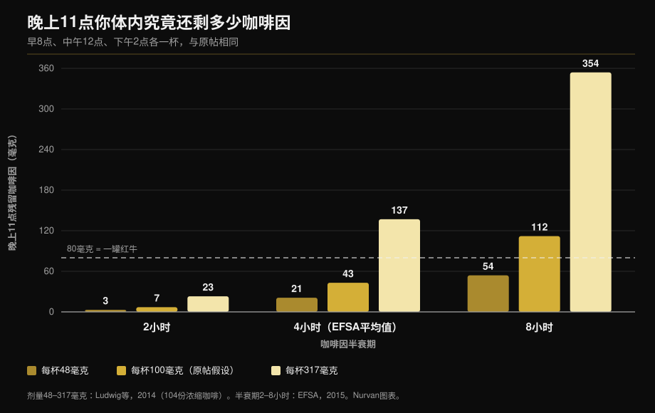

# 咖啡因与睡眠：你真正该停下的那个时间点

作者：[Giammaria Loi](/autore/giammaria-loi) · 更新于 2026 年 10 月 11 日

一张被大量转发的图画了三杯咖啡——早 8 点、中午 12 点、下午 2 点——结论是晚上 11 点你体内还有 87 毫克咖啡因，比一罐红牛还多。这个算术是对的。问题出在喂给它的两个数字：一杯咖啡里到底有多少咖啡因，以及你代谢掉它需要多久。把这两个数字真正测一遍，答案就不再是一个数，而是一个极宽的区间。下面是重算的结果，以及几项荟萃分析真正支持的"截止时间"。

## 要点速览

- **原帖的算术站得住。** 按它自己的假设（每杯 100 毫克、半衰期 6 小时），晚上 11 点约剩 81 毫克，与图上的 87 毫克接近。而且确实超过 250 毫升能量饮料里约 80 毫克的含量（EFSA，2015）。
- **但"一杯 = 100 毫克"并不存在。** 在意大利、苏格兰和西班牙咖啡馆买到的 104 份浓缩咖啡中，咖啡因从 **48 毫克到 317 毫克**不等（Ludwig 等，2014）。杯与杯之间差 6.5 倍。
- **"半衰期 6 小时"同样不存在。** EFSA 给出的平均值约 4 小时，区间为 **2 到 8 小时**；负责代谢咖啡因的酶，其活性在人与人之间相差 **5 到 6 倍**（Grzegorzewski 等，2022）。
- **用实测值重算**，晚上 11 点的残留咖啡因从 **3 毫克到 354 毫克**：这是一个百倍的区间，不是一个数字。下面的图说明了这一点。
- **原帖的结论是对的，而且比它自己说的更严格。** 想不损失睡眠时间，一杯 107 毫克的咖啡应在睡前至少 **8.8 小时**喝完，一份 217 毫克的训练前补剂则应提前至少 **13.2 小时**（Gardiner 等，2023）。

## 模型没问题，喂进去的数字有问题

原帖用的是标准做法：咖啡因每隔固定时间减半，新的一剂叠加在上一剂的残余之上。早 8 点、12 点、下午 2 点各一杯 100 毫克，半衰期 6 小时，晚上 11 点剩约 81 毫克。所以图上的 87 毫克量级是对的。

问题不在这里。这类模型给出的，正是你喂进去的东西——而这里喂进去的是两个被当成常数使用的人群平均值。它们都不是常数。

## 研究到底怎么说

### "一杯咖啡含 100 毫克咖啡因" —— **不成立**

这是整个推理里最脆弱的一环。格拉斯哥大学的团队在苏格兰、意大利和西班牙的咖啡馆买下并分析了 **104 份浓缩咖啡**：咖啡因含量从 **48 毫克到 317 毫克**。作者的结论是，"一杯咖啡"并不是一个可重复的计量单位——可流行病学研究偏偏就在用它来衡量摄入量（Ludwig 等，2014）。

更早一项针对 20 家英国门店浓缩咖啡的调查发现了 **六倍**的差异，其中一份浓缩咖啡含 **322 毫克**（Crozier 等，2012）。影响最大的变量既不是豆子也不是烘焙度，而是咖啡师往粉碗里压了多少粉。

也就是说，你那杯咖啡可能不到原帖假设的一半，也可能是三倍以上，而你无从得知。

### "咖啡因半衰期是 5 到 6 小时" —— **需要修正**

EFSA 在其咖啡因安全性意见中给出的平均半衰期为**健康成人约 4 小时，区间 2 到 8 小时**（EFSA，2015）。原帖用的 6 小时位于区间上端，而不是中间。

离散度这么大的原因是肝脏酶 CYP1A2，它承担了咖啡因代谢的 80–90%。由于遗传、表观遗传和环境原因，其活性在人与人之间相差 **5 到 6 倍**。在对 141 篇药代动力学文献的系统分析中，**吸烟**稳定地加快咖啡因清除，而**口服避孕药**则使其变慢，这一效应在五十多年的研究中可重复（Grzegorzewski 等，2022）。ISSN 的立场声明也指出同一点：个体对咖啡因的反应（包括睡眠）部分取决于代谢相关的基因差异（Guest 等，2021）。

*与原帖相同的模型、相同的时间点，但用文献实测值替换了两个平均值。答案不是 87 毫克，而是 3 到 354 毫克的区间。剂量取自 Ludwig 等，2014；半衰期取自 EFSA 2015 的区间。Nurvan 计算与制图。*

这张图解释了为什么喝同样杯数的两位同事睡眠差别很大，也解释了为什么"我晚饭后喝咖啡一点事都没有"对落在左侧一列的人来说可能是字面意义上的事实。

### "晚上 11 点你体内的咖啡因比一罐红牛还多" —— **确认**

这个比较成立。EFSA 给出的能量饮料浓度为每升 320 毫克，即 250 毫升一罐约 **80 毫克**（EFSA，2015）。按原帖的假设，你刚好高出这条线。若咖啡更浓或代谢更慢，就会高出很多。

### "下午那杯咖啡会影响睡眠" —— **确认，而且门槛更严**

这一点原帖说对了，但停在了最有用的数字之前。权威荟萃分析汇总了 24 项研究：咖啡因使**总睡眠时间减少 45 分钟**、睡眠效率下降 7%，入睡时间延长 9 分钟，入睡后清醒时间增加 12 分钟。更关键的是，作者算出了所需的提前量：**107 毫克的咖啡至少提前 8.8 小时**，**一份 217.5 毫克的标准训练前补剂至少提前 13.2 小时**（Gardiner 等，2023）。

| 就寝时间 | 最后一杯咖啡（107 毫克） | 最后一份氮泵（217 毫克） |
|---|---|---|
| 22:00 | 13:12 | 08:48 |
| 23:00 | 14:12 | 09:48 |
| 00:00 | 15:12 | 10:48 |

*Nurvan 依据 Gardiner 等（2023）发表的 8.8 小时与 13.2 小时阈值计算。这是文献平均值，不是个体化处方。*

一项现场对照试验更直接地证明过同一件事：睡前 **6 小时**摄入 400 毫克咖啡因，相较安慰剂显著减少睡眠，测量使用的是受试者家中经过验证的睡眠监测设备（Drake 等，2013）。

在原帖的安排里，最后一杯咖啡是下午 2 点、就寝 11 点：相隔九小时，刚好越过**一杯**咖啡的门槛。但那一天的总量是三杯。

### "反正我照样睡得着，那就没问题" —— **不成立**

这不是原帖的说法，却是这类内容下最常见的回复，而研究把它拆开了。在同一项荟萃分析中，咖啡因增加浅睡眠（N1 期 +6.1 分钟），并**使深睡眠减少 11.4 分钟**（Gardiner 等，2023）。随后一项纳入 22 项多导睡眠图对照试验、956 名受试者的荟萃分析也印证：总睡眠 −34.7 分钟、效率 −4.7%、入睡时间 +8.4 分钟，深睡眠占比下降，高剂量时更明显（Chang 等，2025）。

睡着并不等于任务完成。如果你在训练，夜里深睡的那一段才是最值得守住的。

在运动员身上，画面有个有意思的反转。十项关于傍晚或夜间训练、比赛前摄入咖啡因的研究显示，睡眠效率小幅下降（−4.87%），总睡眠时间的趋势不显著，但运动员**一致反映自己睡得明显更差**（Kocak 等，2025）。主观感受跑在客观测量前面：考虑到夜数少、人数少，这是谨慎的理由，不是放心的理由。

### "咖啡因是提升表现的工具" —— **确认**

这一点原帖与文献一致。ISSN 立场声明报告：在 **每公斤体重 3–6 毫克**的剂量下，耐力、力量、动作速度和各项目专项动作都有稳定收益，通常提前 60 分钟摄入；9 毫克/公斤这类超高剂量不会带来更多收益，只会带来更多副作用（Guest 等，2021）。按 75 公斤算就是 225–450 毫克：最极端的情况下，等于一杯极浓的浓缩咖啡再加一份氮泵。如果你习惯用证据而不是营销来判断补剂，我们在[力量补剂等级榜](/zh/blog/liliang-buji-dengji-bang)里做过同样的工作。

## 怎么落地

1. **先定时间，别先定量。** 用你的就寝时间减去 9 小时，那就是当天最后一杯普通咖啡。氮泵则减去 13 小时。
2. **如果你晚上训练，就换工具。** 晚上 7 点来一整勺氮泵，和 11 点上床这两件事无法共存。减半、换成无咖啡因版本，或者把咖啡因挪到早训。
3. **数"份"，别数"杯"。** 你的浓缩咖啡可能是 48 毫克，也可能是 317 毫克。不知道浓度时，就假设在外面喝两杯已经可能占掉每日上限的一半。
4. **别越过安全线。** EFSA 认为健康成人每日不超过 400 毫克、单次不超过 200 毫克没有安全顾虑（EFSA，2015）。孕期以及有疾病或正在服药时限值不同：这要问医生，不是问计算器。
5. **给自己做两周测试。** 记录每一个咖啡因来源的时间和剂量，以及当晚睡得如何。十天之后你自己的区间就会浮现：这是判断你落在图上哪一列的唯一办法。
6. **不要用更多咖啡因来弥补。** 睡不好、第二天加量，正是文献所描述的问题起点，而不是解决办法。

> ### 💡 搭配 Nurvan
> **补剂有时间，不只有剂量。** 在 Nurvan 里，每一种补剂都可以连同用量和服用时间一起记录——包括咖啡因和训练前补剂——并与当天的训练安排并排显示。这样一来，如果你在晚训后总是睡不好，就不必凭记忆回溯：数据已经在那里，精确到小时。[试用 Nurvan](https://nurvan.app)

## 常见问题

**睡前几小时应该停止喝咖啡？**
如果目标是不损失总睡眠时间，一杯约 107 毫克的咖啡至少提前 8.8 小时，一份 217 毫克的氮泵至少提前 13.2 小时（Gardiner 等，2023）。按 11 点就寝算，最后一杯咖啡大约在下午 2 点。这些是平均值：代谢慢的人需要留更多余量。

**一杯浓缩咖啡到底有多少咖啡因？**
在意大利、苏格兰和西班牙咖啡馆实测的 104 份浓缩咖啡中，每份 48 到 317 毫克（Ludwig 等，2014）。影响最大的是咖啡师用了多少粉，而不是豆子的拼配。

**喝完咖啡我照样很快入睡，那晚上能喝吗？**
快速入睡不等于睡得好。咖啡因把睡眠推向浅睡阶段，每晚减少约 11 分钟深睡眠（Gardiner 等，2023；Chang 等，2025）。不管你有没有察觉，这个效应都在。

**晚训前摄入咖啡因值得吗？**
取决于那个晚上要做什么。3–6 毫克/公斤对表现的益处有充分证据（Guest 等，2021），但在晚间训练前使用咖啡因的运动员普遍反映睡眠更差（Kocak 等，2025）。对一次普通训练，这笔账很少划算；对一场比赛，可能划算。

## 延伸阅读

- [力量补剂等级榜：研究到底怎么说](/zh/blog/liliang-buji-dengji-bang)
- [45岁后不健身也吃肌酸：研究到底说了什么](/zh/blog/jirousuan-bu-jianshen-45sui)
- [增肌每组做多少次？8-12 次的迷思](/zh/blog/duoshao-cishu-zengji)

## 参考文献

1. Gardiner C, Weakley J, Burke LM, Roach GD, Sargent C, Maniar N, Townshend A, Halson SL, 2023. *The effect of caffeine on subsequent sleep: A systematic review and meta-analysis.* Sleep Med Rev 69:101764. PMID 36870101 — [doi:10.1016/j.smrv.2023.101764](https://doi.org/10.1016/j.smrv.2023.101764)
2. Chang YH, Cheng YC, Cheng WJ, 2025. *Age- and dose-specific effects of caffeine on sleep: A meta-analysis of controlled crossover trials.* Sleep Med 136:106874. PMID 41124973 — [doi:10.1016/j.sleep.2025.106874](https://doi.org/10.1016/j.sleep.2025.106874)
3. Drake C, Roehrs T, Shambroom J, Roth T, 2013. *Caffeine effects on sleep taken 0, 3, or 6 hours before going to bed.* J Clin Sleep Med 9(11):1195–1200. PMID 24235903 — [doi:10.5664/jcsm.3170](https://doi.org/10.5664/jcsm.3170)
4. Ludwig IA, Mena P, Calani L, Cid C, Del Rio D, Lean MEJ, Crozier A, 2014. *Variations in caffeine and chlorogenic acid contents of coffees: what are we drinking?* Food Funct 5(8):1718–1726. PMID 25014672 — [doi:10.1039/c4fo00290c](https://doi.org/10.1039/c4fo00290c)
5. Crozier TWM, Stalmach A, Lean MEJ, Crozier A, 2012. *Espresso coffees, caffeine and chlorogenic acid intake: potential health implications.* Food Funct 3(1):30–33. PMID 22130653 — [doi:10.1039/c1fo10240k](https://doi.org/10.1039/c1fo10240k)
6. Grzegorzewski J, Bartsch F, Köller A, König M, 2022. *Pharmacokinetics of Caffeine: A Systematic Analysis of Reported Data for Application in Metabolic Phenotyping and Liver Function Testing.* Front Pharmacol 12:752826. PMID 35280254 — [doi:10.3389/fphar.2021.752826](https://doi.org/10.3389/fphar.2021.752826)
7. Kocak A, Georgousopoulou E, Knight-Agarwal CR, Matthews R, Minehan M, 2025. *The Effect of Consuming Caffeine Before Late Afternoon/Evening Training or Competition on Sleep: A Systematic Review with Meta-Analysis.* Sports (Basel) 13(9):317. PMID 41003623 — [doi:10.3390/sports13090317](https://doi.org/10.3390/sports13090317)
8. Guest NS, VanDusseldorp TA, Nelson MT, et al., 2021. *International society of sports nutrition position stand: caffeine and exercise performance.* J Int Soc Sports Nutr 18(1):1. PMID 33388079 — [doi:10.1186/s12970-020-00383-4](https://doi.org/10.1186/s12970-020-00383-4)
9. EFSA Panel on Dietetic Products, Nutrition and Allergies, 2015. *Scientific Opinion on the safety of caffeine.* EFSA Journal 13(5):4102. — [doi:10.2903/j.efsa.2015.4102](https://doi.org/10.2903/j.efsa.2015.4102)

研究元数据与摘要取自 PubMed。出发点：[Todd Anderson（@toddanderson42_）](https://www.instagram.com/p/DdNDHgthiYV/) 2026 年 9 月 13 日的帖子。该帖的文字、图片与结构均未被复制：其主张经过提取、重写与独立核实。

---

**Giammaria Loi** 是 Nurvan 的创始人。他自 2012 年开始进行力量训练，自 2013 年起担任 FIPE 认证私人教练，自 2018 年起在国家级力量举（powerlifting）赛事中参赛。他署名的每一篇文章都从科研出发，落到健身房里真正有用的做法上。

> 说明：本文为科普内容，不能替代医生或专业人士的意见。如果你处于孕期或哺乳期、正在服药，或有睡眠障碍、心脏问题或焦虑障碍，请在调整咖啡因摄入前咨询医生。
