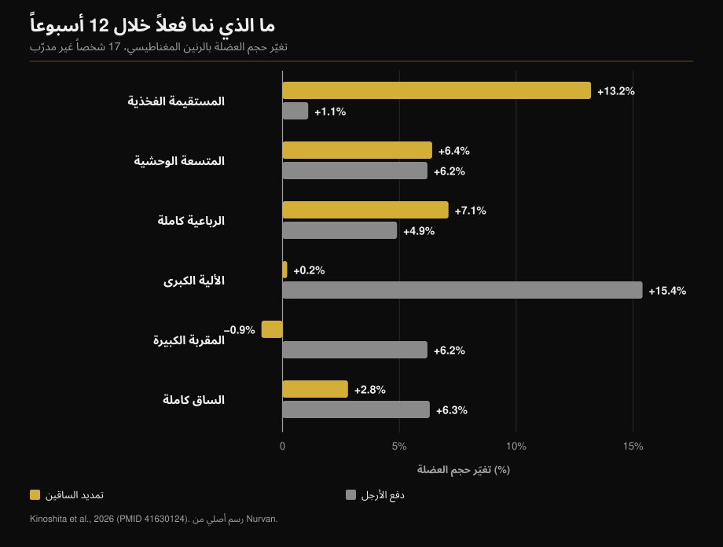
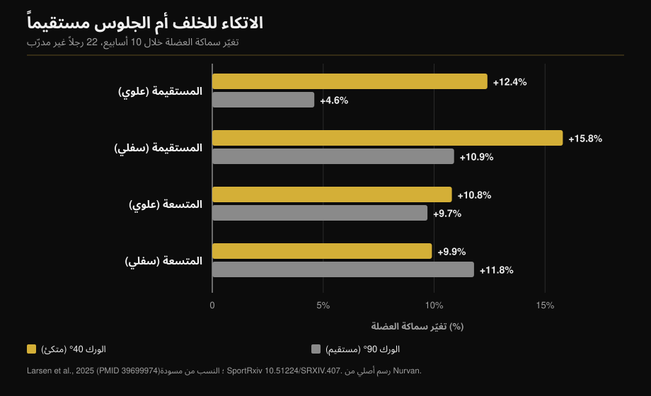

# تمديد الساقين أم دفع الأرجل: ما الذي ينمو فعلاً

بقلم [Giammaria Loi](/autore/giammaria-loi) · حُدِّث في 12 أكتوبر 2026

منشوران بفارق شهر يقولان الفكرة نفسها من زاويتين: تمديد الساقين ليس تمرين إنهاء، بل الطريقة الوحيدة لتدريب جزء من العضلة الرباعية يتجاوزه السكوات ودفع الأرجل. الأول يعرض أرقام دراسة بالرنين المغناطيسي، وهو محق. الثاني يضيف حيلة — الاتكاء للخلف — ورقماً لا وجود له في الدراسة التي يستشهد بها. هنا تجد مراجعة للادعاءين معاً، إضافة إلى المعطى الغائب عنهما: ما الذي ينمو بدفع الأرجل ولا يلمسه تمديد الساقين إطلاقاً.

## باختصار

- **العضلة المستقيمة الفخذية تنمو بتمديد الساقين ولا تنمو بدفع الأرجل.** زيادة في الحجم بنسبة 13.2% مقابل 1.1% خلال اثني عشر أسبوعاً، بقياس كل عضلة على حدة بالرنين المغناطيسي (Kinoshita وزملاؤه، 2026). في دفع الأرجل لا يمكن تمييز التغيّر عن الصفر إحصائياً.
- **لكن العضلة الرباعية ككل نمت بالقدر نفسه**: 7.1% مقابل 4.9%، بلا فرق ذي دلالة. العضلات المتسعة الثلاث تمثل نحو 85% من حجم الرباعية، والتمرينان يدرّبانها بالقدر نفسه.
- **المعطى الذي لا يذكره أي من المنشورين**: دفع الأرجل زاد الألوية الكبرى 15.4% والمقربة الكبيرة 6.2%، وهي عضلات لم يمسّها تمديد الساقين. مجمل حجم عضلات الساق: 6.3% مقابل 2.8%.
- **رقم «+73% بالاتكاء للخلف» غير موجود في الدراسة المذكورة.** تلك الدراسة من 2025 واستمرت عشرة أسابيع، لا من 2021 واثني عشر أسبوعاً. أرقامها الحقيقية: 12.4% مقابل 4.6% في الجزء العلوي من العضلة المستقيمة، و**لا فرق إطلاقاً** في المتسعة الوحشية.
- **«كلما طالت العضلة كان أفضل» ليست قاعدة.** في دفع الأرجل نفسه، ولدى أشخاص مدرَّبين، لم يغيّر توسيع مدى حركة الركبة أي شيء.

## العضلة التي لا يدرّبها دفع الأرجل

نُشرت الدراسة التي يستند إليها المنشوران في *Medicine & Science in Sports & Exercise*. تدرّب سبعة عشر شخصاً غير مدرَّب لمدة اثني عشر أسبوعاً، ساق على جهاز تمديد الساقين والأخرى على دفع الأرجل: الحمل النسبي نفسه (70% من الأقصى)، خمس مجموعات من عشر تكرارات، حصتان أسبوعياً. في النهاية صُوِّرت سبع عشرة عضلة في الورك والفخذ بالرنين المغناطيسي، واحدة واحدة (Kinoshita وزملاؤه، 2026).

نمت العضلة المستقيمة الفخذية — الرأس الذي يمتد في منتصف الفخذ — بنسبة **13.2%** مع تمديد الساقين و**1.1%** مع دفع الأرجل. الرقم الثاني ليس مكسباً صغيراً، بل مكسباً غير موجود (p = 0.379).

قاست تجربة ثانية في العمل نفسه التنشيط الكهربائي للعضلات خلال التمرينين. تعمل العضلة المستقيمة عند **38.0%** من أقصى تنشيطها في تمديد الساقين وعند **21.7%** في دفع الأرجل. أما الألوية الكبرى فالعكس: 8.8% مقابل 41.2%.

وما قيل عن راكبي الدراجات صحيح أيضاً. بمقارنة ثمانية من راكبي الدراجات التنافسيين بعشرة رجال غير مدرَّبين، كانت عضلات الفخذ أحادية المفصل أكبر بوضوح؛ أما ثنائية المفصل، ومنها العضلة المستقيمة، فكانت **بحجم عضلات غير المدرَّبين نفسه**. وستة أشهر من الموسم التنافسي لم تغيّرها (Ema وزملاؤه، 2015).

## لماذا: عضلة تعبر مفصلين

العضلة المستقيمة الفخذية هي الوحيدة بين رؤوس الرباعية الأربعة التي تبدأ من الحوض: تعبر الورك والركبة معاً. تثني الورك وتمدّ الركبة. في دفع الأرجل — وكذلك في السكوات وركوب الدراجة — يمتدّ الورك والركبة معاً، فيكون على العضلة المستقيمة أن تشدّ في اتجاه عند الركبة وفي الاتجاه المعاكس عند الورك. يسمّي الباحثون ذلك تعارض العزوم، وما قاسوه هو أن العضلة ببساطة تُنشَّط أقل.

وهنا يحتاج المنشور إلى تصحيح: فهو ينسب الظاهرة إلى مقدار تغيّر طول العضلة، بينما المتغيّر المقيس ليس المدى بل التنشيط. الفارق مهم، لأن الحل يصبح «نحتاج تمريناً يبقى فيه الورك ثابتاً» لا «نحتاج تطويلاً أكبر».

النمط نفسه يتكرر: في هذه الدراسة نمت أوتار الركبة، وهي أيضاً ثنائية المفصل، بنسبة 1.5% إلى 3.1% فقط، مقابل 12-19% عند تدريبها مباشرة بثني الساقين.

## المعطى الغائب عن المنشورين معاً

إذا توقفت عند العضلة المستقيمة بدت النتيجة بديهية. أما بقية الدراسة نفسها فتقول شيئاً آخر.

نمت العضلات المتسعة الثلاث بالقدر نفسه تقريباً في الحالتين (5.0-7.2% مقابل 4.4-6.2%). ونمت **الرباعية كاملة** بنسبة 7.1% مع تمديد الساقين و4.9% مع دفع الأرجل: فرق غير ذي دلالة. السبب حسابي، والنص الكامل يذكره: المتسعات تمثل نحو 85% من حجم الرباعية، والعضلة المستقيمة بالكاد عُشره. زيادة 13% على عُشر لا تحرّك المجموع كثيراً.

وخارج الرباعية يفوز دفع الأرجل بلا منازع: **الألوية الكبرى +15.4%** (تمديد الساقين: +0.2%)، **المقربة الكبيرة +6.2%** (تمديد الساقين: −0.9%)، ومجمل حجم عضلات الساق **+6.3% مقابل +2.8%**.

إذن المسألة ليست «تمرين أفضل من آخر». إنهما يبنيان أشياء مختلفة، وواحد فقط يصل إلى العضلة المستقيمة.

## الاتكاء للخلف: الفكرة صحيحة والرقم خطأ

ينصح المنشور الثاني بالاستناد إلى الظهر بدل الجلوس مستقيماً، مستشهداً بـ«دراسة من 2021، 12 أسبوعاً، نمو أكبر بنسبة 73% في العضلة المستقيمة». والمرجع الذي يرفقه المنشور نفسه يكذّبه: إنه عمل Larsen وزملائه، نُشر إلكترونياً في ديسمبر 2024 في *Journal of Sports Sciences* وصدر في مجلد 2025، واستمر **عشرة أسابيع** لا اثني عشر. اثنان وعشرون رجلاً غير مدرَّب، حصتان أسبوعياً، ساق عند 40° من ثني الورك (الجذع مائل للخلف) والأخرى عند 90° (جلوس مستقيم).

لا وجود لرقم 73% في البحث. التحليل بايزي ويعرض التأثيرات بالمليمترات وبعوامل بايز، لا بفروق مئوية. الأرقام المنشورة هي: العضلة المستقيمة العلوية **+12.4%** عند 40° مقابل **+4.6%** عند 90°؛ والسفلية **+15.8%** مقابل **+10.9%**.

أما في المتسعة الوحشية فالدليل يسير في الاتجاه المعاكس: BF = 0.07، أي دليل قوي على **عدم وجود فرق** (10.8% مقابل 9.7% أعلى، و9.9% مقابل 11.8% أسفل).

وهذا منطقي: الاتكاء يطيل العضلة المستقيمة لأنها الوحيدة التي تعبر الورك. أما المتسعات الثلاث فتبدأ من عظم الفخذ ولا يتغيّر طولها مليمتراً واحداً — ولذلك لم تنمُ أكثر. الحيلة إذن تعمل، لكن على رأس واحد من أربعة. أما القول إنها تُنمّي «الفخذ الرباعية» بنسبة 73% إضافية فوعدٌ لا تغطّيه البيانات.

وثمة تفصيل يجعل المنشورين متكاملين: في دراسة دفع الأرجل كان الورك مثبّتاً عند **90°** في التمرينين، وهو أسوأ وضع للعضلة المستقيمة، ومع ذلك فاز تمديد الساقين 13.2 مقابل 1.1. ويذكر الباحثون أنفسهم أن زاوية ورك أكثر انفتاحاً كانت على الأرجح ستعطي نمواً أكبر.

## «الأطول أفضل» ليست قاعدة

السطر الأخير في المنشور الأول — التدريب عند أطوال عضلية أكبر يبدو مفيداً — هو الأكثر اقتباساً والأكثر سوء فهم.

حيث يتغيّر طول العضلة فعلاً، ينجح الأمر. تدريب أوتار الركبة جالساً بدل الاستلقاء على البطن، أي مع ثني الورك، أعطى نمواً 14% مقابل 9% (Maeo وزملاؤه، 2021).

وحيث لا يتغيّر، لا يحدث شيء. فريق Larsen نفسه درّب ثلاثة وعشرين شخصاً **مدرَّباً** (سبع سنوات خبرة في المتوسط) ثمانية أسابيع على دفع الأرجل، ساق حتى 100° من ثني الركبة والأخرى حتى 154°: دليل يتراوح بين «المعتدل» و«البالغ» لصالح **انعدام** الفرق، بزيادة سماكة بين 1.08 و1.91 مم في الحالتين (Larsen وزملاؤه، 2025).

كما أن تحليلاً بعدياً بايزياً لاثنتي عشرة دراسة تناولت متوسط طول العضلة يجد تأثيرات **تافهة** على نمط النمو الموضعي: 0.05 في الأعلى، 0.07 في بطن العضلة، 0.09 في الأسفل، على مقياس موحّد (Varović وزملاؤه، 2025).

القاعدة المفيدة ليست «طوّل دائماً»، بل: الطول يهمّ حين يتغيّر فعلاً، وهو يتغيّر أساساً في العضلات التي تعبر مفصلين.

## ما تقوله الأبحاث فعلاً

| ادعاء المنشورين | الحكم | المعطى |
|---|---|---|
| تمديد الساقين +13.2% للمستقيمة ودفع الأرجل +1.1% | **مؤكد** | حرفياً، بالرنين المغناطيسي، خلال 12 أسبوعاً (Kinoshita، 2026) |
| راكبو الدراجات لديهم عضلة مستقيمة كغير المدرَّبين | **مؤكد** | 8 راكبين مقابل 10 غير مدرَّبين، بلا تغيّر في 6 أشهر (Ema، 2015) |
| السبب قلة تغيّر الطول | **يحتاج تدقيقاً** | المقيس هو التنشيط: 38.0% مقابل 21.7% من أقصى تخطيط كهربي |
| «دراسة 2021، 12 أسبوعاً» | **خطأ** | نُشرت 2024/2025 واستمرت 10 أسابيع (Larsen، 2025) |
| «+73% نمو بالاتكاء» | **غير قابل للتحقق** | البحث لا يذكر فروقاً مئوية: 12.4% مقابل 4.6% |
| الاتكاء ينشّط «الفخذ الرباعية» أكثر | **يحتاج تدقيقاً** | المستقيمة فقط. المتسعة الوحشية: BF = 0.07، بلا فرق |
| التدريب عند أطوال كبيرة مفيد | **يحتاج تدقيقاً** | نعم في ثنائية المفصل؛ لا في دفع الأرجل لدى المدرَّبين (Larsen، 2025) |

## كيف تطبّق ذلك

1. **لا تختر: احتفظ بالاثنين.** دفع الأرجل (أو السكوات) يمنحك المتسعات والألوية والمقربات في حركة واحدة. وتمديد الساقين هو الطريق الموثّق الوحيد إلى العضلة المستقيمة.
2. **مجموعتان أو ثلاث من تمديد الساقين لكل ساق في يوم الأرجل** تكفي لسدّ الفجوة. هي لا تحلّ محلّ العمل الثقيل بل تكمّله.
3. **إذا كان المسند قابلاً للتعديل فأرجعه للخلف.** قارنت الدراسة بين 40° و90° من ثني الورك. وإن كان ثابتاً، أرجع الجذع بقدر ما يسمح به الجهاز من دون رفع الحوض عن المقعد.
4. **لا تتوقّع تغيّراً في محيط الفخذ.** ما يتغيّر رأس واحد من أربعة. والسبب الأفضل للتدريب هو أن العضلة المستقيمة أكثر أجزاء الرباعية عرضة للتمزق.
5. **إن كنت قادماً من الدراجة أو التجديف أو الجري**، فأنت تحديداً الحالة التي تصفها دراسة راكبي الدراجات: فخذان مدرَّبان وعضلة مستقيمة متوقفة منذ سنوات.

> **Nurvan — تحقّق مما يدرّبه برنامجك فعلاً**
>
> في Nurvan يرتبط كل تمرين في المكتبة بالعضلات التي يدرّبها، فترى فوراً ما إذا كان برنامج مليء بالسكوات ودفع الأرجل يترك العضلة المستقيمة من دون عمل؛ ثم تخبرك متابعة الأحمال وRIR إن كان تمديد الساقين يتقدّم أم يُؤدّى فحسب. وإذا استوردت برنامجاً من ملف PDF أو جدول أو صورة، يتم الفحص تلقائياً.
>
> **[جرّب Nurvan](/)**

## أسئلة شائعة

**هل أحتاج تمديد الساقين إذا كنت أؤدي السكوات ودفع الأرجل؟**
نعم، وهذا كل ما يفيد فيه. المتسعات والألوية والمقربات مغطاة أصلاً، أما العضلة المستقيمة فلا. في دراسة الرنين المغناطيسي نمت 1.1% بدفع الأرجل، وهي قيمة لا تُميَّز عن الصفر.

**كم أتكئ للخلف؟**
قارنت الدراسة 40° و90° من ثني الورك: 40° تعني جذعاً مائلاً للخلف بوضوح لا مجرد استناد. عملياً، بقدر ما يسمح به الجهاز مع بقاء الحوض على المقعد.

**هل يضرّ تمديد الساقين بالركبتين؟**
الدراسات المذكورة هنا قاست نمو العضلات لا ألم المفاصل، فلا يمكنها الإجابة. إذا شعرت بألم في الركبة أثناء التمرين أو بعده، فالمسألة ليست التمرين عموماً بل وضعك الخاص، ويستحسن مناقشة ذلك مع طبيب أو أخصائي علاج طبيعي قبل الاستمرار.

**هل يدرّب السكوات العضلة المستقيمة؟**
البيانات المتاحة تقول لا، للسبب نفسه في دفع الأرجل: الورك والركبة يمتدّان معاً. ويلاحظ الباحثون أن لا السكوات بالأوزان الحرة ولا على جهاز سميث أنتج نمواً في العضلة المستقيمة.

## اقرأ أيضاً

- [كم تكراراً لبناء الكتلة العضلية: خرافة 8-12](/ar/blog/kam-takrar-lilkutla-aladalia) — كم مجموعة وكم راحة حول هذه التمارين.
- [تقسيم التدريب: مبتدئ أم متقدّم](/ar/blog/taqsim-altadrib-mubtadi-mutaqaddim) — أين يوضع عمل العزل خلال الأسبوع.
- [نحيف أم ممتلئ: هل يحدّد نوع الجسم الكتلة العضلية؟](/ar/blog/nawe-aljism-ectomorph-mesomorph-kutla-adaliya) — كم يزن بناء جسمك الأصلي.

## المصادر

1. Kinoshita M, Maeo S, Kobayashi Y, et al., 2026. Hypertrophic Effects of Single- versus Multi-Joint Exercise: A Direct Comparison between Knee Extension and Leg Press. *Medicine and Science in Sports and Exercise* 58(7):1566-1580. PMID 41630124 — [DOI](https://doi.org/10.1249/MSS.0000000000003957)
2. Larsen S, Sandvik Kristiansen B, Swinton PA, et al., 2025. The effects of hip flexion angle on quadriceps femoris muscle hypertrophy in the leg extension exercise. *Journal of Sports Sciences* 43(2):210-221. PMID 39699974 — [DOI](https://doi.org/10.1080/02640414.2024.2444713). النسب المئوية من مسودة الدراسة نفسها على [SportRxiv](https://doi.org/10.51224/SRXIV.407)
3. Ema R, Wakahara T, Yanaka T, et al., 2015. Unique muscularity in cyclists' thigh and trunk. *Scandinavian Journal of Medicine & Science in Sports* 26(7):782-793. PMID 26148051 — [DOI](https://doi.org/10.1111/sms.12511)
4. Maeo S, Huang M, Wu Y, et al., 2021. Greater Hamstrings Muscle Hypertrophy but Similar Damage Protection after Training at Long versus Short Muscle Lengths. *Medicine and Science in Sports and Exercise* 53(4):825-837. PMID 33009197 — [DOI](https://doi.org/10.1249/MSS.0000000000002523)
5. Larsen S, Wolf M, Schoenfeld BJ, et al., 2025. Knee flexion range of motion does not influence muscle hypertrophy of the quadriceps femoris during leg press training in resistance-trained individuals. *Journal of Sports Sciences* 43(10):986-994. PMID 40113586 — [DOI](https://doi.org/10.1080/02640414.2025.2481534)
6. Varović D, Wolf M, Schoenfeld BJ, et al., 2025. Does Muscle Length Influence Regional Hypertrophy? A Systematic Review and Meta-Analysis. *International Journal of Sports Medicine* 46(14):1027-1036. PMID 40570881 — [DOI](https://doi.org/10.1055/a-2615-4935)
7. Varović D, Zganjer K, Wolf M, et al., 2025. The effects of long muscle length isometric versus full range of motion isotonic training on regional quadriceps femoris hypertrophy in resistance-trained individuals. *Applied Physiology, Nutrition, and Metabolism* 50:1-14. PMID 40911904 — [DOI](https://doi.org/10.1139/apnm-2025-0238)

بيانات الدراسات وملخصاتها مستخرجة من PubMed.

نقطة الانطلاق: منشورا [William Wallace (@dr.williamwallace)](https://www.instagram.com/p/Dcyi6zGkUig/) و[@iwannaburnfat](https://www.instagram.com/p/Dd9XGVUCCy9/). لم يُنسخ أي نص أو صورة من المنشورين.

---

*Giammaria Loi مؤسس Nurvan. يتدرّب بالأثقال منذ 2012، ويعمل مدرّباً شخصياً ومعتمداً من FIPE منذ 2013، ويشارك في منافسات رفع الأثقال القوة على المستوى الوطني منذ 2018. كل مقال يوقّعه ينطلق من الدراسات العلمية وينتهي عند ما ينفع فعلاً في النادي.*

> ملاحظة: محتوى تثقيفي لا يغني عن رأي طبيب أو مختص مؤهل.
