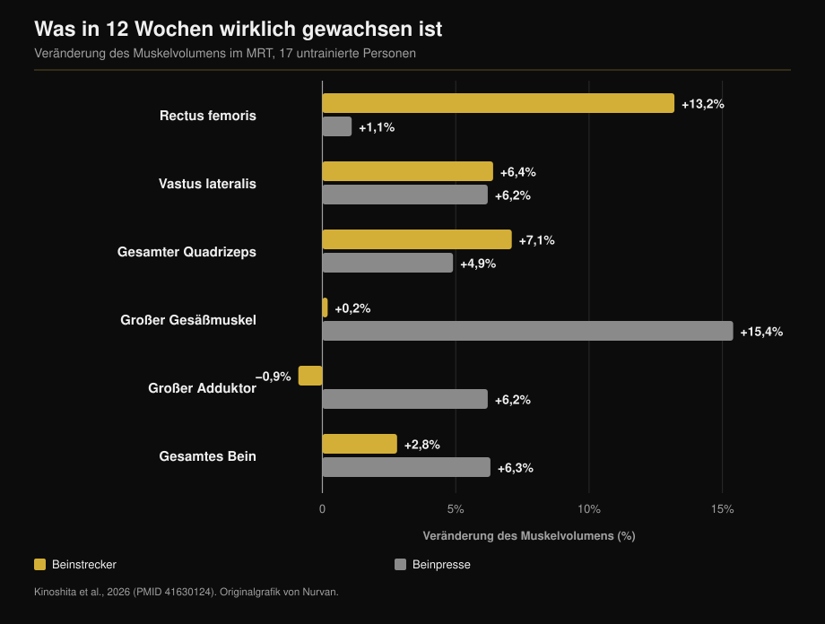
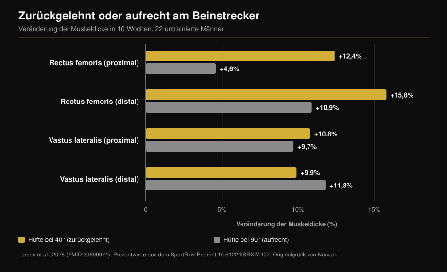

# Beinstrecker oder Beinpresse: Was wirklich wächst

Von [Giammaria Loi](/autore/giammaria-loi) · aktualisiert am 12. Oktober 2026

Zwei Posts im Abstand von einem Monat sagen dasselbe aus zwei Richtungen: Der Beinstrecker ist keine Abschlussübung, sondern die einzige Möglichkeit, einen Teil des Quadrizeps zu treffen, den Kniebeuge und Beinpresse auslassen. Der erste liefert die Zahlen einer MRT-Studie und hat recht. Der zweite ergänzt einen Trick — zurücklehnen — und eine Zahl, die in der zitierten Studie nicht vorkommt. Hier sind beide Aussagen geprüft, plus die Angabe, die in beiden Posts fehlt: was die Beinpresse aufbaut und der Beinstrecker nie erreicht.

## Kurz gefasst

- **Der Rectus femoris wächst am Beinstrecker, nicht an der Beinpresse.** +13,2 % Muskelvolumen gegenüber +1,1 % in zwölf Wochen, Muskel für Muskel im MRT gemessen (Kinoshita et al., 2026). An der Beinpresse ist die Veränderung nicht einmal von null zu unterscheiden.
- **Der Quadrizeps als Ganzes wuchs aber gleich stark**: +7,1 % gegenüber +4,9 %, kein signifikanter Unterschied. Die drei Vasti machen rund 85 % des Quadrizepsvolumens aus, und beide Übungen trainieren sie gleich.
- **Die Zahl, die in keinem Post steht**: Die Beinpresse ließ den großen Gesäßmuskel um 15,4 % und den großen Adduktor um 6,2 % wachsen — Muskeln, die der Beinstrecker gar nicht erreicht. Gesamtes Beinmuskelvolumen: +6,3 % gegenüber +2,8 %.
- **Die „+73 % durch Zurücklehnen" stehen nicht in der zitierten Studie.** Diese Studie ist von 2025 und lief zehn Wochen, nicht 2021 und zwölf. Ihre echten Zahlen: +12,4 % gegenüber +4,6 % am proximalen Rectus femoris und **gar kein Unterschied** am Vastus lateralis.
- **„Länger ist besser" ist kein Gesetz.** An der Beinpresse selbst änderte ein größerer Bewegungsumfang im Knie bei Trainierten nichts.

## Der Muskel, den die Beinpresse nicht trainiert

Die Studie hinter beiden Posts erschien in *Medicine & Science in Sports & Exercise*. Siebzehn untrainierte Erwachsene trainierten zwölf Wochen lang ein Bein am Beinstrecker und das andere an der Beinpresse: gleiche relative Last (70 % des Maximums), fünf Sätze à zehn Wiederholungen, zwei Einheiten pro Woche. Am Ende MRT von siebzehn einzelnen Hüft- und Oberschenkelmuskeln (Kinoshita et al., 2026).

Der Rectus femoris — der Kopf, der mittig über den Oberschenkel läuft — wuchs am Beinstrecker um **13,2 %** und an der Beinpresse um **1,1 %**. Die zweite Zahl ist kein kleiner Zuwachs, sondern gar keiner (p = 0,379).

Ein zweites Experiment derselben Arbeit maß die Muskelaktivierung während beider Übungen. Der Rectus femoris arbeitet am Beinstrecker bei **38,0 %** seiner maximalen Aktivierung, an der Beinpresse bei **21,7 %**. Beim großen Gesäßmuskel ist es umgekehrt: 8,8 % gegenüber 41,2 %.

Auch der Hinweis auf Radfahrer stimmt. Im Vergleich von acht Wettkampfradfahrern mit zehn untrainierten Männern waren die eingelenkigen Oberschenkelmuskeln deutlich größer; die zweigelenkigen, Rectus femoris eingeschlossen, waren **so groß wie bei Untrainierten**. Sechs Monate Wettkampfsaison änderten daran nichts (Ema et al., 2015).

## Warum: ein Muskel über zwei Gelenke

Der Rectus femoris ist der einzige der vier Quadrizepsköpfe, der am Becken entspringt: Er überquert Hüfte und Knie. An der Hüfte beugt er, am Knie streckt er. An der Beinpresse — wie bei der Kniebeuge und beim Radfahren — strecken sich Hüfte und Knie gleichzeitig, der Rectus femoris müsste also am Knie in die eine und an der Hüfte in die andere Richtung ziehen. Die Autoren sprechen von einem Konflikt der Drehmomente, und gemessen wurde: Der Muskel wird schlicht weniger aktiviert.

Hier braucht der Post eine Korrektur. Er führt das Phänomen auf die Längenänderung zurück. Die gemessene Größe ist aber nicht der Bewegungsumfang, sondern die Aktivierung. Der Unterschied zählt, denn die Lösung heißt „eine Übung, bei der die Hüfte stillsteht" und nicht „mehr Dehnung".

Dasselbe Muster zeigt sich anderswo: In dieser Studie wuchs die ebenfalls zweigelenkige ischiocrurale Muskulatur nur um 1,5 bis 3,1 %, gegenüber 12 bis 19 % bei direktem Training am Beinbeuger.

## Die Angabe, die beiden Posts fehlt

Wer beim Rectus femoris stehen bleibt, hält die Sache für klar. Der Rest derselben Studie sagt etwas anderes.

Die drei Vasti wuchsen in beiden Bedingungen fast gleich (+5,0 bis 7,2 % gegenüber +4,4 bis 6,2 %). Der **gesamte Quadrizeps** wuchs am Beinstrecker um 7,1 % und an der Beinpresse um 4,9 %: kein signifikanter Unterschied. Der Grund ist Arithmetik, und der Volltext nennt ihn: Die Vasti machen etwa 85 % des Quadrizepsvolumens aus, der Rectus femoris kaum ein Zehntel. +13 % auf ein Zehntel verschieben die Summe wenig.

Außerhalb des Quadrizeps gewinnt die Beinpresse klar: **großer Gesäßmuskel +15,4 %** (Beinstrecker: +0,2 %), **großer Adduktor +6,2 %** (Beinstrecker: −0,9 %), gesamtes Beinmuskelvolumen **+6,3 % gegenüber +2,8 %**.

Es geht also nicht darum, welche Übung besser ist. Sie bauen Unterschiedliches auf, und nur eine erreicht den Rectus femoris.

## Zurücklehnen: richtige Idee, falsche Zahl

Der zweite Post empfiehlt, sich anzulehnen statt aufrecht zu sitzen, und zitiert „eine Studie von 2021, 12 Wochen, 73 % mehr Wachstum des Rectus femoris". Die Quelle, die der Post selbst angibt, widerspricht ihm: Es ist die Arbeit von Larsen und Kollegen, online im Dezember 2024 im *Journal of Sports Sciences* erschienen und im Jahrgang 2025 gedruckt, und sie lief **zehn Wochen**, nicht zwölf. Zweiundzwanzig untrainierte Männer, zwei Einheiten pro Woche, ein Bein bei 40° Hüftbeugung (Oberkörper zurückgelehnt), das andere bei 90° (aufrecht).

Die 73 % stehen nirgends in der Arbeit. Die Analyse ist bayesianisch und berichtet Effekte in Millimetern und Bayes-Faktoren, keine prozentualen Unterschiede. Die veröffentlichten Zahlen: proximaler Rectus femoris **+12,4 %** bei 40° gegenüber **+4,6 %** bei 90°; distaler Rectus femoris **+15,8 %** gegenüber **+10,9 %**.

Beim Vastus lateralis zeigt die Evidenz in die andere Richtung: BF = 0,07, also starke Evidenz dafür, dass es **keinen Unterschied** gibt (+10,8 % gegenüber +9,7 % proximal, +9,9 % gegenüber +11,8 % distal).

Das ist plausibel: Zurücklehnen verlängert den Rectus femoris, weil er als Einziger die Hüfte überquert. Die drei Vasti entspringen am Oberschenkelknochen, ihre Länge ändert sich kein Stück — und entsprechend wuchsen sie nicht stärker. Der Trick funktioniert also, aber an einem von vier Köpfen. Zu sagen, er lasse „den Quadrizeps" um 73 % stärker wachsen, deckt die Datenlage nicht.

Ein Detail macht beide Posts zu einer Einheit: In der Beinpressen-Studie war die Hüfte in beiden Übungen auf **90°** fixiert, die ungünstigste Position für den Rectus femoris — und der Beinstrecker gewann trotzdem 13,2 zu 1,1. Die Autoren schreiben selbst, dass ein offenerer Hüftwinkel vermutlich mehr Wachstum gebracht hätte.

## „Länger ist besser" ist kein Gesetz

Die Schlusszeile des ersten Posts — Training bei großer Muskellänge scheint zu helfen — wird am häufigsten zitiert und am häufigsten missverstanden.

Wo sich die Länge wirklich ändert, funktioniert es. Beinbeuger sitzend statt bäuchlings trainiert, also mit gebeugter Hüfte, ergab +14 % Volumen gegenüber +9 % (Maeo et al., 2021).

Wo sie sich kaum ändert, passiert nichts. Larsens eigene Gruppe ließ dreiundzwanzig **trainierte** Personen (im Schnitt sieben Jahre Erfahrung) acht Wochen lang Beinpresse machen, ein Bein bis 100° Kniebeugung, das andere bis 154°: Evidenz von „moderat" bis „extrem" für das **Fehlen** eines Unterschieds, mit Dickenzuwächsen von 1,08 bis 1,91 mm in beiden Bedingungen (Larsen et al., 2025).

Und eine bayesianische Meta-Analyse von zwölf Studien zur mittleren Muskellänge findet **vernachlässigbare** Effekte auf das regionale Wachstumsprofil: 0,05 proximal, 0,07 am Muskelbauch, 0,09 distal, standardisiert (Varović et al., 2025).

Die brauchbare Regel lautet nicht „immer dehnen", sondern: Länge zählt dort, wo sie sich wirklich ändert — und das tut sie vor allem bei zweigelenkigen Muskeln.

## Was die Forschung wirklich sagt

| Aussage der Posts | Urteil | Die Datenlage |
|---|---|---|
| Beinstrecker +13,2 % Rectus femoris, Beinpresse +1,1 % | **Bestätigt** | Wörtlich, per MRT, über 12 Wochen (Kinoshita, 2026) |
| Radfahrer haben einen untrainierten Rectus femoris | **Bestätigt** | 8 Radfahrer vs. 10 Untrainierte, keine Änderung in 6 Monaten (Ema, 2015) |
| Ursache ist die geringe Längenänderung | **Zu präzisieren** | Gemessen wurde die Aktivierung: 38,0 % vs. 21,7 % des maximalen EMG |
| „Studie von 2021, 12 Wochen" | **Falsch** | 2024/2025 veröffentlicht, Dauer 10 Wochen (Larsen, 2025) |
| „+73 % mehr Wachstum durch Zurücklehnen" | **Nicht überprüfbar** | Die Arbeit nennt keine prozentualen Unterschiede: +12,4 % vs. +4,6 % |
| Zurücklehnen reizt „den Quadrizeps" stärker | **Zu präzisieren** | Nur den Rectus femoris. Vastus lateralis: BF = 0,07, kein Unterschied |
| Training bei großer Länge hilft | **Zu präzisieren** | Ja bei zweigelenkigen Muskeln; nein an der Beinpresse bei Trainierten (Larsen, 2025) |

## So setzt du es um

1. **Nicht auswählen: beides behalten.** Beinpresse (oder Kniebeuge) liefert Vasti, Gesäß und Adduktoren in einer Bewegung. Der Beinstrecker ist der einzige belegte Weg zum Rectus femoris.
2. **Zwei bis drei Sätze Beinstrecker pro Bein am Beintag** reichen, um die Lücke zu schließen. Sie ersetzen die schwere Arbeit nicht, sie ergänzen sie.
3. **Lässt sich die Rückenlehne verstellen, lehne sie zurück.** Die Studie verglich 40° mit 90° Hüftbeugung. Ist sie fix, nimm den Oberkörper so weit zurück, wie es das Gerät erlaubt, ohne das Becken abzuheben.
4. **Erwarte keine Veränderung des Oberschenkelumfangs.** Es geht um einen von vier Köpfen. Der bessere Grund: Der Rectus femoris ist der Teil des Quadrizeps, der am häufigsten zerrt.
5. **Wer vom Rad, vom Rudern oder vom Laufen kommt**, ist genau der Fall aus der Radfahrer-Studie: trainierte Oberschenkel und ein Rectus femoris, der seit Jahren stillsteht.

> **Nurvan — prüfe, was dein Programm wirklich trainiert**
>
> In Nurvan ist jede Übung der Bibliothek mit den Muskeln verknüpft, die sie trainiert. So siehst du sofort, ob ein Plan voller Kniebeugen und Beinpresse den Rectus femoris auslässt; das Last- und RIR-Tracking zeigt dir dann, ob deine Beinstrecker-Sätze fortschreiten oder nur stattfinden. Importierst du einen Plan aus PDF, Tabelle oder Foto, läuft die Prüfung automatisch.
>
> **[Nurvan testen](/)**

## Häufige Fragen

**Brauche ich den Beinstrecker, wenn ich schon Kniebeuge und Beinpresse mache?**
Ja, und nur dafür ist er da. Vasti, Gesäß und Adduktoren sind abgedeckt, der Rectus femoris nicht. In der MRT-Studie wuchs er an der Beinpresse um 1,1 % — statistisch nicht von null zu unterscheiden.

**Wie weit soll ich mich zurücklehnen?**
Die Studie verglich 40° und 90° Hüftbeugung: 40° heißt deutlich zurückgelehnt, nicht nur angelehnt. In der Praxis so weit, wie es das Gerät erlaubt, solange das Becken auf der Sitzfläche bleibt.

**Ist der Beinstrecker schlecht für die Knie?**
Die hier zitierten Studien maßen Muskelwachstum, nicht Gelenkschmerz — sie können das nicht beantworten. Wenn du während oder nach der Übung Knieschmerzen spürst, geht es nicht um die Übung an sich, sondern um deine Situation: Sprich darüber mit einer Ärztin, einem Arzt oder einer Physiotherapeutin, bevor du weitermachst.

**Trainiert die Kniebeuge den Rectus femoris?**
Die verfügbaren Daten sagen nein, aus demselben Grund wie bei der Beinpresse: Hüfte und Knie strecken gleichzeitig. Die Autoren merken an, dass weder freie Kniebeuge noch Multipresse Wachstum des Rectus femoris erzeugt haben.

## Lies auch

- [Wie viele Wiederholungen für Muskelaufbau: der 8-12-Mythos](/de/blog/wie-viele-wiederholungen-muskelaufbau) — wie viele Sätze und wie viel Pause um diese Übungen herum.
- [Trainingssplit: Anfänger oder Fortgeschrittene](/de/blog/trainingssplit-anfaenger-fortgeschrittene) — wo Isolationsarbeit in die Woche passt.
- [Ektomorph oder mesomorph: entscheidet der Körpertyp über den Muskelaufbau?](/de/blog/koerpertyp-ektomorph-mesomorph-muskelaufbau) — wie viel die Ausgangsstatur wiegt.

## Quellen

1. Kinoshita M, Maeo S, Kobayashi Y, et al., 2026. Hypertrophic Effects of Single- versus Multi-Joint Exercise: A Direct Comparison between Knee Extension and Leg Press. *Medicine and Science in Sports and Exercise* 58(7):1566-1580. PMID 41630124 — [DOI](https://doi.org/10.1249/MSS.0000000000003957)
2. Larsen S, Sandvik Kristiansen B, Swinton PA, et al., 2025. The effects of hip flexion angle on quadriceps femoris muscle hypertrophy in the leg extension exercise. *Journal of Sports Sciences* 43(2):210-221. PMID 39699974 — [DOI](https://doi.org/10.1080/02640414.2024.2444713). Prozentwerte aus dem Preprint derselben Studie auf [SportRxiv](https://doi.org/10.51224/SRXIV.407)
3. Ema R, Wakahara T, Yanaka T, et al., 2015. Unique muscularity in cyclists' thigh and trunk. *Scandinavian Journal of Medicine & Science in Sports* 26(7):782-793. PMID 26148051 — [DOI](https://doi.org/10.1111/sms.12511)
4. Maeo S, Huang M, Wu Y, et al., 2021. Greater Hamstrings Muscle Hypertrophy but Similar Damage Protection after Training at Long versus Short Muscle Lengths. *Medicine and Science in Sports and Exercise* 53(4):825-837. PMID 33009197 — [DOI](https://doi.org/10.1249/MSS.0000000000002523)
5. Larsen S, Wolf M, Schoenfeld BJ, et al., 2025. Knee flexion range of motion does not influence muscle hypertrophy of the quadriceps femoris during leg press training in resistance-trained individuals. *Journal of Sports Sciences* 43(10):986-994. PMID 40113586 — [DOI](https://doi.org/10.1080/02640414.2025.2481534)
6. Varović D, Wolf M, Schoenfeld BJ, et al., 2025. Does Muscle Length Influence Regional Hypertrophy? A Systematic Review and Meta-Analysis. *International Journal of Sports Medicine* 46(14):1027-1036. PMID 40570881 — [DOI](https://doi.org/10.1055/a-2615-4935)
7. Varović D, Zganjer K, Wolf M, et al., 2025. The effects of long muscle length isometric versus full range of motion isotonic training on regional quadriceps femoris hypertrophy in resistance-trained individuals. *Applied Physiology, Nutrition, and Metabolism* 50:1-14. PMID 40911904 — [DOI](https://doi.org/10.1139/apnm-2025-0238)

Metadaten und Abstracts der Studien über PubMed abgerufen.

Ausgangspunkt: die Posts von [William Wallace (@dr.williamwallace)](https://www.instagram.com/p/Dcyi6zGkUig/) und [@iwannaburnfat](https://www.instagram.com/p/Dd9XGVUCCy9/). Kein Text und kein Bild aus diesen Posts wurde übernommen.

---

*Giammaria Loi ist der Gründer von Nurvan. Er trainiert seit 2012 mit Gewichten, arbeitet seit 2013 als FIPE-zertifizierter Personal Trainer und Coach und startet seit 2018 auf nationaler Ebene im Powerlifting. Jeder Artikel, den er zeichnet, beginnt bei den Studien und endet bei dem, was im Gym wirklich funktioniert.*

> Hinweis: informativer Inhalt. Er ersetzt nicht die Einschätzung einer Ärztin, eines Arztes oder einer qualifizierten Fachperson.
