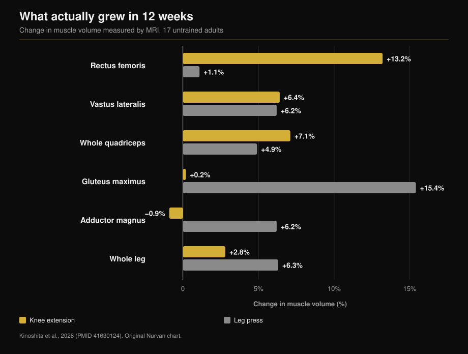
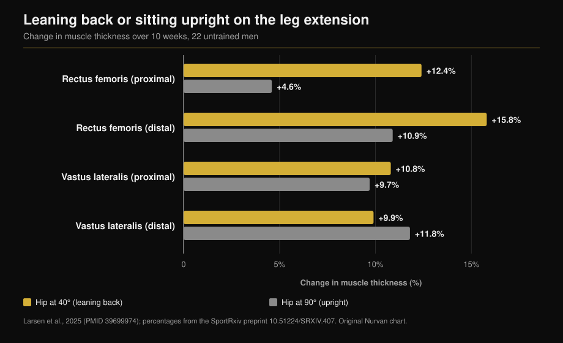

# Leg extension vs leg press: what actually grows

By [Giammaria Loi](/autore/giammaria-loi) · updated 12 October 2026

Two posts a month apart make the same case from different angles: the leg extension is not a finishing exercise, it is the only way to train a piece of quadriceps that squats and leg presses skip. The first one brings numbers from an MRI study, and it holds up. The second adds a trick — lean back — and a number that does not exist in the study it cites. Here is both claims checked, plus the data neither post mentions: what the leg press grows that the leg extension never touches.

## The short version

- **The rectus femoris grows with the leg extension and not with the leg press.** +13.2% muscle volume versus +1.1% over twelve weeks, measured muscle by muscle on MRI (Kinoshita et al., 2026). The leg press change is not even statistically different from zero.
- **But the quadriceps as a whole grew the same**: +7.1% versus +4.9%, no significant difference. The three vasti make up roughly 85% of quadriceps volume, and both exercises train them equally.
- **The number neither post reports**: the leg press grew the gluteus maximus by 15.4% and the adductor magnus by 6.2%, muscles the leg extension left untouched. Total leg muscle volume: +6.3% versus +2.8%.
- **The "+73% from leaning back" is not in the cited study.** That study is from 2025 and ran ten weeks, not 2021 and twelve. Its actual numbers: +12.4% versus +4.6% on the proximal rectus femoris, and **no difference at all** on the vastus lateralis.
- **"Longer is better" is not a law.** In the leg press itself, in trained lifters, widening the knee range of motion changed nothing.

## The muscle the leg press does not train

The study behind both posts was published in *Medicine & Science in Sports & Exercise*. Seventeen untrained adults trained one leg on the knee extension machine and the other on the leg press for twelve weeks: same relative load (70% of one-rep max), five sets of ten, twice a week. At the end, MRI of seventeen individual hip and thigh muscles, measured one by one (Kinoshita et al., 2026).

The rectus femoris — the head that runs down the middle of the thigh — grew **13.2%** with knee extensions and **1.1%** with the leg press. The second figure is not a small gain. It is a gain that is not there (p = 0.379).

A second experiment in the same paper measured muscle excitation during both lifts. The rectus femoris works at **38.0%** of its maximum activation in the knee extension and **21.7%** in the leg press. The gluteus maximus runs the opposite way: 8.8% versus 41.2%.

The cycling point in the post is also correct. Comparing eight competitive cyclists with ten untrained men, the single-joint thigh muscles were clearly bigger; the two-joint ones, rectus femoris included, were **the same size as in untrained men**. Six months of competitive training did not change them (Ema et al., 2015).

## Why: a muscle that crosses two joints

The rectus femoris is the only one of the four quadriceps heads that starts on the pelvis: it crosses the hip and the knee. It flexes the hip and extends the knee. In the leg press — and the squat, and cycling — hip and knee extend together, so the rectus femoris would have to pull one way at the knee and the opposite way at the hip. The authors call it a conflict of joint moments, and what they measured is that the muscle simply gets activated less.

This is where the post needs a correction. It blames how much the muscle changes length. The measured variable in the study is not excursion: it is activation. The distinction matters, because it points to "you need an exercise where the hip stays still" rather than "you need more stretch".

The same pattern shows up elsewhere. In this study the hamstrings — also two-joint muscles — grew only 1.5% to 3.1%, against the 12-19% you get by training them directly on leg curls.

## The data missing from both posts

Stop at the rectus femoris and the conclusion looks obvious: leg extension beats leg press. The rest of the same study says something else.

The three vasti grew almost identically in both conditions (+5.0-7.2% versus +4.4-6.2%). The **whole quadriceps** grew 7.1% with knee extensions and 4.9% with the leg press: not a significant difference. The reason is arithmetic, and the full text spells it out: the vasti are about 85% of quadriceps volume, the rectus femoris barely a tenth. A 13% gain on a tenth of the muscle moves the total very little.

Outside the quadriceps the leg press wins outright: **gluteus maximus +15.4%** (knee extension: +0.2%), **adductor magnus +6.2%** (knee extension: −0.9%), total leg muscle volume **+6.3% versus +2.8%**.

So this is not "one exercise is better". They build different things, and only one of them reaches the rectus femoris.

## Leaning back: right idea, wrong number

The second post tells you to lie back against the pad instead of sitting upright, citing "a 2021 study, 12 weeks, 73% more rectus femoris growth". The reference the post itself attaches contradicts the post: the study is Larsen and colleagues, published online in December 2024 in the *Journal of Sports Sciences* and printed in the 2025 volume, and it ran **ten weeks**, not twelve. Twenty-two untrained men, two sessions a week, one leg at 40° of hip flexion (torso reclined) and the other at 90° (sitting upright).

The 73% does not appear in the paper. The analysis is Bayesian and reports treatment effects in millimetres and Bayes factors, not percentage differences. The published numbers are these: proximal rectus femoris **+12.4%** at 40° versus **+4.6%** at 90°; distal rectus femoris **+15.8%** versus **+10.9%**.

On the vastus lateralis the evidence points the other way: BF = 0.07, strong evidence that there is **no difference** (+10.8% versus +9.7% high on the thigh, +9.9% versus +11.8% low).

That makes sense. Leaning back lengthens the rectus femoris, because it is the only head crossing the hip. The three vasti originate on the femur; their length does not change by a millimetre, and sure enough they did not grow more. So the trick works, but on one head out of four. Saying it grows "your quads" 73% more is a promise the data does not cover.

One detail makes the two posts complementary: in the leg press study the hip was fixed at **90°** in both exercises, the worst position for the rectus femoris, and the leg extension still won 13.2 to 1.1. The authors themselves note that a more open hip angle would likely have produced more growth.

## "Longer is better" is not a law

The closing line of the first post — longer-length training seems to help — is the most quoted and the most misread.

Where the muscle really changes length, it works. Training hamstrings seated rather than prone, with the hip flexed, grew them 14% versus 9% (Maeo et al., 2021).

Where it does not, nothing happens. Larsen's own group had twenty-three **trained** lifters (seven years of training on average) press one leg to 100° of knee flexion and the other to 154° for eight weeks: evidence ranging from "moderate" to "extreme" in favour of **no difference**, with thickness gains of 1.08 to 1.91 mm in both conditions (Larsen et al., 2025).

And a Bayesian meta-analysis of twelve studies that manipulated mean muscle length found **trivial** effects on the regional growth profile: 0.05 proximally, 0.07 at mid-belly, 0.09 distally, on a standardised scale (Varović et al., 2025).

The useful rule is not "always stretch". It is: length matters where length actually changes, and it changes most in muscles that cross two joints.

## What the research actually says

| Claim in the posts | Verdict | The data |
|---|---|---|
| Knee extension +13.2% rectus femoris, leg press +1.1% | **Confirmed** | Exactly, by MRI, over 12 weeks (Kinoshita, 2026) |
| Cyclists have an untrained-sized rectus femoris | **Confirmed** | 8 cyclists vs 10 untrained, no change over 6 months (Ema, 2015) |
| The cause is limited length change | **Needs correcting** | What was measured is activation: 38.0% vs 21.7% of max EMG |
| "2021 study, 12 weeks" | **False** | Published 2024/2025, ran 10 weeks (Larsen, 2025) |
| "+73% more growth from leaning back" | **Unverifiable** | The paper reports no percentage differences: +12.4% vs +4.6% proximally |
| Leaning back stimulates "the quads" more | **Needs correcting** | Only the rectus femoris. Vastus lateralis: BF = 0.07, no difference |
| Training at long lengths helps | **Needs correcting** | Yes in two-joint muscles; no in the leg press in trained lifters (Larsen, 2025) |

## How to use this

1. **Do not choose: keep both.** The leg press (or the squat) is what buys you vasti, glutes and adductors in one movement. The leg extension is the only documented way to train the rectus femoris.
2. **Two or three sets of leg extensions per leg on leg day** are enough to cover the gap. They do not replace the heavy work, they complete it.
3. **If the backrest adjusts, recline it.** The study compared 40° against 90° of hip flexion. If it is fixed, take the torso back as far as the machine allows without lifting your hips off the seat.
4. **Do not expect your thigh circumference to change.** What changes is one head out of four, and its effect on total quadriceps volume is small. The better reason is that the rectus femoris is the part of the quadriceps most prone to strain injuries.
5. **If you come from cycling, rowing or running**, you are the case the cyclist study describes: trained thighs and a rectus femoris that has not moved in years.

> **Nurvan — see what your programme is actually training**
>
> In Nurvan every exercise in the library is mapped to the muscles it trains, so you can see at a glance whether a programme full of squats and leg presses leaves the rectus femoris uncovered; load and RIR tracking then tells you whether your leg extensions are progressing or just happening. Import a programme from a PDF, a spreadsheet or a photo and the check runs automatically.
>
> **[Try Nurvan](/)**

## Frequently asked questions

**Do I need leg extensions if I already squat and leg press?**
Yes, and that is all they are for. Vasti, glutes and adductors are already covered; the rectus femoris is not. In the MRI study it grew 1.1% with the leg press, a value statistically indistinguishable from zero.

**How far back should I lean?**
The study compared 40° and 90° of hip flexion: 40° means the torso is clearly reclined, not just resting against the pad. In practice, as far as the machine allows while your hips stay down on the seat.

**Are leg extensions bad for your knees?**
The studies here measured muscle growth, not joint pain, so they cannot answer that. If you feel knee pain during or after the exercise, the issue is not the exercise in general but your specific situation, and it is worth discussing with a doctor or physiotherapist before pushing through.

**Do squats train the rectus femoris?**
The available data say no, for the same reason as the leg press: hip and knee extend together. The study authors note that neither free-weight nor Smith machine squat training produced rectus femoris growth.

## Read next

- [How many reps build muscle: the 8-12 myth](/en/blog/how-many-reps-build-muscle) — how many sets and how much rest to put around these exercises.
- [Training split: beginner vs advanced](/en/blog/training-split-beginner-vs-advanced) — where isolation work fits in the week.
- [Ectomorph or mesomorph: does somatotype decide muscle growth?](/en/blog/somatotype-ectomorph-mesomorph-muscle-growth) — how much your starting build matters.

## Sources

1. Kinoshita M, Maeo S, Kobayashi Y, et al., 2026. Hypertrophic Effects of Single- versus Multi-Joint Exercise: A Direct Comparison between Knee Extension and Leg Press. *Medicine and Science in Sports and Exercise* 58(7):1566-1580. PMID 41630124 — [DOI](https://doi.org/10.1249/MSS.0000000000003957)
2. Larsen S, Sandvik Kristiansen B, Swinton PA, et al., 2025. The effects of hip flexion angle on quadriceps femoris muscle hypertrophy in the leg extension exercise. *Journal of Sports Sciences* 43(2):210-221. PMID 39699974 — [DOI](https://doi.org/10.1080/02640414.2024.2444713). Percentage values from the preprint of the same study on [SportRxiv](https://doi.org/10.51224/SRXIV.407)
3. Ema R, Wakahara T, Yanaka T, et al., 2015. Unique muscularity in cyclists' thigh and trunk: A cross-sectional and longitudinal study. *Scandinavian Journal of Medicine & Science in Sports* 26(7):782-793. PMID 26148051 — [DOI](https://doi.org/10.1111/sms.12511)
4. Maeo S, Huang M, Wu Y, et al., 2021. Greater Hamstrings Muscle Hypertrophy but Similar Damage Protection after Training at Long versus Short Muscle Lengths. *Medicine and Science in Sports and Exercise* 53(4):825-837. PMID 33009197 — [DOI](https://doi.org/10.1249/MSS.0000000000002523)
5. Larsen S, Wolf M, Schoenfeld BJ, et al., 2025. Knee flexion range of motion does not influence muscle hypertrophy of the quadriceps femoris during leg press training in resistance-trained individuals. *Journal of Sports Sciences* 43(10):986-994. PMID 40113586 — [DOI](https://doi.org/10.1080/02640414.2025.2481534)
6. Varović D, Wolf M, Schoenfeld BJ, et al., 2025. Does Muscle Length Influence Regional Hypertrophy? A Systematic Review and Meta-Analysis. *International Journal of Sports Medicine* 46(14):1027-1036. PMID 40570881 — [DOI](https://doi.org/10.1055/a-2615-4935)
7. Varović D, Zganjer K, Wolf M, et al., 2025. The effects of long muscle length isometric versus full range of motion isotonic training on regional quadriceps femoris hypertrophy in resistance-trained individuals. *Applied Physiology, Nutrition, and Metabolism* 50:1-14. PMID 40911904 — [DOI](https://doi.org/10.1139/apnm-2025-0238)

Study metadata and abstracts retrieved from PubMed.

Starting point: posts by [William Wallace (@dr.williamwallace)](https://www.instagram.com/p/Dcyi6zGkUig/) and [@iwannaburnfat](https://www.instagram.com/p/Dd9XGVUCCy9/). No text or image from either post has been reproduced: every claim was rewritten and checked against the primary sources.

---

*Giammaria Loi is the founder of Nurvan. He has been lifting since 2012, has worked as a FIPE-certified personal trainer and coach since 2013, and has competed in powerlifting at national level since 2018. Every article he writes starts from the research and ends with what actually works in the gym.*

> Note: educational content. It does not replace advice from a doctor or qualified professional.
