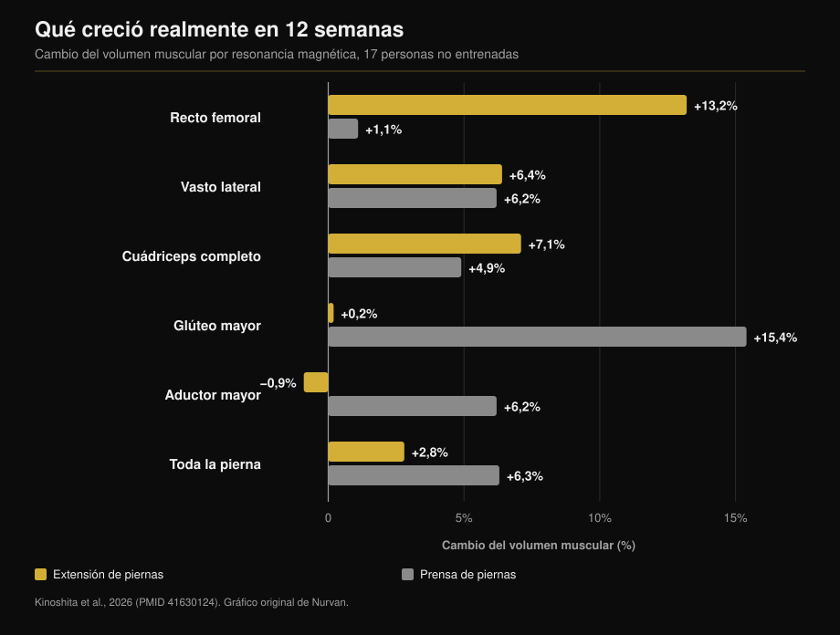
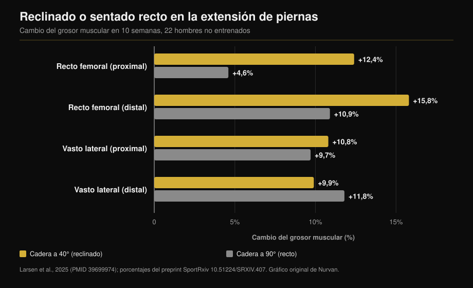

# Extensión de piernas o prensa: qué crece de verdad

Por [Giammaria Loi](/autore/giammaria-loi) · actualizado el 12 de octubre de 2026

Dos posts con un mes de diferencia defienden lo mismo desde ángulos distintos: la extensión de piernas no es un ejercicio de remate, es la única forma de entrenar una parte del cuádriceps que la sentadilla y la prensa se saltan. El primero aporta los números de un estudio con resonancia magnética, y es correcto. El segundo añade un truco —reclinarse hacia atrás— y una cifra que no existe en el estudio que cita. Aquí tienes las dos afirmaciones verificadas y el dato que falta en ambos: qué crece con la prensa y no con la extensión.

## En resumen

- **El recto femoral crece con la extensión de piernas y no con la prensa.** +13,2% de volumen muscular frente a +1,1% en doce semanas, medido músculo por músculo con resonancia (Kinoshita et al., 2026). En la prensa el cambio ni siquiera es distinguible de cero.
- **Pero el cuádriceps en conjunto creció igual**: +7,1% frente a +4,9%, sin diferencia significativa. Los tres vastos son alrededor del 85% del volumen del cuádriceps y ambos ejercicios los entrenan por igual.
- **El dato que ningún post menciona**: la prensa hizo crecer el glúteo mayor un 15,4% y el aductor mayor un 6,2%, músculos que la extensión no tocó. Volumen muscular total de la pierna: +6,3% frente a +2,8%.
- **El "+73% al reclinarse" no está en el estudio citado.** Ese estudio es de 2025 y duró diez semanas, no 2021 y doce. Sus cifras reales: +12,4% frente a +4,6% en el recto femoral proximal, y **ninguna diferencia** en el vasto lateral.
- **"Más largo es mejor" no es una ley.** En la propia prensa, con personas entrenadas, ampliar el recorrido de la rodilla no cambió nada.

## El músculo que la prensa no entrena

El estudio detrás de ambos posts se publicó en *Medicine & Science in Sports & Exercise*. Diecisiete personas no entrenadas trabajaron doce semanas con una pierna en la máquina de extensión y la otra en la prensa: misma carga relativa (70% del máximo), cinco series de diez, dos sesiones por semana. Al final, resonancia magnética de diecisiete músculos de cadera y muslo, medidos uno a uno (Kinoshita et al., 2026).

El recto femoral —la cabeza que recorre el centro del muslo— creció un **13,2%** con la extensión y un **1,1%** con la prensa. La segunda cifra no es una ganancia pequeña: es una ganancia que no existe (p = 0,379).

Un segundo experimento del mismo trabajo midió la activación eléctrica durante ambos ejercicios. El recto femoral trabaja al **38,0%** de su activación máxima en la extensión y al **21,7%** en la prensa. El glúteo mayor hace el camino contrario: 8,8% frente a 41,2%.

Lo de los ciclistas también es cierto. Comparando ocho ciclistas de competición con diez hombres no entrenados, los músculos del muslo que cruzan una sola articulación eran claramente mayores; los que cruzan dos, recto femoral incluido, eran **iguales a los de los no entrenados**. Y seis meses de temporada no los cambiaron (Ema et al., 2015).

## Por qué: un músculo que cruza dos articulaciones

El recto femoral es la única de las cuatro cabezas del cuádriceps que nace en la pelvis: cruza la cadera y la rodilla. En la cadera flexiona, en la rodilla extiende. En la prensa —y en la sentadilla, y en la bicicleta— cadera y rodilla se extienden a la vez, así que el recto femoral tendría que tirar en un sentido en la rodilla y en el contrario en la cadera. Los autores lo llaman conflicto de momentos, y lo que midieron es que el músculo simplemente se activa menos.

Aquí hay que corregir el post, que atribuye el fenómeno a cuánto cambia de longitud el músculo. La variable medida no es el recorrido: es la activación. La diferencia importa, porque la solución es "hace falta un ejercicio con la cadera quieta", no "hace falta más estiramiento".

El patrón se repite: en este estudio los isquiosurales, también biarticulares, crecieron apenas entre un 1,5% y un 3,1%, frente al 12-19% que se obtiene entrenándolos directamente en el curl femoral.

## El dato que falta en los dos posts

Si te quedas en el recto femoral, la conclusión parece obvia. El resto del mismo estudio dice otra cosa.

Los tres vastos crecieron casi igual en ambas condiciones (+5,0-7,2% frente a +4,4-6,2%). El **cuádriceps entero** creció un 7,1% con la extensión y un 4,9% con la prensa: diferencia no significativa. El motivo es aritmético y el texto completo lo explica: los vastos son cerca del 85% del volumen del cuádriceps, el recto femoral apenas una décima parte. Un +13% sobre una décima mueve poco el total.

Y fuera del cuádriceps la prensa gana sin discusión: **glúteo mayor +15,4%** (extensión: +0,2%), **aductor mayor +6,2%** (extensión: −0,9%), volumen muscular total de la pierna **+6,3% frente a +2,8%**.

No es que un ejercicio sea mejor que otro. Construyen cosas distintas, y solo uno llega al recto femoral.

## Reclinarse: la idea es buena, la cifra no

El segundo post recomienda apoyarse hacia atrás en vez de sentarse recto, citando "un estudio de 2021, 12 semanas, 73% más de crecimiento del recto femoral". La referencia que el propio post adjunta lo desmiente: es el trabajo de Larsen y colaboradores, publicado online en diciembre de 2024 en el *Journal of Sports Sciences* y en el volumen de 2025, y duró **diez semanas**, no doce. Veintidós hombres no entrenados, dos sesiones semanales, una pierna a 40° de flexión de cadera (tronco reclinado) y la otra a 90° (sentado recto).

El 73% no aparece en el trabajo. El análisis es bayesiano y reporta efectos en milímetros y factores de Bayes, no diferencias porcentuales. Las cifras publicadas son estas: recto femoral proximal **+12,4%** a 40° frente a **+4,6%** a 90°; recto femoral distal **+15,8%** frente a **+10,9%**.

En el vasto lateral la evidencia va en sentido contrario: BF = 0,07, evidencia fuerte de que **no hay diferencia** (+10,8% frente a +9,7% arriba, +9,9% frente a +11,8% abajo).

Tiene sentido: reclinarse alarga el recto femoral porque es el único que cruza la cadera. Los tres vastos nacen en el fémur y su longitud no cambia ni un milímetro; por eso no crecieron más. El truco funciona, pero sobre una cabeza de cuatro. Decir que hace crecer "los cuádriceps" un 73% más es una promesa que los datos no cubren.

Un detalle que hace complementarios a los dos posts: en el estudio de la prensa la cadera estaba fijada a **90°** en ambos ejercicios, la peor posición para el recto femoral, y aun así la extensión ganó 13,2 a 1,1. Los propios autores señalan que con la cadera más abierta el crecimiento habría sido probablemente mayor.

## "Más largo es mejor" no es una ley

La última línea del primer post —entrenar a longitudes largas parece ayudar— es la más citada y la peor entendida.

Donde el músculo cambia de longitud de verdad, funciona. Entrenando los isquiosurales sentado en lugar de tumbado boca abajo, con la cadera flexionada, el volumen creció un 14% frente a un 9% (Maeo et al., 2021).

Donde no cambia, no pasa nada. El propio grupo de Larsen puso a veintitrés personas **entrenadas** (siete años de media) a hacer prensa durante ocho semanas, una pierna hasta 100° de flexión de rodilla y la otra hasta 154°: evidencia de "moderada" a "extrema" a favor de la **ausencia** de diferencia, con aumentos de grosor de 1,08 a 1,91 mm en ambas condiciones (Larsen et al., 2025).

Y un metaanálisis bayesiano de doce estudios que manipularon la longitud media del músculo encuentra efectos **triviales** sobre el perfil de crecimiento: 0,05 proximal, 0,07 en el vientre, 0,09 distal, en escala estandarizada (Varović et al., 2025).

La regla útil no es "estira siempre". Es: la longitud importa cuando cambia de verdad, y cambia sobre todo en los músculos que cruzan dos articulaciones.

## Qué dice realmente la investigación

| Afirmación de los posts | Veredicto | El dato |
|---|---|---|
| Extensión +13,2% recto femoral, prensa +1,1% | **Confirmado** | Literal, por resonancia, 12 semanas (Kinoshita, 2026) |
| Los ciclistas tienen el recto femoral como los no entrenados | **Confirmado** | 8 ciclistas frente a 10 no entrenados, sin cambios en 6 meses (Ema, 2015) |
| La causa es cuánto cambia de longitud | **A matizar** | Lo medido es la activación: 38,0% frente a 21,7% del EMG máximo |
| "Estudio de 2021, 12 semanas" | **Falso** | Publicado en 2024/2025, duró 10 semanas (Larsen, 2025) |
| "+73% más de crecimiento al reclinarse" | **No verificable** | El trabajo no reporta diferencias porcentuales: +12,4% frente a +4,6% |
| Reclinarse estimula más "los cuádriceps" | **A matizar** | Solo el recto femoral. Vasto lateral: BF = 0,07, sin diferencia |
| Entrenar en longitudes largas ayuda | **A matizar** | Sí en biarticulares; no en la prensa con entrenados (Larsen, 2025) |

## Cómo aplicarlo

1. **No elijas: quédate con los dos.** La prensa (o la sentadilla) te da vastos, glúteos y aductores en un solo movimiento. La extensión es la única forma documentada de entrenar el recto femoral.
2. **Dos o tres series de extensión por pierna en el día de piernas** bastan para cubrir el hueco. No sustituyen el trabajo pesado: lo completan.
3. **Si el respaldo se regula, recuéstalo.** El estudio comparó 40° frente a 90° de flexión de cadera. Si es fijo, lleva el tronco atrás todo lo que la máquina permita sin despegar la cadera del asiento.
4. **No esperes que cambie el perímetro del muslo.** Cambia una cabeza de cuatro. La mejor razón para entrenarla es que el recto femoral es la parte del cuádriceps que más se lesiona.
5. **Si vienes del ciclismo, el remo o la carrera**, eres exactamente el caso del estudio de los ciclistas: muslos entrenados y un recto femoral parado desde hace años.

> **Nurvan — comprueba qué está entrenando de verdad tu programa**
>
> En Nurvan cada ejercicio de la biblioteca está vinculado a los músculos que entrena, así ves de un vistazo si una rutina llena de sentadillas y prensa deja el recto femoral sin cubrir; y el seguimiento de cargas y RIR te dice si tus extensiones progresan o solo se hacen. Si importas una rutina desde PDF, Excel o una foto, la comprobación es automática.
>
> **[Prueba Nurvan](/)**

## Preguntas frecuentes

**¿Necesito extensiones si ya hago sentadilla y prensa?**
Sí, y solo sirven para eso. Vastos, glúteos y aductores ya están cubiertos; el recto femoral no. En el estudio con resonancia creció un 1,1% con la prensa, un valor indistinguible de cero.

**¿Cuánto debo reclinarme?**
El estudio comparó 40° y 90° de flexión de cadera: 40° significa tronco claramente echado hacia atrás, no solo apoyado. En la práctica, lo que permita la máquina manteniendo la cadera pegada al asiento.

**¿La extensión de piernas daña las rodillas?**
Los estudios citados medían crecimiento muscular, no dolor articular: no pueden responder. Si notas dolor de rodilla durante o después del ejercicio, el problema no es el ejercicio en general sino tu situación concreta, y conviene comentarlo con un médico o un fisioterapeuta antes de insistir.

**¿La sentadilla entrena el recto femoral?**
Los datos disponibles dicen que no, por el mismo motivo que la prensa: cadera y rodilla se extienden a la vez. Los autores señalan que ni la sentadilla libre ni la multipower produjeron crecimiento del recto femoral.

## Lee también

- [Cuántas repeticiones para la masa muscular: el mito del 8-12](/es/blog/cuantas-repeticiones-masa-muscular) — cuántas series y cuánto descanso poner alrededor de estos ejercicios.
- [Rutina de entrenamiento: principiante o avanzado](/es/blog/rutina-entrenamiento-principiante-avanzado) — dónde colocar el trabajo de aislamiento en la semana.
- [¿Ectomorfo o mesomorfo? El somatotipo y la masa muscular](/es/blog/somatotipo-ectomorfo-mesomorfo-masa-muscular) — cuánto pesa tu estructura de partida.

## Fuentes

1. Kinoshita M, Maeo S, Kobayashi Y, et al., 2026. Hypertrophic Effects of Single- versus Multi-Joint Exercise: A Direct Comparison between Knee Extension and Leg Press. *Medicine and Science in Sports and Exercise* 58(7):1566-1580. PMID 41630124 — [DOI](https://doi.org/10.1249/MSS.0000000000003957)
2. Larsen S, Sandvik Kristiansen B, Swinton PA, et al., 2025. The effects of hip flexion angle on quadriceps femoris muscle hypertrophy in the leg extension exercise. *Journal of Sports Sciences* 43(2):210-221. PMID 39699974 — [DOI](https://doi.org/10.1080/02640414.2024.2444713). Porcentajes tomados del preprint del mismo estudio en [SportRxiv](https://doi.org/10.51224/SRXIV.407)
3. Ema R, Wakahara T, Yanaka T, et al., 2015. Unique muscularity in cyclists' thigh and trunk. *Scandinavian Journal of Medicine & Science in Sports* 26(7):782-793. PMID 26148051 — [DOI](https://doi.org/10.1111/sms.12511)
4. Maeo S, Huang M, Wu Y, et al., 2021. Greater Hamstrings Muscle Hypertrophy but Similar Damage Protection after Training at Long versus Short Muscle Lengths. *Medicine and Science in Sports and Exercise* 53(4):825-837. PMID 33009197 — [DOI](https://doi.org/10.1249/MSS.0000000000002523)
5. Larsen S, Wolf M, Schoenfeld BJ, et al., 2025. Knee flexion range of motion does not influence muscle hypertrophy of the quadriceps femoris during leg press training in resistance-trained individuals. *Journal of Sports Sciences* 43(10):986-994. PMID 40113586 — [DOI](https://doi.org/10.1080/02640414.2025.2481534)
6. Varović D, Wolf M, Schoenfeld BJ, et al., 2025. Does Muscle Length Influence Regional Hypertrophy? A Systematic Review and Meta-Analysis. *International Journal of Sports Medicine* 46(14):1027-1036. PMID 40570881 — [DOI](https://doi.org/10.1055/a-2615-4935)
7. Varović D, Zganjer K, Wolf M, et al., 2025. The effects of long muscle length isometric versus full range of motion isotonic training on regional quadriceps femoris hypertrophy in resistance-trained individuals. *Applied Physiology, Nutrition, and Metabolism* 50:1-14. PMID 40911904 — [DOI](https://doi.org/10.1139/apnm-2025-0238)

Metadatos y resúmenes de los estudios obtenidos de PubMed.

Punto de partida: los posts de [William Wallace (@dr.williamwallace)](https://www.instagram.com/p/Dcyi6zGkUig/) y [@iwannaburnfat](https://www.instagram.com/p/Dd9XGVUCCy9/). No se ha reproducido ningún texto ni imagen de los posts.

---

*Giammaria Loi es el fundador de Nurvan. Entrena con pesas desde 2012, trabaja como entrenador personal y coach certificado por la FIPE desde 2013 y compite en powerlifting a nivel nacional desde 2018. Cada artículo que firma parte de los estudios científicos y llega a lo que funciona de verdad en el gimnasio.*

> Nota: contenido informativo. No sustituye la opinión de un médico o profesional cualificado.
