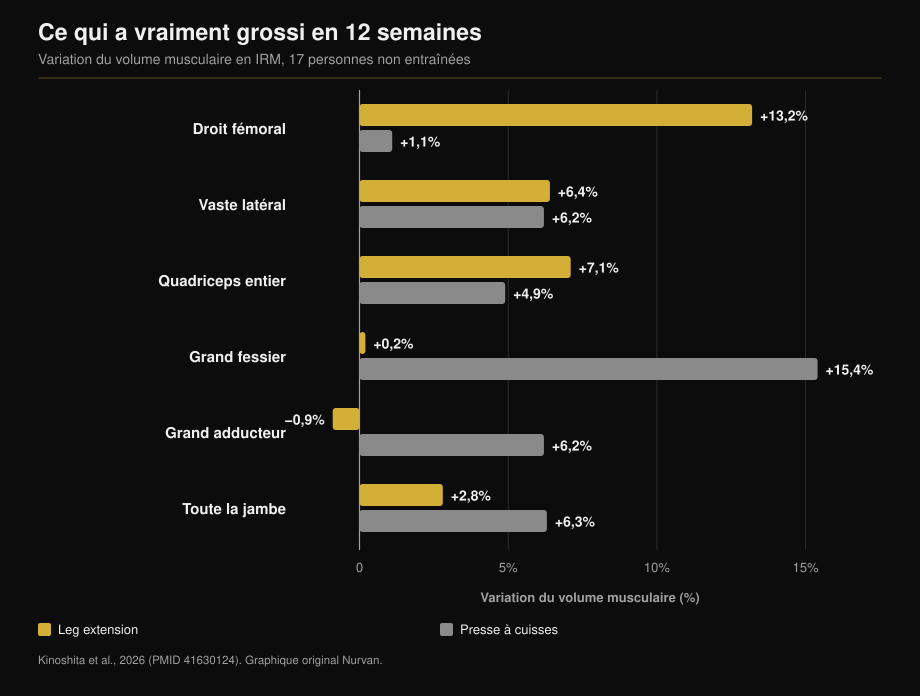
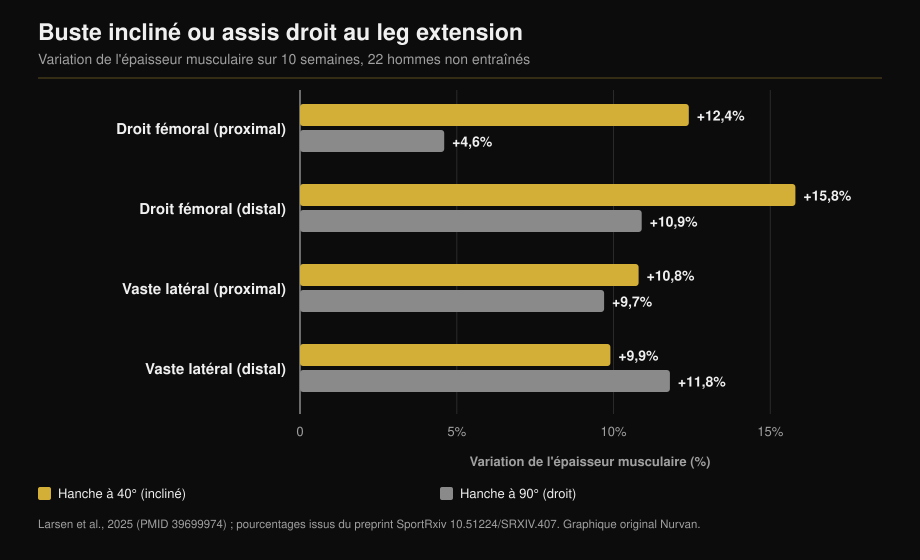

# Leg extension ou presse à cuisses : qu'est-ce qui grossit vraiment

Par [Giammaria Loi](/autore/giammaria-loi) · mis à jour le 12 octobre 2026

Deux posts publiés à un mois d'intervalle défendent la même idée sous deux angles : le leg extension n'est pas un exercice de finition, c'est le seul moyen de travailler une portion de quadriceps que le squat et la presse ignorent. Le premier avance les chiffres d'une étude IRM, et il a raison. Le second ajoute une astuce — s'incliner en arrière — et un chiffre qui n'existe pas dans l'étude citée. Voici les deux affirmations vérifiées, et la donnée qui manque aux deux : ce que la presse fait grossir et que le leg extension ne touche pas.

## L'essentiel

- **Le droit fémoral grossit au leg extension et pas à la presse.** +13,2 % de volume contre +1,1 % en douze semaines, mesuré muscle par muscle à l'IRM (Kinoshita et al., 2026). À la presse, la variation n'est même pas distinguable de zéro.
- **Mais le quadriceps entier a grossi pareil** : +7,1 % contre +4,9 %, différence non significative. Les trois vastes représentent environ 85 % du volume du quadriceps, et les deux exercices les travaillent autant.
- **La donnée absente des deux posts** : la presse a fait grossir le grand fessier de 15,4 % et le grand adducteur de 6,2 %, muscles auxquels le leg extension n'a rien fait. Volume musculaire total de la jambe : +6,3 % contre +2,8 %.
- **Le « +73 % en s'inclinant » n'est pas dans l'étude citée.** Cette étude date de 2025 et dure dix semaines, pas 2021 et douze. Ses vrais chiffres : +12,4 % contre +4,6 % sur le droit fémoral proximal, et **aucune différence** sur le vaste latéral.
- **« Plus long, c'est mieux » n'est pas une loi.** À la presse, chez des pratiquants entraînés, élargir l'amplitude du genou n'a rien changé.

## Le muscle que la presse ne travaille pas

L'étude derrière les deux posts est parue dans *Medicine & Science in Sports & Exercise*. Dix-sept personnes non entraînées ont travaillé douze semaines, une jambe au leg extension et l'autre à la presse : même charge relative (70 % du maximum), cinq séries de dix, deux séances par semaine. À l'arrivée, IRM de dix-sept muscles de la hanche et de la cuisse, mesurés un par un (Kinoshita et al., 2026).

Le droit fémoral — le chef qui descend au milieu de la cuisse — a grossi de **13,2 %** au leg extension et de **1,1 %** à la presse. Le second chiffre n'est pas un petit gain : c'est un gain inexistant (p = 0,379).

Une seconde expérience du même travail a mesuré l'activation électrique pendant les deux exercices. Le droit fémoral travaille à **38,0 %** de son activation maximale au leg extension et à **21,7 %** à la presse. Le grand fessier fait l'inverse : 8,8 % contre 41,2 %.

Sur les cyclistes aussi, le post dit juste. En comparant huit cyclistes de compétition à dix hommes non entraînés, les muscles de cuisse mono-articulaires étaient nettement plus gros ; les bi-articulaires, droit fémoral compris, étaient **identiques à ceux des non-entraînés**. Et six mois de saison ne les ont pas modifiés (Ema et al., 2015).

## Pourquoi : un muscle qui croise deux articulations

Le droit fémoral est le seul des quatre chefs du quadriceps à partir du bassin : il croise la hanche et le genou. Il fléchit la hanche et étend le genou. À la presse — comme au squat et à vélo — hanche et genou s'étendent ensemble : le droit fémoral devrait tirer dans un sens au genou et dans l'autre à la hanche. Les auteurs parlent d'un conflit de moments, et ce qu'ils mesurent, c'est que le muscle est tout simplement moins activé.

C'est là qu'il faut corriger le post, qui attribue le phénomène à la variation de longueur. La variable mesurée n'est pas l'amplitude, c'est l'activation. La nuance compte : elle oriente vers « il faut un exercice où la hanche ne bouge pas », pas vers « il faut plus d'étirement ».

Même schéma ailleurs : dans cette étude, les ischio-jambiers, eux aussi bi-articulaires, n'ont grossi que de 1,5 à 3,1 %, contre 12 à 19 % quand on les travaille directement au leg curl.

## La donnée qui manque aux deux posts

Si l'on s'arrête au droit fémoral, la conclusion semble évidente. Le reste de la même étude dit autre chose.

Les trois vastes ont grossi presque pareil dans les deux conditions (+5,0 à 7,2 % contre +4,4 à 6,2 %). Le **quadriceps entier** a pris 7,1 % au leg extension et 4,9 % à la presse : différence non significative. La raison est arithmétique, et le texte intégral la donne : les vastes pèsent environ 85 % du volume du quadriceps, le droit fémoral à peine un dixième. +13 % sur un dixième, ça ne déplace pas grand-chose.

Et hors quadriceps, la presse gagne sans discussion : **grand fessier +15,4 %** (leg extension : +0,2 %), **grand adducteur +6,2 %** (leg extension : −0,9 %), volume musculaire total de la jambe **+6,3 % contre +2,8 %**.

Ce n'est donc pas « un exercice meilleur que l'autre ». Ils construisent des choses différentes, et un seul atteint le droit fémoral.

## S'incliner en arrière : bonne idée, mauvais chiffre

Le second post conseille de s'appuyer en arrière plutôt que de rester assis droit, en citant « une étude de 2021, 12 semaines, 73 % de croissance en plus du droit fémoral ». La référence que le post joint lui-même le contredit : il s'agit du travail de Larsen et collègues, publié en ligne en décembre 2024 dans le *Journal of Sports Sciences* et paru dans le volume 2025, et il dure **dix semaines**, pas douze. Vingt-deux hommes non entraînés, deux séances par semaine, une jambe à 40° de flexion de hanche (buste incliné) et l'autre à 90° (assis droit).

Les 73 % n'apparaissent nulle part dans l'article. L'analyse est bayésienne et rapporte des effets en millimètres et des facteurs de Bayes, pas des écarts en pourcentage. Les chiffres publiés : droit fémoral proximal **+12,4 %** à 40° contre **+4,6 %** à 90° ; droit fémoral distal **+15,8 %** contre **+10,9 %**.

Sur le vaste latéral, la preuve va dans l'autre sens : BF = 0,07, c'est-à-dire une preuve forte qu'il n'y a **aucune différence** (+10,8 % contre +9,7 % en haut, +9,9 % contre +11,8 % en bas).

C'est logique : s'incliner allonge le droit fémoral, seul chef à croiser la hanche. Les trois vastes naissent sur le fémur, leur longueur ne bouge pas d'un millimètre — et ils n'ont effectivement pas grossi davantage. L'astuce marche donc, mais sur un chef sur quatre. Dire qu'elle fait grossir « les quadriceps » de 73 % de plus est une promesse que les données ne couvrent pas.

Un détail rend les deux posts complémentaires : dans l'étude sur la presse, la hanche était fixée à **90°** dans les deux exercices, la pire position pour le droit fémoral, et le leg extension l'a quand même emporté 13,2 contre 1,1. Les auteurs eux-mêmes notent qu'avec une hanche plus ouverte, la croissance aurait sans doute été supérieure.

## « Plus long, c'est mieux » n'est pas une loi

La dernière ligne du premier post — s'entraîner à longueur longue semble aider — est la plus citée et la plus mal comprise.

Là où le muscle change vraiment de longueur, ça marche. Travailler les ischio-jambiers assis plutôt qu'allongé sur le ventre, hanche fléchie, donne +14 % de volume contre +9 % (Maeo et al., 2021).

Là où il ne change pas, rien ne se passe. L'équipe de Larsen a fait travailler vingt-trois personnes **entraînées** (sept ans de pratique en moyenne) huit semaines à la presse, une jambe jusqu'à 100° de flexion de genou et l'autre jusqu'à 154° : preuve « modérée » à « extrême » en faveur de l'**absence** de différence, avec des gains d'épaisseur de 1,08 à 1,91 mm dans les deux cas (Larsen et al., 2025).

Et une méta-analyse bayésienne de douze études ayant manipulé la longueur moyenne du muscle trouve des effets **négligeables** sur le profil de croissance : 0,05 en proximal, 0,07 au ventre, 0,09 en distal, en échelle standardisée (Varović et al., 2025).

La règle utile n'est pas « allonge toujours ». C'est : la longueur compte quand elle change vraiment, et elle change surtout dans les muscles qui croisent deux articulations.

## Ce que dit vraiment la recherche

| Affirmation des posts | Verdict | La donnée |
|---|---|---|
| Leg extension +13,2 % droit fémoral, presse +1,1 % | **Confirmé** | À la lettre, à l'IRM, sur 12 semaines (Kinoshita, 2026) |
| Les cyclistes ont un droit fémoral de non-entraîné | **Confirmé** | 8 cyclistes contre 10 non-entraînés, rien en 6 mois (Ema, 2015) |
| La cause est la variation de longueur | **À préciser** | Ce qui est mesuré, c'est l'activation : 38,0 % contre 21,7 % de l'EMG max |
| « Étude de 2021, 12 semaines » | **Faux** | Publiée en 2024/2025, dure 10 semaines (Larsen, 2025) |
| « +73 % de croissance en s'inclinant » | **Non vérifiable** | L'article ne donne aucun écart en pourcentage : +12,4 % contre +4,6 % |
| S'incliner stimule plus « les quadriceps » | **À préciser** | Seulement le droit fémoral. Vaste latéral : BF = 0,07, aucune différence |
| S'entraîner en longueur longue aide | **À préciser** | Oui pour les bi-articulaires ; non à la presse chez les entraînés (Larsen, 2025) |

## Comment l'appliquer

1. **Ne choisissez pas : gardez les deux.** La presse (ou le squat) vous donne vastes, fessiers et adducteurs en un seul mouvement. Le leg extension est le seul moyen documenté de travailler le droit fémoral.
2. **Deux à trois séries de leg extension par jambe lors de la séance jambes** suffisent à combler le trou. Elles ne remplacent pas le travail lourd : elles le complètent.
3. **Si le dossier est réglable, inclinez-le.** L'étude comparait 40° et 90° de flexion de hanche. S'il est fixe, reculez le buste autant que la machine le permet sans décoller le bassin.
4. **N'attendez pas de changement de tour de cuisse.** Ce qui change, c'est un chef sur quatre. La meilleure raison de le travailler : le droit fémoral est la partie du quadriceps la plus sujette aux déchirures.
5. **Si vous venez du vélo, de l'aviron ou de la course**, vous êtes exactement le cas décrit par l'étude sur les cyclistes : des cuisses entraînées et un droit fémoral à l'arrêt depuis des années.

> **Nurvan — vérifiez ce que votre programme travaille vraiment**
>
> Dans Nurvan, chaque exercice de la bibliothèque est relié aux muscles qu'il travaille : vous voyez tout de suite si un programme plein de squats et de presse laisse le droit fémoral de côté. Le suivi des charges et du RIR vous dit ensuite si vos leg extensions progressent ou si vous les faites simplement. En important un programme depuis un PDF, un tableur ou une photo, la vérification est automatique.
>
> **[Essayer Nurvan](/)**

## Questions fréquentes

**Le leg extension sert-il si je fais déjà squat et presse ?**
Oui, et il ne sert qu'à ça. Vastes, fessiers et adducteurs sont déjà couverts ; le droit fémoral non. Dans l'étude IRM, il a pris 1,1 % à la presse, une valeur indistinguable de zéro.

**De combien faut-il s'incliner ?**
L'étude comparait 40° et 90° de flexion de hanche : 40° signifie un buste nettement basculé en arrière, pas simplement appuyé. En pratique, autant que la machine le permet en gardant le bassin plaqué sur l'assise.

**Le leg extension abîme-t-il les genoux ?**
Les études citées ici mesuraient la croissance musculaire, pas la douleur articulaire : elles ne peuvent pas répondre. Si vous ressentez une douleur au genou pendant ou après l'exercice, le problème n'est pas l'exercice en général mais votre situation, et il vaut mieux en parler à un médecin ou à un kinésithérapeute avant d'insister.

**Le squat travaille-t-il le droit fémoral ?**
Les données disponibles disent non, pour la même raison que la presse : hanche et genou s'étendent ensemble. Les auteurs relèvent que ni le squat barre libre ni le squat à la Smith n'ont produit de croissance du droit fémoral.

## À lire aussi

- [Combien de répétitions pour la masse : le mythe du 8-12](/fr/blog/combien-de-repetitions-masse-musculaire) — combien de séries et quel repos autour de ces exercices.
- [Split d'entraînement : débutant ou avancé](/fr/blog/split-entrainement-debutant-avance) — où placer le travail d'isolation dans la semaine.
- [Ectomorphe ou mésomorphe : le somatotype décide-t-il de la masse ?](/fr/blog/somatotype-ectomorphe-mesomorphe-masse-musculaire) — ce que pèse votre morphologie de départ.

## Sources

1. Kinoshita M, Maeo S, Kobayashi Y, et al., 2026. Hypertrophic Effects of Single- versus Multi-Joint Exercise: A Direct Comparison between Knee Extension and Leg Press. *Medicine and Science in Sports and Exercise* 58(7):1566-1580. PMID 41630124 — [DOI](https://doi.org/10.1249/MSS.0000000000003957)
2. Larsen S, Sandvik Kristiansen B, Swinton PA, et al., 2025. The effects of hip flexion angle on quadriceps femoris muscle hypertrophy in the leg extension exercise. *Journal of Sports Sciences* 43(2):210-221. PMID 39699974 — [DOI](https://doi.org/10.1080/02640414.2024.2444713). Pourcentages issus du preprint de la même étude sur [SportRxiv](https://doi.org/10.51224/SRXIV.407)
3. Ema R, Wakahara T, Yanaka T, et al., 2015. Unique muscularity in cyclists' thigh and trunk. *Scandinavian Journal of Medicine & Science in Sports* 26(7):782-793. PMID 26148051 — [DOI](https://doi.org/10.1111/sms.12511)
4. Maeo S, Huang M, Wu Y, et al., 2021. Greater Hamstrings Muscle Hypertrophy but Similar Damage Protection after Training at Long versus Short Muscle Lengths. *Medicine and Science in Sports and Exercise* 53(4):825-837. PMID 33009197 — [DOI](https://doi.org/10.1249/MSS.0000000000002523)
5. Larsen S, Wolf M, Schoenfeld BJ, et al., 2025. Knee flexion range of motion does not influence muscle hypertrophy of the quadriceps femoris during leg press training in resistance-trained individuals. *Journal of Sports Sciences* 43(10):986-994. PMID 40113586 — [DOI](https://doi.org/10.1080/02640414.2025.2481534)
6. Varović D, Wolf M, Schoenfeld BJ, et al., 2025. Does Muscle Length Influence Regional Hypertrophy? A Systematic Review and Meta-Analysis. *International Journal of Sports Medicine* 46(14):1027-1036. PMID 40570881 — [DOI](https://doi.org/10.1055/a-2615-4935)
7. Varović D, Zganjer K, Wolf M, et al., 2025. The effects of long muscle length isometric versus full range of motion isotonic training on regional quadriceps femoris hypertrophy in resistance-trained individuals. *Applied Physiology, Nutrition, and Metabolism* 50:1-14. PMID 40911904 — [DOI](https://doi.org/10.1139/apnm-2025-0238)

Métadonnées et résumés des études obtenus via PubMed.

Point de départ : les posts de [William Wallace (@dr.williamwallace)](https://www.instagram.com/p/Dcyi6zGkUig/) et [@iwannaburnfat](https://www.instagram.com/p/Dd9XGVUCCy9/). Aucun texte ni aucune image de ces posts n'a été reproduit.

---

*Giammaria Loi est le fondateur de Nurvan. Il s'entraîne avec des charges depuis 2012, travaille comme préparateur et coach certifié FIPE depuis 2013 et pratique le powerlifting en compétition au niveau national depuis 2018. Chaque article qu'il signe part des études scientifiques et arrive à ce qui fonctionne vraiment en salle.*

> Note : contenu informatif. Il ne remplace pas l'avis d'un médecin ou d'un professionnel qualifié.
