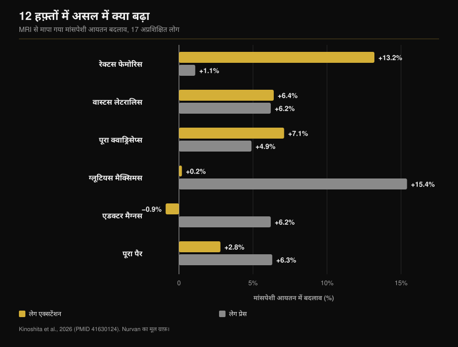
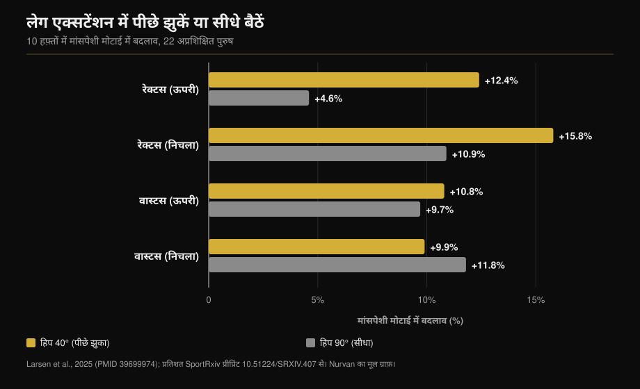

# लेग एक्सटेंशन या लेग प्रेस: असल में क्या बढ़ता है

लेखक: [Giammaria Loi](/autore/giammaria-loi) · 12 अक्टूबर 2026 को अपडेट किया गया

एक महीने के अंतर पर आए दो पोस्ट अलग-अलग कोणों से एक ही बात कहते हैं: लेग एक्सटेंशन कोई "फ़िनिशिंग" एक्सरसाइज़ नहीं है, बल्कि क्वाड्स के उस हिस्से को ट्रेन करने का इकलौता तरीक़ा है जिसे स्क्वाट और लेग प्रेस छोड़ देते हैं। पहला पोस्ट एक MRI अध्ययन के आंकड़े देता है, और वह सही है। दूसरा एक ट्रिक जोड़ता है — पीछे झुकना — और एक ऐसा आंकड़ा, जो उसके ही बताए अध्ययन में कहीं नहीं है। यहाँ दोनों दावों की जाँच है, साथ ही वह आंकड़ा जो दोनों पोस्ट से ग़ायब है: लेग प्रेस किसे बढ़ाती है, जिसे लेग एक्सटेंशन छूती तक नहीं।

## संक्षेप में

- **रेक्टस फेमोरिस लेग एक्सटेंशन से बढ़ता है, लेग प्रेस से नहीं।** बारह हफ़्तों में मांसपेशी आयतन +13.2% बनाम +1.1%, MRI से हर मांसपेशी अलग-अलग मापी गई (Kinoshita et al., 2026)। लेग प्रेस वाला बदलाव सांख्यिकीय रूप से शून्य से अलग भी नहीं है।
- **लेकिन पूरा क्वाड्रिसेप्स बराबर बढ़ा**: +7.1% बनाम +4.9%, अंतर सार्थक नहीं। तीनों वास्टस मिलकर क्वाड्रिसेप्स के लगभग 85% आयतन हैं, और दोनों एक्सरसाइज़ उन्हें बराबर ट्रेन करती हैं।
- **वह आंकड़ा जो किसी पोस्ट में नहीं है**: लेग प्रेस ने ग्लूटियस मैक्सिमस 15.4% और एडक्टर मैग्नस 6.2% बढ़ाया — ये मांसपेशियाँ लेग एक्सटेंशन ने छुई तक नहीं। पूरे पैर का मांसपेशी आयतन: +6.3% बनाम +2.8%।
- **"पीछे झुकने से +73%" उस अध्ययन में है ही नहीं।** वह अध्ययन 2025 का है और दस हफ़्ते चला, न कि 2021 का और बारह हफ़्ते। उसके असली आंकड़े: ऊपरी रेक्टस फेमोरिस में +12.4% बनाम +4.6%, और वास्टस लेटरालिस में **कोई अंतर नहीं**।
- **"जितना लंबा उतना बेहतर" कोई नियम नहीं है।** उसी लेग प्रेस में, ट्रेंड लोगों पर, घुटने की रेंज बढ़ाने से कुछ नहीं बदला।

## वह मांसपेशी जिसे लेग प्रेस ट्रेन नहीं करती

दोनों पोस्ट के पीछे वाला अध्ययन *Medicine & Science in Sports & Exercise* में छपा। सत्रह अप्रशिक्षित वयस्कों ने बारह हफ़्ते तक एक पैर से लेग एक्सटेंशन और दूसरे से लेग प्रेस किया: वही सापेक्ष भार (अधिकतम का 70%), दस-दस के पाँच सेट, हफ़्ते में दो सेशन। अंत में कूल्हे और जांघ की सत्रह मांसपेशियों की MRI, एक-एक करके (Kinoshita et al., 2026)।

रेक्टस फेमोरिस — जांघ के बीचोंबीच चलने वाला सिर — लेग एक्सटेंशन से **13.2%** और लेग प्रेस से **1.1%** बढ़ा। दूसरा आंकड़ा छोटा लाभ नहीं है: वह लाभ है ही नहीं (p = 0.379)।

उसी शोध के दूसरे प्रयोग ने दोनों एक्सरसाइज़ के दौरान मांसपेशी सक्रियता मापी। रेक्टस फेमोरिस लेग एक्सटेंशन में अपनी अधिकतम सक्रियता के **38.0%** पर और लेग प्रेस में **21.7%** पर काम करता है। ग्लूटियस मैक्सिमस का हाल उल्टा है: 8.8% बनाम 41.2%।

साइकिलिस्ट वाली बात भी सही है। आठ प्रतिस्पर्धी साइकिलिस्टों की दस अप्रशिक्षित पुरुषों से तुलना में, एक जोड़ पार करने वाली जांघ की मांसपेशियाँ स्पष्ट रूप से बड़ी थीं; दो जोड़ पार करने वाली, रेक्टस फेमोरिस सहित, **अप्रशिक्षित लोगों जितनी ही** थीं। छह महीने के प्रतिस्पर्धी सीज़न ने भी उन्हें नहीं बदला (Ema et al., 2015)।

## क्यों: दो जोड़ों को पार करने वाली मांसपेशी

रेक्टस फेमोरिस क्वाड्रिसेप्स के चार सिरों में अकेला है जो श्रोणि से शुरू होता है: वह कूल्हे और घुटने दोनों को पार करता है। कूल्हे पर वह मोड़ता है, घुटने पर फैलाता है। लेग प्रेस में — और स्क्वाट तथा साइक्लिंग में भी — कूल्हा और घुटना एक साथ फैलते हैं, यानी रेक्टस फेमोरिस को घुटने पर एक दिशा में और कूल्हे पर उल्टी दिशा में खींचना पड़ता। शोधकर्ता इसे मोमेंट का टकराव कहते हैं, और उन्होंने जो मापा वह यह है: मांसपेशी बस कम सक्रिय होती है।

यहाँ पोस्ट में सुधार चाहिए। वह इसका कारण लंबाई में बदलाव को बताता है, जबकि मापा गया चर रेंज नहीं, सक्रियता है। यह फ़र्क़ मायने रखता है: निष्कर्ष "ऐसा एक्सरसाइज़ चाहिए जिसमें कूल्हा स्थिर रहे" बनता है, न कि "ज़्यादा स्ट्रेच चाहिए"।

यही पैटर्न कहीं और भी दिखता है: इस अध्ययन में हैमस्ट्रिंग, जो दो जोड़ पार करती है, सिर्फ़ 1.5% से 3.1% बढ़ी, जबकि सीधे लेग कर्ल से 12-19% मिलता है।

## वह आंकड़ा जो दोनों पोस्ट से ग़ायब है

अगर आप रेक्टस फेमोरिस पर रुक जाएँ तो नतीजा साफ़ लगता है। उसी अध्ययन का बाक़ी हिस्सा कुछ और कहता है।

तीनों वास्टस दोनों स्थितियों में लगभग बराबर बढ़े (+5.0-7.2% बनाम +4.4-6.2%)। **पूरा क्वाड्रिसेप्स** लेग एक्सटेंशन से 7.1% और लेग प्रेस से 4.9% बढ़ा: अंतर सार्थक नहीं। कारण अंकगणितीय है और पूरा पाठ उसे बताता है: वास्टस मिलकर क्वाड्रिसेप्स आयतन का क़रीब 85% हैं, रेक्टस फेमोरिस मुश्किल से दसवाँ हिस्सा। दसवें हिस्से पर 13% की बढ़त कुल जोड़ को ज़्यादा नहीं हिलाती।

और क्वाड्रिसेप्स के बाहर लेग प्रेस बिना बहस जीतती है: **ग्लूटियस मैक्सिमस +15.4%** (लेग एक्सटेंशन: +0.2%), **एडक्टर मैग्नस +6.2%** (लेग एक्सटेंशन: −0.9%), पूरे पैर का मांसपेशी आयतन **+6.3% बनाम +2.8%**।

तो बात "कौन-सी एक्सरसाइज़ बेहतर है" की नहीं है। वे अलग चीज़ें बनाती हैं, और उनमें से सिर्फ़ एक रेक्टस फेमोरिस तक पहुँचती है।

## पीछे झुकना: विचार सही, आंकड़ा ग़लत

दूसरा पोस्ट सीधे बैठने की जगह पीठ टिकाकर झुकने को कहता है और "2021 का अध्ययन, 12 हफ़्ते, रेक्टस फेमोरिस में 73% ज़्यादा ग्रोथ" का हवाला देता है। जो संदर्भ पोस्ट ख़ुद लगाता है, वही उसे काटता है: वह Larsen और साथियों का काम है, दिसंबर 2024 में *Journal of Sports Sciences* में ऑनलाइन छपा और 2025 के अंक में आया, और वह **दस हफ़्ते** चला, बारह नहीं। बाईस अप्रशिक्षित पुरुष, हफ़्ते में दो सेशन, एक पैर 40° हिप फ्लेक्शन पर (धड़ पीछे झुका) और दूसरा 90° पर (सीधा बैठा)।

73% का आंकड़ा शोध में कहीं नहीं है। विश्लेषण बेयसियन है और प्रभाव मिलीमीटर तथा बेयस फैक्टर में बताए गए हैं, प्रतिशत अंतर में नहीं। प्रकाशित आंकड़े ये हैं: ऊपरी रेक्टस फेमोरिस 40° पर **+12.4%** बनाम 90° पर **+4.6%**; निचला रेक्टस फेमोरिस **+15.8%** बनाम **+10.9%**।

वास्टस लेटरालिस पर प्रमाण उल्टी दिशा में जाता है: BF = 0.07, यानी मज़बूत प्रमाण कि **कोई अंतर नहीं** है (ऊपर +10.8% बनाम +9.7%, नीचे +9.9% बनाम +11.8%)।

यह तर्कसंगत है: पीछे झुकने से रेक्टस फेमोरिस लंबा होता है, क्योंकि वही अकेला कूल्हे को पार करता है। तीनों वास्टस फीमर से शुरू होते हैं, उनकी लंबाई एक मिलीमीटर भी नहीं बदलती — और सच में वे ज़्यादा बढ़े भी नहीं। यानी ट्रिक काम करती है, पर चार में से एक सिर पर। यह कहना कि इससे "क्वाड्स" 73% ज़्यादा बढ़ते हैं, आंकड़ों से परे का वादा है।

एक बारीकी दोनों पोस्ट को जोड़ देती है: लेग प्रेस वाले अध्ययन में दोनों एक्सरसाइज़ में कूल्हा **90°** पर तय था, जो रेक्टस फेमोरिस के लिए सबसे ख़राब स्थिति है, फिर भी लेग एक्सटेंशन 13.2 बनाम 1.1 से जीता। शोधकर्ता ख़ुद लिखते हैं कि कूल्हा ज़्यादा खुला होता तो ग्रोथ शायद और ज़्यादा होती।

## "लंबा बेहतर है" नियम नहीं है

पहले पोस्ट की आख़िरी पंक्ति — लंबी मांसपेशी लंबाई पर ट्रेनिंग मददगार लगती है — सबसे ज़्यादा उद्धृत और सबसे ज़्यादा ग़लत समझी जाती है।

जहाँ लंबाई सचमुच बदलती है, वहाँ यह काम करती है। हैमस्ट्रिंग को पेट के बल लेटकर नहीं बल्कि बैठकर, यानी कूल्हा मुड़ा रखकर ट्रेन करने पर आयतन 14% बनाम 9% बढ़ा (Maeo et al., 2021)।

जहाँ नहीं बदलती, वहाँ कुछ नहीं होता। Larsen के ही समूह ने तेईस **ट्रेंड** लोगों (औसतन सात साल का अनुभव) से आठ हफ़्ते लेग प्रेस कराई, एक पैर 100° घुटना मोड़ तक और दूसरा 154° तक: "मध्यम" से "अत्यधिक" तक का प्रमाण **अंतर न होने** के पक्ष में, दोनों स्थितियों में मोटाई 1.08 से 1.91 मिमी बढ़ी (Larsen et al., 2025)।

और औसत मांसपेशी लंबाई बदलने वाले बारह अध्ययनों के बेयसियन मेटा-विश्लेषण में क्षेत्रीय वृद्धि पर प्रभाव **नगण्य** मिले: मानकीकृत पैमाने पर ऊपर 0.05, बीच में 0.07, नीचे 0.09 (Varović et al., 2025)।

काम का नियम "हमेशा लंबा करो" नहीं है। यह है: लंबाई तब मायने रखती है जब वह सचमुच बदले, और वह मुख्यतः दो जोड़ पार करने वाली मांसपेशियों में बदलती है।

## शोध असल में क्या कहता है

| पोस्ट का दावा | नतीजा | आंकड़ा |
|---|---|---|
| लेग एक्सटेंशन +13.2% रेक्टस फेमोरिस, लेग प्रेस +1.1% | **पुष्ट** | अक्षरशः, MRI से, 12 हफ़्ते (Kinoshita, 2026) |
| साइकिलिस्टों का रेक्टस फेमोरिस अप्रशिक्षित जैसा | **पुष्ट** | 8 साइकिलिस्ट बनाम 10 अप्रशिक्षित, 6 महीने में बदलाव नहीं (Ema, 2015) |
| कारण लंबाई का कम बदलना है | **स्पष्टीकरण ज़रूरी** | मापी गई चीज़ सक्रियता है: अधिकतम EMG का 38.0% बनाम 21.7% |
| "2021 का अध्ययन, 12 हफ़्ते" | **ग़लत** | 2024/2025 में प्रकाशित, 10 हफ़्ते चला (Larsen, 2025) |
| "पीछे झुकने से +73% ग्रोथ" | **असत्यापित** | शोध में कोई प्रतिशत अंतर नहीं: +12.4% बनाम +4.6% |
| पीछे झुकने से "क्वाड्स" ज़्यादा उत्तेजित | **स्पष्टीकरण ज़रूरी** | सिर्फ़ रेक्टस फेमोरिस। वास्टस लेटरालिस: BF = 0.07, अंतर नहीं |
| लंबी लंबाई पर ट्रेनिंग मदद करती है | **स्पष्टीकरण ज़रूरी** | दो-जोड़ वाली मांसपेशियों में हाँ; ट्रेंड लोगों की लेग प्रेस में नहीं (Larsen, 2025) |

## इसे कैसे लागू करें

1. **चुनिए मत: दोनों रखिए।** लेग प्रेस (या स्क्वाट) एक ही मूवमेंट में वास्टस, ग्लूट्स और एडक्टर देती है। लेग एक्सटेंशन रेक्टस फेमोरिस तक पहुँचने का इकलौता प्रमाणित रास्ता है।
2. **लेग डे पर प्रति पैर दो-तीन सेट लेग एक्सटेंशन** कमी भरने के लिए काफ़ी हैं। वे भारी काम की जगह नहीं लेतीं, उसे पूरा करती हैं।
3. **अगर बैकरेस्ट एडजस्ट होता है तो उसे पीछे कीजिए।** अध्ययन ने 40° और 90° हिप फ्लेक्शन की तुलना की थी। अगर वह फ़िक्स है, तो कूल्हा सीट से उठाए बिना जितना मशीन दे उतना धड़ पीछे ले जाइए।
4. **जांघ की गोलाई बदलने की उम्मीद मत रखिए।** बदलता है चार में से एक सिर। बेहतर कारण यह है कि रेक्टस फेमोरिस क्वाड्रिसेप्स का सबसे ज़्यादा खिंचाव-चोट वाला हिस्सा है।
5. **अगर आप साइक्लिंग, रोइंग या दौड़ से आते हैं**, तो आप ठीक वही मामला हैं जो साइकिलिस्ट अध्ययन बताता है: ट्रेंड जांघें और सालों से रुका हुआ रेक्टस फेमोरिस।

> **Nurvan — देखिए आपका प्रोग्राम असल में क्या ट्रेन कर रहा है**
>
> Nurvan में लाइब्रेरी का हर एक्सरसाइज़ उन मांसपेशियों से जुड़ा है जिन्हें वह ट्रेन करता है, इसलिए एक नज़र में दिखता है कि स्क्वाट और लेग प्रेस से भरा प्रोग्राम रेक्टस फेमोरिस को छोड़ तो नहीं रहा; और लोड तथा RIR ट्रैकिंग बताती है कि आपका लेग एक्सटेंशन आगे बढ़ रहा है या बस हो रहा है। PDF, एक्सेल या फ़ोटो से प्रोग्राम इम्पोर्ट कीजिए और जाँच अपने आप हो जाती है।
>
> **[Nurvan आज़माएँ](/)**

## अक्सर पूछे जाने वाले सवाल

**अगर मैं स्क्वाट और लेग प्रेस करता हूँ तो क्या लेग एक्सटेंशन ज़रूरी है?**
हाँ, और वह बस इसी काम की है। वास्टस, ग्लूट्स और एडक्टर पहले से कवर हैं; रेक्टस फेमोरिस नहीं। MRI अध्ययन में लेग प्रेस से वह 1.1% बढ़ा, यानी शून्य से अप्रभेद्य।

**कितना पीछे झुकूँ?**
अध्ययन ने 40° और 90° हिप फ्लेक्शन की तुलना की: 40° का मतलब है धड़ साफ़ तौर पर पीछे झुका हुआ, सिर्फ़ टिका हुआ नहीं। व्यवहार में, जितना मशीन दे — बशर्ते कूल्हा सीट पर टिका रहे।

**क्या लेग एक्सटेंशन घुटनों के लिए ख़राब है?**
यहाँ उद्धृत अध्ययनों ने मांसपेशी वृद्धि मापी है, जोड़ों का दर्द नहीं, इसलिए वे इसका जवाब नहीं दे सकते। अगर एक्सरसाइज़ के दौरान या बाद में घुटने में दर्द हो, तो मसला एक्सरसाइज़ का नहीं बल्कि आपकी अपनी स्थिति का है — ज़ोर लगाने से पहले डॉक्टर या फ़िज़ियोथेरेपिस्ट से बात कर लेना बेहतर है।

**क्या स्क्वाट रेक्टस फेमोरिस को ट्रेन करता है?**
उपलब्ध आंकड़े कहते हैं नहीं, उसी वजह से जो लेग प्रेस की है: कूल्हा और घुटना साथ फैलते हैं। शोधकर्ता बताते हैं कि न फ्री-वेट स्क्वाट ने और न स्मिथ मशीन स्क्वाट ने रेक्टस फेमोरिस में वृद्धि दी।

## यह भी पढ़ें

- [मसल्स के लिए कितने रेप्स: 8-12 का मिथक](/hi/blog/kitne-reps-muscle-ke-liye) — इन एक्सरसाइज़ के आसपास कितने सेट और कितना आराम।
- [ट्रेनिंग स्प्लिट: बिगिनर बनाम एडवांस्ड](/hi/blog/training-split-beginner-advanced) — हफ़्ते में आइसोलेशन काम कहाँ रखें।
- [एक्टोमॉर्फ या मेसोमॉर्फ: क्या बॉडी टाइप मसल ग्रोथ तय करता है?](/hi/blog/body-type-ectomorph-mesomorph-muscle-growth) — शुरुआती बनावट कितना मायने रखती है।

## स्रोत

1. Kinoshita M, Maeo S, Kobayashi Y, et al., 2026. Hypertrophic Effects of Single- versus Multi-Joint Exercise: A Direct Comparison between Knee Extension and Leg Press. *Medicine and Science in Sports and Exercise* 58(7):1566-1580. PMID 41630124 — [DOI](https://doi.org/10.1249/MSS.0000000000003957)
2. Larsen S, Sandvik Kristiansen B, Swinton PA, et al., 2025. The effects of hip flexion angle on quadriceps femoris muscle hypertrophy in the leg extension exercise. *Journal of Sports Sciences* 43(2):210-221. PMID 39699974 — [DOI](https://doi.org/10.1080/02640414.2024.2444713)। प्रतिशत मान इसी अध्ययन के [SportRxiv प्रीप्रिंट](https://doi.org/10.51224/SRXIV.407) से
3. Ema R, Wakahara T, Yanaka T, et al., 2015. Unique muscularity in cyclists' thigh and trunk. *Scandinavian Journal of Medicine & Science in Sports* 26(7):782-793. PMID 26148051 — [DOI](https://doi.org/10.1111/sms.12511)
4. Maeo S, Huang M, Wu Y, et al., 2021. Greater Hamstrings Muscle Hypertrophy but Similar Damage Protection after Training at Long versus Short Muscle Lengths. *Medicine and Science in Sports and Exercise* 53(4):825-837. PMID 33009197 — [DOI](https://doi.org/10.1249/MSS.0000000000002523)
5. Larsen S, Wolf M, Schoenfeld BJ, et al., 2025. Knee flexion range of motion does not influence muscle hypertrophy of the quadriceps femoris during leg press training in resistance-trained individuals. *Journal of Sports Sciences* 43(10):986-994. PMID 40113586 — [DOI](https://doi.org/10.1080/02640414.2025.2481534)
6. Varović D, Wolf M, Schoenfeld BJ, et al., 2025. Does Muscle Length Influence Regional Hypertrophy? A Systematic Review and Meta-Analysis. *International Journal of Sports Medicine* 46(14):1027-1036. PMID 40570881 — [DOI](https://doi.org/10.1055/a-2615-4935)
7. Varović D, Zganjer K, Wolf M, et al., 2025. The effects of long muscle length isometric versus full range of motion isotonic training on regional quadriceps femoris hypertrophy in resistance-trained individuals. *Applied Physiology, Nutrition, and Metabolism* 50:1-14. PMID 40911904 — [DOI](https://doi.org/10.1139/apnm-2025-0238)

अध्ययनों के मेटाडेटा और सार PubMed से लिए गए हैं।

शुरुआती प्रेरणा: [William Wallace (@dr.williamwallace)](https://www.instagram.com/p/Dcyi6zGkUig/) और [@iwannaburnfat](https://www.instagram.com/p/Dd9XGVUCCy9/) की पोस्ट। दोनों पोस्ट का कोई टेक्स्ट या चित्र दोबारा प्रकाशित नहीं किया गया है।

---

*Giammaria Loi, Nurvan के संस्थापक हैं। वे 2012 से वेट ट्रेनिंग कर रहे हैं, 2013 से FIPE-प्रमाणित पर्सनल ट्रेनर और कोच के रूप में काम करते हैं और 2018 से राष्ट्रीय स्तर पर पावरलिफ्टिंग में प्रतिस्पर्धा करते हैं। उनके हर लेख की शुरुआत वैज्ञानिक अध्ययनों से होती है और अंत उस पर, जो जिम में सच में काम करता है।*

> नोट: यह जानकारीपरक सामग्री है। यह डॉक्टर या योग्य पेशेवर की सलाह का विकल्प नहीं है।
