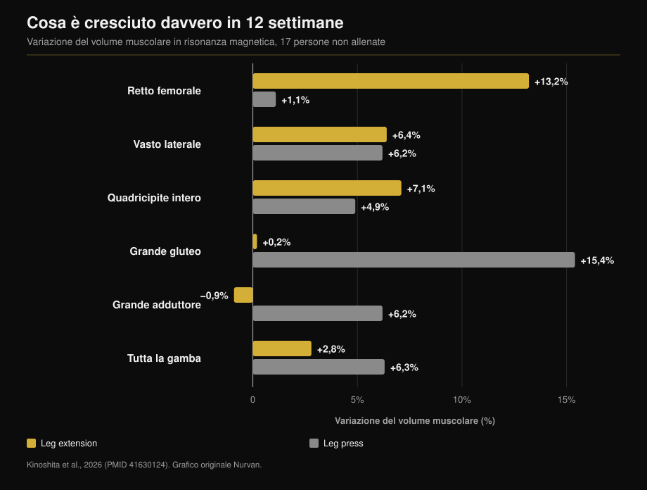
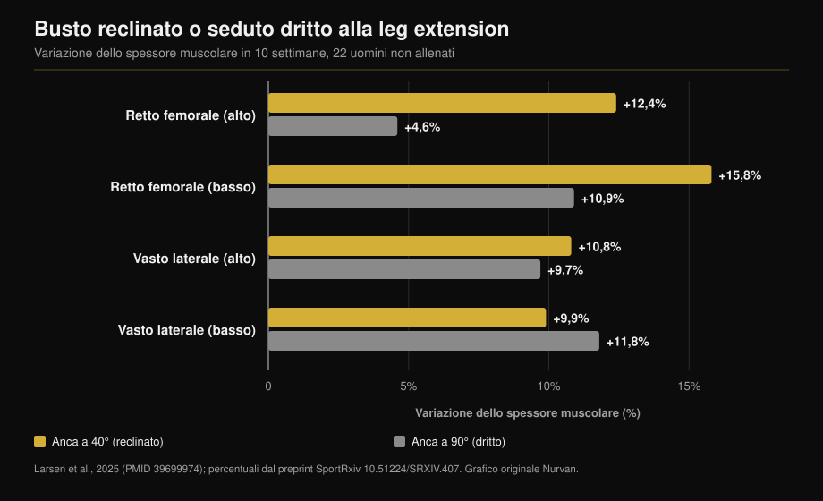

# Leg extension o leg press: cosa cresce davvero

Di [Giammaria Loi](/autore/giammaria-loi) · aggiornato il 12 ottobre 2026

Due post a un mese di distanza dicono la stessa cosa da angoli diversi: la leg extension non è un esercizio di rifinitura, è l'unico modo per allenare un pezzo di quadricipite che squat e leg press saltano. Il primo porta i numeri di uno studio con risonanza magnetica, ed è corretto. Il secondo aggiunge un trucco — inclinarsi indietro — e un numero che nello studio citato non esiste. Qui trovi tutte e due le affermazioni verificate, più il dato che manca a entrambi: cosa cresce con la leg press e non con la leg extension.

## In breve

- **Il retto femorale cresce con la leg extension e non con la leg press.** +13,2% di volume contro +1,1% in dodici settimane, misurato in risonanza magnetica muscolo per muscolo (Kinoshita et al., 2026). Nella leg press l'aumento non è nemmeno statisticamente distinguibile da zero.
- **Ma il quadricipite nel suo insieme è cresciuto uguale**: +7,1% contro +4,9%, differenza non significativa. I tre vasti sono circa l'85% del volume del quadricipite e si allenano allo stesso modo nei due esercizi.
- **Il dato che nessuno dei due post riporta**: la leg press ha fatto crescere il grande gluteo del 15,4% e il grande adduttore del 6,2%, muscoli che la leg extension non ha toccato. Volume muscolare totale della gamba: +6,3% contro +2,8%.
- **Il "+73% inclinandosi indietro" non è nello studio citato.** Quello studio è del 2025 e dura 10 settimane, non 2021 e 12. I suoi numeri: +12,4% contro +4,6% sul retto femorale prossimale, e **nessuna differenza** sul vasto laterale.
- **"Più lungo è meglio" non è una legge.** Nella stessa leg press, in persone allenate, allargare l'escursione del ginocchio non ha cambiato nulla.

## Il muscolo che la leg press non allena

Lo studio al centro dei post è uscito su *Medicine & Science in Sports & Exercise*. Diciassette persone non allenate hanno fatto dodici settimane con una gamba alla leg extension e l'altra alla leg press: stesso carico relativo (70% del massimale), cinque serie da dieci, due sedute a settimana. Alla fine, risonanza magnetica su diciassette muscoli di coscia e anca, misurati uno per uno (Kinoshita et al., 2026).

Il retto femorale — la testa del quadricipite che corre al centro della coscia — è cresciuto del **13,2%** con la leg extension e dell'**1,1%** con la leg press. Il secondo numero non è una crescita piccola: è una crescita che non c'è (p = 0,379).

Nello stesso lavoro un secondo esperimento ha misurato l'attivazione elettrica dei muscoli durante i due esercizi. Il retto femorale lavora al **38,0%** della sua attivazione massima nella leg extension e al **21,7%** nella leg press. Il grande gluteo fa il percorso opposto: 8,8% contro 41,2%.

Il post cita anche i ciclisti, e ha ragione. Confrontando otto ciclisti agonisti con dieci non allenati, i muscoli della coscia che attraversano una sola articolazione erano nettamente più grandi; quelli che ne attraversano due, retto femorale compreso, erano **uguali a quelli dei non allenati**. E dopo sei mesi di stagione agonistica non erano cambiati (Ema et al., 2015).

## Perché succede: un muscolo che attraversa due articolazioni

Il retto femorale è l'unica delle quattro teste del quadricipite che parte dal bacino: scavalca l'anca e il ginocchio. All'anca flette, al ginocchio estende. Nella leg press — e nello squat, e in bici — anca e ginocchio si estendono insieme: il retto femorale dovrebbe tirare in un verso al ginocchio e nel verso opposto all'anca. Gli autori lo chiamano conflitto di momenti, e il risultato misurato è che il muscolo viene attivato poco.

Qui va fatta una precisazione rispetto al post, che attribuisce il fenomeno a quanto il muscolo cambia lunghezza. Il dato misurato nello studio non è l'escursione: è l'attivazione. È una differenza che conta, perché orienta la soluzione verso "serve un esercizio in cui l'anca sta ferma", non verso "serve più allungamento".

Lo stesso schema vale per altri muscoli biarticolari. Nello studio i femorali sono cresciuti appena (+1,5% e +3,1% nei due esercizi) contro il 12-19% che si ottiene allenandoli direttamente ai leg curl.

## Il dato che manca a entrambi i post

Se ti fermi al retto femorale, la conclusione sembra ovvia: leg extension meglio della leg press. I numeri dello stesso studio dicono un'altra cosa.

I tre vasti sono cresciuti praticamente uguale nei due esercizi (+5,0-7,2% contro +4,4-6,2%). Il **quadricipite intero** è cresciuto del 7,1% con la leg extension e del 4,9% con la leg press: differenza non significativa. Il motivo è aritmetico, e il testo integrale lo dice: i vasti valgono circa l'85% del volume del quadricipite, il retto femorale poco più di un decimo. Un +13% su un decimo sposta poco il totale.

E fuori dal quadricipite la leg press vince senza discussione: **grande gluteo +15,4%** (leg extension: +0,2%), **grande adduttore +6,2%** (leg extension: −0,9%), volume muscolare totale della gamba **+6,3% contro +2,8%**.

Tradotto: non è "un esercizio migliore dell'altro". È che allenano cose diverse, e solo uno dei due arriva al retto femorale.

## Inclinarsi indietro: il trucco è giusto, il numero no

Il secondo post dice di appoggiarsi allo schienale invece di stare seduti dritti, e cita "uno studio del 2021, 12 settimane, +73% di crescita del retto femorale". Il riferimento che il post stesso allega smentisce il post: lo studio è di Larsen e colleghi, pubblicato online a dicembre 2024 sul *Journal of Sports Sciences* e uscito nel numero del 2025, e dura **dieci settimane**, non dodici. Ventidue uomini non allenati, due sedute a settimana, una gamba a 40° di flessione dell'anca (busto reclinato) e l'altra a 90° (seduto dritto).

Il 73% non compare nel lavoro. L'analisi è bayesiana e riporta effetti in millimetri e Bayes factor, non differenze percentuali. I numeri pubblicati sono questi: retto femorale prossimale **+12,4%** a 40° contro **+4,6%** a 90°; retto femorale distale **+15,8%** contro **+10,9%**.

Sul vasto laterale, invece, la prova va nella direzione opposta: BF = 0,07, cioè evidenza forte che **differenza non ce n'è** (+10,8% contro +9,7% in alto, +9,9% contro +11,8% in basso).

Ha senso: inclinando il busto allunghi il retto femorale, perché è l'unico che attraversa l'anca. I tre vasti partono dal femore, la loro lunghezza non cambia di un millimetro — e infatti non sono cresciuti di più. Quindi il trucco funziona, ma su una testa su quattro. Dire che fa crescere "i quadricipiti" del 73% in più è una promessa che i dati non coprono.

Un dettaglio che rende i due post complementari: nello studio sulla leg press l'anca era fissata a **90°** in entrambi gli esercizi, cioè la posizione peggiore per il retto femorale, e la leg extension ha comunque vinto 13,2 a 1,1. Gli autori stessi scrivono che con l'anca più aperta la crescita sarebbe stata probabilmente maggiore.

## "Più lungo è meglio" non è una legge

L'ultima riga del primo post — allenare a lunghezze maggiori sembra aiutare — è la più citata e la più fraintesa.

Dove il muscolo cambia davvero lunghezza, funziona. Allenando i femorali da seduto invece che da proni, cioè con l'anca flessa, il volume è cresciuto del 14% contro il 9% (Maeo et al., 2021).

Dove non cambia granché, non succede niente. Lo stesso gruppo di Larsen ha fatto allenare ventitré persone **allenate** (sette anni di media) per otto settimane alla leg press, una gamba con escursione fino a 100° di flessione del ginocchio e l'altra fino a 154°: evidenza da "moderata" a "estrema" a favore dell'**assenza** di differenza, con aumenti di spessore fra 1,08 e 1,91 mm in entrambe le condizioni (Larsen et al., 2025).

E una meta-analisi bayesiana su dodici studi che hanno manipolato la lunghezza media del muscolo trova effetti **trascurabili** sul profilo di crescita: 0,05 in zona prossimale, 0,07 al ventre, 0,09 in zona distale, su scala standardizzata (Varović et al., 2025).

La regola utile non è "allunga sempre". È: la lunghezza conta quando cambia davvero, e cambia davvero soprattutto nei muscoli che attraversano due articolazioni.

## Cosa dice davvero la ricerca

| Affermazione dei post | Esito | Il dato |
|---|---|---|
| Leg extension +13,2% retto femorale, leg press +1,1% | **Confermato** | Alla lettera, risonanza magnetica, 12 settimane (Kinoshita, 2026) |
| I ciclisti hanno il retto femorale come i non allenati | **Confermato** | 8 ciclisti vs 10 non allenati, nessun cambiamento in 6 mesi (Ema, 2015) |
| Il motivo è quanto il muscolo cambia lunghezza | **Da precisare** | Il dato misurato è l'attivazione: 38,0% vs 21,7% EMG massimo |
| "Studio del 2021, 12 settimane" | **Smentito** | Pubblicato 2024/2025, dura 10 settimane (Larsen, 2025) |
| "+73% di crescita inclinandosi indietro" | **Non verificabile** | Nel lavoro non ci sono percentuali di differenza: +12,4% vs +4,6% prossimale |
| Inclinarsi indietro stimola di più "i quadricipiti" | **Da precisare** | Solo il retto femorale. Vasto laterale: BF = 0,07, nessuna differenza |
| Allenare lungo aiuta | **Da precisare** | Sì nei biarticolari; no nella leg press in allenati (Larsen, 2025) |

## Come applicarlo

1. **Non scegliere: tieni entrambi.** La leg press (o lo squat) resta l'esercizio che ti dà vasti, glutei e adduttori con una sola serie. La leg extension è l'unico modo documentato di allenare il retto femorale.
2. **Due o tre serie di leg extension per gamba a seduta di gambe** bastano a coprire il buco. Non devono sostituire il lavoro pesante: lo completano.
3. **Se la macchina ha lo schienale regolabile, reclinalo.** Nello studio il confronto era 40° contro 90° di flessione dell'anca. Se è fisso, porta il busto indietro quanto la macchina ti permette senza staccare il bacino.
4. **Non aspettarti che cambi la circonferenza della coscia.** Quello che cambia è una testa su quattro, e l'effetto sul volume totale del quadricipite è piccolo. Il retto femorale è però la parte del quadricipite che si infortuna più spesso, e questo è un motivo migliore dell'estetica per allenarlo.
5. **Se vieni da bici, canottaggio o sport di corsa**, sei esattamente il caso descritto dallo studio sui ciclisti: cosce allenate e retto femorale fermo da anni.

> **Nurvan — controlla cosa sta allenando davvero il tuo programma**
>
> In Nurvan ogni esercizio della libreria è collegato ai muscoli che allena, così vedi subito se una scheda piena di squat e leg press lascia scoperto il retto femorale; e il tracciamento di carichi e RIR ti dice se la leg extension sta progredendo o se la stai solo facendo. Se importi una scheda da PDF, Excel o foto, il controllo è automatico.
>
> **[Prova Nurvan](/)**

## Domande frequenti

**La leg extension serve se faccio già squat e leg press?**
Sì, e serve solo a quello. Vasti, glutei e adduttori li copri già; il retto femorale no. Nello studio con risonanza magnetica è cresciuto dell'1,1% con la leg press, un valore statisticamente indistinguibile da zero.

**Di quanto devo inclinare lo schienale?**
Nello studio il confronto era fra 40° e 90° di flessione dell'anca: 40° significa busto chiaramente reclinato all'indietro, non solo appoggiato. Nella pratica, quanto la macchina consente mantenendo il bacino fermo contro il sedile.

**La leg extension fa male alle ginocchia?**
Gli studi citati qui misuravano crescita muscolare, non dolore articolare: non possono rispondere. Se senti dolore al ginocchio durante o dopo l'esercizio, il punto non è l'esercizio in generale ma la tua situazione specifica, e vale la pena parlarne con un medico o un fisioterapista prima di insistere.

**Lo squat allena il retto femorale?**
I dati disponibili dicono di no, per lo stesso motivo della leg press: anca e ginocchio si estendono insieme. Gli autori dello studio osservano che né lo squat con bilanciere né al multipower hanno prodotto crescita del retto femorale.

## Leggi anche

- [Quante ripetizioni per la massa: il mito dell'8-12](/blog/ripetizioni-serie-recupero-ipertrofia) — quante serie e che recupero mettere attorno a questi esercizi.
- [Split di allenamento: principiante vs avanzato](/blog/split-allenamento-principiante-avanzato) — dove collocare il lavoro di isolamento nella settimana.
- [Ectomorfo o mesomorfo: il somatotipo decide la massa?](/blog/somatotipo-ectomorfo-mesomorfo-massa-muscolare) — quanto pesa la struttura di partenza sui risultati.

## Fonti

1. Kinoshita M, Maeo S, Kobayashi Y, et al., 2026. Hypertrophic Effects of Single- versus Multi-Joint Exercise: A Direct Comparison between Knee Extension and Leg Press. *Medicine and Science in Sports and Exercise* 58(7):1566-1580. PMID 41630124 — [DOI](https://doi.org/10.1249/MSS.0000000000003957)
2. Larsen S, Sandvik Kristiansen B, Swinton PA, et al., 2025. The effects of hip flexion angle on quadriceps femoris muscle hypertrophy in the leg extension exercise. *Journal of Sports Sciences* 43(2):210-221. PMID 39699974 — [DOI](https://doi.org/10.1080/02640414.2024.2444713). Valori percentuali dal preprint dello stesso studio, [SportRxiv](https://doi.org/10.51224/SRXIV.407)
3. Ema R, Wakahara T, Yanaka T, et al., 2015. Unique muscularity in cyclists' thigh and trunk: A cross-sectional and longitudinal study. *Scandinavian Journal of Medicine & Science in Sports* 26(7):782-793. PMID 26148051 — [DOI](https://doi.org/10.1111/sms.12511)
4. Maeo S, Huang M, Wu Y, et al., 2021. Greater Hamstrings Muscle Hypertrophy but Similar Damage Protection after Training at Long versus Short Muscle Lengths. *Medicine and Science in Sports and Exercise* 53(4):825-837. PMID 33009197 — [DOI](https://doi.org/10.1249/MSS.0000000000002523)
5. Larsen S, Wolf M, Schoenfeld BJ, et al., 2025. Knee flexion range of motion does not influence muscle hypertrophy of the quadriceps femoris during leg press training in resistance-trained individuals. *Journal of Sports Sciences* 43(10):986-994. PMID 40113586 — [DOI](https://doi.org/10.1080/02640414.2025.2481534)
6. Varović D, Wolf M, Schoenfeld BJ, et al., 2025. Does Muscle Length Influence Regional Hypertrophy? A Systematic Review and Meta-Analysis. *International Journal of Sports Medicine* 46(14):1027-1036. PMID 40570881 — [DOI](https://doi.org/10.1055/a-2615-4935)
7. Varović D, Zganjer K, Wolf M, et al., 2025. The effects of long muscle length isometric versus full range of motion isotonic training on regional quadriceps femoris hypertrophy in resistance-trained individuals. *Applied Physiology, Nutrition, and Metabolism* 50:1-14. PMID 40911904 — [DOI](https://doi.org/10.1139/apnm-2025-0238)

Metadati e abstract degli studi recuperati da PubMed.

Spunto iniziale: i post di [William Wallace (@dr.williamwallace)](https://www.instagram.com/p/Dcyi6zGkUig/) e [@iwannaburnfat](https://www.instagram.com/p/Dd9XGVUCCy9/). Nessun testo o immagine dei post è stato riprodotto: le affermazioni sono state riscritte e verificate sulle fonti primarie.

---

*Giammaria Loi è il fondatore di Nurvan. Si allena con i pesi dal 2012, lavora come personal trainer e coach certificato FIPE dal 2013 e gareggia nel powerlifting a livello nazionale dal 2018. Ogni articolo che firma parte dagli studi scientifici e arriva a ciò che funziona davvero in palestra.*

> Nota: contenuto informativo, non sostituisce il parere di un medico o professionista.
