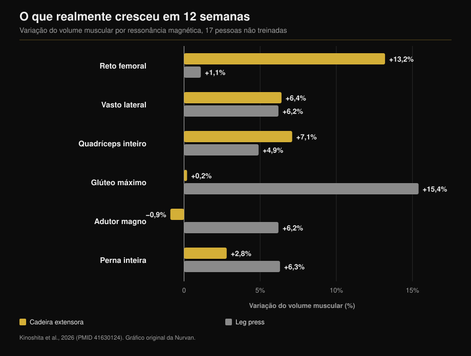
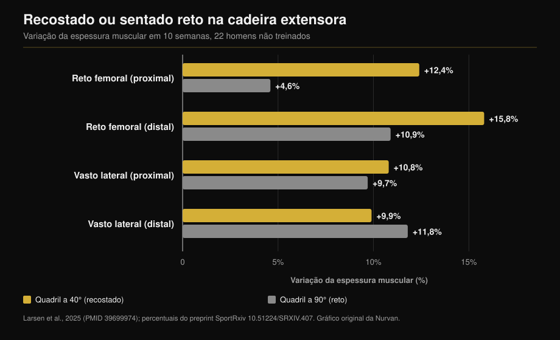

# Cadeira extensora ou leg press: o que cresce de verdade

Por [Giammaria Loi](/autore/giammaria-loi) · atualizado em 12 de outubro de 2026

Dois posts com um mês de diferença defendem a mesma ideia por ângulos distintos: a cadeira extensora não é exercício de acabamento, é a única forma de treinar uma parte do quadríceps que o agachamento e o leg press deixam de fora. O primeiro traz os números de um estudo com ressonância magnética, e está certo. O segundo acrescenta um truque — reclinar o tronco — e um número que não existe no estudo que cita. Aqui estão as duas afirmações verificadas e o dado que falta em ambos: o que o leg press faz crescer e a cadeira extensora nunca toca.

## Em resumo

- **O reto femoral cresce na cadeira extensora e não no leg press.** +13,2% de volume muscular contra +1,1% em doze semanas, medido músculo a músculo por ressonância (Kinoshita et al., 2026). No leg press a variação nem sequer se distingue de zero.
- **Mas o quadríceps inteiro cresceu igual**: +7,1% contra +4,9%, sem diferença significativa. Os três vastos são cerca de 85% do volume do quadríceps e os dois exercícios os treinam do mesmo jeito.
- **O dado que nenhum post traz**: o leg press fez o glúteo máximo crescer 15,4% e o adutor magno 6,2%, músculos que a cadeira extensora não tocou. Volume muscular total da perna: +6,3% contra +2,8%.
- **O "+73% reclinando" não está no estudo citado.** Esse estudo é de 2025 e durou dez semanas, não 2021 e doze. Os números reais: +12,4% contra +4,6% no reto femoral proximal e **nenhuma diferença** no vasto lateral.
- **"Mais longo é melhor" não é lei.** No próprio leg press, com pessoas treinadas, ampliar a amplitude do joelho não mudou nada.

## O músculo que o leg press não treina

O estudo por trás dos dois posts saiu na *Medicine & Science in Sports & Exercise*. Dezessete pessoas não treinadas passaram doze semanas com uma perna na cadeira extensora e a outra no leg press: mesma carga relativa (70% do máximo), cinco séries de dez, duas sessões por semana. No fim, ressonância magnética de dezessete músculos do quadril e da coxa, medidos um a um (Kinoshita et al., 2026).

O reto femoral — a cabeça que desce pelo meio da coxa — cresceu **13,2%** na cadeira extensora e **1,1%** no leg press. O segundo número não é um ganho pequeno: é um ganho que não existe (p = 0,379).

Um segundo experimento do mesmo trabalho mediu a ativação elétrica durante os dois exercícios. O reto femoral trabalha a **38,0%** da ativação máxima na cadeira extensora e a **21,7%** no leg press. O glúteo máximo faz o caminho inverso: 8,8% contra 41,2%.

A parte sobre ciclistas também confere. Comparando oito ciclistas de competição com dez homens não treinados, os músculos da coxa que cruzam uma só articulação eram claramente maiores; os que cruzam duas, incluindo o reto femoral, eram **iguais aos dos não treinados**. E seis meses de temporada não os mudaram (Ema et al., 2015).

## Por quê: um músculo que cruza duas articulações

O reto femoral é a única das quatro cabeças do quadríceps que nasce na pelve: cruza o quadril e o joelho. No quadril flexiona, no joelho estende. No leg press — como no agachamento e na bicicleta — quadril e joelho estendem juntos, então o reto femoral teria de puxar num sentido no joelho e no oposto no quadril. Os autores chamam isso de conflito de momentos, e o que mediram é que o músculo simplesmente é menos ativado.

Aqui o post precisa de correção: ele atribui o fenômeno à variação de comprimento. A variável medida não é a amplitude, é a ativação. A diferença importa, porque aponta para "é preciso um exercício com o quadril parado" e não para "é preciso mais alongamento".

O padrão se repete: neste estudo os isquiotibiais, também biarticulares, cresceram apenas 1,5% a 3,1%, contra os 12-19% obtidos treinando-os direto na mesa flexora.

## O dado que falta nos dois posts

Se você parar no reto femoral, a conclusão parece óbvia. O resto do mesmo estudo diz outra coisa.

Os três vastos cresceram quase igual nas duas condições (+5,0-7,2% contra +4,4-6,2%). O **quadríceps inteiro** cresceu 7,1% na cadeira extensora e 4,9% no leg press: diferença não significativa. O motivo é aritmético e o texto completo explica: os vastos são cerca de 85% do volume do quadríceps, o reto femoral mal chega a um décimo. +13% sobre um décimo mexe pouco no total.

E fora do quadríceps o leg press ganha sem discussão: **glúteo máximo +15,4%** (cadeira extensora: +0,2%), **adutor magno +6,2%** (cadeira extensora: −0,9%), volume muscular total da perna **+6,3% contra +2,8%**.

Não é "um exercício melhor que o outro". Eles constroem coisas diferentes, e só um chega ao reto femoral.

## Reclinar o tronco: a ideia é boa, o número não

O segundo post manda encostar o tronco para trás em vez de sentar ereto, citando "um estudo de 2021, 12 semanas, 73% mais crescimento do reto femoral". A referência que o próprio post anexa o desmente: é o trabalho de Larsen e colegas, publicado online em dezembro de 2024 no *Journal of Sports Sciences* e impresso no volume de 2025, e durou **dez semanas**, não doze. Vinte e dois homens não treinados, duas sessões por semana, uma perna a 40° de flexão de quadril (tronco reclinado) e a outra a 90° (sentado ereto).

Os 73% não aparecem no trabalho. A análise é bayesiana e reporta efeitos em milímetros e fatores de Bayes, não diferenças percentuais. Os números publicados: reto femoral proximal **+12,4%** a 40° contra **+4,6%** a 90°; reto femoral distal **+15,8%** contra **+10,9%**.

No vasto lateral a evidência vai no sentido oposto: BF = 0,07, evidência forte de que **não há diferença** (+10,8% contra +9,7% na parte alta, +9,9% contra +11,8% na baixa).

Faz sentido: reclinar alonga o reto femoral porque é o único que cruza o quadril. Os três vastos nascem no fêmur e seu comprimento não muda um milímetro — e de fato não cresceram mais. O truque funciona, mas em uma cabeça de quatro. Dizer que faz "o quadríceps" crescer 73% a mais é uma promessa que os dados não sustentam.

Um detalhe torna os dois posts complementares: no estudo do leg press o quadril estava fixo a **90°** nos dois exercícios, a pior posição para o reto femoral, e mesmo assim a cadeira extensora venceu por 13,2 a 1,1. Os próprios autores observam que com o quadril mais aberto o crescimento provavelmente teria sido maior.

## "Mais longo é melhor" não é lei

A última linha do primeiro post — treinar em comprimentos longos parece ajudar — é a mais citada e a mais mal entendida.

Onde o músculo realmente muda de comprimento, funciona. Treinar isquiotibiais sentado em vez de deitado de bruços, com o quadril flexionado, rendeu +14% de volume contra +9% (Maeo et al., 2021).

Onde não muda, nada acontece. O próprio grupo de Larsen colocou vinte e três pessoas **treinadas** (sete anos em média) oito semanas no leg press, uma perna até 100° de flexão de joelho e a outra até 154°: evidência de "moderada" a "extrema" a favor da **ausência** de diferença, com ganhos de espessura de 1,08 a 1,91 mm nas duas condições (Larsen et al., 2025).

E uma meta-análise bayesiana de doze estudos que manipularam o comprimento médio do músculo encontra efeitos **triviais** no perfil de crescimento: 0,05 proximal, 0,07 no ventre, 0,09 distal, em escala padronizada (Varović et al., 2025).

A regra útil não é "alongue sempre". É: o comprimento importa quando muda de verdade, e muda sobretudo nos músculos que cruzam duas articulações.

## O que a pesquisa realmente diz

| Afirmação dos posts | Veredicto | O dado |
|---|---|---|
| Cadeira extensora +13,2% reto femoral, leg press +1,1% | **Confirmado** | Literalmente, por ressonância, em 12 semanas (Kinoshita, 2026) |
| Ciclistas têm reto femoral de não treinado | **Confirmado** | 8 ciclistas vs 10 não treinados, nada em 6 meses (Ema, 2015) |
| A causa é a pouca variação de comprimento | **A precisar** | O que se mediu foi a ativação: 38,0% vs 21,7% do EMG máximo |
| "Estudo de 2021, 12 semanas" | **Falso** | Publicado em 2024/2025, durou 10 semanas (Larsen, 2025) |
| "+73% de crescimento reclinando" | **Não verificável** | O trabalho não traz diferenças percentuais: +12,4% vs +4,6% |
| Reclinar estimula mais "o quadríceps" | **A precisar** | Só o reto femoral. Vasto lateral: BF = 0,07, sem diferença |
| Treinar em comprimentos longos ajuda | **A precisar** | Sim nos biarticulares; não no leg press em treinados (Larsen, 2025) |

## Como aplicar

1. **Não escolha: fique com os dois.** O leg press (ou o agachamento) entrega vastos, glúteos e adutores num movimento só. A cadeira extensora é o único caminho documentado até o reto femoral.
2. **Duas ou três séries de cadeira extensora por perna no dia de perna** bastam para cobrir o buraco. Não substituem o trabalho pesado: completam.
3. **Se o encosto for regulável, recline.** O estudo comparou 40° e 90° de flexão de quadril. Se for fixo, leve o tronco para trás o quanto a máquina permitir sem tirar o quadril do banco.
4. **Não espere mudança na circunferência da coxa.** O que muda é uma cabeça de quatro. O melhor motivo é outro: o reto femoral é a parte do quadríceps que mais sofre estiramentos.
5. **Se você vem do ciclismo, do remo ou da corrida**, é exatamente o caso do estudo dos ciclistas: coxas treinadas e um reto femoral parado há anos.

> **Nurvan — veja o que o seu programa treina de verdade**
>
> No Nurvan cada exercício da biblioteca está ligado aos músculos que treina, então você vê na hora se um treino cheio de agachamento e leg press deixa o reto femoral descoberto; o acompanhamento de cargas e RIR mostra se a sua cadeira extensora está progredindo ou só acontecendo. Ao importar um treino de PDF, Excel ou foto, a checagem é automática.
>
> **[Experimente o Nurvan](/)**

## Perguntas frequentes

**Preciso de cadeira extensora se já faço agachamento e leg press?**
Sim, e é só para isso que ela serve. Vastos, glúteos e adutores já estão cobertos; o reto femoral não. No estudo com ressonância ele cresceu 1,1% no leg press, valor indistinguível de zero.

**Quanto devo reclinar?**
O estudo comparou 40° e 90° de flexão de quadril: 40° significa tronco claramente para trás, não apenas apoiado. Na prática, o quanto a máquina permitir mantendo o quadril no banco.

**Cadeira extensora faz mal para o joelho?**
Os estudos citados aqui mediam crescimento muscular, não dor articular: não têm como responder. Se você sente dor no joelho durante ou depois do exercício, a questão não é o exercício em geral e sim a sua situação específica — vale conversar com um médico ou fisioterapeuta antes de insistir.

**O agachamento treina o reto femoral?**
Os dados disponíveis dizem que não, pelo mesmo motivo do leg press: quadril e joelho estendem juntos. Os autores observam que nem o agachamento livre nem o no Smith produziram crescimento do reto femoral.

## Leia também

- [Quantas repetições para a massa muscular: o mito do 8-12](/pt/blog/quantas-repeticoes-massa-muscular) — quantas séries e quanto descanso colocar em volta desses exercícios.
- [Divisão de treino: iniciante ou avançado](/pt/blog/divisao-treino-iniciante-avancado) — onde encaixar o trabalho de isolamento na semana.
- [Ectomorfo ou mesomorfo: o somatotipo decide a massa muscular?](/pt/blog/somatotipo-ectomorfo-mesomorfo-massa-muscular) — quanto pesa a estrutura de partida.

## Fontes

1. Kinoshita M, Maeo S, Kobayashi Y, et al., 2026. Hypertrophic Effects of Single- versus Multi-Joint Exercise: A Direct Comparison between Knee Extension and Leg Press. *Medicine and Science in Sports and Exercise* 58(7):1566-1580. PMID 41630124 — [DOI](https://doi.org/10.1249/MSS.0000000000003957)
2. Larsen S, Sandvik Kristiansen B, Swinton PA, et al., 2025. The effects of hip flexion angle on quadriceps femoris muscle hypertrophy in the leg extension exercise. *Journal of Sports Sciences* 43(2):210-221. PMID 39699974 — [DOI](https://doi.org/10.1080/02640414.2024.2444713). Percentuais do preprint do mesmo estudo no [SportRxiv](https://doi.org/10.51224/SRXIV.407)
3. Ema R, Wakahara T, Yanaka T, et al., 2015. Unique muscularity in cyclists' thigh and trunk. *Scandinavian Journal of Medicine & Science in Sports* 26(7):782-793. PMID 26148051 — [DOI](https://doi.org/10.1111/sms.12511)
4. Maeo S, Huang M, Wu Y, et al., 2021. Greater Hamstrings Muscle Hypertrophy but Similar Damage Protection after Training at Long versus Short Muscle Lengths. *Medicine and Science in Sports and Exercise* 53(4):825-837. PMID 33009197 — [DOI](https://doi.org/10.1249/MSS.0000000000002523)
5. Larsen S, Wolf M, Schoenfeld BJ, et al., 2025. Knee flexion range of motion does not influence muscle hypertrophy of the quadriceps femoris during leg press training in resistance-trained individuals. *Journal of Sports Sciences* 43(10):986-994. PMID 40113586 — [DOI](https://doi.org/10.1080/02640414.2025.2481534)
6. Varović D, Wolf M, Schoenfeld BJ, et al., 2025. Does Muscle Length Influence Regional Hypertrophy? A Systematic Review and Meta-Analysis. *International Journal of Sports Medicine* 46(14):1027-1036. PMID 40570881 — [DOI](https://doi.org/10.1055/a-2615-4935)
7. Varović D, Zganjer K, Wolf M, et al., 2025. The effects of long muscle length isometric versus full range of motion isotonic training on regional quadriceps femoris hypertrophy in resistance-trained individuals. *Applied Physiology, Nutrition, and Metabolism* 50:1-14. PMID 40911904 — [DOI](https://doi.org/10.1139/apnm-2025-0238)

Metadados e resumos dos estudos obtidos no PubMed.

Ponto de partida: os posts de [William Wallace (@dr.williamwallace)](https://www.instagram.com/p/Dcyi6zGkUig/) e [@iwannaburnfat](https://www.instagram.com/p/Dd9XGVUCCy9/). Nenhum texto ou imagem dos posts foi reproduzido.

---

*Giammaria Loi é o fundador da Nurvan. Treina com pesos desde 2012, trabalha como personal trainer e coach certificado pela FIPE desde 2013 e compete em powerlifting em nível nacional desde 2018. Cada artigo que assina parte dos estudos científicos e chega ao que funciona de verdade na academia.*

> Nota: conteúdo informativo. Não substitui a opinião de um médico ou profissional qualificado.
