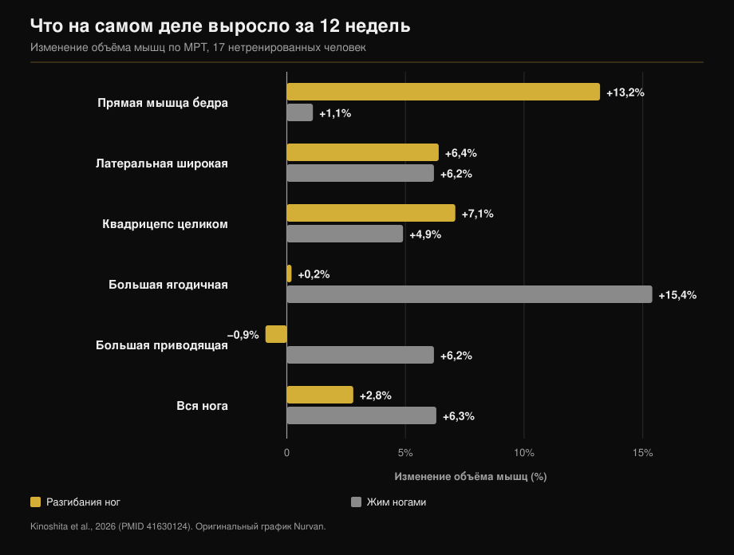
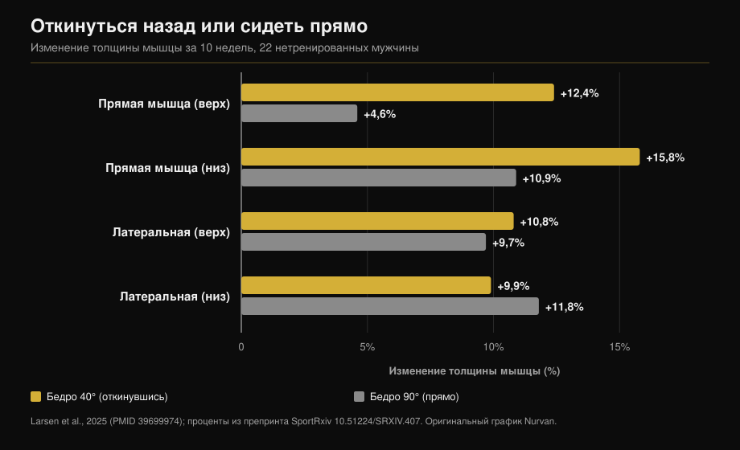

# Разгибания ног или жим ногами: что растёт на самом деле

Автор: [Giammaria Loi](/autore/giammaria-loi) · обновлено 12 октября 2026

Два поста с разницей в месяц говорят об одном и том же с разных сторон: разгибания ног — не «добивка», а единственный способ нагрузить часть квадрицепса, которую приседания и жим ногами пропускают. В первом приведены цифры из исследования с МРТ, и они верны. Во втором добавлен приём — откинуться назад — и число, которого в цитируемой работе нет. Ниже обе версии проверены, плюс данные, которых нет ни в одном посте: что растёт от жима ногами и чего разгибания не дают вовсе.

## Коротко

- **Прямая мышца бедра растёт от разгибаний и не растёт от жима ногами.** +13,2% объёма против +1,1% за двенадцать недель, измерено по МРТ мышца за мышцей (Kinoshita et al., 2026). В жиме ногами прирост статистически неотличим от нуля.
- **Но квадрицепс в целом вырос одинаково**: +7,1% против +4,9%, разница незначима. Три широкие мышцы — около 85% объёма квадрицепса, и оба упражнения нагружают их одинаково.
- **Данные, которых нет ни в одном посте**: жим ногами увеличил большую ягодичную на 15,4%, а большую приводящую на 6,2% — мышцы, которых разгибания не коснулись вовсе. Общий мышечный объём ноги: +6,3% против +2,8%.
- **«+73% от наклона назад» в цитируемой работе отсутствуют.** Эта работа 2025 года и длилась десять недель, а не 2021-го и двенадцать. Её реальные цифры: +12,4% против +4,6% для верхней части прямой мышцы и **никакой разницы** для латеральной широкой.
- **«Чем длиннее, тем лучше» — не закон.** В самом жиме ногами у тренированных людей увеличение амплитуды в колене не дало ничего.

## Мышца, которую жим ногами не тренирует

Работа, на которой построены оба поста, вышла в *Medicine & Science in Sports & Exercise*. Семнадцать нетренированных человек двенадцать недель работали одной ногой в тренажёре для разгибаний, другой — в жиме ногами: одинаковая относительная нагрузка (70% от максимума), пять подходов по десять, две тренировки в неделю. В конце — МРТ семнадцати отдельных мышц бедра и таза (Kinoshita et al., 2026).

Прямая мышца бедра — та, что идёт по центру бедра, — выросла на **13,2%** от разгибаний и на **1,1%** от жима ногами. Вторая цифра не «небольшой прирост», а отсутствие прироста (p = 0,379).

Второй эксперимент той же работы измерил электрическую активность мышц в обоих упражнениях. Прямая мышца работает на **38,0%** от максимальной активации в разгибаниях и на **21,7%** в жиме ногами. Большая ягодичная — наоборот: 8,8% против 41,2%.

Про велосипедистов пост тоже прав. При сравнении восьми соревнующихся велосипедистов с десятью нетренированными мужчинами односуставные мышцы бедра были заметно крупнее, а двусуставные, включая прямую мышцу, — **такие же, как у нетренированных**. Полгода соревновательного сезона их не изменили (Ema et al., 2015).

## Почему: мышца через два сустава

Прямая мышца — единственная из четырёх головок квадрицепса, которая начинается на тазе: она пересекает и тазобедренный сустав, и колено. В бедре она сгибает, в колене разгибает. В жиме ногами — как в приседе и на велосипеде — бедро и колено разгибаются одновременно, и прямой мышце пришлось бы тянуть в одну сторону в колене и в противоположную в бедре. Авторы называют это конфликтом моментов, а измерили они вот что: мышца просто меньше включается.

Здесь пост нужно поправить: он объясняет явление тем, насколько меняется длина мышцы. Измеряли же не амплитуду, а активацию. Разница важна: отсюда следует «нужно упражнение, где таз неподвижен», а не «нужно больше растяжения».

Та же картина и в других местах: в этом исследовании двусуставные мышцы задней поверхности выросли лишь на 1,5-3,1% против 12-19%, которые дают сгибания ног.

## Данные, которых нет в обоих постах

Если остановиться на прямой мышце, вывод кажется очевидным. Остальная часть того же исследования говорит другое.

Три широкие мышцы выросли почти одинаково в обоих условиях (+5,0-7,2% против +4,4-6,2%). **Квадрицепс целиком** вырос на 7,1% от разгибаний и на 4,9% от жима: разница незначима. Причина арифметическая, и полный текст её называет: широкие мышцы — около 85% объёма квадрицепса, прямая — едва десятая часть. +13% на десятой части почти не двигают сумму.

А за пределами квадрицепса жим ногами выигрывает безоговорочно: **большая ягодичная +15,4%** (разгибания: +0,2%), **большая приводящая +6,2%** (разгибания: −0,9%), общий мышечный объём ноги **+6,3% против +2,8%**.

То есть дело не в том, что одно упражнение лучше другого. Они строят разное, и только одно достаёт до прямой мышцы.

## Откинуться назад: приём верный, число — нет

Второй пост советует откинуться на спинку вместо того, чтобы сидеть прямо, и ссылается на «исследование 2021 года, 12 недель, на 73% больше роста прямой мышцы». Ссылка, которую приводит сам пост, его и опровергает: это работа Larsen и коллег, опубликованная онлайн в декабре 2024 года в *Journal of Sports Sciences* и вышедшая в томе 2025 года, и длилась она **десять недель**, а не двенадцать. Двадцать два нетренированных мужчины, две тренировки в неделю, одна нога при 40° сгибания в тазобедренном суставе (корпус откинут), другая при 90° (сидя прямо).

Числа 73% в работе нет. Анализ байесовский, эффекты даны в миллиметрах и в байесовских факторах, а не в процентных различиях. Опубликованные значения: прямая мышца сверху **+12,4%** при 40° против **+4,6%** при 90°; снизу **+15,8%** против **+10,9%**.

Для латеральной широкой мышцы доказательства идут в обратную сторону: BF = 0,07, то есть сильное свидетельство того, что разницы **нет** (+10,8% против +9,7% сверху, +9,9% против +11,8% снизу).

Это логично: наклон назад удлиняет именно прямую мышцу, единственную, что пересекает тазобедренный сустав. Три широкие начинаются на бедренной кости, их длина не меняется ни на миллиметр — и они действительно не выросли сильнее. Приём работает, но на одной головке из четырёх. Утверждать, что он растит «квадрицепс» на 73% сильнее, данные не позволяют.

Одна деталь делает оба поста взаимодополняющими: в исследовании с жимом ногами таз был зафиксирован под **90°** в обоих упражнениях — худшее положение для прямой мышцы, — и разгибания всё равно выиграли 13,2 против 1,1. Авторы сами пишут, что при более открытом угле роста было бы, вероятно, больше.

## «Длиннее — лучше» не закон

Последняя строка первого поста — тренировка на большой длине, похоже, помогает — цитируется чаще всего и понимается хуже всего.

Там, где длина действительно меняется, это работает. Сгибания ног сидя вместо лёжа на животе, то есть со согнутым бедром, дали +14% объёма против +9% (Maeo et al., 2021).

Там, где не меняется, ничего не происходит. Группа Larsen взяла двадцать три **тренированных** человека (в среднем семь лет стажа) и восемь недель давала им жим ногами: одна нога до 100° сгибания в колене, другая до 154°. Свидетельства от «умеренных» до «крайних» в пользу **отсутствия** разницы, прирост толщины от 1,08 до 1,91 мм в обоих случаях (Larsen et al., 2025).

А байесовский метаанализ двенадцати исследований, менявших среднюю длину мышцы, находит **ничтожные** эффекты на профиль роста: 0,05 в верхней части, 0,07 в брюшке, 0,09 в нижней, по стандартизованной шкале (Varović et al., 2025).

Полезное правило звучит не как «всегда тяни», а так: длина важна там, где она действительно меняется, а меняется она прежде всего у мышц, пересекающих два сустава.

## Что на самом деле говорят исследования

| Утверждение постов | Вердикт | Данные |
|---|---|---|
| Разгибания +13,2% прямой мышцы, жим +1,1% | **Подтверждено** | Дословно, по МРТ, за 12 недель (Kinoshita, 2026) |
| У велосипедистов прямая мышца как у нетренированных | **Подтверждено** | 8 велосипедистов против 10 нетренированных, без изменений за 6 месяцев (Ema, 2015) |
| Причина — малое изменение длины | **Требует уточнения** | Измеряли активацию: 38,0% против 21,7% максимального ЭМГ |
| «Исследование 2021 года, 12 недель» | **Опровергнуто** | Опубликовано в 2024/2025, длилось 10 недель (Larsen, 2025) |
| «+73% роста от наклона назад» | **Непроверяемо** | В работе нет процентных различий: +12,4% против +4,6% |
| Наклон назад сильнее нагружает «квадрицепс» | **Требует уточнения** | Только прямую мышцу. Латеральная широкая: BF = 0,07, разницы нет |
| Тренировка на большой длине помогает | **Требует уточнения** | Да для двусуставных; нет в жиме ногами у тренированных (Larsen, 2025) |

## Как это применить

1. **Не выбирайте: оставьте оба.** Жим ногами (или присед) даёт широкие мышцы, ягодичные и приводящие одним движением. Разгибания — единственный задокументированный путь к прямой мышце.
2. **Двух-трёх подходов разгибаний на ногу в день ног** достаточно, чтобы закрыть пробел. Они не заменяют тяжёлую работу, а дополняют её.
3. **Если спинка регулируется — откиньте её.** В исследовании сравнивали 40° и 90° сгибания в тазобедренном суставе. Если спинка фиксированная, отведите корпус назад настолько, насколько позволяет тренажёр, не отрывая таз от сиденья.
4. **Не ждите изменения обхвата бедра.** Меняется одна головка из четырёх. Более весомая причина: прямая мышца — та часть квадрицепса, которая чаще всего травмируется.
5. **Если вы из велоспорта, гребли или бега**, вы ровно тот случай, что описан в исследовании велосипедистов: тренированные бёдра и прямая мышца, стоящая на месте годами.

> **Nurvan — проверьте, что на самом деле тренирует ваша программа**
>
> В Nurvan каждое упражнение в библиотеке связано с мышцами, которые оно нагружает, поэтому сразу видно, оставляет ли программа из приседов и жимов ногами прямую мышцу без работы. Отслеживание весов и RIR покажет, прогрессируют ли ваши разгибания или просто повторяются. Импортируйте программу из PDF, таблицы или фотографии — проверка выполнится автоматически.
>
> **[Попробовать Nurvan](/)**

## Частые вопросы

**Нужны ли разгибания, если я уже делаю присед и жим ногами?**
Да, и только ради этого. Широкие мышцы, ягодичные и приводящие уже нагружены, прямая — нет. В исследовании с МРТ она выросла на 1,1% от жима ногами, то есть неотличимо от нуля.

**Насколько сильно откидываться?**
В исследовании сравнивали 40° и 90° сгибания в бедре: 40° — это явно откинутый корпус, а не просто опора на спинку. На практике — настолько, насколько позволяет тренажёр, пока таз остаётся на сиденье.

**Вредны ли разгибания для коленей?**
Приведённые здесь исследования измеряли рост мышц, а не боль в суставах, поэтому ответить не могут. Если во время или после упражнения вы чувствуете боль в колене, дело не в упражнении вообще, а в вашей конкретной ситуации: стоит обсудить это с врачом или физиотерапевтом, прежде чем продолжать.

**Тренирует ли присед прямую мышцу?**
Имеющиеся данные говорят, что нет, по той же причине, что и жим ногами: бедро и колено разгибаются вместе. Авторы отмечают, что ни присед со свободным весом, ни присед в Смите не вызвали роста прямой мышцы.

## Читайте также

- [Сколько повторений нужно для массы: миф о 8-12](/ru/blog/skolko-povtoreniy-dlya-massy) — сколько подходов и отдыха ставить вокруг этих упражнений.
- [Сплит тренировок: новичок или продвинутый](/ru/blog/split-trenirovok-novichok-prodvinutyy) — куда ставить изолирующую работу в неделе.
- [Эктоморф или мезоморф: решает ли соматотип набор массы?](/ru/blog/somatotip-ektomorf-mezomorf-myshechnaya-massa) — сколько значит исходное телосложение.

## Источники

1. Kinoshita M, Maeo S, Kobayashi Y, et al., 2026. Hypertrophic Effects of Single- versus Multi-Joint Exercise: A Direct Comparison between Knee Extension and Leg Press. *Medicine and Science in Sports and Exercise* 58(7):1566-1580. PMID 41630124 — [DOI](https://doi.org/10.1249/MSS.0000000000003957)
2. Larsen S, Sandvik Kristiansen B, Swinton PA, et al., 2025. The effects of hip flexion angle on quadriceps femoris muscle hypertrophy in the leg extension exercise. *Journal of Sports Sciences* 43(2):210-221. PMID 39699974 — [DOI](https://doi.org/10.1080/02640414.2024.2444713). Проценты взяты из препринта той же работы на [SportRxiv](https://doi.org/10.51224/SRXIV.407)
3. Ema R, Wakahara T, Yanaka T, et al., 2015. Unique muscularity in cyclists' thigh and trunk. *Scandinavian Journal of Medicine & Science in Sports* 26(7):782-793. PMID 26148051 — [DOI](https://doi.org/10.1111/sms.12511)
4. Maeo S, Huang M, Wu Y, et al., 2021. Greater Hamstrings Muscle Hypertrophy but Similar Damage Protection after Training at Long versus Short Muscle Lengths. *Medicine and Science in Sports and Exercise* 53(4):825-837. PMID 33009197 — [DOI](https://doi.org/10.1249/MSS.0000000000002523)
5. Larsen S, Wolf M, Schoenfeld BJ, et al., 2025. Knee flexion range of motion does not influence muscle hypertrophy of the quadriceps femoris during leg press training in resistance-trained individuals. *Journal of Sports Sciences* 43(10):986-994. PMID 40113586 — [DOI](https://doi.org/10.1080/02640414.2025.2481534)
6. Varović D, Wolf M, Schoenfeld BJ, et al., 2025. Does Muscle Length Influence Regional Hypertrophy? A Systematic Review and Meta-Analysis. *International Journal of Sports Medicine* 46(14):1027-1036. PMID 40570881 — [DOI](https://doi.org/10.1055/a-2615-4935)
7. Varović D, Zganjer K, Wolf M, et al., 2025. The effects of long muscle length isometric versus full range of motion isotonic training on regional quadriceps femoris hypertrophy in resistance-trained individuals. *Applied Physiology, Nutrition, and Metabolism* 50:1-14. PMID 40911904 — [DOI](https://doi.org/10.1139/apnm-2025-0238)

Метаданные и аннотации исследований получены из PubMed.

Отправная точка: посты [William Wallace (@dr.williamwallace)](https://www.instagram.com/p/Dcyi6zGkUig/) и [@iwannaburnfat](https://www.instagram.com/p/Dd9XGVUCCy9/). Ни текст, ни изображения постов не воспроизводились.

---

*Giammaria Loi — основатель Nurvan. Тренируется с отягощениями с 2012 года, работает персональным тренером и коучем с сертификацией FIPE с 2013 года и выступает в пауэрлифтинге на национальном уровне с 2018 года. Каждая его статья начинается с научных работ и заканчивается тем, что действительно работает в зале.*

> Примечание: материал информационный. Он не заменяет консультацию врача или профильного специалиста.
