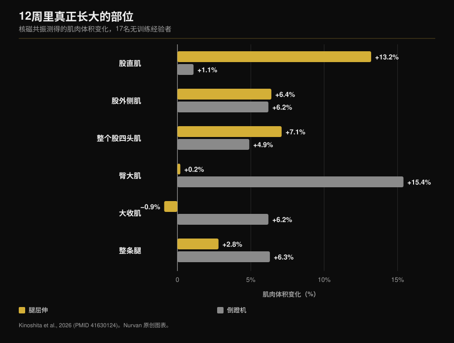
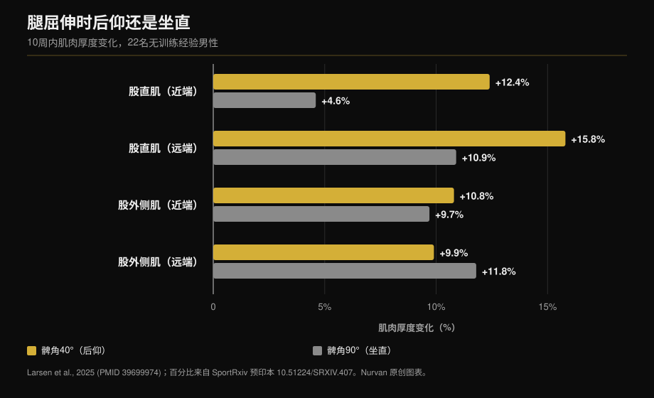

# 腿屈伸还是倒蹬机：到底哪块肌肉在长

作者：[Giammaria Loi](/autore/giammaria-loi) · 更新于 2026 年 10 月 12 日

相隔一个月的两个帖子，从不同角度说了同一件事：腿屈伸不是收尾动作，而是练到深蹲和倒蹬机都漏掉的那部分股四头肌的唯一方法。第一个帖子引用了一项核磁共振研究的数据，站得住脚。第二个帖子加了一个技巧——身体后仰——和一个在它所引研究里根本不存在的数字。下面是对两个说法的逐条核对，外加两个帖子都没提的关键数据：倒蹬机练到了什么，而腿屈伸完全碰不到。

## 重点速览

- **股直肌靠腿屈伸长，靠倒蹬机不长。** 十二周内肌肉体积 +13.2% 对 +1.1%，逐块肌肉用核磁共振测量（Kinoshita 等，2026）。倒蹬机那一侧的变化在统计上与零没有区别。
- **但整个股四头肌长得一样多**：+7.1% 对 +4.9%，差异不显著。三块股肌约占股四头肌体积的 85%，两个动作对它们的刺激相当。
- **两个帖子都没提的数字**：倒蹬机让臀大肌增长 15.4%、大收肌增长 6.2%，而腿屈伸对这两块肌肉几乎毫无作用。整条腿的肌肉总体积：+6.3% 对 +2.8%。
- **“后仰多长 73%”并不在被引用的研究里。** 那项研究是 2025 年的，为期十周，不是 2021 年、十二周。它的真实数字是：股直肌近端 +12.4% 对 +4.6%，而股外侧肌**毫无差异**。
- **“越长越好”不是定律。** 同样是倒蹬机，在有训练经验的人身上，加大膝关节活动范围没有带来任何差别。

## 倒蹬机练不到的那块肌肉

两个帖子背后的研究发表在《Medicine & Science in Sports & Exercise》。十七名无训练经验的成年人进行了十二周训练，一条腿做腿屈伸，另一条腿做倒蹬机：相对负荷相同（最大重量的 70%），五组十次，每周两练。结束后用核磁共振逐一测量髋部与大腿的十七块肌肉（Kinoshita 等，2026）。

股直肌——沿大腿正中走行的那一头——在腿屈伸一侧增长了 **13.2%**，在倒蹬机一侧只有 **1.1%**。第二个数字不是“增长得少”，而是根本没有增长（p = 0.379）。

同一项研究的第二个实验测了两个动作中的肌肉激活。股直肌在腿屈伸中达到最大激活的 **38.0%**，在倒蹬机中只有 **21.7%**。臀大肌正好相反：8.8% 对 41.2%。

关于自行车运动员的说法也成立。把八名竞技自行车运动员与十名无训练经验男性相比，单关节大腿肌肉明显更大；跨两个关节的肌肉，包括股直肌，**与无训练者一样大**。六个月的赛季训练也没有改变它们（Ema 等，2015）。

## 原因：一块跨两个关节的肌肉

股直肌是股四头肌四个头里唯一起于骨盆的：它同时跨过髋与膝。在髋屈，在膝伸。而在倒蹬机上——深蹲和骑车也一样——髋与膝同时伸展，股直肌就得在膝关节往一个方向拉、在髋关节往相反方向拉。研究者称之为力矩冲突，而他们测到的结果是：这块肌肉干脆被更少地激活。

这里需要修正帖子的说法。帖子把原因归于肌肉长度变化的多少，但研究测的不是活动幅度，而是激活程度。这个区别很重要：结论应该是“需要一个髋关节不动的动作”，而不是“需要更多拉伸”。

同样的模式出现在别处：在这项研究里，同样跨两关节的腘绳肌只增长了 1.5% 到 3.1%，而直接用腿弯举训练可以达到 12%-19%。

## 两个帖子都缺的那组数据

如果只看股直肌，结论似乎显而易见。同一项研究的其余部分说的却是另一回事。

三块股肌在两种条件下增长几乎相同（+5.0%-7.2% 对 +4.4%-6.2%）。**整个股四头肌**在腿屈伸一侧增长 7.1%，倒蹬机一侧 4.9%：差异不显著。原因是算术问题，全文写得很清楚：三块股肌约占股四头肌体积的 85%，股直肌只占大约十分之一。十分之一上涨 13%，对总量的影响很小。

而在股四头肌之外，倒蹬机赢得毫无争议：**臀大肌 +15.4%**（腿屈伸：+0.2%），**大收肌 +6.2%**（腿屈伸：−0.9%），整条腿的肌肉体积 **+6.3% 对 +2.8%**。

所以这不是“谁比谁更好”。它们长的是不同的东西，而只有一个能够到股直肌。

## 后仰：思路对，数字错

第二个帖子建议靠向椅背而不是坐直，并引用“一项 2021 年的研究，12 周，股直肌多长 73%”。帖子自己附上的参考文献就推翻了它：那是 Larsen 等人的工作，2024 年 12 月在线发表于《Journal of Sports Sciences》，收入 2025 年卷，而且为期**十周**，不是十二周。二十二名无训练经验男性，每周两练，一条腿髋屈 40°（躯干后仰），另一条腿 90°（坐直）。

论文里根本没有 73% 这个数字。该研究采用贝叶斯分析，报告的是以毫米为单位的效应量和贝叶斯因子，不是百分比差异。已发表的数字是：股直肌近端 40° 时 **+12.4%**，90° 时 **+4.6%**；股直肌远端 **+15.8%** 对 **+10.9%**。

而在股外侧肌上，证据指向相反方向：BF = 0.07，即强证据表明**没有差异**（上段 +10.8% 对 +9.7%，下段 +9.9% 对 +11.8%）。

这很合理：后仰拉长的是股直肌，因为它是唯一跨过髋关节的头。三块股肌起于股骨，长度一毫米都不变——结果它们确实没有长得更多。所以这个技巧有效，但只对四个头中的一个有效。说它让“股四头肌”多长 73%，数据撑不起这个承诺。

有个细节让两个帖子恰好互补：在倒蹬机那项研究里，两个动作的髋角都被固定在 **90°**，这是股直肌最不利的位置，腿屈伸仍然以 13.2 比 1.1 取胜。研究者自己也写道，髋角更开的话，增长很可能更大。

## “越长越好”不是定律

第一个帖子的最后一句——在较长肌肉长度下训练似乎有帮助——被引用得最多，也被误解得最多。

在肌肉长度真正改变的地方，它有效。坐姿而非俯卧做腿弯举，也就是髋关节屈曲状态下训练，体积增长 14% 对 9%（Maeo 等，2021）。

在长度变化不大的地方，什么也不会发生。Larsen 自己的团队让二十三名**有训练经验**者（平均七年）做了八周倒蹬机，一条腿膝屈到 100°，另一条到 154°：证据从“中等”到“极强”支持**没有差异**，两种条件下厚度增加都在 1.08 到 1.91 毫米之间（Larsen 等，2025）。

而一项纳入十二项研究、操纵平均肌肉长度的贝叶斯荟萃分析发现，对区域性增长的影响**微不足道**：标准化尺度上近端 0.05、肌腹 0.07、远端 0.09（Varović 等，2025）。

有用的规则不是“永远要拉长”，而是：长度在真正会改变的地方才重要，而它主要在跨两个关节的肌肉上改变。

## 研究究竟怎么说

| 帖子的说法 | 结论 | 数据 |
|---|---|---|
| 腿屈伸股直肌 +13.2%，倒蹬机 +1.1% | **确认** | 原文如此，核磁共振，12 周（Kinoshita，2026） |
| 自行车手的股直肌与无训练者相当 | **确认** | 8 名车手对 10 名无训练者，6 个月无变化（Ema，2015） |
| 原因是肌肉长度变化小 | **需修正** | 实际测的是激活：最大肌电的 38.0% 对 21.7% |
| “2021 年研究，12 周” | **错误** | 2024/2025 年发表，为期 10 周（Larsen，2025） |
| “后仰多长 73%” | **无法核实** | 论文没有任何百分比差异：+12.4% 对 +4.6% |
| 后仰更刺激“股四头肌” | **需修正** | 只有股直肌。股外侧肌：BF = 0.07，没有差异 |
| 在长肌肉长度下训练更好 | **需修正** | 跨两关节的肌肉是；倒蹬机在有经验者身上不是（Larsen，2025） |

## 怎么用

1. **不用二选一：两个都留。** 倒蹬机（或深蹲）一个动作就带来股肌、臀肌和内收肌。腿屈伸是有据可查的唯一能练到股直肌的方式。
2. **练腿日每条腿两到三组腿屈伸**足以补上缺口。它们不替代大重量训练，而是补完它。
3. **如果椅背可调，就把它放倒。** 研究比较的是髋屈 40° 与 90°。如果椅背固定，就在不让臀部离开座垫的前提下尽量后仰。
4. **别指望大腿围度改变。** 改变的是四个头中的一个。更好的理由是：股直肌是股四头肌中最容易拉伤的部位。
5. **如果你来自自行车、赛艇或跑步**，你正是自行车手研究描述的情况：大腿练得很好，股直肌却多年没动过。

> **Nurvan —— 看看你的计划到底在练什么**
>
> 在 Nurvan 里，动作库中的每个动作都与它训练的肌肉相关联，你一眼就能看出一份满是深蹲和倒蹬机的计划是不是漏掉了股直肌；而负荷与 RIR 记录会告诉你，腿屈伸是在进步还是只是在做。从 PDF、表格或照片导入计划后，这项检查会自动完成。
>
> **[试试 Nurvan](/)**

## 常见问题

**已经做深蹲和倒蹬机，还需要腿屈伸吗？**
需要，而且它的作用仅限于此。股肌、臀肌和内收肌已经被覆盖，股直肌没有。在核磁共振研究中，倒蹬机让它增长 1.1%，与零无法区分。

**应该后仰多少？**
研究比较的是髋屈 40° 与 90°：40° 意味着躯干明显后倾，不只是靠着椅背。实际操作中，在臀部不离开座垫的前提下，器械允许多少就多少。

**腿屈伸伤膝盖吗？**
这里引用的研究测的是肌肉增长，不是关节疼痛，因此无法回答。如果你在动作中或动作后感到膝盖疼，问题不在动作本身，而在你的具体情况，继续硬练之前值得先找医生或物理治疗师聊一聊。

**深蹲能练到股直肌吗？**
现有数据说不能，原因与倒蹬机相同：髋与膝同时伸展。研究者指出，无论是自由重量深蹲还是史密斯机深蹲，都没有带来股直肌的增长。

## 延伸阅读

- [增肌要做多少次：8-12 次的迷思](/zh/blog/duoshao-cishu-zengji) —— 围绕这些动作该做几组、休息多久。
- [训练分化：新手与高阶](/zh/blog/xunlian-fenhua-xinshou-gaoji) —— 孤立动作在一周里该放在哪。
- [外胚型还是中胚型：体型决定增肌吗？](/zh/blog/titai-leixing-jirou-zengzhang) —— 起点体型到底有多重要。

## 参考文献

1. Kinoshita M, Maeo S, Kobayashi Y, et al., 2026. Hypertrophic Effects of Single- versus Multi-Joint Exercise: A Direct Comparison between Knee Extension and Leg Press. *Medicine and Science in Sports and Exercise* 58(7):1566-1580. PMID 41630124 — [DOI](https://doi.org/10.1249/MSS.0000000000003957)
2. Larsen S, Sandvik Kristiansen B, Swinton PA, et al., 2025. The effects of hip flexion angle on quadriceps femoris muscle hypertrophy in the leg extension exercise. *Journal of Sports Sciences* 43(2):210-221. PMID 39699974 — [DOI](https://doi.org/10.1080/02640414.2024.2444713)。百分比数值取自同一研究的 [SportRxiv 预印本](https://doi.org/10.51224/SRXIV.407)
3. Ema R, Wakahara T, Yanaka T, et al., 2015. Unique muscularity in cyclists' thigh and trunk. *Scandinavian Journal of Medicine & Science in Sports* 26(7):782-793. PMID 26148051 — [DOI](https://doi.org/10.1111/sms.12511)
4. Maeo S, Huang M, Wu Y, et al., 2021. Greater Hamstrings Muscle Hypertrophy but Similar Damage Protection after Training at Long versus Short Muscle Lengths. *Medicine and Science in Sports and Exercise* 53(4):825-837. PMID 33009197 — [DOI](https://doi.org/10.1249/MSS.0000000000002523)
5. Larsen S, Wolf M, Schoenfeld BJ, et al., 2025. Knee flexion range of motion does not influence muscle hypertrophy of the quadriceps femoris during leg press training in resistance-trained individuals. *Journal of Sports Sciences* 43(10):986-994. PMID 40113586 — [DOI](https://doi.org/10.1080/02640414.2025.2481534)
6. Varović D, Wolf M, Schoenfeld BJ, et al., 2025. Does Muscle Length Influence Regional Hypertrophy? A Systematic Review and Meta-Analysis. *International Journal of Sports Medicine* 46(14):1027-1036. PMID 40570881 — [DOI](https://doi.org/10.1055/a-2615-4935)
7. Varović D, Zganjer K, Wolf M, et al., 2025. The effects of long muscle length isometric versus full range of motion isotonic training on regional quadriceps femoris hypertrophy in resistance-trained individuals. *Applied Physiology, Nutrition, and Metabolism* 50:1-14. PMID 40911904 — [DOI](https://doi.org/10.1139/apnm-2025-0238)

研究的元数据与摘要取自 PubMed。

灵感来源：[William Wallace (@dr.williamwallace)](https://www.instagram.com/p/Dcyi6zGkUig/) 与 [@iwannaburnfat](https://www.instagram.com/p/Dd9XGVUCCy9/) 的帖子。两则帖子的文字与图片均未被复制。

---

*Giammaria Loi 是 Nurvan 的创始人。他自 2012 年开始力量训练，2013 年起担任 FIPE 认证私人教练，2018 年起在国家级powerlifting赛事中参赛。他署名的每篇文章都从科学研究出发，落到健身房里真正有效的做法。*

> 说明：本文为科普内容，不能替代医生或专业人士的意见。
