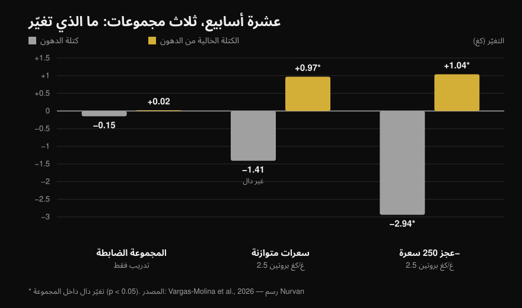
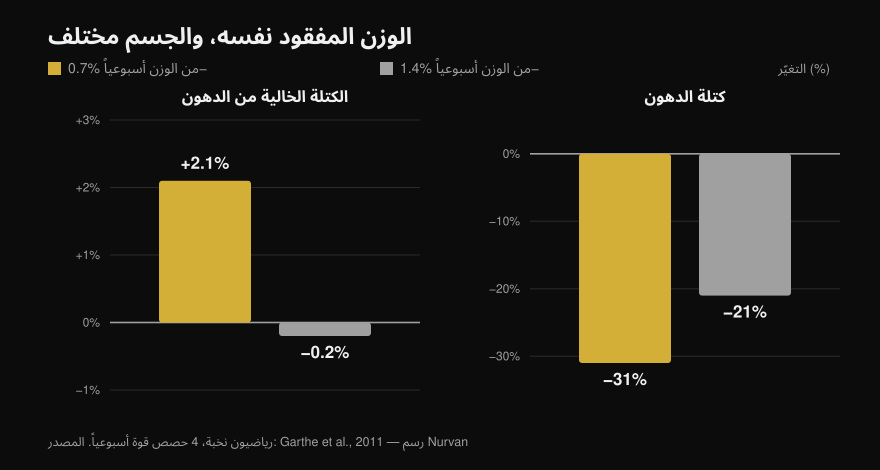

# إعادة تركيب الجسم: هل تحدث فعلاً؟

بقلم [Giammaria Loi](/autore/giammaria-loi) · حُدِّث في 13 أكتوبر 2026

منشوران واسعا الانتشار يقولان الفكرة نفسها من زاويتين: خسارة الدهون وبناء العضلات في الوقت نفسه أمر ممكن. الأول يقولها بخبرة المدرّب، والثاني يسند كلامه بدراسة من 2026 مع رسم بياني. كلاهما محق، لكن الدراسة المذكورة تقول أقل كثيراً مما تُفهِمه الشريحة — والسطران الأهم فيها هما بالضبط ما لا يذكره أي من المنشورين. هنا تجد الأرقام مقروءة من النص الكامل، وحدّ نقص السعرات الذي تشير إليه الأبحاث فعلاً، ونوع الشخص الذي تنفعه هذه الاستراتيجية.

## باختصار

- **إعادة تركيب الجسم موجودة ولا خلاف عليها.** موثّقة منذ سنوات وترد في بيان موقف ISSN حول الأنظمة الغذائية وتكوين الجسم (Aragon وزملاؤه، 2017). القول إن «العلم يعتبرها مستحيلة» هو هدف من صنع المنشور نفسه.
- **في الدراسة التي يستشهد بها المنشور، المجموعة متساوية السعرات لم تخسر دهوناً بدلالة إحصائية**: ‎−1.41 كغ عند p = 0.051 (Vargas-Molina وزملاؤه، 2026).
- **ونقص السعرات لم يتغلّب على سعرات الثبات.** التفاعل بين الزمن والمجموعة في كتلة الدهون غير ذي دلالة (p = 0.277)، ولا تصمد أي مقارنة ثنائية بعد التصحيح الإحصائي. بعشرة أشخاص في كل مجموعة، «النقص يحرق دهوناً أكثر» فرضية لا نتيجة.
- **المعطى الذي يغيّر الصورة ويغيب عن المنشورين: المشاركون كانوا على نسبة دهون 24.7%–24.8% وبخبرة تدريب سنة ونصف.** والمؤلفون أنفسهم يكتبون أن هذا المستوى من الدهون مرتفع بما يكفي لتسهيل إعادة التركيب.
- **الحدّ الأنفع لنقص السعرات ليس بالسعرات بل بنسبة من الوزن.** خسارة 0.7% من الوزن أسبوعياً **زادت** الكتلة الخالية من الدهن بنسبة 2.1% عند رياضيي النخبة؛ وعند 1.4% بقيت الكتلة الخالية من الدهن في مكانها (Garthe وزملاؤه، 2011).

## ما فعلته دراسة 2026 فعلاً

العمل المذكور في الشرائح موجود ومتاح بالكامل للقراءة: ثلاثون شخصاً بين 18 و35 عاماً، موزّعين على ثلاث مجموعات من عشرة (Vargas-Molina وزملاؤه، 2026). الثلاث جميعاً اتّبعت **البرنامج القوة نفسه، أربعة أيام أسبوعياً لعشرة أسابيع**، ثلاث مجموعات من عشر تكرارات لكل تمرين مع 1–2 تكرار احتياطي (RIR، أي التكرارات التي تبقى في رصيدك عند انتهاء المجموعة)، و2–3 دقائق راحة.

الاختلاف الوحيد كان في الطعام:

- **ISO**: سعرات الثبات، و**2.5 غ بروتين لكل كغ** من الوزن يومياً.
- **DEF**: **250 سعرة تحت الثبات**، والبروتين نفسه.
- **الضابطة**: التدريب نفسه، بلا أي توجيه غذائي.

بعد عشرة أسابيع، وبالقياس عبر DXA:

*متوسط التغيّر بين القياس القبلي والبعدي. النجمة تعني تغيّراً ذا دلالة إحصائية داخل المجموعة، والأعمدة بلا نجمة لا. التفاعل بين الزمن والمجموعة ذو دلالة في الكتلة الخالية من الدهن (p = 0.034) و**ليس** في كتلة الدهون (p = 0.277). البيانات من Vargas-Molina وزملاؤه، 2026. رسم أصلي من Nurvan.*

المجموعة الضابطة هي الجزء الأكثر دلالة، ولا يسمّيها أي من المنشورين: **أدّت البرنامج نفسه تماماً ولم يتغيّر فيها شيء**، ‎+0.02 كغ كتلة خالية من الدهن و‎−0.15 كغ دهون. عشرة أسابيع من الحديد الجدّي، أربع مرات أسبوعياً، دون لمس الغذاء: صفر إعادة تركيب. والمفارقة أنها المجموعة التي ربحت أكبر قدر من القوة (‎+4.38 كغ في البنش)، وهي نتيجة يصفها المؤلفون أنفسهم بأنها على الأرجح زائفة.

## ما تقوله الأبحاث حقاً

### «يمكن خسارة الدهون وبناء العضل معاً» — **مؤكَّد**

ليست جديدة ولا استفزازية. في عمل أصبح كلاسيكياً، وُضع أربعون شاباً في نقص قدره 40% لأربعة أسابيع، مع ست حصص أسبوعياً بين الأثقال والتدريب المتقطّع عالي الشدة: من تناول **2.4 غ/كغ بروتين ربح 1.2 كغ كتلة خالية من الدهن وخسر 4.8 كغ دهون**، مقابل ‎+0.1 كغ و‎−3.5 كغ لمن تناول 1.2 غ/كغ (Longland وزملاؤه، 2016). عضل يصعد ودهون تهبط، في الشهر نفسه، وفي نقص شديد.

وبيان موقف ISSN حول الأنظمة الغذائية وتكوين الجسم يتعامل مع المسألة كأمر مستقرّ، ويكتفي بتحديد الشروط التي تعمل فيها بأفضل صورة (Aragon وزملاؤه، 2017).

### «العلم يقول إنها مستحيلة» — **غير صحيح**

هذه هي المقدّمة الخطابية للمنشور الأول، وهي لا تصمد. لا يوجد موقف علمي ينكر إعادة التركيب: ما يوجد هو أدبيات تقيسها وتشرح حدودها. نموذج السعرات الداخلة والخارجة يتعلّق بالتوازن الكلي للطاقة، ولا يمنع نسيجين مختلفين من السير في اتجاهين متعاكسين في الفترة نفسها.

### «النقص الخفيف أنتج خسارة دهون إضافية» — **يحتاج توضيحاً**

داخل مجموعة DEF نعم: ‎−2.94 كغ دهون، p < 0.001. لكن سؤال المنشور مختلف، وهو ما إذا كان النقص قد تفوّق **على** سعرات الثبات. وهنا لا وجود للمعطى: **التفاعل بين الزمن والمجموعة في كتلة الدهون غير ذي دلالة (p = 0.277)**، وفي الملحق يكتب المؤلفون أن أي مقارنة ثنائية لا تبقى ذات دلالة بعد تصحيح بونفيروني.

وفي المجموعة متساوية السعرات، تتوقف خسارة الدهون البالغة ‎−1.41 كغ عند **p = 0.051**: خارج الحدّ بقليل. والشريحة تعرضها كأنها واقعة.

وأمر آخر لا يذكره المنشور: حجم الأثر على مكاسب الكتلة الخالية من الدهن هو 0.08، وهو في المقياس الذي استخدمه المؤلفون أنفسهم **«trivial»**، أي مهمل. كيلوغرام في عشرة أسابيع نتيجة حقيقية لكنها صغيرة، ويجب أن تُروى كما هي.

### «نقص 300 سعرة كحدّ أقصى» — **يحتاج توضيحاً**

مخطط الانتشار في الشريحة مأخوذ من التحليل التجميعي المرجعي في هذا الموضوع، الذي جمع دراسات التدريب في نقص سعرات لمدة ثلاثة أسابيع على الأقل. الرقم هناك مختلف: **الانحدار التجميعي يضع نقطة تصفير مكاسب الكتلة الخالية من الدهن عند نحو 500 سعرة يومياً**، وتوصية المؤلفين هي عدم تجاوز ذلك الحدّ (Murphy & Koehler، 2022). والعمل نفسه يبيّن أن القوة، في المقابل، تواصل الصعود حتى في النقص (حجم أثر ‎−0.31، غير ذي دلالة): يمكنك أن تصير أقوى وأنت تخسر دهوناً، حتى حين لا تنمو العضلة.

إذن «لا أكثر من 300» أكثر تحفّظاً من المصدر. ليس نصيحة خاطئة، لكنه ليس رقم الدراسة المذكورة.

### «إعادة التركيب أقلّ شيوعاً عند النحيفين» — **مؤكَّد في المبدأ**

النسب الدقيقة في الشريحة (رجال تحت 15%، نساء تحت 21%) تصفها Examine نفسها بأنها تقديرات تقريبية جداً، ولم أجد مصدراً أولياً يثبّتها. أما المبدأ فيصمد ومكتوب بوضوح: كلما زادت دهونك في البداية جاز أن يكون النقص أكثر جرأة؛ وكلما كنت أنحف كان الأنفع أن تخسر ببطء لتحفظ الكتلة الخالية من الدهن (Aragon وزملاؤه، 2017).

ومراجعة عن رياضيين مدرَّبين في تقييد سعري تُظهر ذلك جيداً: من بين ثلاث عشرة مجموعة، انخفضت الكتلة الخالية من الدهن في تسع. أما المجموعات الست التي حفظتها أو زادتها فكانت **من الأعلى دهوناً في البداية، أو في نقص أخفّ، أو أمام مثير تدريبي جديد**. والمجموعة الوحيدة النحيفة وفي نقص واضح التي حفظت كتلتها كانت تتناول 2.5–2.6 غ/كغ، أعلى مدخول في المراجعة كلها (Helms وزملاؤه، 2014). والفارق في الغذاء لا يكون عادةً في النشويات بل في ما لا تحسبه أصلاً، وهو ما نفصّله في [هل الكربوهيدرات تزيد الوزن؟ الدهون الخفيّة](/ar/blog/hal-alkarbohidrat-tazid-alwazn-duhun-khafiya).

وهنا تحديداً تُقرأ دراسة 2026 من جديد: المشاركون كانوا على نسبة دهون **24.7%–24.8%** وبخبرة **سنة ونصف**. في حدود المقال يقول المؤلفون ذلك صريحاً — هذا المستوى من الدهون مرتفع بما يكفي لتسهيل إعادة التركيب، ومع عيّنة أنحف وأكثر تدريباً كانت النتائج ستصير أقل وضوحاً. المنشور يعرض النتيجة ويتخطّى الشرط الذي يجعلها ممكنة.

## السؤال الصحيح ليس «كم سعرة» بل «بأي سرعة»

تثبيت رقم واحد من السعرات للجميع قليل المعنى: 250 سعرة نقص ضئيل لمن يزن 110 كغ وحصّة كبيرة لمن يزن 50. التفكير بنسبة من وزن الجسم أسبوعياً يعمل أفضل، وهناك دراسة اختبرت ذلك مباشرة.

أربعة وعشرون رياضياً من النخبة، جميعهم بأربع حصص قوة أسبوعياً، وُزّعوا عشوائياً لخسارة **0.7% من الوزن أسبوعياً أو 1.4%**. خسارة الوزن الكلية كانت متطابقة (‎−5.6% مقابل ‎−5.5%)، أما التكوين فلا (Garthe وزملاؤه، 2011):

*خسارة وزن متطابقة في المجموعتين، وتكوين جسم مختلف تماماً. الفرق في الكتلة الخالية من الدهن بين المجموعتين ذو دلالة إحصائية (p < 0.01). البيانات من Garthe وزملاؤه، 2011. رسم أصلي من Nurvan.*

المجموعة البطيئة **ربحت 2.1% من الكتلة الخالية من الدهن** بينما كانت تخسر نحو ثلث دهونها. والمجموعة السريعة خسرت الوزن نفسه في نصف المدة، لكن بكتلة خالية من الدهن ثابتة ودهون أقلّ انخفاضاً. هذه هي إعادة التركيب في رسم واحد: الرقم نفسه على الميزان، وجسم مختلف.

## كيف تطبّقها

1. **حدّد السرعة لا السعرات.** استهدف **0.7% من الوزن أسبوعياً**: 0.5 كغ أسبوعياً إن كان وزنك 70 كغ، و0.6 كغ إن كان 85. هذه هي السرعة التي رفعت الكتلة الخالية من الدهن عند الرياضيين (Garthe وزملاؤه، 2011).
2. **لا تنزل تحتها، والأهم ألّا تتجاوزها.** فوق نحو 500 سعرة نقص يومياً تتصفّر مكاسب الكتلة الخالية من الدهن (Murphy & Koehler، 2022). إذا هبط الميزان أسرع من المتوقع، أضف طعاماً بدل أن تحذف منه.
3. **بروتين مرتفع، لكن ليس بالضرورة 2.5 غ/كغ.** في سعرات الثبات، وفوق **1.62 غ/كغ**، لا يضيف البروتين الإضافي كتلة خالية من الدهن (Morton وزملاؤه، 2018). وفي النقص يرتفع الطلب: 2.3–3.1 غ لكل كغ من **الكتلة الخالية من الدهن**، نحو الأعلى بقدر ما تكون أنحف وأعمق في النقص (Helms وزملاؤه، 2014).
4. **درّب القوة بجدّية وقِسها.** في الدراسة لم تُعِد المجموعة التي تدرّبت دون متابعة غذائية تركيب أي شيء — لكن بلا أحمال تصعد لا يوجد المثير الذي يوجّه السعرات نحو العضلة. سجّل الحمل والتكرارات وRIR حصةً بحصة. ولتوزيع ذلك على الأسبوع، انظر [تقسيم التدريب: مبتدئ أم متقدّم](/ar/blog/taqsim-altadrib-mubtadi-mutaqaddim).
5. **لا تنظر إلى الوزن وحده.** إعادة التركيب هي الحالة التي يتحرك فيها الميزان قليلاً بينما يتغيّر الجسم. استخدم المحيطات، وصوراً كل أربعة أسابيع، والأحمال المرفوعة، لا رقم الصباح.
6. **اختر اللحظة المناسبة.** إن كنت تتدرّب منذ سنوات وأنت نحيف أصلاً، فستكون إعادة التركيب بطيئة ومحبطة: الأفضل حينها هدف واحد في كل مرة. وإن كنت تستأنف بعد توقف، أو لديك دهون لتخسرها، فهذه بالضبط النافذة التي تعمل فيها بأفضل صورة.

> ### 💡 مع Nurvan
> **إعادة التركيب لا تُرى إلا إذا قِست أمرين معاً.** في Nurvan يعمل مفكّرة الطعام على قاعدة بيانات CREA للأغذية الإيطالية، فيصبح إجمالي البروتين اليومي معطى حقيقياً لا تقديراً؛ وبجانبها يحفظ سجلّ التدريب الأحمال والتكرارات وRIR حصةً بحصة، وتبقى قياسات الجسم في الملف نفسه. وزن ثابت، وأحمال تصعد، ومحيطات تنزل: هذه هي إعادة التركيب، وتحتاج أن تراها في مكان واحد حتى تلاحظها. [جرّب Nurvan](https://nurvan.app)

## أسئلة شائعة

**كم عضلاً يمكن بناؤه أثناء خسارة الدهون؟**
في الدراسات المتاحة نحو **كيلوغرام واحد من الكتلة الخالية من الدهن في عشرة أسابيع** لدى أشخاص بخبرة سنة إلى سنتين ونسبة دهون حول 25% (Vargas-Molina وزملاؤه، 2026)، وحتى 1.2 كغ في أربعة أسابيع لدى غير المدرَّبين في بروتوكول شديد القسوة (Longland وزملاؤه، 2016). أرقام صغيرة: إعادة التركيب عملية بطيئة لا تحوّل في شهرين.

**هل نقص السعرات ضروري لإعادة التركيب؟**
ليس بالضرورة. في دراسة 2026 ربحت مجموعة سعرات الثبات أيضاً كتلة خالية من الدهن، ولم يبلغ فرق خسارة الدهون عن مجموعة النقص حدّ الدلالة الإحصائية (Vargas-Molina وزملاؤه، 2026). إن كنت في منتصف الطريق، فالثبات مع بروتين مرتفع خيار معقول.

**كم بروتيناً يلزم لخسارة الدهون دون خسارة العضل؟**
للمدرَّب في تقييد سعري: 2.3–3.1 غ لكل كغ من الكتلة الخالية من الدهن، مع الطرف الأعلى لمن هو أنحف وفي نقص أشدّ (Helms وزملاؤه، 2014؛ Aragon وزملاؤه، 2017). وفي الظروف العادية، فوق 1.62 غ لكل كغ من وزن الجسم لا تُربح كتلة خالية من الدهن إضافية (Morton وزملاؤه، 2018).

**هل تنفع إعادة التركيب من يتدرّب منذ سنوات؟**
تنفع أقل. يكتب مؤلفو دراسة 2026 أن القدرة على إعادة التركيب تتراجع مع الاقتراب من السقف الشخصي ومن نسب الدهون المنخفضة، وأن الرياضي المتقدّم والنحيف يحسن به أن يتبع هدفاً واحداً في كل مرة. المبتدئ، ومن يستأنف بعد توقف، في أفضل وضع.

## اقرأ أيضاً

- [هل الكربوهيدرات تزيد الوزن؟ الدهون الخفيّة](/ar/blog/hal-alkarbohidrat-tazid-alwazn-duhun-khafiya) — أين تختفي السعرات فعلاً.
- [تقسيم التدريب: مبتدئ أم متقدّم](/ar/blog/taqsim-altadrib-mubtadi-mutaqaddim) — كيف توزّع حصص القوة على الأسبوع.

## المصادر

1. Vargas-Molina S, García-Palumbo A, García-Sillero M, Bonilla DA, Petro JL, Aragon AA, Schoenfeld BJ, Benítez-Porres J, 2026. *Comparison of two nutritional protocols in body re-composition of resistance-trained participants.* Eur J Appl Physiol 126(7):4019–4030. PMID 41940947 — [doi:10.1007/s00421-026-06209-6](https://doi.org/10.1007/s00421-026-06209-6)
2. Murphy C, Koehler K, 2022. *Energy deficiency impairs resistance training gains in lean mass but not strength: A meta-analysis and meta-regression.* Scand J Med Sci Sports 32(1):125–137. PMID 34623696 — [doi:10.1111/sms.14075](https://doi.org/10.1111/sms.14075)
3. Garthe I, Raastad T, Refsnes PE, Koivisto A, Sundgot-Borgen J, 2011. *Effect of two different weight-loss rates on body composition and strength and power-related performance in elite athletes.* Int J Sport Nutr Exerc Metab 21(2):97–104. PMID 21558571 — [doi:10.1123/ijsnem.21.2.97](https://doi.org/10.1123/ijsnem.21.2.97)
4. Longland TM, Oikawa SY, Mitchell CJ, Devries MC, Phillips SM, 2016. *Higher compared with lower dietary protein during an energy deficit combined with intense exercise promotes greater lean mass gain and fat mass loss: a randomized trial.* Am J Clin Nutr 103(3):738–746. PMID 26817506 — [doi:10.3945/ajcn.115.119339](https://doi.org/10.3945/ajcn.115.119339)
5. Morton RW, Murphy KT, McKellar SR, Schoenfeld BJ, Henselmans M, Helms E, Aragon AA, Devries MC, Banfield L, Krieger JW, Phillips SM, 2018. *A systematic review, meta-analysis and meta-regression of the effect of protein supplementation on resistance training-induced gains in muscle mass and strength in healthy adults.* Br J Sports Med 52(6):376–384. PMID 28698222 — [doi:10.1136/bjsports-2017-097608](https://doi.org/10.1136/bjsports-2017-097608)
6. Helms ER, Zinn C, Rowlands DS, Brown SR, 2014. *A systematic review of dietary protein during caloric restriction in resistance trained lean athletes: a case for higher intakes.* Int J Sport Nutr Exerc Metab 24(2):127–138. PMID 24092765 — [doi:10.1123/ijsnem.2013-0054](https://doi.org/10.1123/ijsnem.2013-0054)
7. Aragon AA, Schoenfeld BJ, Wildman R, Kleiner S, VanDusseldorp T, Taylor L, Earnest CP, Arciero PJ, Wilborn C, Kalman DS, Stout JR, Willoughby DS, Campbell B, Arent SM, Bannock L, Smith-Ryan AE, Antonio J, 2017. *International Society of Sports Nutrition position stand: diets and body composition.* J Int Soc Sports Nutr 14:16. PMID 28630601 — [doi:10.1186/s12970-017-0174-y](https://doi.org/10.1186/s12970-017-0174-y)

*البيانات الببليوغرافية مُتحقَّق منها على PubMed. الشرارة الأولى: منشور [John Rusin](https://www.instagram.com/p/DdL-SJoEZYg/) وشرائح [Examine.com](https://www.instagram.com/p/Dd6tyK2F2HD/). لم يُستنسخ أي نص أو صورة من المنشورين: المحتوى والادعاءات أُعيدت كتابتها وتم التحقق منها على المصادر الأولية.*

---

**Giammaria Loi** مؤسس Nurvan. يتدرّب بالأثقال منذ 2012، ويعمل مدرّباً شخصياً ومعتمداً من FIPE منذ 2013، ويشارك في منافسات رفع الأثقال القوة على المستوى الوطني منذ 2018. كل مقال يوقّعه ينطلق من الدراسات العلمية وينتهي عند ما ينفع فعلاً في النادي. [صفحة الكاتب](/autore/giammaria-loi)

> ملاحظة: محتوى تثقيفي لا يغني عن رأي طبيب أو مختص مؤهل. إذا كنت تعاني من أمراض أو من اضطرابات في سلوك الأكل أو تتبع علاجاً، فتحدّث مع طبيبك قبل تغيير نظامك الغذائي.
