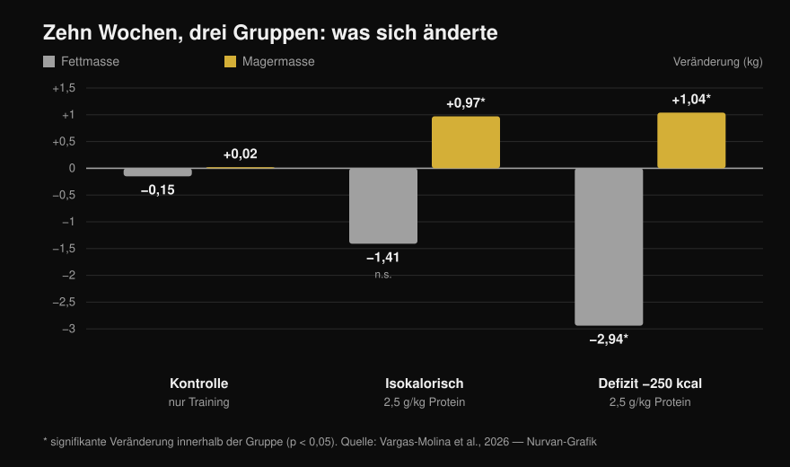
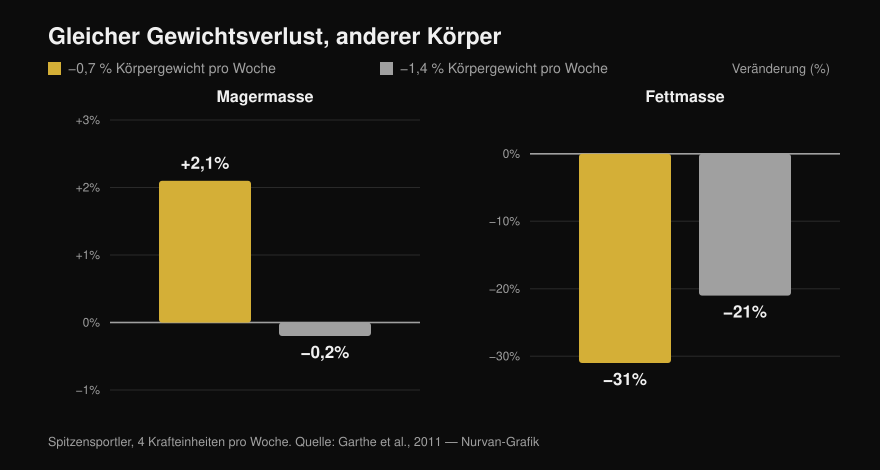

# Körperrekomposition: Geht das wirklich?

Von [Giammaria Loi](/autore/giammaria-loi) · aktualisiert am 13. Oktober 2026

Zwei viel geteilte Posts sagen aus unterschiedlichen Richtungen dasselbe: Fett verlieren und gleichzeitig Muskeln aufbauen ist möglich. Der eine sagt es aus der Praxis als Coach, der andere legt eine Studie von 2026 samt Balkendiagramm daneben. Im Kern haben beide recht — nur sagt die zitierte Studie deutlich weniger, als die Slide vermuten lässt, und die zwei wichtigsten Zeilen daraus kommen in keinem der beiden Posts vor. Hier stehen die Zahlen aus dem Volltext, die Defizitgrenze, die die Literatur tatsächlich nennt, und das Personenprofil, für das sich diese Strategie überhaupt lohnt.

## Kurz gefasst

- **Rekomposition existiert und ist nicht umstritten.** Sie ist seit Jahren dokumentiert und taucht im Position Stand der ISSN zu Diäten und Körperzusammensetzung auf (Aragon et al., 2017). Zu behaupten, „die Wissenschaft hält das für unmöglich", baut sich einen bequemen Gegner.
- **In der zitierten Studie hat die isokalorische Gruppe NICHT statistisch signifikant Fett verloren**: −1,41 kg bei p = 0,051 (Vargas-Molina et al., 2026).
- **Und das Defizit hat den Erhaltungsbedarf nicht geschlagen.** Die Interaktion zwischen Zeit und Gruppe für die Fettmasse ist nicht signifikant (p = 0,277), und kein Paarvergleich hält der statistischen Korrektur stand. Bei zehn Personen pro Gruppe ist „das Defizit lässt mehr Fett verlieren" eine Hypothese, kein Ergebnis.
- **Die Angabe, die alles verändert und in beiden Posts fehlt: die Teilnehmenden hatten 24,7–24,8 % Körperfett und 1,5 Jahre Trainingserfahrung.** Die Autoren schreiben selbst, dass dieser Fettanteil hoch genug ist, um Rekomposition zu begünstigen.
- **Die nützlichste Grenze steht nicht in Kalorien, sondern in Prozent des Körpergewichts.** 0,7 % Gewichtsverlust pro Woche brachte Spitzenathleten **2,1 % mehr** fettfreie Masse; bei 1,4 % blieb die fettfreie Masse stehen (Garthe et al., 2011).

## Was die Studie von 2026 wirklich gemacht hat

Die Arbeit aus dem Karussell existiert, ist frei zugänglich und lässt sich komplett lesen: dreißig Personen zwischen 18 und 35 Jahren, aufgeteilt in drei Gruppen à zehn (Vargas-Molina et al., 2026). Alle drei folgten **demselben Krafttrainingsprogramm, vier Tage pro Woche über zehn Wochen**, drei Sätze à zehn Wiederholungen pro Übung mit ein bis zwei Wiederholungen Reserve (RIR, die Wiederholungen, die am Satzende noch übrig wären) und zwei bis drei Minuten Pause.

Unterschiedlich war nur die Ernährung:

- **ISO**: Kalorien auf Erhaltungsniveau, **2,5 g Protein pro kg** Körpergewicht am Tag.
- **DEF**: **250 kcal unter dem Erhaltungsbedarf**, gleiche Proteinmenge.
- **Kontrolle**: gleiches Training, keine Ernährungsvorgabe.

Nach zehn Wochen, per DXA gemessen:

*Mittlere Veränderungen von vor zu nach der Intervention. Die Sternchen markieren die innerhalb einer Gruppe statistisch signifikanten Veränderungen; Balken ohne Sternchen sind es nicht. Die Interaktion zwischen Zeit und Gruppe ist für die fettfreie Masse signifikant (p = 0,034), für die Fettmasse aber NICHT (p = 0,277). Daten aus Vargas-Molina et al., 2026. Originalgrafik von Nurvan.*

Der interessanteste Teil ist die Kontrollgruppe, und genau sie nennt keiner der beiden Posts: **sie machte exakt dasselbe Training, und es änderte sich nichts**, +0,02 kg fettfreie Masse und −0,15 kg Fett. Zehn Wochen ernsthaftes Krafttraining, viermal pro Woche, ohne die Ernährung anzufassen: null Rekomposition. Kurios dabei: Diese Gruppe legte am meisten Kraft zu (+4,38 kg im Bankdrücken), ein Ergebnis, das die Autoren selbst als vermutlich zufällig einordnen.

## Was die Forschung wirklich sagt

### „Man kann Fett verlieren und gleichzeitig Muskeln aufbauen" — **Bestätigt**

Das ist weder neu noch provokant. In einer inzwischen klassischen Arbeit wurden vierzig junge Männer vier Wochen lang in ein Defizit von 40 % geschickt, mit sechs Einheiten pro Woche aus Gewichten und hochintensiven Intervallen: Wer **2,4 g/kg Protein aß, baute 1,2 kg fettfreie Masse auf und verlor 4,8 kg Fett**, gegenüber +0,1 kg und −3,5 kg bei 1,2 g/kg (Longland et al., 2016). Muskeln rauf, Fett runter, im selben Monat, in einem harten Defizit.

Der Position Stand der ISSN zu Diäten und Körperzusammensetzung behandelt die Sache als gesichert und beschränkt sich darauf, die Bedingungen zu beschreiben, unter denen sie am besten funktioniert (Aragon et al., 2017).

### „Die Wissenschaft sagt, das sei unmöglich" — **Widerlegt**

Das ist die rhetorische Vorlage des ersten Posts, und sie hält nicht. Es gibt keine wissenschaftliche Position, die Rekomposition leugnet: Es gibt eine Literatur, die sie misst und ihre Grenzen beschreibt. Das Modell von zugeführter und verbrauchter Energie betrifft die Gesamtenergiebilanz — es verbietet nicht, dass sich zwei verschiedene Gewebe im selben Zeitraum in entgegengesetzte Richtungen bewegen.

### „Das leichte Defizit brachte zusätzlichen Fettverlust" — **Zu präzisieren**

Innerhalb der DEF-Gruppe ja: −2,94 kg Fett, p < 0,001. Die Frage des Posts ist aber eine andere, nämlich ob das Defizit *besser* war als der Erhaltungsbedarf. Und dafür fehlt die Grundlage: **Die Interaktion Zeit × Gruppe für die Fettmasse ist nicht signifikant (p = 0,277)**, und im Zusatzmaterial schreiben die Autoren, dass nach der Bonferroni-Korrektur kein einziger Paarvergleich signifikant bleibt.

In der isokalorischen Gruppe bleibt der Fettverlust von −1,41 kg außerdem bei **p = 0,051** stehen: knapp daneben. Die Slide verkauft ihn als Tatsache.

Noch etwas, das im Post fehlt: Die Effektstärke der Zuwächse an fettfreier Masse liegt bei 0,08, was auf der von den Autoren selbst benutzten Skala **„trivial"** heißt, also vernachlässigbar. Ein Kilo in zehn Wochen ist ein echtes, aber kleines Ergebnis — und sollte auch so erzählt werden.

### „Maximal 300 kcal Defizit" — **Zu präzisieren**

Das Streudiagramm der Slide stammt aus der einschlägigen Meta-Analyse zum Thema, die alle Trainingsstudien im Defizit von mindestens drei Wochen Dauer zusammengeführt hat. Dort steht eine andere Zahl: **Die Meta-Regression verortet den Punkt, an dem die Zuwächse an fettfreier Masse auf null fallen, bei etwa 500 kcal pro Tag**, und die Empfehlung der Autoren lautet, diese Grenze nicht zu überschreiten (Murphy & Koehler, 2022). Dieselbe Arbeit zeigt, dass die Kraft im Defizit dagegen weiter steigt (Effekt −0,31, nicht signifikant): Beim Abnehmen kannst du stärker werden, auch wenn der Muskel nicht wächst.

Das „nicht mehr als 300" ist also vorsichtiger als die Quelle. Als Ratschlag ist das nicht falsch, aber es ist nicht die Zahl der zitierten Studie.

### „Rekomposition ist bei schlanken Menschen seltener" — **Im Prinzip bestätigt**

Die genauen Prozentwerte der Slide (Männer unter 15 %, Frauen unter 21 %) werden von Examine selbst als sehr grobe Schätzungen bezeichnet, und ich habe keine Primärquelle gefunden, die sie festlegt. Das Prinzip steht dagegen schwarz auf weiß: Je mehr Fett am Anfang, desto aggressiver darf das Defizit sein; je schlanker du bist, desto langsamer solltest du abnehmen, um die fettfreie Masse zu retten (Aragon et al., 2017).

Eine Übersichtsarbeit zu trainierten Athleten in Kalorienrestriktion zeigt das deutlich: Von dreizehn Gruppen verlor die fettfreie Masse in neun. Die sechs Gruppen, die sie hielten oder steigerten, gehörten zu den **fettreicheren zu Beginn, waren in einem leichteren Defizit oder trafen auf einen neuen Trainingsreiz**. Die einzige schlanke Gruppe in ausgeprägtem Defizit, die ihre fettfreie Masse hielt, aß 2,5–2,6 g/kg — die höchste Zufuhr der ganzen Übersicht (Helms et al., 2014).

Und hier muss die Studie von 2026 neu gelesen werden: Die Teilnehmenden lagen bei **24,7–24,8 % Körperfett** und hatten **1,5 Jahre** Erfahrung. In den Limitationen sagen die Autoren es ausdrücklich — dieser Fettanteil ist hoch genug, um Rekomposition zu begünstigen, und mit einer schlankeren, trainierteren Stichprobe wären die Ergebnisse weniger deutlich ausgefallen. Der Post zeigt das Ergebnis und überspringt die Bedingung, die es möglich macht.

## Die richtige Frage ist nicht „wie viele Kalorien", sondern „wie schnell"

Eine Kalorienzahl für alle festzulegen, bringt wenig: 250 kcal sind ein winziges Defizit für jemanden mit 110 kg und ein großer Brocken für jemanden mit 50 kg. In Prozent des Körpergewichts pro Woche zu denken funktioniert besser, und es gibt eine Studie, die genau das direkt getestet hat.

Vierundzwanzig Spitzenathleten, alle mit vier Krafteinheiten pro Woche, wurden randomisiert zugeteilt: **0,7 % Gewichtsverlust pro Woche oder 1,4 %**. Der Gesamtgewichtsverlust war identisch (−5,6 % gegenüber −5,5 %), die Zusammensetzung nicht (Garthe et al., 2011):

*Gleicher Gesamtgewichtsverlust in beiden Gruppen, sehr unterschiedliche Körperzusammensetzung. Der Unterschied in der fettfreien Masse zwischen den Gruppen ist statistisch signifikant (p < 0,01). Daten aus Garthe et al., 2011. Originalgrafik von Nurvan.*

Die langsame Gruppe **gewann 2,1 % fettfreie Masse**, während sie fast ein Drittel ihres Fetts verlor. Die schnelle Gruppe verlor dasselbe Gewicht in der halben Zeit, aber mit stehender fettfreier Masse und weniger abgebautem Fett. Das ist Rekomposition in einer einzigen Grafik: gleiches Gewicht auf der Waage, anderer Körper.

Dazu passt, dass das Defizit selten dort entsteht, wo man es vermutet. Flüssige Kalorien, Öl in der Pfanne und Soßen verschieben die Bilanz schneller als jede Makroverteilung — wir haben das in [machen Kohlenhydrate dick und wo das versteckte Fett sitzt](/de/blog/machen-kohlenhydrate-dick-verstecktes-fett) im Detail durchgerechnet.

## So setzt du es um

1. **Entscheide über das Tempo, nicht über die Kalorien.** Ziel sind **0,7 % des Körpergewichts pro Woche**: 0,5 kg pro Woche bei 70 kg, 0,6 kg bei 85 kg. Das ist das Tempo, bei dem die fettfreie Masse der Athleten gestiegen ist (Garthe et al., 2011).
2. **Geh nicht darunter, und vor allem nicht darüber.** Jenseits von rund 500 kcal Defizit pro Tag fallen die Zuwächse an fettfreier Masse auf null (Murphy & Koehler, 2022). Sinkt die Waage schneller als geplant, füge Essen hinzu, statt weiter zu kürzen.
3. **Viel Protein, aber nicht zwangsläufig 2,5 g/kg.** Im Kalorienerhalt bringt Protein über **1,62 g/kg** keine zusätzliche fettfreie Masse (Morton et al., 2018). Im Defizit steigt der Bedarf: 2,3–3,1 g pro kg **fettfreier Masse**, Richtung Obergrenze, je schlanker du bist und je tiefer das Defizit (Helms et al., 2014).
4. **Trainiere Kraft wirklich und messe sie.** In der Studie hat die Gruppe, die nur trainierte, ohne die Ernährung zu steuern, gar nichts rekomponiert — aber ohne steigende Lasten fehlt der Reiz, der die Kalorien in den Muskel lenkt. Notiere Last, Wiederholungen und RIR Einheit für Einheit, und bau sie in eine Woche ein, die zu deinem Stand passt: [welcher Trainingssplit zu Anfängern und Fortgeschrittenen passt](/de/blog/trainingssplit-anfaenger-fortgeschrittene).
5. **Hör auf, nur das Gewicht anzuschauen.** Rekomposition ist genau der Fall, in dem sich die Waage kaum bewegt, während sich der Körper verändert. Nutze Umfänge, Fotos im Abstand von vier Wochen und bewegte Lasten, nicht die Zahl am Morgen.
6. **Wähl den richtigen Moment.** Wer aus Jahren Training kommt und schon definiert ist, erlebt Rekomposition als langsam und frustrierend: Dann ist es besser, eine Sache nach der anderen zu machen. Wer nach einer Pause neu startet oder Fett zu verlieren hat, ist genau in dem Fenster, in dem es am besten funktioniert.

> ### 💡 Mit Nurvan
> **Rekomposition sieht man nur, wenn man zwei Dinge gleichzeitig misst.** In Nurvan arbeitet das Ernährungstagebuch mit der CREA-Datenbank der italienischen Lebensmittel, die Tagessumme an Protein ist also ein echter Wert und keine Schätzung; daneben hält das Trainingstagebuch Lasten, Wiederholungen und RIR Einheit für Einheit, und die Körpermaße bleiben im selben Profil. Gewicht steht, Lasten steigen, Umfänge sinken: Das ist Rekomposition — und man muss sie an einem Ort sehen, um sie überhaupt zu bemerken. [Nurvan testen](https://nurvan.app)

## Häufige Fragen

**Wie viel Muskel kann man aufbauen, während man Fett verliert?**
In den verfügbaren Studien rund **1 kg fettfreie Masse in 10 Wochen** bei Menschen mit ein bis zwei Jahren Training und etwa 25 % Körperfett (Vargas-Molina et al., 2026), und bis zu 1,2 kg in vier Wochen bei Untrainierten in einem sehr harten Protokoll (Longland et al., 2016). Das sind kleine Zahlen: Rekomposition ist ein langsamer Prozess, keine Verwandlung in zwei Monaten.

**Braucht Rekomposition ein Kaloriendefizit?**
Nicht zwingend. In der Studie von 2026 hat auch die Gruppe im Kalorienerhalt fettfreie Masse aufgebaut, und der Unterschied im Fettverlust gegenüber der Defizitgruppe erreichte keine statistische Signifikanz (Vargas-Molina et al., 2026). Wenn du irgendwo in der Mitte stehst, ist Erhaltung mit hohem Protein eine sinnvolle Option.

**Wie viel Protein braucht man, um Fett ohne Muskelverlust zu verlieren?**
Für Trainierte in Kalorienrestriktion 2,3–3,1 g pro kg fettfreier Masse, mit dem oberen Teil der Spanne für Schlanke in tiefem Defizit (Helms et al., 2014; Aragon et al., 2017). Unter normalen Bedingungen bringt mehr als 1,62 g pro kg Körpergewicht keine zusätzliche fettfreie Masse (Morton et al., 2018).

**Funktioniert Rekomposition auch für Leute, die seit Jahren trainieren?**
Weniger gut. Die Autoren der Studie von 2026 schreiben, dass die Fähigkeit zur Rekomposition abnimmt, je näher man seinem Potenzial und niedrigen Fettwerten kommt, und dass schlanke, fortgeschrittene Athleten besser ein Ziel nach dem anderen verfolgen. Am besten aufgestellt sind Einsteiger und Rückkehrer nach einer Pause.

## Lies auch

- [Machen Kohlenhydrate dick? Das versteckte Fett](/de/blog/machen-kohlenhydrate-dick-verstecktes-fett) — wo das Defizit wirklich entsteht.
- [Trainingssplit: Anfänger oder Fortgeschrittene](/de/blog/trainingssplit-anfaenger-fortgeschrittene) — wie die Krafteinheiten in die Woche passen.

## Quellen

1. Vargas-Molina S, García-Palumbo A, García-Sillero M, Bonilla DA, Petro JL, Aragon AA, Schoenfeld BJ, Benítez-Porres J, 2026. *Comparison of two nutritional protocols in body re-composition of resistance-trained participants.* Eur J Appl Physiol 126(7):4019–4030. PMID 41940947 — [doi:10.1007/s00421-026-06209-6](https://doi.org/10.1007/s00421-026-06209-6)
2. Murphy C, Koehler K, 2022. *Energy deficiency impairs resistance training gains in lean mass but not strength: A meta-analysis and meta-regression.* Scand J Med Sci Sports 32(1):125–137. PMID 34623696 — [doi:10.1111/sms.14075](https://doi.org/10.1111/sms.14075)
3. Garthe I, Raastad T, Refsnes PE, Koivisto A, Sundgot-Borgen J, 2011. *Effect of two different weight-loss rates on body composition and strength and power-related performance in elite athletes.* Int J Sport Nutr Exerc Metab 21(2):97–104. PMID 21558571 — [doi:10.1123/ijsnem.21.2.97](https://doi.org/10.1123/ijsnem.21.2.97)
4. Longland TM, Oikawa SY, Mitchell CJ, Devries MC, Phillips SM, 2016. *Higher compared with lower dietary protein during an energy deficit combined with intense exercise promotes greater lean mass gain and fat mass loss: a randomized trial.* Am J Clin Nutr 103(3):738–746. PMID 26817506 — [doi:10.3945/ajcn.115.119339](https://doi.org/10.3945/ajcn.115.119339)
5. Morton RW, Murphy KT, McKellar SR, Schoenfeld BJ, Henselmans M, Helms E, Aragon AA, Devries MC, Banfield L, Krieger JW, Phillips SM, 2018. *A systematic review, meta-analysis and meta-regression of the effect of protein supplementation on resistance training-induced gains in muscle mass and strength in healthy adults.* Br J Sports Med 52(6):376–384. PMID 28698222 — [doi:10.1136/bjsports-2017-097608](https://doi.org/10.1136/bjsports-2017-097608)
6. Helms ER, Zinn C, Rowlands DS, Brown SR, 2014. *A systematic review of dietary protein during caloric restriction in resistance trained lean athletes: a case for higher intakes.* Int J Sport Nutr Exerc Metab 24(2):127–138. PMID 24092765 — [doi:10.1123/ijsnem.2013-0054](https://doi.org/10.1123/ijsnem.2013-0054)
7. Aragon AA, Schoenfeld BJ, Wildman R, Kleiner S, VanDusseldorp T, Taylor L, Earnest CP, Arciero PJ, Wilborn C, Kalman DS, Stout JR, Willoughby DS, Campbell B, Arent SM, Bannock L, Smith-Ryan AE, Antonio J, 2017. *International Society of Sports Nutrition position stand: diets and body composition.* J Int Soc Sports Nutr 14:16. PMID 28630601 — [doi:10.1186/s12970-017-0174-y](https://doi.org/10.1186/s12970-017-0174-y)

*Bibliografische Angaben über PubMed geprüft. Ausgangspunkt: der Post von [John Rusin](https://www.instagram.com/p/DdL-SJoEZYg/) und das Karussell von [Examine.com](https://www.instagram.com/p/Dd6tyK2F2HD/). Kein Text und kein Bild aus den beiden Posts wurde übernommen: Thema und Aussagen wurden neu geschrieben und an den Primärquellen geprüft.*

---

**Giammaria Loi** ist der Gründer von Nurvan. Er trainiert seit 2012 mit Gewichten, arbeitet seit 2013 als FIPE-zertifizierter Personal Trainer und Coach und startet seit 2018 auf nationaler Ebene im Powerlifting. Jeder Artikel, den er zeichnet, beginnt bei den Studien und endet bei dem, was im Gym wirklich funktioniert. [Autorenseite](/autore/giammaria-loi)

> Hinweis: informativer Inhalt, der nicht die Einschätzung einer Ärztin, eines Arztes oder einer qualifizierten Fachperson ersetzt. Bei Vorerkrankungen, Essstörungen oder laufender Therapie sprich mit deiner Ärztin oder deinem Arzt, bevor du deine Ernährung umstellst.
