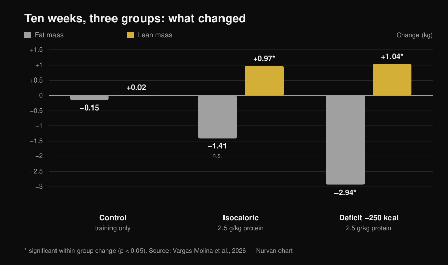
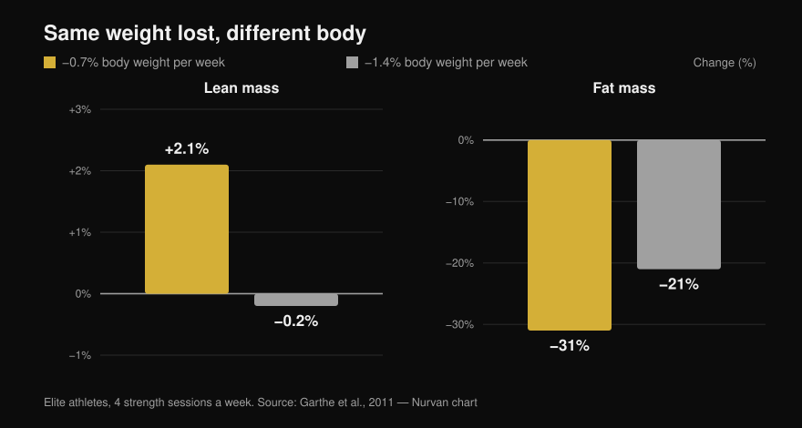

# Body recomposition: can you actually do it?

By [Giammaria Loi](/autore/giammaria-loi) · updated 13 October 2026

Two widely shared posts make the same case from opposite ends of the spectrum: you can lose fat and gain muscle at the same time. One argues it from nineteen years of coaching, the other brings a 2026 trial complete with a bar chart. Both are right about the headline — but the study behind the chart says a good deal less than the slide implies, and the two most important lines in it are exactly the ones neither post mentions. Here are the numbers read off the full text, the deficit ceiling the literature actually points to, and the kind of person this strategy is worth it for.

## The short version

- **Recomposition is real and nobody serious disputes it.** It has been documented for years and it appears in the ISSN position stand on diets and body composition (Aragon et al., 2017). "Science says it is impossible" is a straw man.
- **In the study the post cites, the isocaloric group did NOT lose fat to a statistically significant degree**: −1.41 kg at p = 0.051 (Vargas-Molina et al., 2026).
- **And the deficit did not beat maintenance.** The time × group interaction for fat mass is not significant (p = 0.277), and no pairwise comparison survives the statistical correction. With ten people per group, "the deficit strips more fat" is a hypothesis, not a finding.
- **The detail that changes everything, missing from both posts: participants were at 24.7-24.8% body fat with 1.5 years of training behind them.** The authors themselves write that this is a high enough fat level to make recomposition easier.
- **The most useful deficit threshold is not in calories, it is in percent of body weight.** Losing 0.7% of body weight per week made elite athletes *gain* 2.1% lean mass; at 1.4% per week, lean mass flatlined (Garthe et al., 2011).

## What the 2026 study actually did

The trial in the carousel is real, open access and readable end to end: thirty people aged 18 to 35, split into three groups of ten (Vargas-Molina et al., 2026). All three followed the **same strength programme, four days a week for ten weeks** — three sets of ten per exercise with 1-2 reps in reserve (RIR, the reps you could still have done at the end of the set) and 2-3 minutes of rest.

Only the food changed:

- **ISO**: maintenance calories, **2.5 g of protein per kg** of body weight per day.
- **DEF**: **250 kcal below maintenance**, same protein.
- **Control**: same training, no nutritional guidance at all.

After ten weeks, measured on DXA:

*Mean pre-to-post changes. Asterisks mark the statistically significant changes within each group; bars without one are not significant. The time × group interaction is significant for lean mass (p = 0.034) but NOT for fat mass (p = 0.277). Data from Vargas-Molina et al., 2026. Original Nurvan chart.*

The control group is the most interesting part of the paper and neither post names it: **it did exactly the same training and nothing happened**, +0.02 kg of lean mass and −0.15 kg of fat. Ten weeks of serious lifting, four times a week, with the diet left alone: zero recomposition. Oddly enough it is also the group that gained the most strength (+4.38 kg on the bench press), a result the authors themselves call probably spurious.

## What the research really says

### "You can lose fat and gain muscle at the same time" — **Confirmed**

This is neither new nor provocative. In a now-classic trial, forty young men spent four weeks in a 40% deficit with six training sessions a week combining weights and high-intensity intervals: those eating **2.4 g/kg of protein gained 1.2 kg of lean mass and lost 4.8 kg of fat**, against +0.1 kg and −3.5 kg for those eating 1.2 g/kg (Longland et al., 2016). Lean mass up and fat down, in the same month, in a brutal deficit.

The ISSN position stand on diets and body composition treats the phenomenon as settled and simply spells out the conditions under which it works best (Aragon et al., 2017).

### "Science says it is impossible" — **Debunked**

That is the rhetorical setup of the first post, and it does not hold. There is no scientific position denying recomposition: there is a body of literature that measures it and explains its limits. Calories in versus calories out describes total energy balance; it does not forbid two different tissues from moving in opposite directions over the same period.

### "The mild deficit produced extra fat loss" — **Needs context**

Within the DEF group, yes: −2.94 kg of fat, p < 0.001. But the claim in the post is a different one — whether the deficit did *better* than maintenance. And that evidence is not there: **the time × group interaction for fat mass is not significant (p = 0.277)**, and in the supplementary material the authors state that no pairwise comparison remains significant after the Bonferroni correction.

In the isocaloric group, meanwhile, the −1.41 kg of fat loss stops at **p = 0.051**: just outside. The slide presents it as a fact.

Something else the post leaves out: the effect size for the lean mass gains is 0.08, which on the scale the authors themselves use is **"trivial"** — negligible. A kilo in ten weeks is a real result but a small one, and it deserves to be reported as such.

### "Keep the deficit under 300 kcal" — **Needs context**

The scatter plot on the slide comes from the reference meta-analysis on the topic, which pooled resistance-training studies run in a deficit for at least three weeks. The number there is different: **the meta-regression puts the point where lean mass gains disappear at roughly 500 kcal per day**, and the authors' recommendation is not to exceed that threshold (Murphy & Koehler, 2022). The same paper shows that strength, by contrast, keeps climbing in a deficit (effect −0.31, not significant): you can get stronger while losing fat even when the muscle is not growing.

So "no more than 300" is more conservative than the source. It is not bad advice, but it is not the number in the study being cited.

### "Recomposition is less common in people who are already lean" — **Confirmed in principle**

The exact cut-offs on the slide (men under 15%, women under 21%) are described by Examine itself as very rough estimates, and I could not find a primary source that fixes them. The principle, though, holds and is stated in black and white: the more fat you carry at the start, the more aggressive the deficit can be; the leaner you are, the more it pays to lose weight slowly to protect lean mass (Aragon et al., 2017).

A review of trained athletes in caloric restriction illustrates it well: across thirteen groups, lean mass fell in nine. The six groups that held or increased it were **among the fattest at baseline, in a milder deficit, or exposed to a novel training stimulus**. The only lean group in a marked deficit that kept its lean mass was eating 2.5-2.6 g/kg, the highest intake in the entire review (Helms et al., 2014).

And this is where the 2026 study has to be read again: participants were at **24.7-24.8% body fat** with **1.5 years** of experience. In the limitations the authors say it outright — that level of body fat is high enough to facilitate recomposition, and with a leaner, better-trained sample the results would have been less clear-cut. The post shows the outcome and skips the condition that made it possible.

## The right question is not "how many calories" but "how fast"

Setting one calorie number for everybody makes little sense: 250 kcal is a rounding error for someone weighing 110 kg and a serious cut for someone weighing 50 kg. Thinking in percent of body weight per week works better, and one study tested exactly that.

Twenty-four elite athletes, all doing four strength sessions a week, were randomised to lose either **0.7% of body weight per week or 1.4%**. Total weight loss came out identical (−5.6% versus −5.5%); the composition did not (Garthe et al., 2011):

*Identical total weight loss in the two groups, very different body composition. The between-group difference in lean mass is statistically significant (p < 0.01). Data from Garthe et al., 2011. Original Nurvan chart.*

The slow group **gained 2.1% lean mass** while losing nearly a third of its fat. The fast group lost the same weight in half the time, but with lean mass standing still and less fat removed. That is recomposition in a single chart: same number on the scale, different body.

## How to apply it

1. **Pick a rate, not a calorie number.** Aim for **0.7% of body weight per week**: 0.5 kg a week at 70 kg, 0.6 kg at 85 kg. That is the rate that pushed lean mass up in athletes (Garthe et al., 2011).
2. **Don't undershoot it, but above all don't overshoot.** Past roughly 500 kcal of daily deficit, lean mass gains go to zero (Murphy & Koehler, 2022). If the scale is dropping faster than planned, add food rather than taking more away.
3. **Protein high, but not necessarily 2.5 g/kg.** At maintenance calories, anything above **1.62 g/kg** adds no further lean mass (Morton et al., 2018). In a deficit the requirement rises: 2.3-3.1 g per kg of **lean mass**, towards the top end the leaner you are and the deeper the deficit (Helms et al., 2014). If you don't know where to start, we ran the maths in detail in [how much protein you actually need when cutting](/en/blog/protein-intake-cutting).
4. **Train strength properly and track it.** In the study, the group that trained without touching its diet recomposed nothing — but without loads that climb there is no stimulus directing calories towards muscle. Log load, reps and RIR session by session.
5. **Stop looking only at the scale.** Recomposition is the one case where body weight barely moves while the body changes. Use circumferences, photos four weeks apart and the loads you lift, not the morning number.
6. **Choose the right moment.** If you have years of training behind you and you are already lean, recomposition turns slow and frustrating; in that case you are better off doing one thing at a time. If you are coming back after a break, or you have fat to lose, that is precisely the window where it works best.

> ### 💡 With Nurvan
> **Recomposition only shows up if you measure two things at once.** In Nurvan the food diary runs on the CREA database of Italian foods, so your daily protein total is a real figure and not a guess; alongside it, the training log keeps load, reps and RIR session by session, and your body measurements live in the same profile. Weight flat, loads climbing, circumferences dropping: that is recomposition, and you need to see it all in one place to notice it at all. [Try Nurvan](https://nurvan.app)

## Frequently asked questions

**How much muscle can you gain while losing fat?**
In the available studies, roughly **1 kg of lean mass in 10 weeks** in people with 1-2 years of training and body fat around 25% (Vargas-Molina et al., 2026), and up to 1.2 kg in four weeks in untrained subjects on a very harsh protocol (Longland et al., 2016). These are small numbers: recomposition is a slow process, not a two-month transformation.

**Do you need a calorie deficit for body recomposition?**
Not necessarily. In the 2026 study even the maintenance-calorie group gained lean mass, and the difference in fat loss compared with the deficit group did not reach statistical significance (Vargas-Molina et al., 2026). If you are somewhere in the middle, maintenance with high protein is a sensible option.

**How much protein do you need to lose fat without losing muscle?**
For trained people in caloric restriction, 2.3-3.1 g per kg of lean mass, with the upper end for those who are leaner and in a more severe deficit (Helms et al., 2014; Aragon et al., 2017). Under normal conditions, past 1.62 g per kg of body weight you gain no extra lean mass (Morton et al., 2018).

**Does recomposition work for people who have trained for years?**
Less well. The authors of the 2026 study write that the capacity to recompose declines as you approach your genetic ceiling and low body fat levels, and that the lean, advanced lifter is better off chasing one goal at a time. The beginner, or anyone restarting after a layoff, is in the best possible position.

## Read next

- [Protein intake when cutting: how much you really need](/en/blog/protein-intake-cutting)
- [Do carbs make you gain weight? The hidden fat](/en/blog/do-carbs-make-you-gain-weight-hidden-fat)
- [Training split: beginner vs advanced](/en/blog/training-split-beginner-vs-advanced)

## Sources

1. Vargas-Molina S, García-Palumbo A, García-Sillero M, Bonilla DA, Petro JL, Aragon AA, Schoenfeld BJ, Benítez-Porres J, 2026. *Comparison of two nutritional protocols in body re-composition of resistance-trained participants.* Eur J Appl Physiol 126(7):4019–4030. PMID 41940947 — [doi:10.1007/s00421-026-06209-6](https://doi.org/10.1007/s00421-026-06209-6)
2. Murphy C, Koehler K, 2022. *Energy deficiency impairs resistance training gains in lean mass but not strength: A meta-analysis and meta-regression.* Scand J Med Sci Sports 32(1):125–137. PMID 34623696 — [doi:10.1111/sms.14075](https://doi.org/10.1111/sms.14075)
3. Garthe I, Raastad T, Refsnes PE, Koivisto A, Sundgot-Borgen J, 2011. *Effect of two different weight-loss rates on body composition and strength and power-related performance in elite athletes.* Int J Sport Nutr Exerc Metab 21(2):97–104. PMID 21558571 — [doi:10.1123/ijsnem.21.2.97](https://doi.org/10.1123/ijsnem.21.2.97)
4. Longland TM, Oikawa SY, Mitchell CJ, Devries MC, Phillips SM, 2016. *Higher compared with lower dietary protein during an energy deficit combined with intense exercise promotes greater lean mass gain and fat mass loss: a randomized trial.* Am J Clin Nutr 103(3):738–746. PMID 26817506 — [doi:10.3945/ajcn.115.119339](https://doi.org/10.3945/ajcn.115.119339)
5. Morton RW, Murphy KT, McKellar SR, Schoenfeld BJ, Henselmans M, Helms E, Aragon AA, Devries MC, Banfield L, Krieger JW, Phillips SM, 2018. *A systematic review, meta-analysis and meta-regression of the effect of protein supplementation on resistance training-induced gains in muscle mass and strength in healthy adults.* Br J Sports Med 52(6):376–384. PMID 28698222 — [doi:10.1136/bjsports-2017-097608](https://doi.org/10.1136/bjsports-2017-097608)
6. Helms ER, Zinn C, Rowlands DS, Brown SR, 2014. *A systematic review of dietary protein during caloric restriction in resistance trained lean athletes: a case for higher intakes.* Int J Sport Nutr Exerc Metab 24(2):127–138. PMID 24092765 — [doi:10.1123/ijsnem.2013-0054](https://doi.org/10.1123/ijsnem.2013-0054)
7. Aragon AA, Schoenfeld BJ, Wildman R, Kleiner S, VanDusseldorp T, Taylor L, Earnest CP, Arciero PJ, Wilborn C, Kalman DS, Stout JR, Willoughby DS, Campbell B, Arent SM, Bannock L, Smith-Ryan AE, Antonio J, 2017. *International Society of Sports Nutrition position stand: diets and body composition.* J Int Soc Sports Nutr 14:16. PMID 28630601 — [doi:10.1186/s12970-017-0174-y](https://doi.org/10.1186/s12970-017-0174-y)

*Bibliographic data verified on PubMed. Starting point: the post by [John Rusin](https://www.instagram.com/p/DdL-SJoEZYg/) and the carousel by [Examine.com](https://www.instagram.com/p/Dd6tyK2F2HD/). No text or image from either post has been reproduced: the topic and the claims were rewritten and checked against the primary sources.*

---

**Giammaria Loi** is the founder of Nurvan. He has been lifting since 2012, has worked as a FIPE-certified personal trainer and coach since 2013, and has competed in powerlifting at national level since 2018. Every article he writes starts from the research and ends with what actually works in the gym. [Author page](/autore/giammaria-loi)

> Note: educational content, not a substitute for advice from a doctor or qualified professional. If you have a medical condition, a history of disordered eating or you are on medication, talk to your doctor before changing your diet.
