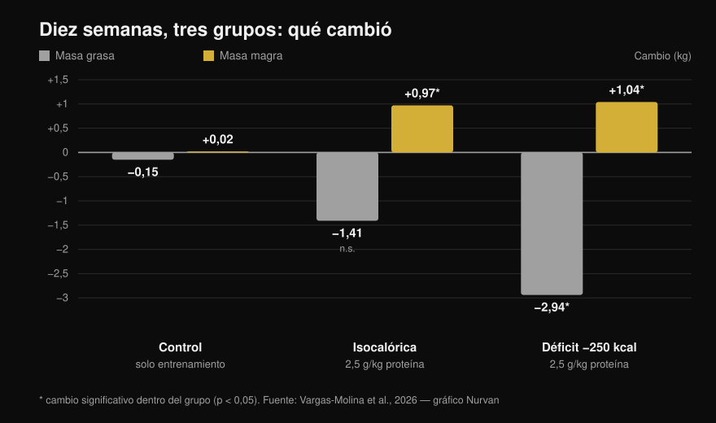
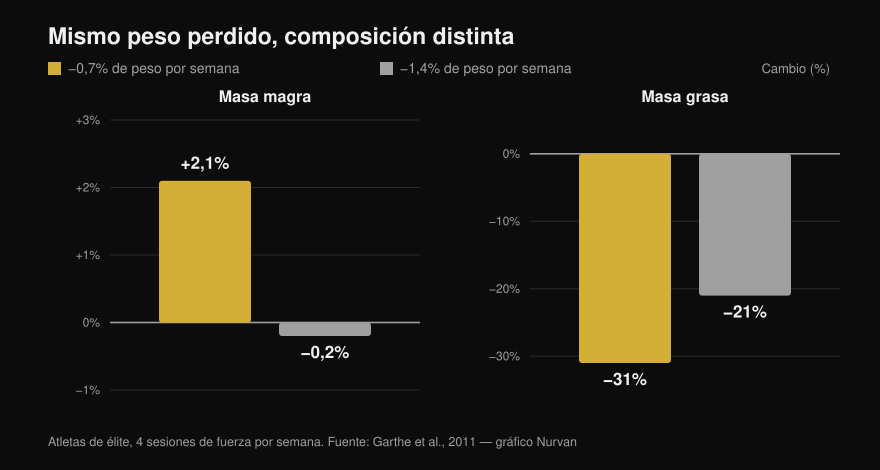

# Recomposición corporal: ¿se puede hacer de verdad?

Por [Giammaria Loi](/autore/giammaria-loi) · actualizado el 13 de octubre de 2026

Dos posts muy compartidos defienden lo mismo desde ángulos distintos: se puede perder grasa y ganar músculo al mismo tiempo. Uno lo argumenta desde su experiencia como entrenador, el otro aporta un estudio de 2026 con gráfico incluido. En el titular tienen razón, pero el estudio dice bastante menos de lo que sugiere la diapositiva, y las dos líneas más importantes son justo las que ninguno menciona. Aquí tienes los números del texto completo, el techo de déficit que la literatura señala de verdad y el perfil al que esta estrategia compensa.

## En resumen

- **La recomposición existe y no es polémica.** Está documentada desde hace años y aparece en el position stand de la ISSN sobre dietas y composición corporal (Aragon et al., 2017). "La ciencia la considera imposible" es un muñeco de paja.
- **En el estudio que cita el post, el grupo isocalórico NO perdió grasa de forma estadísticamente significativa**: −1,41 kg con p = 0,051 (Vargas-Molina et al., 2026).
- **Y el déficit no superó al mantenimiento.** La interacción tiempo × grupo sobre la masa grasa no es significativa (p = 0,277) y ninguna comparación por pares aguanta la corrección estadística. Con diez personas por grupo, "el déficit quita más grasa" es una hipótesis, no un resultado.
- **El dato que lo cambia todo y que falta en ambos posts: los participantes estaban al 24,7-24,8% de grasa con 1,5 años de entrenamiento.** Los propios autores escriben que es un nivel de grasa lo bastante alto para facilitar la recomposición.
- **El umbral de déficit más útil no está en calorías, sino en porcentaje de peso.** Perder el 0,7% del peso por semana hizo *ganar* un 2,1% de masa magra a atletas de élite; al 1,4% la masa magra se quedó quieta (Garthe et al., 2011).

## Qué hizo realmente el estudio de 2026

El trabajo citado en el carrusel existe, es de acceso abierto y se lee entero: treinta personas de 18 a 35 años en tres grupos de diez (Vargas-Molina et al., 2026). Los tres siguieron el **mismo programa de fuerza, cuatro días por semana durante diez semanas**: tres series de diez por ejercicio con 1-2 repeticiones de margen (RIR, las repeticiones que aún te quedarían al terminar la serie) y 2-3 minutos de descanso.

Solo cambiaba la dieta:

- **ISO**: calorías de mantenimiento y **2,5 g de proteína por kg** de peso al día.
- **DEF**: **250 kcal por debajo del mantenimiento**, las mismas proteínas.
- **Control**: el mismo entrenamiento, sin indicación alimentaria.

A las diez semanas, medidos con DXA:

*Variaciones medias del pre al post. Los asteriscos marcan los cambios estadísticamente significativos dentro de cada grupo; las barras sin asterisco, no. La interacción entre tiempo y grupo es significativa para la masa magra (p = 0,034) pero NO para la masa grasa (p = 0,277). Datos de Vargas-Molina et al., 2026. Gráfico original de Nurvan.*

El grupo de control es la parte más interesante y ninguno de los dos posts lo nombra: **hizo exactamente el mismo entrenamiento y no cambió nada**, +0,02 kg de masa magra y −0,15 kg de grasa. Diez semanas de pesas en serio, cuatro veces por semana, sin tocar la dieta: cero recomposición. Curiosamente también es el grupo que más fuerza ganó (+4,38 kg en press de banca), un resultado que los autores consideran probablemente espurio.

## Qué dice realmente la investigación

### "Se puede perder grasa y ganar músculo a la vez" — **Confirmado**

No es ninguna novedad. En un trabajo ya clásico, cuarenta hombres jóvenes pasaron cuatro semanas en un déficit del 40%, con seis sesiones semanales entre pesas e intervalos de alta intensidad: los que comían **2,4 g/kg de proteína ganaron 1,2 kg de masa magra y perdieron 4,8 kg de grasa**, frente a +0,1 kg y −3,5 kg de los que comían 1,2 (Longland et al., 2016). Masa magra arriba y grasa abajo, en el mismo mes y con un déficit duro.

El position stand de la ISSN sobre dietas y composición corporal trata el fenómeno como algo asentado y solo define cuándo funciona mejor (Aragon et al., 2017).

### "La ciencia dice que es imposible" — **Desmentido**

Es la premisa retórica del primer post y no se sostiene. No hay una postura científica que niegue la recomposición: hay una literatura que la mide y explica sus límites. El modelo de calorías que entran y salen habla del balance energético total; no prohíbe que dos tejidos vayan en direcciones opuestas en el mismo periodo.

### "El déficit leve produjo pérdida de grasa adicional" — **Con matices**

Dentro del grupo DEF, sí: −2,94 kg de grasa, p < 0,001. Pero la pregunta del post es otra: si el déficit lo hizo *mejor* que el mantenimiento. Y ahí el dato no está: **la interacción tiempo × grupo sobre la masa grasa no es significativa (p = 0,277)**, y en el material suplementario los autores escriben que ninguna comparación por pares sigue siendo significativa tras la corrección de Bonferroni.

Y en el grupo isocalórico la pérdida de grasa de −1,41 kg se queda en **p = 0,051**: justo fuera. La diapositiva lo presenta como un hecho.

Otra cosa que el post no cuenta: el tamaño del efecto de las ganancias de masa magra es de 0,08, que en la escala de los propios autores es **"trivial"**, o sea despreciable. Un kilo en diez semanas es un resultado real pero pequeño, y hay que contarlo como tal.

### "Como máximo 300 kcal de déficit" — **Con matices**

El gráfico de dispersión de la diapositiva viene del metaanálisis de referencia, que reunió los estudios de entrenamiento en déficit de al menos tres semanas. Allí el número es otro: **la metarregresión sitúa en unas 500 kcal al día el punto en el que las ganancias de masa magra se anulan**, y la recomendación de los autores es no pasar de ese umbral (Murphy & Koehler, 2022). El mismo trabajo muestra que la fuerza sigue subiendo en déficit (efecto −0,31, no significativo): adelgazando puedes volverte más fuerte aunque el músculo no crezca.

Así que el "no más de 300" es más prudente que la fuente: no es mal consejo, pero no es el número del estudio citado.

### "La recomposición es menos común en quien ya está delgado" — **Confirmado en el principio**

Los porcentajes de la diapositiva (hombres por debajo del 15%, mujeres por debajo del 21%) los define Examine como estimaciones muy aproximadas, y no hay una fuente primaria que los fije. El principio, en cambio, está escrito negro sobre blanco: cuanta más grasa tengas al empezar, más agresivo puede ser el déficit; cuanto más delgado, más te conviene adelgazar despacio para salvar la masa magra (Aragon et al., 2017).

Una revisión sobre atletas en restricción calórica lo enseña bien: de trece grupos, la masa magra bajó en nueve. Los seis grupos que la mantuvieron o la aumentaron estaban **entre los más grasos de partida, en un déficit más leve, o ante un estímulo de entrenamiento nuevo**. El único grupo delgado y en déficit marcado que conservó la masa magra comía 2,5-2,6 g/kg, la ingesta más alta de la revisión (Helms et al., 2014).

Y aquí hay que releer el estudio de 2026: los participantes estaban al **24,7-24,8% de grasa**, con **1,5 años** de experiencia. En las limitaciones los autores lo dicen sin rodeos: ese nivel de grasa basta para facilitar la recomposición, y con una muestra más delgada y entrenada los resultados habrían sido menos claros. El post muestra el resultado y se salta la condición que lo hace posible.

## La pregunta correcta no es "cuántas calorías", sino "a qué velocidad"

Fijar un número de calorías igual para todos tiene poco sentido: 250 kcal son minúsculas con 110 kg de peso y mucho con 50. Razonar en porcentaje de peso por semana funciona mejor, y hay un estudio que lo probó.

Veinticuatro atletas de élite, con cuatro sesiones de fuerza por semana, fueron asignados al azar a perder **el 0,7% del peso por semana o el 1,4%**. El adelgazamiento total fue idéntico (−5,6% frente a −5,5%), pero la composición no (Garthe et al., 2011):

*Pérdida de peso total idéntica en los dos grupos, composición corporal muy distinta. La diferencia en masa magra entre grupos es estadísticamente significativa (p < 0,01). Datos de Garthe et al., 2011. Gráfico original de Nurvan.*

El grupo lento **ganó un 2,1% de masa magra** mientras perdía casi un tercio de la grasa. El grupo rápido perdió el mismo peso en la mitad del tiempo, pero con la masa magra parada y menos grasa fuera. La recomposición en un gráfico: el mismo peso en la báscula, otro cuerpo.

## Cómo aplicarlo

1. **Decide la velocidad, no las calorías.** Apunta al **0,7% del peso por semana**: 0,5 kg con 70 kg de peso, 0,6 kg con 85. Es la velocidad que en los atletas hizo subir la masa magra (Garthe et al., 2011).
2. **No te quedes corto, pero sobre todo no te pases.** Más allá de unas 500 kcal de déficit al día, las ganancias de masa magra se anulan (Murphy & Koehler, 2022). Si la báscula baja más rápido de lo previsto, añade comida en vez de quitarla.
3. **Proteína alta, pero no necesariamente 2,5 g/kg.** En normocalórica, por encima de **1,62 g/kg** la proteína extra no añade masa magra (Morton et al., 2018). En déficit la exigencia sube: 2,3-3,1 g por kg de **masa magra**, hacia la parte alta cuanto más delgado estés y más profundo sea el déficit (Helms et al., 2014). Y no hace falta recortar los hidratos: en el estudio el 40% de las calorías venía de carbohidratos, y ya lo analizamos en [¿los carbohidratos engordan?](/es/blog/carbohidratos-engordan-grasa-oculta).
4. **Entrena la fuerza en serio y mídela.** En el estudio, el grupo que entrenaba sin tocar la alimentación no recompuso nada, pero sin cargas que suban no existe el estímulo que dirige las calorías hacia el músculo. Apunta carga, repeticiones y RIR sesión a sesión, dentro de una estructura que aguante: lo desglosamos en [rutina de entrenamiento para principiante y avanzado](/es/blog/rutina-entrenamiento-principiante-avanzado).
5. **Deja de mirar solo el peso.** La recomposición es el caso en el que la báscula se mueve poco mientras el cuerpo cambia. Usa perímetros, fotos cada 4 semanas y las cargas que levantas, no el número de la mañana.
6. **Elige el momento.** Si llevas años entrenando y ya estás definido, la recomposición se vuelve lenta y frustrante: mejor hacer una cosa a la vez. Si vuelves de un parón, o tienes grasa que perder, es exactamente la ventana en la que mejor funciona.

> ### 💡 Con Nurvan
> **La recomposición solo se ve si mides dos cosas a la vez.** En Nurvan el diario de alimentación trabaja sobre la base de datos CREA de alimentos italianos, así que el total diario de proteína es un dato real y no una estimación; al lado, el registro de entrenamiento guarda cargas, repeticiones y RIR sesión a sesión, y las medidas corporales se quedan en el mismo perfil. Peso quieto, cargas que suben y perímetros que bajan: eso es recomposición, y hay que verlo todo en el mismo sitio para darse cuenta. [Prueba Nurvan](https://nurvan.app)

## Preguntas frecuentes

**¿Cuánto músculo se puede ganar perdiendo grasa?**
En los estudios disponibles, **1 kg de masa magra en 10 semanas** en personas con 1-2 años de entrenamiento y un 25% de grasa corporal (Vargas-Molina et al., 2026), y hasta 1,2 kg en cuatro semanas en no entrenados con un protocolo muy duro (Longland et al., 2016). Son cifras pequeñas: la recomposición es un proceso lento, no una transformación en dos meses.

**¿Hace falta déficit calórico para recomponer?**
No necesariamente. En el estudio de 2026 también el grupo a calorías de mantenimiento ganó masa magra, y la diferencia de pérdida de grasa respecto al grupo en déficit no alcanzó la significación estadística (Vargas-Molina et al., 2026). Si estás a medio camino, el mantenimiento con proteína alta es una opción razonable.

**¿Cuánta proteína hace falta para perder grasa sin perder músculo?**
Para quien entrena y está en restricción calórica, 2,3-3,1 g por kg de masa magra, con la parte alta para quien está más delgado y en un déficit más severo (Helms et al., 2014; Aragon et al., 2017). En condiciones normales, por encima de 1,62 g por kg de peso corporal ya no se gana más masa magra (Morton et al., 2018).

**¿La recomposición funciona si llevas años entrenando?**
Funciona menos. Los autores del estudio de 2026 escriben que la capacidad de recomponer disminuye al acercarse al propio potencial y a niveles de grasa bajos, y que el atleta avanzado y delgado hace mejor en perseguir un objetivo cada vez. El principiante, o quien vuelve tras un parón, está en la mejor situación.

## Lee también

- [¿Los carbohidratos engordan? La grasa oculta de la dieta](/es/blog/carbohidratos-engordan-grasa-oculta)
- [Rutina de entrenamiento: principiante o avanzado](/es/blog/rutina-entrenamiento-principiante-avanzado)

## Fuentes

1. Vargas-Molina S, García-Palumbo A, García-Sillero M, Bonilla DA, Petro JL, Aragon AA, Schoenfeld BJ, Benítez-Porres J, 2026. *Comparison of two nutritional protocols in body re-composition of resistance-trained participants.* Eur J Appl Physiol 126(7):4019–4030. PMID 41940947 — [doi:10.1007/s00421-026-06209-6](https://doi.org/10.1007/s00421-026-06209-6)
2. Murphy C, Koehler K, 2022. *Energy deficiency impairs resistance training gains in lean mass but not strength: A meta-analysis and meta-regression.* Scand J Med Sci Sports 32(1):125–137. PMID 34623696 — [doi:10.1111/sms.14075](https://doi.org/10.1111/sms.14075)
3. Garthe I, Raastad T, Refsnes PE, Koivisto A, Sundgot-Borgen J, 2011. *Effect of two different weight-loss rates on body composition and strength and power-related performance in elite athletes.* Int J Sport Nutr Exerc Metab 21(2):97–104. PMID 21558571 — [doi:10.1123/ijsnem.21.2.97](https://doi.org/10.1123/ijsnem.21.2.97)
4. Longland TM, Oikawa SY, Mitchell CJ, Devries MC, Phillips SM, 2016. *Higher compared with lower dietary protein during an energy deficit combined with intense exercise promotes greater lean mass gain and fat mass loss: a randomized trial.* Am J Clin Nutr 103(3):738–746. PMID 26817506 — [doi:10.3945/ajcn.115.119339](https://doi.org/10.3945/ajcn.115.119339)
5. Morton RW, Murphy KT, McKellar SR, Schoenfeld BJ, Henselmans M, Helms E, Aragon AA, Devries MC, Banfield L, Krieger JW, Phillips SM, 2018. *A systematic review, meta-analysis and meta-regression of the effect of protein supplementation on resistance training-induced gains in muscle mass and strength in healthy adults.* Br J Sports Med 52(6):376–384. PMID 28698222 — [doi:10.1136/bjsports-2017-097608](https://doi.org/10.1136/bjsports-2017-097608)
6. Helms ER, Zinn C, Rowlands DS, Brown SR, 2014. *A systematic review of dietary protein during caloric restriction in resistance trained lean athletes: a case for higher intakes.* Int J Sport Nutr Exerc Metab 24(2):127–138. PMID 24092765 — [doi:10.1123/ijsnem.2013-0054](https://doi.org/10.1123/ijsnem.2013-0054)
7. Aragon AA, Schoenfeld BJ, Wildman R, Kleiner S, VanDusseldorp T, Taylor L, Earnest CP, Arciero PJ, Wilborn C, Kalman DS, Stout JR, Willoughby DS, Campbell B, Arent SM, Bannock L, Smith-Ryan AE, Antonio J, 2017. *International Society of Sports Nutrition position stand: diets and body composition.* J Int Soc Sports Nutr 14:16. PMID 28630601 — [doi:10.1186/s12970-017-0174-y](https://doi.org/10.1186/s12970-017-0174-y)

*Datos bibliográficos verificados en PubMed. Punto de partida: el post de [John Rusin](https://www.instagram.com/p/DdL-SJoEZYg/) y el carrusel de [Examine.com](https://www.instagram.com/p/Dd6tyK2F2HD/). No se ha reproducido ningún texto ni imagen de los dos posts: el tema y las afirmaciones se han reescrito y verificado con las fuentes primarias.*

---

**Giammaria Loi** es el fundador de Nurvan. Entrena con pesas desde 2012, trabaja como entrenador personal y coach certificado por la FIPE desde 2013 y compite en powerlifting a nivel nacional desde 2018. Cada artículo que firma parte de los estudios científicos y llega a lo que funciona de verdad en el gimnasio. [Página del autor](/autore/giammaria-loi)

> Nota: contenido informativo, no sustituye la opinión de un médico o de un profesional cualificado. Si tienes patologías, trastornos de la conducta alimentaria o sigues un tratamiento, háblalo con tu médico antes de cambiar tu alimentación.
