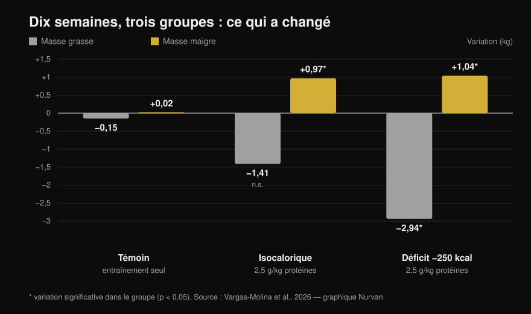
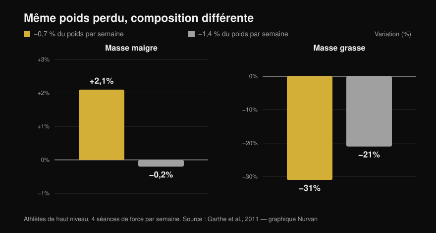

# Recomposition corporelle : est-ce vraiment faisable ?

Par [Giammaria Loi](/autore/giammaria-loi) · mis à jour le 13 octobre 2026

Deux posts très partagés défendent la même idée sous deux angles : on peut perdre du gras et gagner du muscle en même temps. Le premier l'affirme depuis le terrain, le second avance une étude de 2026 avec graphique. Sur le titre, ils ont raison — mais l'étude citée dit bien moins que la slide ne le laisse croire, et les deux lignes les plus importantes sont celles qu'aucun des deux ne reprend. Voici les chiffres du texte intégral, le plafond de déficit réel de la littérature et le profil pour qui ça vaut le coup.

## L'essentiel

- **La recomposition existe et ne fait pas débat.** Documentée depuis des années, elle figure dans le position stand de l'ISSN sur les régimes et la composition corporelle (Aragon et al., 2017). « La science la juge impossible » est un homme de paille.
- **Dans l'étude citée, le groupe isocalorique n'a PAS perdu de gras de façon statistiquement significative** : −1,41 kg, p = 0,051 (Vargas-Molina et al., 2026).
- **Et le déficit n'a pas battu le maintien.** L'interaction temps × groupe sur la masse grasse n'est pas significative (p = 0,277) et aucune comparaison par paires ne résiste à la correction. Avec dix personnes par groupe, « le déficit fait perdre plus de gras » est une hypothèse, pas un résultat.
- **La donnée qui change tout, absente des deux posts : les participants étaient à 24,7-24,8 % de masse grasse avec 1,5 an d'entraînement.** Les auteurs écrivent que ce niveau de gras est assez élevé pour faciliter la recomposition.
- **Le seuil de déficit le plus utile n'est pas en calories mais en pourcentage du poids.** Perdre 0,7 % du poids par semaine a fait *gagner* 2,1 % de masse maigre à des athlètes d'élite ; à 1,4 %, elle n'a pas bougé (Garthe et al., 2011).

## Ce que l'étude de 2026 a vraiment fait

Le travail cité dans le carrousel existe, en accès libre et lisible en entier : trente personnes de 18 à 35 ans, trois groupes de dix (Vargas-Molina et al., 2026). Les trois ont suivi le **même programme de force, quatre jours par semaine pendant dix semaines** : trois séries de dix par exercice, 1-2 répétitions en réserve (RIR, ce qu'il vous resterait en fin de série), 2-3 minutes de récupération.

Seule l'alimentation changeait :

- **ISO** : calories de maintien, **2,5 g de protéines par kg** de poids par jour.
- **DEF** : **250 kcal sous le maintien**, mêmes protéines.
- **Témoin** : même entraînement, aucune consigne alimentaire.

Après dix semaines, mesures au DXA :

*Variations moyennes du début à la fin. Les astérisques signalent les variations significatives au sein de chaque groupe ; les barres sans astérisque, non. L'interaction temps × groupe est significative pour la masse maigre (p = 0,034) mais PAS pour la masse grasse (p = 0,277). Données de Vargas-Molina et al., 2026. Graphique original Nurvan.*

Le groupe témoin est la partie la plus intéressante et aucun post ne le mentionne : **même entraînement, rien n'a changé**, +0,02 kg de masse maigre et −0,15 kg de gras. Dix semaines de fonte sérieuse, quatre fois par semaine, diète intacte : zéro recomposition. Curieusement, c'est aussi le groupe qui a le plus progressé en force (+4,38 kg au développé couché), un résultat que les auteurs jugent fortuit.

## Ce que dit vraiment la recherche

### « On peut perdre du gras et gagner du muscle en même temps » — **Confirmé**

Ce n'est pas une nouveauté. Dans un travail classique, quarante jeunes hommes ont passé quatre semaines en déficit de 40 %, six séances par semaine entre fonte et intervalles intenses : ceux qui mangeaient **2,4 g/kg de protéines ont gagné 1,2 kg de masse maigre et perdu 4,8 kg de gras**, contre +0,1 kg et −3,5 kg à 1,2 g/kg (Longland et al., 2016). Masse maigre en hausse, gras en baisse, le même mois, en déficit sévère.

Le position stand de l'ISSN traite le phénomène comme acquis et précise seulement les conditions où il fonctionne le mieux (Aragon et al., 2017).

### « La science dit que c'est impossible » — **Démenti**

C'est la prémisse rhétorique du premier post, et elle ne tient pas. Aucune position scientifique ne nie la recomposition : il existe une littérature qui la mesure et en explique les limites. Le modèle des calories entrantes et sortantes décrit le bilan énergétique global ; il n'interdit pas à deux tissus d'aller en sens opposés sur la même période.

### « Le léger déficit a produit une perte de gras supplémentaire » — **À nuancer**

Dans le groupe DEF, oui : −2,94 kg de gras, p < 0,001. Mais la question du post est autre : le déficit a-t-il fait *mieux* que le maintien ? La donnée manque : **l'interaction temps × groupe sur la masse grasse n'est pas significative (p = 0,277)**, et dans le matériel supplémentaire les auteurs écrivent qu'aucune comparaison par paires ne survit à Bonferroni.

Et dans le groupe isocalorique, la perte de −1,41 kg s'arrête à **p = 0,051** : juste à côté. La slide la présente comme un fait.

Autre chose absente du post : la taille d'effet des gains de masse maigre est de 0,08, soit **« triviale »** sur l'échelle des auteurs eux-mêmes. Un kilo en dix semaines est réel mais petit, et il faut le dire.

### « 300 kcal de déficit au maximum » — **À nuancer**

Le nuage de points de la slide vient de la méta-analyse de référence, qui réunit les études d'entraînement en déficit d'au moins trois semaines. Le chiffre y est différent : **la méta-régression situe autour de 500 kcal par jour le point où les gains de masse maigre s'annulent**, et les auteurs recommandent de ne pas dépasser ce seuil (Murphy & Koehler, 2022). Le même travail montre que la force continue de monter en déficit (effet −0,31, non significatif) : en maigrissant, on peut devenir plus fort même quand le muscle ne grossit pas.

Le « pas plus de 300 » est donc plus prudent que la source : pas un mauvais conseil, mais pas le chiffre de l'étude citée.

### « La recomposition est plus rare chez les gens déjà secs » — **Confirmé dans le principe**

Les pourcentages de la slide (hommes sous 15 %, femmes sous 21 %) sont donnés par Examine elle-même comme des estimations très grossières, et aucune source primaire ne les fixe. Le principe, lui, est écrit noir sur blanc : plus vous avez de gras au départ, plus le déficit peut être agressif ; plus vous êtes sec, mieux vaut maigrir lentement pour préserver la masse maigre (Aragon et al., 2017).

Une revue sur des athlètes en restriction calorique le montre : sur treize groupes, la masse maigre a baissé dans neuf. Les six groupes qui l'ont maintenue ou augmentée étaient **parmi les plus gras au départ, en déficit plus léger, ou face à un stimulus d'entraînement nouveau**. Le seul groupe sec et en déficit marqué qui a tenu sa masse maigre mangeait 2,5-2,6 g/kg, l'apport le plus élevé de la revue (Helms et al., 2014).

Et c'est là qu'il faut relire l'étude de 2026 : participants à **24,7-24,8 % de gras**, avec **1,5 an** d'expérience. Les auteurs le disent dans les limites : ce niveau de gras suffit à faciliter la recomposition, et avec un échantillon plus sec et entraîné les résultats auraient été moins nets. Le post montre le résultat et saute la condition qui le rend possible.

## La bonne question n'est pas « combien de calories » mais « à quelle vitesse »

Fixer le même nombre de calories pour tout le monde a peu de sens : 250 kcal, c'est minuscule à 110 kg et beaucoup à 50 kg. Raisonner en pourcentage de poids par semaine marche mieux, et une étude l'a testé.

Vingt-quatre athlètes d'élite, à quatre séances de force par semaine, ont été tirés au sort pour perdre **0,7 % du poids par semaine ou 1,4 %**. La perte de poids totale a été identique (−5,6 % contre −5,5 %), pas la composition (Garthe et al., 2011) :

*Perte de poids identique dans les deux groupes, composition corporelle très différente. L'écart de masse maigre entre groupes est significatif (p < 0,01). Données de Garthe et al., 2011. Graphique original Nurvan.*

Le groupe lent a **gagné 2,1 % de masse maigre** en perdant près d'un tiers de son gras. Le groupe rapide a perdu le même poids en deux fois moins de temps, masse maigre à l'arrêt et moins de gras retiré. La recomposition en un graphique : même poids sur la balance, corps différent.

## Comment l'appliquer

1. **Choisissez la vitesse, pas les calories.** Visez **0,7 % du poids par semaine** : 0,5 kg à 70 kg, 0,6 kg à 85 kg. C'est la vitesse qui a fait monter la masse maigre chez les athlètes (Garthe et al., 2011).
2. **N'allez pas en dessous, mais surtout pas au-delà.** Passé environ 500 kcal de déficit par jour, les gains de masse maigre s'annulent (Murphy & Koehler, 2022). Si la balance descend plus vite que prévu, ajoutez à manger plutôt que d'en retirer.
3. **Protéines hautes, mais pas forcément 2,5 g/kg.** À calories de maintien, au-delà de **1,62 g/kg** les protéines en plus n'ajoutent pas de masse maigre (Morton et al., 2018). En déficit, la demande monte : 2,3-3,1 g par kg de **masse maigre**, vers le haut quand vous êtes plus sec et plus en déficit (Helms et al., 2014). Et non, pas besoin de couper les glucides : dans l'étude, 40 % des calories venaient d'eux, et nous l'avons traité dans [les glucides font-ils grossir ?](/fr/blog/glucides-font-ils-grossir-gras-cache).
4. **Entraînez la force sérieusement et mesurez-la.** Dans l'étude, le groupe qui s'entraînait sans suivre sa diète n'a rien recomposé, mais sans charges qui montent aucun stimulus n'oriente les calories vers le muscle. Notez charge, répétitions et RIR séance par séance, dans une structure qui tient : voir [split d'entraînement débutant ou avancé](/fr/blog/split-entrainement-debutant-avance).
5. **Arrêtez de ne regarder que le poids.** La recomposition est le cas où la balance bouge peu quand le corps change. Fiez-vous aux circonférences, aux photos à quatre semaines d'écart et aux charges soulevées, pas au chiffre du matin.
6. **Choisissez le bon moment.** Si vous avez des années de fonte derrière vous et êtes déjà sec, la recomposition devient lente et frustrante : mieux vaut une chose à la fois. Si vous repartez après une pause, ou s'il vous reste du gras à perdre, c'est la fenêtre où ça marche le mieux.

> ### 💡 Avec Nurvan
> **La recomposition ne se voit que si vous mesurez deux choses à la fois.** Dans Nurvan, le journal alimentaire s'appuie sur la base de données CREA des aliments italiens : le total protéique du jour est une donnée réelle, pas une estimation. À côté, le carnet d'entraînement garde charges, répétitions et RIR séance par séance, et les mesures corporelles restent dans le même profil. Poids stable, charges qui montent, circonférences qui baissent : voilà la recomposition, et il faut la voir au même endroit pour la remarquer. [Essayez Nurvan](https://nurvan.app)

## Questions fréquentes

**Combien de muscle peut-on gagner en perdant du gras ?**
Dans les études, environ **1 kg de masse maigre en 10 semaines** chez des personnes avec 1-2 ans d'entraînement et un taux de gras autour de 25 % (Vargas-Molina et al., 2026), et jusqu'à 1,2 kg en quatre semaines chez des non-entraînés avec un protocole très dur (Longland et al., 2016). De petits chiffres : la recomposition est un processus lent, pas une transformation en deux mois.

**Faut-il un déficit calorique pour se recomposer ?**
Pas forcément. Dans l'étude de 2026, le groupe à calories de maintien a aussi gagné de la masse maigre, et l'écart de perte de gras avec le groupe en déficit n'a pas atteint la significativité (Vargas-Molina et al., 2026). À mi-chemin, le maintien avec des protéines hautes est une option sensée.

**Combien de protéines pour perdre du gras sans perdre de muscle ?**
Pour une personne entraînée en restriction calorique, 2,3-3,1 g par kg de masse maigre, le haut de la fourchette pour les plus secs et en déficit marqué (Helms et al., 2014 ; Aragon et al., 2017). En conditions normales, au-delà de 1,62 g par kg de poids on ne gagne plus de masse maigre (Morton et al., 2018).

**La recomposition marche-t-elle quand on s'entraîne depuis des années ?**
Moins bien. Les auteurs de l'étude de 2026 écrivent que la capacité à se recomposer diminue quand on approche de son potentiel et de taux de gras bas, et que le pratiquant avancé et sec gagne à poursuivre un objectif à la fois. Le débutant, ou celui qui reprend après un arrêt, est le mieux placé.

## À lire aussi

- [Les glucides font-ils grossir ? Le gras caché](/fr/blog/glucides-font-ils-grossir-gras-cache)
- [Split d'entraînement : débutant ou avancé](/fr/blog/split-entrainement-debutant-avance)

## Sources

1. Vargas-Molina S, García-Palumbo A, García-Sillero M, Bonilla DA, Petro JL, Aragon AA, Schoenfeld BJ, Benítez-Porres J, 2026. *Comparison of two nutritional protocols in body re-composition of resistance-trained participants.* Eur J Appl Physiol 126(7):4019–4030. PMID 41940947 — [doi:10.1007/s00421-026-06209-6](https://doi.org/10.1007/s00421-026-06209-6)
2. Murphy C, Koehler K, 2022. *Energy deficiency impairs resistance training gains in lean mass but not strength: A meta-analysis and meta-regression.* Scand J Med Sci Sports 32(1):125–137. PMID 34623696 — [doi:10.1111/sms.14075](https://doi.org/10.1111/sms.14075)
3. Garthe I, Raastad T, Refsnes PE, Koivisto A, Sundgot-Borgen J, 2011. *Effect of two different weight-loss rates on body composition and strength and power-related performance in elite athletes.* Int J Sport Nutr Exerc Metab 21(2):97–104. PMID 21558571 — [doi:10.1123/ijsnem.21.2.97](https://doi.org/10.1123/ijsnem.21.2.97)
4. Longland TM, Oikawa SY, Mitchell CJ, Devries MC, Phillips SM, 2016. *Higher compared with lower dietary protein during an energy deficit combined with intense exercise promotes greater lean mass gain and fat mass loss: a randomized trial.* Am J Clin Nutr 103(3):738–746. PMID 26817506 — [doi:10.3945/ajcn.115.119339](https://doi.org/10.3945/ajcn.115.119339)
5. Morton RW, Murphy KT, McKellar SR, Schoenfeld BJ, Henselmans M, Helms E, Aragon AA, Devries MC, Banfield L, Krieger JW, Phillips SM, 2018. *A systematic review, meta-analysis and meta-regression of the effect of protein supplementation on resistance training-induced gains in muscle mass and strength in healthy adults.* Br J Sports Med 52(6):376–384. PMID 28698222 — [doi:10.1136/bjsports-2017-097608](https://doi.org/10.1136/bjsports-2017-097608)
6. Helms ER, Zinn C, Rowlands DS, Brown SR, 2014. *A systematic review of dietary protein during caloric restriction in resistance trained lean athletes: a case for higher intakes.* Int J Sport Nutr Exerc Metab 24(2):127–138. PMID 24092765 — [doi:10.1123/ijsnem.2013-0054](https://doi.org/10.1123/ijsnem.2013-0054)
7. Aragon AA, Schoenfeld BJ, Wildman R, Kleiner S, VanDusseldorp T, Taylor L, Earnest CP, Arciero PJ, Wilborn C, Kalman DS, Stout JR, Willoughby DS, Campbell B, Arent SM, Bannock L, Smith-Ryan AE, Antonio J, 2017. *International Society of Sports Nutrition position stand: diets and body composition.* J Int Soc Sports Nutr 14:16. PMID 28630601 — [doi:10.1186/s12970-017-0174-y](https://doi.org/10.1186/s12970-017-0174-y)

*Données bibliographiques vérifiées sur PubMed. Point de départ : le post de [John Rusin](https://www.instagram.com/p/DdL-SJoEZYg/) et le carrousel d'[Examine.com](https://www.instagram.com/p/Dd6tyK2F2HD/). Aucun texte ni image des deux posts n'a été reproduit : thème et affirmations ont été réécrits et vérifiés sur les sources primaires.*

---

**Giammaria Loi** est le fondateur de Nurvan. Il s'entraîne avec des charges depuis 2012, travaille comme préparateur et coach certifié FIPE depuis 2013 et pratique le powerlifting en compétition au niveau national depuis 2018. Chaque article qu'il signe part des études scientifiques et arrive à ce qui fonctionne vraiment en salle. [Page auteur](/autore/giammaria-loi)

> Note : contenu informatif, il ne remplace pas l'avis d'un médecin ou d'un professionnel. Si vous avez une pathologie, des troubles du comportement alimentaire ou un traitement en cours, parlez-en à votre médecin avant de modifier votre alimentation.
