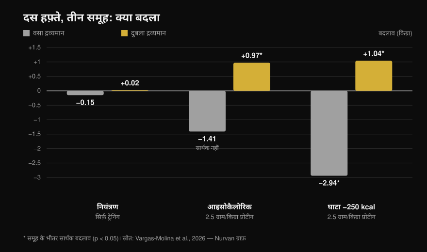
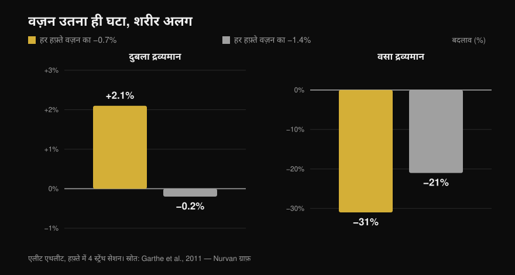

# बॉडी रीकंपोज़िशन: क्या यह सच में हो सकता है?

लेखक: [Giammaria Loi](/autore/giammaria-loi) · 13 अक्टूबर 2026 को अपडेट किया गया

ख़ूब शेयर हुए दो पोस्ट अलग-अलग कोणों से एक ही बात कहते हैं: चर्बी घटाना और मसल बढ़ाना एक ही समय में मुमकिन है। एक इसे कोच के अनुभव से कहता है, दूसरा 2026 की एक स्टडी और एक ग्राफ़ के साथ। दोनों सही हैं, लेकिन जिस स्टडी का हवाला दिया गया है वह स्लाइड के इशारे से बहुत कम कहती है — और उसकी दो सबसे अहम पंक्तियाँ ठीक वही हैं जो कोई भी पोस्ट नहीं बताता। यहाँ पूरे पेपर से पढ़े गए असली आंकड़े हैं, वह डेफिसिट सीमा जो रिसर्च असल में बताती है, और वह प्रोफ़ाइल जिसके लिए यह रणनीति सच में फ़ायदेमंद है।

## संक्षेप में

- **रीकंपोज़िशन मौजूद है और इस पर कोई विवाद नहीं है।** यह सालों से दर्ज है और डाइट तथा बॉडी कंपोज़िशन पर ISSN के पोज़िशन स्टैंड में भी है (Aragon et al., 2017)। यह कहना कि "विज्ञान इसे असंभव मानता है" एक गढ़ा हुआ निशाना है।
- **पोस्ट में बताई गई स्टडी में आइसोकैलोरिक ग्रुप ने सांख्यिकीय रूप से सार्थक चर्बी नहीं घटाई**: −1.41 kg, p = 0.051 (Vargas-Molina et al., 2026)।
- **और डेफिसिट, मेंटेनेंस से जीता भी नहीं।** फ़ैट मास पर टाइम × ग्रुप इंटरैक्शन सार्थक नहीं है (p = 0.277), और सांख्यिकीय सुधार के बाद कोई जोड़ीवार तुलना टिकती नहीं। हर ग्रुप में दस लोगों के साथ, "डेफिसिट से ज़्यादा चर्बी जाती है" एक परिकल्पना है, नतीजा नहीं।
- **वह आंकड़ा जो सब बदल देता है और दोनों पोस्ट से ग़ायब है: प्रतिभागियों का बॉडी फ़ैट 24.7%–24.8% था और ट्रेनिंग अनुभव 1.5 साल।** लेखक ख़ुद लिखते हैं कि यह फ़ैट स्तर इतना ऊँचा है कि रीकंपोज़िशन आसान हो जाती है।
- **सबसे काम की डेफिसिट सीमा कैलोरी में नहीं, वज़न के प्रतिशत में है।** हफ़्ते में वज़न का 0.7% घटाने से एलीट एथलीटों की लीन मास **2.1% बढ़ी**; 1.4% पर लीन मास जहाँ थी वहीं रही (Garthe et al., 2011)।

## 2026 की स्टडी ने असल में क्या किया

कैरोसेल में बताया गया पेपर मौजूद है, ओपन ऐक्सेस है और पूरा पढ़ा जा सकता है: 18 से 35 साल के तीस लोग, दस-दस के तीन ग्रुप (Vargas-Molina et al., 2026)। तीनों ने **एक ही स्ट्रेंथ प्रोग्राम किया, हफ़्ते में चार दिन, दस हफ़्ते तक**, हर एक्सरसाइज़ के तीन सेट दस रेप्स, 1–2 रेप्स रिज़र्व (RIR, यानी सेट ख़त्म होने पर आपके पास बचे हुए रेप्स) और 2–3 मिनट रेस्ट।

फ़र्क़ सिर्फ़ खाने में था:

- **ISO**: मेंटेनेंस कैलोरी, रोज़ **शरीर के वज़न के प्रति किलो 2.5 g प्रोटीन**।
- **DEF**: **मेंटेनेंस से 250 kcal कम**, प्रोटीन उतना ही।
- **कंट्रोल**: वही ट्रेनिंग, खाने पर कोई निर्देश नहीं।

दस हफ़्ते बाद, DXA से मापा गया:

*प्री से पोस्ट तक औसत बदलाव। तारांकन उन बदलावों पर है जो ग्रुप के भीतर सांख्यिकीय रूप से सार्थक हैं; बिना तारांकन वाले बार नहीं। टाइम × ग्रुप इंटरैक्शन लीन मास पर सार्थक है (p = 0.034) लेकिन फ़ैट मास पर **नहीं** (p = 0.277)। आंकड़े Vargas-Molina et al., 2026 से। मूल ग्राफ़िक Nurvan।*

कंट्रोल ग्रुप सबसे दिलचस्प हिस्सा है और दोनों पोस्ट में से कोई उसका नाम नहीं लेता: **उसने बिल्कुल वही ट्रेनिंग की और कुछ भी नहीं बदला**, लीन मास +0.02 kg और चर्बी −0.15 kg। दस हफ़्ते गंभीर वेट ट्रेनिंग, हफ़्ते में चार बार, खाने को छुए बिना: ज़ीरो रीकंपोज़िशन। मज़े की बात, स्ट्रेंथ सबसे ज़्यादा इसी ग्रुप की बढ़ी (बेंच +4.38 kg) — एक नतीजा जिसे लेखक ख़ुद संभवतः संयोगवश मानते हैं।

## रिसर्च असल में क्या कहती है

### "चर्बी घटाना और मसल बढ़ाना साथ हो सकता है" — **पुष्ट**

यह न नई बात है न उकसावा। एक अब क्लासिक बन चुके अध्ययन में चालीस युवकों को चार हफ़्ते 40% डेफिसिट में रखा गया, हफ़्ते में छह सेशन — वेट और हाई-इंटेंसिटी इंटरवल: जिन्होंने **2.4 g/kg प्रोटीन खाया उन्होंने 1.2 kg लीन मास बढ़ाई और 4.8 kg चर्बी घटाई**, जबकि 1.2 g/kg खाने वालों में +0.1 kg और −3.5 kg रहा (Longland et al., 2016)। एक ही महीने में लीन मास ऊपर, चर्बी नीचे — और वह भी गहरे डेफिसिट में।

डाइट तथा बॉडी कंपोज़िशन पर ISSN का पोज़िशन स्टैंड इसे तय बात मानकर चलता है और सिर्फ़ यह बताता है कि यह किन हालात में सबसे अच्छा काम करता है (Aragon et al., 2017)।

### "विज्ञान कहता है यह असंभव है" — **खंडित**

यह पहले पोस्ट की भाषणबाज़ी वाली भूमिका है, और यह टिकती नहीं। रीकंपोज़िशन को नकारने वाला कोई वैज्ञानिक रुख़ मौजूद नहीं है: जो मौजूद है वह साहित्य है जो इसे मापता है और इसकी सीमाएँ समझाता है। कैलोरी इन–कैलोरी आउट मॉडल कुल ऊर्जा संतुलन की बात करता है; वह दो अलग ऊतकों को एक ही अवधि में उलटी दिशाओं में जाने से नहीं रोकता।

### "हल्के डेफिसिट से अतिरिक्त चर्बी घटी" — **स्पष्ट करना ज़रूरी**

DEF ग्रुप के भीतर हाँ: चर्बी −2.94 kg, p < 0.001। लेकिन पोस्ट का सवाल दूसरा है, यानी क्या डेफिसिट ने मेंटेनेंस से **बेहतर** किया। और वहाँ आंकड़ा मौजूद नहीं है: **फ़ैट मास पर टाइम × ग्रुप इंटरैक्शन सार्थक नहीं है (p = 0.277)**, और सप्लीमेंटरी सामग्री में लेखक लिखते हैं कि बोन्फेरोनी सुधार के बाद कोई जोड़ीवार तुलना सार्थक नहीं रहती।

और आइसोकैलोरिक ग्रुप में −1.41 kg की चर्बी कमी **p = 0.051** पर रुक जाती है: बस थोड़ा बाहर। स्लाइड इसे तथ्य की तरह पेश करती है।

एक और बात जो पोस्ट नहीं बताता: लीन मास के फ़ायदे का इफ़ेक्ट साइज़ 0.08 है, जो लेखकों के ही पैमाने पर **"trivial"** यानी नगण्य है। दस हफ़्ते में एक किलो असली नतीजा है, पर छोटा — और उसे वैसा ही बताया जाना चाहिए।

### "ज़्यादा से ज़्यादा 300 kcal डेफिसिट" — **स्पष्ट करना ज़रूरी**

स्लाइड का स्कैटर प्लॉट इस विषय के संदर्भ मेटा-विश्लेषण से आता है, जिसने कम से कम तीन हफ़्ते के डेफिसिट में हुई ट्रेनिंग स्टडीज़ को जोड़ा। वहाँ आंकड़ा दूसरा है: **मेटा-रिग्रेशन लीन मास के फ़ायदे शून्य होने का बिंदु रोज़ाना लगभग 500 kcal पर रखता है**, और लेखकों की सिफ़ारिश है कि उस सीमा से आगे न जाएँ (Murphy & Koehler, 2022)। वही पेपर दिखाता है कि स्ट्रेंथ, उलटे, डेफिसिट में भी बढ़ती रहती है (इफ़ेक्ट −0.31, सार्थक नहीं): चर्बी घटाते हुए आप मज़बूत हो सकते हैं, तब भी जब मसल न बढ़े।

यानी "300 से ज़्यादा नहीं" अपने स्रोत से ज़्यादा सतर्क है। सलाह के तौर पर ग़लत नहीं, पर यह उस स्टडी का आंकड़ा नहीं है जिसका हवाला दिया गया।

### "जो पहले से दुबले हैं उनमें रीकंपोज़िशन कम होती है" — **सिद्धांत में पुष्ट**

स्लाइड के ठीक-ठीक प्रतिशत (पुरुष 15% से नीचे, महिलाएँ 21% से नीचे) को Examine ख़ुद बहुत मोटा अनुमान बताती है, और मुझे ऐसा कोई प्राथमिक स्रोत नहीं मिला जो उन्हें तय करता हो। पर सिद्धांत टिकता है और साफ़ लिखा है: शुरुआत में जितनी ज़्यादा चर्बी, उतना आक्रामक डेफिसिट चल सकता है; जितने दुबले, उतना बेहतर है धीरे घटाना ताकि लीन मास बची रहे (Aragon et al., 2017)।

कैलोरी प्रतिबंध में ट्रेंड एथलीटों पर हुई एक समीक्षा इसे अच्छे से दिखाती है: तेरह ग्रुप में से नौ में लीन मास घटी। जिन छह ग्रुप ने उसे बचाया या बढ़ाया, वे **शुरुआत में सबसे ज़्यादा चर्बी वाले, या हल्के डेफिसिट में, या किसी नए ट्रेनिंग स्टिमुलस के सामने थे**। दुबला और गहरे डेफिसिट वाला एकमात्र ग्रुप जिसने लीन मास बचाई, 2.5–2.6 g/kg खा रहा था — पूरी समीक्षा में सबसे ऊँचा सेवन (Helms et al., 2014)। और डाइट में फ़र्क़ अक्सर रोटी-चावल से नहीं, उन चीज़ों से आता है जिन्हें आप गिनते ही नहीं — [क्या कार्ब्स से वज़न बढ़ता है? छिपी चर्बी](/hi/blog/carbs-se-vajan-badhta-hai-chhipi-charbi) में यही खोला गया है।

और यहीं 2026 की स्टडी दोबारा पढ़नी चाहिए: प्रतिभागियों का बॉडी फ़ैट **24.7%–24.8%** था और अनुभव **1.5 साल**। पेपर की सीमाओं में लेखक यह साफ़ कहते हैं — यह फ़ैट स्तर रीकंपोज़िशन को आसान बनाने के लिए काफ़ी ऊँचा है, और दुबले तथा ज़्यादा ट्रेंड सैंपल के साथ नतीजे बहुत धुँधले होते। पोस्ट नतीजा दिखाता है और वह शर्त छोड़ देता है जो उसे मुमकिन बनाती है।

## सही सवाल "कितनी कैलोरी" नहीं, "कितनी तेज़ी से" है

सबके लिए एक ही कैलोरी संख्या तय करने का मतलब कम है: 110 kg वाले के लिए 250 kcal मामूली डेफिसिट है और 50 kg वाले के लिए बड़ा हिस्सा। हफ़्ते में शरीर के वज़न के प्रतिशत में सोचना बेहतर चलता है, और एक स्टडी ने इसे सीधे परखा है।

चौबीस एलीट एथलीट, सब हफ़्ते में चार स्ट्रेंथ सेशन करते हुए, रैंडम तरीक़े से **हफ़्ते में वज़न का 0.7% या 1.4%** घटाने पर रखे गए। कुल वज़न की कमी एक-सी रही (−5.6% बनाम −5.5%), पर कंपोज़िशन नहीं (Garthe et al., 2011):

*दोनों ग्रुप में कुल वज़न की कमी एक-सी, बॉडी कंपोज़िशन बहुत अलग। ग्रुपों के बीच लीन मास का अंतर सांख्यिकीय रूप से सार्थक है (p < 0.01)। आंकड़े Garthe et al., 2011 से। मूल ग्राफ़िक Nurvan।*

धीमे ग्रुप ने अपनी चर्बी का लगभग एक-तिहाई घटाते हुए **लीन मास 2.1% बढ़ाई**। तेज़ ग्रुप ने उतना ही वज़न आधे समय में घटाया, पर लीन मास जहाँ थी वहीं रही और चर्बी भी कम गई। यह एक ही ग्राफ़ में रीकंपोज़िशन है: तराज़ू पर वही वज़न, शरीर अलग।

## इसे कैसे लागू करें

1. **रफ़्तार तय कीजिए, कैलोरी नहीं।** लक्ष्य रखिए **हफ़्ते में वज़न का 0.7%**: 70 kg हैं तो हफ़्ते में 0.5 kg, 85 kg हैं तो 0.6 kg। यही वह रफ़्तार है जिसने एथलीटों में लीन मास बढ़ाई (Garthe et al., 2011)।
2. **इससे नीचे न जाएँ, और सबसे ज़रूरी — इससे आगे न जाएँ।** रोज़ाना ~500 kcal डेफिसिट से आगे लीन मास के फ़ायदे शून्य हो जाते हैं (Murphy & Koehler, 2022)। अगर तराज़ू उम्मीद से तेज़ गिर रहा है, खाना जोड़िए, घटाइए नहीं।
3. **प्रोटीन ऊँचा, पर ज़रूरी नहीं 2.5 g/kg।** मेंटेनेंस कैलोरी पर **1.62 g/kg** से ऊपर अतिरिक्त प्रोटीन से लीन मास नहीं जुड़ती (Morton et al., 2018)। डेफिसिट में ज़रूरत बढ़ती है: **लीन मास** के प्रति किलो 2.3–3.1 g, और जितने दुबले तथा गहरे डेफिसिट में हों उतना ऊपर की ओर (Helms et al., 2014)।
4. **स्ट्रेंथ को गंभीरता से ट्रेन कीजिए और उसे मापिए।** स्टडी में जिस ग्रुप ने ट्रेनिंग की पर डाइट नहीं देखी, उसने कुछ भी रीकंपोज़ नहीं किया — पर बढ़ते वज़न के बिना वह स्टिमुलस भी नहीं होता जो कैलोरी को मसल की तरफ़ भेजता है। हर सेशन में लोड, रेप्स और RIR लिखिए। हफ़्ते में इन सेशन को कैसे बाँटें, यह [ट्रेनिंग स्प्लिट: बिगिनर बनाम एडवांस्ड](/hi/blog/training-split-beginner-advanced) में है।
5. **सिर्फ़ वज़न देखना बंद कीजिए।** रीकंपोज़िशन वही स्थिति है जिसमें तराज़ू कम हिलता है और शरीर बदलता रहता है। घेरे, चार हफ़्ते के अंतर पर खींची तस्वीरें और उठाए गए वज़न देखिए — सुबह का नंबर नहीं।
6. **सही समय चुनिए।** अगर आप सालों से ट्रेनिंग कर रहे हैं और पहले से कटे हुए हैं, तो रीकंपोज़िशन धीमी और झुंझलाने वाली हो जाती है: उस हालत में एक बार में एक काम करना बेहतर है। और अगर आप ब्रेक के बाद दोबारा शुरू कर रहे हैं, या घटाने के लिए चर्बी है, तो यह ठीक वही खिड़की है जिसमें यह सबसे अच्छा चलता है।

> ### 💡 Nurvan के साथ
> **रीकंपोज़िशन सिर्फ़ तब दिखती है जब आप दो चीज़ें साथ मापें।** Nurvan में फ़ूड डायरी इतालवी खाद्य पदार्थों के CREA डेटाबेस पर चलती है, इसलिए दिन का कुल प्रोटीन एक असली आंकड़ा है, अनुमान नहीं; उसके साथ ट्रेनिंग लॉग हर सेशन का लोड, रेप्स और RIR रखता है, और बॉडी मेज़रमेंट उसी प्रोफ़ाइल में रहते हैं। वज़न स्थिर, लोड बढ़ते हुए और घेरे घटते हुए: यही रीकंपोज़िशन है, और इसे पकड़ने के लिए एक ही जगह देखना ज़रूरी है। [Nurvan आज़माएँ](https://nurvan.app)

## अक्सर पूछे जाने वाले सवाल

**चर्बी घटाते हुए कितनी मसल बढ़ सकती है?**
उपलब्ध अध्ययनों में 1–2 साल की ट्रेनिंग और लगभग 25% बॉडी फ़ैट वाले लोगों में करीब **दस हफ़्ते में 1 kg लीन मास** (Vargas-Molina et al., 2026), और बहुत कठोर प्रोटोकॉल वाले अनट्रेंड लोगों में चार हफ़्ते में 1.2 kg तक (Longland et al., 2016)। ये छोटे आंकड़े हैं: रीकंपोज़िशन धीमी प्रक्रिया है, दो महीने का कायाकल्प नहीं।

**रीकंपोज़िशन के लिए कैलोरी डेफिसिट ज़रूरी है?**
ज़रूरी नहीं। 2026 की स्टडी में मेंटेनेंस कैलोरी वाले ग्रुप ने भी लीन मास बढ़ाई, और डेफिसिट ग्रुप से चर्बी कमी का अंतर सांख्यिकीय सार्थकता तक नहीं पहुँचा (Vargas-Molina et al., 2026)। अगर आप बीच के मुक़ाम पर हैं, तो ऊँचे प्रोटीन के साथ मेंटेनेंस समझदारी भरा विकल्प है।

**मसल खोए बिना चर्बी घटाने के लिए कितना प्रोटीन चाहिए?**
ट्रेंड और कैलोरी प्रतिबंध में रहने वालों के लिए लीन मास के प्रति किलो 2.3–3.1 g, और जो ज़्यादा दुबले तथा गहरे डेफिसिट में हैं उनके लिए रेंज का ऊपरी हिस्सा (Helms et al., 2014; Aragon et al., 2017)। सामान्य हालात में शरीर के वज़न के प्रति किलो 1.62 g से ऊपर और लीन मास नहीं बढ़ती (Morton et al., 2018)।

**सालों से ट्रेनिंग कर रहे लोगों के लिए भी रीकंपोज़िशन काम करती है?**
कम काम करती है। 2026 की स्टडी के लेखक लिखते हैं कि अपनी क्षमता की सीमा और कम फ़ैट स्तर के पास पहुँचते-पहुँचते रीकंपोज़ करने की क्षमता घटती जाती है, और दुबले एडवांस्ड एथलीट के लिए एक बार में एक लक्ष्य रखना बेहतर है। बिगिनर, या ब्रेक के बाद लौटने वाला, सबसे अच्छी स्थिति में है।

## यह भी पढ़ें

- [क्या कार्ब्स से वज़न बढ़ता है? छिपी चर्बी](/hi/blog/carbs-se-vajan-badhta-hai-chhipi-charbi) — कैलोरी असल में कहाँ छिपती है।
- [ट्रेनिंग स्प्लिट: बिगिनर बनाम एडवांस्ड](/hi/blog/training-split-beginner-advanced) — हफ़्ते में स्ट्रेंथ सेशन कैसे बाँटें।

## स्रोत

1. Vargas-Molina S, García-Palumbo A, García-Sillero M, Bonilla DA, Petro JL, Aragon AA, Schoenfeld BJ, Benítez-Porres J, 2026. *Comparison of two nutritional protocols in body re-composition of resistance-trained participants.* Eur J Appl Physiol 126(7):4019–4030. PMID 41940947 — [doi:10.1007/s00421-026-06209-6](https://doi.org/10.1007/s00421-026-06209-6)
2. Murphy C, Koehler K, 2022. *Energy deficiency impairs resistance training gains in lean mass but not strength: A meta-analysis and meta-regression.* Scand J Med Sci Sports 32(1):125–137. PMID 34623696 — [doi:10.1111/sms.14075](https://doi.org/10.1111/sms.14075)
3. Garthe I, Raastad T, Refsnes PE, Koivisto A, Sundgot-Borgen J, 2011. *Effect of two different weight-loss rates on body composition and strength and power-related performance in elite athletes.* Int J Sport Nutr Exerc Metab 21(2):97–104. PMID 21558571 — [doi:10.1123/ijsnem.21.2.97](https://doi.org/10.1123/ijsnem.21.2.97)
4. Longland TM, Oikawa SY, Mitchell CJ, Devries MC, Phillips SM, 2016. *Higher compared with lower dietary protein during an energy deficit combined with intense exercise promotes greater lean mass gain and fat mass loss: a randomized trial.* Am J Clin Nutr 103(3):738–746. PMID 26817506 — [doi:10.3945/ajcn.115.119339](https://doi.org/10.3945/ajcn.115.119339)
5. Morton RW, Murphy KT, McKellar SR, Schoenfeld BJ, Henselmans M, Helms E, Aragon AA, Devries MC, Banfield L, Krieger JW, Phillips SM, 2018. *A systematic review, meta-analysis and meta-regression of the effect of protein supplementation on resistance training-induced gains in muscle mass and strength in healthy adults.* Br J Sports Med 52(6):376–384. PMID 28698222 — [doi:10.1136/bjsports-2017-097608](https://doi.org/10.1136/bjsports-2017-097608)
6. Helms ER, Zinn C, Rowlands DS, Brown SR, 2014. *A systematic review of dietary protein during caloric restriction in resistance trained lean athletes: a case for higher intakes.* Int J Sport Nutr Exerc Metab 24(2):127–138. PMID 24092765 — [doi:10.1123/ijsnem.2013-0054](https://doi.org/10.1123/ijsnem.2013-0054)
7. Aragon AA, Schoenfeld BJ, Wildman R, Kleiner S, VanDusseldorp T, Taylor L, Earnest CP, Arciero PJ, Wilborn C, Kalman DS, Stout JR, Willoughby DS, Campbell B, Arent SM, Bannock L, Smith-Ryan AE, Antonio J, 2017. *International Society of Sports Nutrition position stand: diets and body composition.* J Int Soc Sports Nutr 14:16. PMID 28630601 — [doi:10.1186/s12970-017-0174-y](https://doi.org/10.1186/s12970-017-0174-y)

*ग्रंथसूची के विवरण PubMed पर जाँचे गए हैं। शुरुआती प्रेरणा: [John Rusin](https://www.instagram.com/p/DdL-SJoEZYg/) की पोस्ट और [Examine.com](https://www.instagram.com/p/Dd6tyK2F2HD/) का कैरोसेल। दोनों पोस्ट का कोई टेक्स्ट या चित्र दोबारा प्रकाशित नहीं किया गया: विषय और दावे फिर से लिखे गए और प्राथमिक स्रोतों पर जाँचे गए हैं।*

---

**Giammaria Loi**, Nurvan के संस्थापक हैं। वे 2012 से वेट ट्रेनिंग कर रहे हैं, 2013 से FIPE-प्रमाणित पर्सनल ट्रेनर और कोच के रूप में काम करते हैं और 2018 से राष्ट्रीय स्तर पर पावरलिफ्टिंग में प्रतिस्पर्धा करते हैं। उनके हर लेख की शुरुआत वैज्ञानिक अध्ययनों से होती है और अंत उस पर, जो जिम में सच में काम करता है। [लेखक पेज](/autore/giammaria-loi)

> नोट: यह जानकारीपरक सामग्री है और डॉक्टर या योग्य पेशेवर की सलाह का विकल्प नहीं है। अगर आपको कोई बीमारी है, खाने के व्यवहार से जुड़ा विकार है, या आप कोई इलाज ले रहे हैं, तो डाइट बदलने से पहले अपने डॉक्टर से बात कीजिए।
