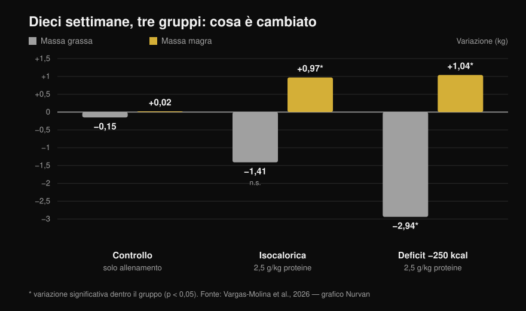
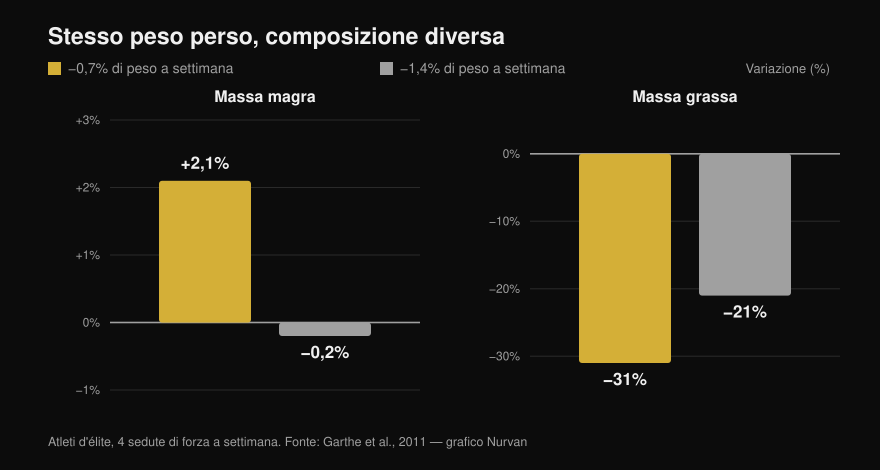

# Ricomposizione corporea: si può davvero fare?

Di [Giammaria Loi](/autore/giammaria-loi) · aggiornato il 13 ottobre 2026

Due post molto condivisi dicono la stessa cosa da angoli diversi: perdere grasso e guadagnare muscolo contemporaneamente è possibile. Uno lo dice da coach, l'altro porta uno studio del 2026 con tanto di grafico. Hanno ragione tutti e due, ma lo studio citato dice parecchio meno di quello che la slide lascia credere — e le due righe più importanti sono proprio quelle che nessuno dei due post riporta. Qui trovi i numeri letti dal testo completo, la soglia di deficit che la letteratura indica davvero e il profilo di persona a cui questa strategia conviene.

## In breve

- **La ricomposizione esiste e non è controversa.** È documentata da anni e compare nel position stand dell'ISSN sulle diete e la composizione corporea (Aragon et al., 2017). Dire che "la scienza la considera impossibile" è un bersaglio di comodo.
- **Nello studio citato dal post il gruppo isocalorico NON ha perso grasso in modo statisticamente significativo**: −1,41 kg con p = 0,051 (Vargas-Molina et al., 2026).
- **E il deficit non ha battuto il mantenimento.** L'interazione fra tempo e gruppo sulla massa grassa non è significativa (p = 0,277), e nessun confronto a coppie regge la correzione statistica. Con 10 persone per gruppo, "il deficit fa perdere più grasso" è un'ipotesi, non un risultato.
- **Il dato che cambia tutto e che manca nei post: i partecipanti erano al 24,7-24,8% di grasso con 1,5 anni di allenamento alle spalle.** Gli autori stessi scrivono che è un livello di grasso abbastanza alto da facilitare la ricomposizione.
- **La soglia di deficit più utile non è in calorie, è in percentuale di peso.** Perdere lo 0,7% del peso a settimana ha fatto *guadagnare* il 2,1% di massa magra ad atleti d'élite; all'1,4% la massa magra è rimasta ferma (Garthe et al., 2011).

## Cosa ha fatto davvero lo studio del 2026

Il lavoro citato nel carosello esiste, è aperto e si legge per intero: trenta persone fra i 18 e i 35 anni, divise in tre gruppi da dieci (Vargas-Molina et al., 2026). Tutti e tre hanno seguito lo **stesso programma di forza, quattro giorni a settimana per dieci settimane**, tre serie da dieci per esercizio con 1-2 ripetizioni di margine (RIR, le ripetizioni che avresti ancora in canna a fine serie) e 2-3 minuti di recupero.

Cambiava solo la parte alimentare:

- **ISO**: calorie di mantenimento, **2,5 g di proteine per kg** di peso al giorno.
- **DEF**: **250 kcal sotto il mantenimento**, stesse proteine.
- **Controllo**: stesso allenamento, nessuna indicazione alimentare.

Dopo dieci settimane, misurati alla DXA:

*Variazioni medie dal pre al post. Gli asterischi indicano le variazioni statisticamente significative dentro ciascun gruppo; le barre senza asterisco no. L'interazione fra tempo e gruppo è significativa per la massa magra (p = 0,034) ma NON per la massa grassa (p = 0,277). Dati da Vargas-Molina et al., 2026. Grafico originale Nurvan.*

Il gruppo di controllo è la parte più interessante e nessuno dei due post la nomina: **ha fatto esattamente lo stesso allenamento e non è cambiato niente**, +0,02 kg di massa magra e −0,15 kg di grasso. Dieci settimane di pesi seri, quattro volte a settimana, senza toccare l'alimentazione: zero ricomposizione. Curiosamente è anche il gruppo che ha guadagnato più forza (+4,38 kg di panca), un risultato che gli stessi autori definiscono probabilmente spurio.

## Cosa dice davvero la ricerca

### "Si può perdere grasso e guadagnare muscolo insieme" — **Confermato**

Non è una novità né una provocazione. In un lavoro ormai classico, quaranta uomini giovani sono stati messi in un deficit del 40% per quattro settimane, con sei allenamenti a settimana fra pesi e intervalli ad alta intensità: chi mangiava **2,4 g/kg di proteine ha guadagnato 1,2 kg di massa magra e perso 4,8 kg di grasso**, contro +0,1 kg e −3,5 kg di chi ne mangiava 1,2 (Longland et al., 2016). Massa magra su e grasso giù, nello stesso mese, in deficit pesante.

Il position stand dell'ISSN sulle diete e la composizione corporea tratta la cosa come assodata, e si limita a definire le condizioni in cui funziona meglio (Aragon et al., 2017).

### "La scienza dice che è impossibile" — **Smentito**

È la premessa retorica del primo post, e non regge. Non esiste una posizione scientifica che neghi la ricomposizione: esiste una letteratura che la misura e che ne spiega i limiti. Il modello delle calorie in entrata e in uscita riguarda il bilancio energetico totale, non vieta che due tessuti diversi vadano in direzioni opposte nello stesso periodo.

### "Il deficit lieve ha prodotto ulteriore perdita di grasso" — **Da precisare**

Dentro il gruppo DEF sì: −2,94 kg di grasso, p < 0,001. Ma la domanda del post è un'altra, cioè se il deficit abbia fatto *meglio* del mantenimento. E lì il dato non c'è: **l'interazione tempo × gruppo sulla massa grassa non è significativa (p = 0,277)**, e nel materiale supplementare gli autori scrivono che nessun confronto a coppie resta significativo dopo la correzione di Bonferroni.

Nel gruppo isocalorico, poi, la perdita di grasso di −1,41 kg si ferma a **p = 0,051**: appena fuori. La slide la presenta come un fatto.

Un'altra cosa che il post non dice: la dimensione dell'effetto sui guadagni di massa magra è di 0,08, che nella scala usata dagli autori stessi è **"trivial"**, cioè trascurabile. Un chilo in dieci settimane è un risultato reale ma piccolo, e va raccontato per quello che è.

### "Al massimo 300 kcal di deficit" — **Da precisare**

Il grafico a dispersione della slide viene dalla meta-analisi di riferimento sull'argomento, che ha riunito gli studi di allenamento in deficit di almeno tre settimane. Lì il numero è un altro: **la meta-regressione colloca a circa 500 kcal al giorno il punto in cui i guadagni di massa magra si azzerano**, e la raccomandazione degli autori è di non superare quella soglia (Murphy & Koehler, 2022). Lo stesso lavoro mostra che la forza, invece, continua a salire anche in deficit (effetto −0,31, non significativo): dimagrendo puoi diventare più forte anche quando il muscolo non cresce.

Il "non più di 300" è dunque più prudente della fonte. Non è sbagliato come consiglio, ma non è il numero dello studio citato.

### "La ricomposizione è meno comune in chi è già magro" — **Confermato nel principio**

Le percentuali precise della slide (uomini sotto il 15%, donne sotto il 21%) sono definite dalla stessa Examine come stime molto grossolane, e non ho trovato una fonte primaria che le fissi. Il principio però regge ed è scritto nero su bianco: più grasso hai all'inizio, più aggressivo può essere il deficit; più sei magro, più ti conviene dimagrire piano per salvare la massa magra (Aragon et al., 2017).

Una revisione sugli atleti allenati in restrizione calorica lo mostra bene: su tredici gruppi, la massa magra è calata in nove. I sei gruppi che l'hanno mantenuta o aumentata erano **fra i più grassi di partenza, in deficit più lieve, o alle prese con uno stimolo di allenamento nuovo**. L'unico gruppo magro e in deficit marcato che ha tenuto la massa magra mangiava 2,5-2,6 g/kg, l'apporto più alto di tutta la revisione (Helms et al., 2014).

Ed è qui che lo studio del 2026 va riletto: i partecipanti erano al **24,7-24,8% di grasso**, con **1,5 anni** di esperienza. Nei limiti dell'articolo gli autori lo dicono esplicitamente — quel livello di grasso è abbastanza alto da facilitare la ricomposizione, e con un campione più magro e più allenato i risultati sarebbero stati meno netti. Il post mostra il risultato e salta la condizione che lo rende possibile.

## La domanda giusta non è "quante calorie", ma "quanto in fretta"

Fissare un numero di calorie uguale per tutti ha poco senso: 250 kcal sono un deficit minuscolo per chi pesa 110 kg e una fetta importante per chi ne pesa 50. Ragionare in percentuale di peso corporeo a settimana funziona meglio, e c'è uno studio che lo ha testato in modo diretto.

Ventiquattro atleti d'élite, tutti con quattro sedute di forza a settimana, sono stati randomizzati a perdere **lo 0,7% del peso a settimana oppure l'1,4%**. Il dimagrimento totale è stato identico (−5,6% contro −5,5%), ma la composizione no (Garthe et al., 2011):

*Dimagrimento totale identico nei due gruppi, composizione corporea molto diversa. La differenza sulla massa magra fra i gruppi è statisticamente significativa (p < 0,01). Dati da Garthe et al., 2011. Grafico originale Nurvan.*

Il gruppo lento ha **guadagnato il 2,1% di massa magra** mentre perdeva quasi un terzo del grasso. Il gruppo veloce ha perso lo stesso peso in metà del tempo, ma con la massa magra ferma e meno grasso tolto. È la ricomposizione in un grafico solo: stesso peso sulla bilancia, corpo diverso.

## Come applicarlo

1. **Decidi la velocità, non le calorie.** Punta allo **0,7% del peso a settimana**: 0,5 kg a settimana se pesi 70 kg, 0,6 kg se ne pesi 85. È la velocità che negli atleti ha fatto salire la massa magra (Garthe et al., 2011).
2. **Non scendere sotto, ma soprattutto non andare oltre.** Oltre i ~500 kcal di deficit al giorno i guadagni di massa magra si azzerano (Murphy & Koehler, 2022). Se la bilancia scende più in fretta del previsto, aggiungi cibo invece di toglierne.
3. **Proteine alte, ma non per forza 2,5 g/kg.** In normocalorica oltre **1,62 g/kg** le proteine in più non aggiungono massa magra (Morton et al., 2018). In deficit la richiesta sale: 2,3-3,1 g per kg di **massa magra**, verso l'alto man mano che sei più magro e più in deficit (Helms et al., 2014). Se non sai da dove partire, abbiamo fatto i conti in dettaglio in [quante proteine servono davvero in definizione](/blog/proteine-in-definizione).
4. **Allena la forza sul serio e misurala.** Nello studio il gruppo che si allenava senza seguire l'alimentazione non ha ricomposto niente — ma senza carichi che salgono non c'è lo stimolo che indirizza le calorie verso il muscolo. Tieni traccia di carico, ripetizioni e RIR seduta per seduta.
5. **Smetti di guardare solo il peso.** La ricomposizione è il caso in cui la bilancia si muove poco mentre il corpo cambia. Usa circonferenze, foto a distanza di 4 settimane e carichi sollevati, non il numero del mattino.
6. **Scegli il momento giusto.** Se vieni da anni di allenamento e sei già definito, la ricomposizione diventa lenta e frustrante: in quel caso conviene fare una cosa alla volta. Se riparti dopo una pausa, o se hai grasso da perdere, è esattamente la finestra in cui funziona meglio.

> ### 💡 Con Nurvan
> **La ricomposizione si vede solo se misuri due cose insieme.** In Nurvan il diario alimentare lavora sul database CREA degli alimenti italiani, quindi il totale proteico giornaliero è un dato reale e non una stima; accanto, il registro di allenamento tiene carichi, ripetizioni e RIR seduta per seduta, e le misure corporee restano nello stesso profilo. Peso fermo, carichi che salgono e circonferenze che scendono: questa è ricomposizione, e serve vederla nello stesso posto per accorgersene. [Prova Nurvan](https://nurvan.app)

## Domande frequenti

**Quanto muscolo si può guadagnare perdendo grasso?**
Negli studi disponibili circa **1 kg di massa magra in 10 settimane** in persone con 1-2 anni di allenamento e grasso corporeo intorno al 25% (Vargas-Molina et al., 2026), e fino a 1,2 kg in quattro settimane in non allenati sottoposti a un protocollo molto duro (Longland et al., 2016). Sono cifre piccole: la ricomposizione è un processo lento, non una trasformazione in due mesi.

**Serve il deficit calorico per la ricomposizione?**
Non necessariamente. Nello studio del 2026 anche il gruppo a calorie di mantenimento ha guadagnato massa magra, e la differenza di perdita di grasso rispetto al gruppo in deficit non ha raggiunto la significatività statistica (Vargas-Molina et al., 2026). Se sei a metà strada, il mantenimento con proteine alte è un'opzione sensata.

**Quante proteine servono per perdere grasso senza perdere muscolo?**
Per chi è allenato e in restrizione calorica, 2,3-3,1 g per kg di massa magra, con la parte alta dell'intervallo per chi è più magro e in deficit più severo (Helms et al., 2014; Aragon et al., 2017). In condizioni normali, oltre 1,62 g per kg di peso corporeo non si guadagna più massa magra (Morton et al., 2018).

**La ricomposizione funziona anche per chi si allena da anni?**
Funziona meno. Gli autori dello studio del 2026 scrivono che la capacità di ricomporre diminuisce man mano che ci si avvicina al proprio potenziale e ai livelli di grasso bassi, e che l'atleta avanzato e magro fa meglio a perseguire un obiettivo per volta. Il principiante o chi riparte dopo uno stop è nella condizione migliore.

## Leggi anche

- [Proteine in definizione: quante ne servono davvero](/blog/proteine-in-definizione)
- [I carboidrati fanno ingrassare? Il grasso nascosto](/blog/carboidrati-fanno-ingrassare-grassi-nascosti)
- [Split di allenamento: principiante vs avanzato](/blog/split-allenamento-principiante-avanzato)

## Fonti

1. Vargas-Molina S, García-Palumbo A, García-Sillero M, Bonilla DA, Petro JL, Aragon AA, Schoenfeld BJ, Benítez-Porres J, 2026. *Comparison of two nutritional protocols in body re-composition of resistance-trained participants.* Eur J Appl Physiol 126(7):4019–4030. PMID 41940947 — [doi:10.1007/s00421-026-06209-6](https://doi.org/10.1007/s00421-026-06209-6)
2. Murphy C, Koehler K, 2022. *Energy deficiency impairs resistance training gains in lean mass but not strength: A meta-analysis and meta-regression.* Scand J Med Sci Sports 32(1):125–137. PMID 34623696 — [doi:10.1111/sms.14075](https://doi.org/10.1111/sms.14075)
3. Garthe I, Raastad T, Refsnes PE, Koivisto A, Sundgot-Borgen J, 2011. *Effect of two different weight-loss rates on body composition and strength and power-related performance in elite athletes.* Int J Sport Nutr Exerc Metab 21(2):97–104. PMID 21558571 — [doi:10.1123/ijsnem.21.2.97](https://doi.org/10.1123/ijsnem.21.2.97)
4. Longland TM, Oikawa SY, Mitchell CJ, Devries MC, Phillips SM, 2016. *Higher compared with lower dietary protein during an energy deficit combined with intense exercise promotes greater lean mass gain and fat mass loss: a randomized trial.* Am J Clin Nutr 103(3):738–746. PMID 26817506 — [doi:10.3945/ajcn.115.119339](https://doi.org/10.3945/ajcn.115.119339)
5. Morton RW, Murphy KT, McKellar SR, Schoenfeld BJ, Henselmans M, Helms E, Aragon AA, Devries MC, Banfield L, Krieger JW, Phillips SM, 2018. *A systematic review, meta-analysis and meta-regression of the effect of protein supplementation on resistance training-induced gains in muscle mass and strength in healthy adults.* Br J Sports Med 52(6):376–384. PMID 28698222 — [doi:10.1136/bjsports-2017-097608](https://doi.org/10.1136/bjsports-2017-097608)
6. Helms ER, Zinn C, Rowlands DS, Brown SR, 2014. *A systematic review of dietary protein during caloric restriction in resistance trained lean athletes: a case for higher intakes.* Int J Sport Nutr Exerc Metab 24(2):127–138. PMID 24092765 — [doi:10.1123/ijsnem.2013-0054](https://doi.org/10.1123/ijsnem.2013-0054)
7. Aragon AA, Schoenfeld BJ, Wildman R, Kleiner S, VanDusseldorp T, Taylor L, Earnest CP, Arciero PJ, Wilborn C, Kalman DS, Stout JR, Willoughby DS, Campbell B, Arent SM, Bannock L, Smith-Ryan AE, Antonio J, 2017. *International Society of Sports Nutrition position stand: diets and body composition.* J Int Soc Sports Nutr 14:16. PMID 28630601 — [doi:10.1186/s12970-017-0174-y](https://doi.org/10.1186/s12970-017-0174-y)

*Dati bibliografici verificati su PubMed. Spunto iniziale: il post di [John Rusin](https://www.instagram.com/p/DdL-SJoEZYg/) e il carosello di [Examine.com](https://www.instagram.com/p/Dd6tyK2F2HD/). Nessun testo o immagine dei due post è stato riprodotto: tema e affermazioni sono stati riscritti e verificati sulle fonti primarie.*

---

**Giammaria Loi** è il fondatore di Nurvan. Si allena con i pesi dal 2012, lavora come personal trainer e coach certificato FIPE dal 2013 e gareggia nel powerlifting a livello nazionale dal 2018. Ogni articolo che firma parte dagli studi scientifici e arriva a ciò che funziona davvero in palestra. [Pagina autore](/autore/giammaria-loi)

> Nota: contenuto informativo, non sostituisce il parere di un medico o di un professionista. Se hai patologie, disturbi del comportamento alimentare o segui una terapia, parlane con il tuo medico prima di modificare la tua alimentazione.
