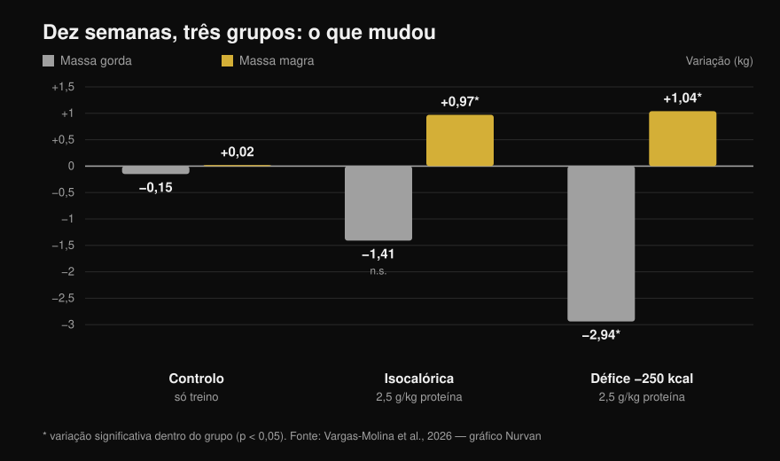
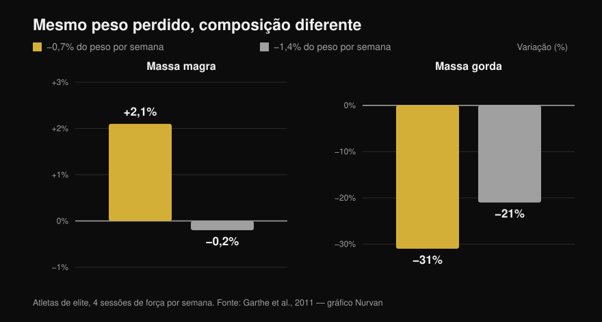

# Recomposição corporal: é mesmo possível?

Por [Giammaria Loi](/autore/giammaria-loi) · atualizado em 13 de outubro de 2026

Dois posts muito partilhados dizem a mesma coisa por ângulos diferentes: perder gordura e ganhar músculo ao mesmo tempo é possível. Um diz isso a partir da experiência de treinador, o outro traz um estudo de 2026 com gráfico de barras e tudo. No essencial ambos têm razão, mas o estudo citado diz bastante menos do que o slide deixa supor — e as duas linhas mais importantes são justamente as que nenhum dos dois posts mostra. Aqui estão os números lidos no texto completo, o limite de défice que a literatura realmente indica e o perfil de pessoa a quem esta estratégia compensa.

## Em resumo

- **A recomposição existe e não é polémica.** Está documentada há anos e aparece no position stand da ISSN sobre dietas e composição corporal (Aragon et al., 2017). Dizer que "a ciência considera isso impossível" é inventar um adversário cómodo.
- **No estudo citado pelo post, o grupo isocalórico NÃO perdeu gordura de forma estatisticamente significativa**: −1,41 kg com p = 0,051 (Vargas-Molina et al., 2026).
- **E o défice não bateu a manutenção.** A interação entre tempo e grupo na massa gorda não é significativa (p = 0,277), e nenhuma comparação par a par resiste à correção estatística. Com dez pessoas por grupo, "o défice faz perder mais gordura" é uma hipótese, não um resultado.
- **O dado que muda tudo e falta nos dois posts: os participantes estavam com 24,7–24,8% de gordura e 1,5 anos de treino nas costas.** Os próprios autores escrevem que esse nível de gordura é alto o suficiente para facilitar a recomposição.
- **O limite mais útil não está em calorias, está em percentagem de peso.** Perder 0,7% do peso por semana fez atletas de elite *ganharem* 2,1% de massa magra; a 1,4% a massa magra ficou parada (Garthe et al., 2011).

## O que o estudo de 2026 fez de verdade

O trabalho citado no carrossel existe, é de acesso aberto e lê-se por inteiro: trinta pessoas entre os 18 e os 35 anos, divididas em três grupos de dez (Vargas-Molina et al., 2026). Os três seguiram **o mesmo programa de força, quatro dias por semana durante dez semanas**, três séries de dez por exercício com uma a duas repetições de margem (RIR, as repetições que ainda sobrariam no fim da série) e dois a três minutos de intervalo.

Só a parte alimentar mudava:

- **ISO**: calorias de manutenção, **2,5 g de proteína por kg** de peso por dia.
- **DEF**: **250 kcal abaixo da manutenção**, a mesma proteína.
- **Controlo**: o mesmo treino, nenhuma orientação alimentar.

Depois de dez semanas, medidos em DXA:

*Variações médias do antes para o depois. Os asteriscos indicam as variações estatisticamente significativas dentro de cada grupo; as barras sem asterisco, não. A interação entre tempo e grupo é significativa para a massa magra (p = 0,034) mas NÃO para a massa gorda (p = 0,277). Dados de Vargas-Molina et al., 2026. Gráfico original Nurvan.*

O grupo de controlo é a parte mais interessante e nenhum dos dois posts o menciona: **fez exactamente o mesmo treino e não mudou nada**, +0,02 kg de massa magra e −0,15 kg de gordura. Dez semanas de pesos a sério, quatro vezes por semana, sem tocar na alimentação: zero recomposição. Curiosamente, foi também o grupo que ganhou mais força (+4,38 kg no supino), um resultado que os próprios autores consideram provavelmente espúrio.

## O que a pesquisa realmente diz

### "Dá para perder gordura e ganhar músculo ao mesmo tempo" — **Confirmado**

Não é novidade nem provocação. Num trabalho já clássico, quarenta homens jovens passaram quatro semanas num défice de 40%, com seis treinos por semana entre pesos e intervalados de alta intensidade: quem comia **2,4 g/kg de proteína ganhou 1,2 kg de massa magra e perdeu 4,8 kg de gordura**, contra +0,1 kg e −3,5 kg de quem comia 1,2 (Longland et al., 2016). Massa magra a subir e gordura a descer, no mesmo mês, em défice pesado.

O position stand da ISSN sobre dietas e composição corporal trata o assunto como assente e limita-se a definir as condições em que funciona melhor (Aragon et al., 2017).

### "A ciência diz que é impossível" — **Desmentido**

É a premissa retórica do primeiro post e não se sustenta. Não existe uma posição científica que negue a recomposição: existe uma literatura que a mede e que explica os seus limites. O modelo das calorias que entram e das que saem diz respeito ao balanço energético total — não proíbe que dois tecidos diferentes caminhem em direções opostas no mesmo período.

### "O défice leve produziu perda extra de gordura" — **A precisar**

Dentro do grupo DEF, sim: −2,94 kg de gordura, p < 0,001. Mas a pergunta do post é outra, ou seja, se o défice foi *melhor* do que a manutenção. E aí o dado não existe: **a interação tempo × grupo na massa gorda não é significativa (p = 0,277)**, e no material suplementar os autores escrevem que nenhuma comparação par a par continua significativa depois da correção de Bonferroni.

No grupo isocalórico, além disso, a perda de gordura de −1,41 kg fica em **p = 0,051**: por pouco fora. O slide apresenta isso como um facto.

Outra coisa que o post não diz: o tamanho do efeito nos ganhos de massa magra é de 0,08, o que na escala usada pelos próprios autores é **"trivial"**, ou seja, desprezável. Um quilo em dez semanas é um resultado real mas pequeno, e deve ser contado como aquilo que é.

### "No máximo 300 kcal de défice" — **A precisar**

O gráfico de dispersão do slide vem da meta-análise de referência sobre o tema, que juntou os estudos de treino em défice com pelo menos três semanas de duração. Lá o número é outro: **a meta-regressão coloca em cerca de 500 kcal por dia o ponto em que os ganhos de massa magra se anulam**, e a recomendação dos autores é não passar desse limite (Murphy & Koehler, 2022). O mesmo trabalho mostra que a força, em compensação, continua a subir mesmo em défice (efeito −0,31, não significativo): a emagrecer podes ficar mais forte mesmo quando o músculo não cresce.

O "não mais de 300" é portanto mais prudente do que a fonte. Como conselho não está errado, mas não é o número do estudo citado.

### "A recomposição é menos comum em quem já é magro" — **Confirmado no princípio**

As percentagens exactas do slide (homens abaixo de 15%, mulheres abaixo de 21%) são classificadas pela própria Examine como estimativas muito grosseiras, e não encontrei uma fonte primária que as fixe. O princípio, porém, está escrito negro no branco: quanto mais gordura tens no início, mais agressivo pode ser o défice; quanto mais magro estás, mais te convém emagrecer devagar para salvar a massa magra (Aragon et al., 2017).

Uma revisão sobre atletas treinados em restrição calórica mostra isso bem: em treze grupos, a massa magra caiu em nove. Os seis grupos que a mantiveram ou aumentaram estavam **entre os mais gordos no início, num défice mais leve, ou a lidar com um estímulo de treino novo**. O único grupo magro e em défice acentuado que segurou a massa magra comia 2,5–2,6 g/kg, a ingestão mais alta de toda a revisão (Helms et al., 2014).

E é aqui que o estudo de 2026 tem de ser relido: os participantes estavam com **24,7–24,8% de gordura** e **1,5 anos** de experiência. Nos limites do artigo os autores dizem-no explicitamente — aquele nível de gordura é alto o suficiente para facilitar a recomposição, e com uma amostra mais magra e mais treinada os resultados teriam sido menos nítidos. O post mostra o resultado e salta a condição que o torna possível.

## A pergunta certa não é "quantas calorias", mas "com que rapidez"

Fixar um número de calorias igual para todos faz pouco sentido: 250 kcal são um défice minúsculo para quem pesa 110 kg e uma fatia importante para quem pesa 50. Raciocinar em percentagem de peso corporal por semana funciona melhor, e há um estudo que testou isso de forma direta.

Vinte e quatro atletas de elite, todos com quatro sessões de força por semana, foram randomizados para perder **0,7% do peso por semana ou 1,4%**. O emagrecimento total foi idêntico (−5,6% contra −5,5%), a composição não (Garthe et al., 2011):

*Emagrecimento total idêntico nos dois grupos, composição corporal muito diferente. A diferença na massa magra entre os grupos é estatisticamente significativa (p < 0,01). Dados de Garthe et al., 2011. Gráfico original Nurvan.*

O grupo lento **ganhou 2,1% de massa magra** enquanto perdia quase um terço da gordura. O grupo rápido perdeu o mesmo peso em metade do tempo, mas com a massa magra parada e menos gordura retirada. É a recomposição num único gráfico: o mesmo peso na balança, outro corpo.

E o défice raramente aparece onde se imagina. Calorias líquidas, azeite na frigideira e molhos mexem no balanço mais depressa do que qualquer distribuição de macros — fizemos as contas em detalhe em [os carboidratos engordam e onde está a gordura escondida](/pt/blog/carboidratos-engordam-gordura-escondida).

## Como aplicar

1. **Decide a velocidade, não as calorias.** Aponta para **0,7% do peso por semana**: 0,5 kg por semana se pesas 70 kg, 0,6 kg se pesas 85. É a velocidade que nos atletas fez subir a massa magra (Garthe et al., 2011).
2. **Não desças abaixo, mas sobretudo não vás além.** Acima dos ~500 kcal de défice por dia os ganhos de massa magra anulam-se (Murphy & Koehler, 2022). Se a balança desce mais depressa do que o previsto, acrescenta comida em vez de tirar.
3. **Proteína alta, mas não necessariamente 2,5 g/kg.** Em normocalórica, acima de **1,62 g/kg** a proteína a mais não acrescenta massa magra (Morton et al., 2018). Em défice a exigência sobe: 2,3–3,1 g por kg de **massa magra**, para o topo do intervalo à medida que estás mais magro e mais em défice (Helms et al., 2014).
4. **Treina força a sério e mede-a.** No estudo, o grupo que treinava sem seguir a alimentação não recompôs nada — mas sem cargas a subir não há o estímulo que direciona as calorias para o músculo. Regista carga, repetições e RIR sessão a sessão, e encaixa-as numa semana compatível com o teu nível: [que divisão de treino serve a iniciante e a avançado](/pt/blog/divisao-treino-iniciante-avancado).
5. **Para de olhar só para o peso.** A recomposição é exactamente o caso em que a balança se move pouco enquanto o corpo muda. Usa perímetros, fotos com quatro semanas de intervalo e cargas levantadas, não o número da manhã.
6. **Escolhe o momento certo.** Se vens de anos de treino e já estás definido, a recomposição torna-se lenta e frustrante: nesse caso compensa fazer uma coisa de cada vez. Se estás a recomeçar depois de uma pausa, ou se tens gordura para perder, é exactamente a janela em que funciona melhor.

> ### 💡 Com o Nurvan
> **A recomposição só se vê se medires duas coisas ao mesmo tempo.** No Nurvan o diário alimentar trabalha sobre a base de dados CREA dos alimentos italianos, portanto o total diário de proteína é um dado real e não uma estimativa; ao lado, o registo de treino guarda cargas, repetições e RIR sessão a sessão, e as medidas corporais ficam no mesmo perfil. Peso parado, cargas a subir e perímetros a descer: isto é recomposição, e é preciso vê-la no mesmo lugar para dar por ela. [Experimenta a Nurvan](https://nurvan.app)

## Perguntas frequentes

**Quanto músculo se consegue ganhar enquanto se perde gordura?**
Nos estudos disponíveis, cerca de **1 kg de massa magra em 10 semanas** em pessoas com um a dois anos de treino e gordura corporal na casa dos 25% (Vargas-Molina et al., 2026), e até 1,2 kg em quatro semanas em não treinados submetidos a um protocolo muito duro (Longland et al., 2016). São números pequenos: a recomposição é um processo lento, não uma transformação em dois meses.

**É preciso défice calórico para a recomposição?**
Não necessariamente. No estudo de 2026 também o grupo em calorias de manutenção ganhou massa magra, e a diferença de perda de gordura em relação ao grupo em défice não alcançou significância estatística (Vargas-Molina et al., 2026). Se estás a meio caminho, manutenção com proteína alta é uma opção sensata.

**Quanta proteína é preciso para perder gordura sem perder músculo?**
Para quem é treinado e está em restrição calórica, 2,3–3,1 g por kg de massa magra, com a parte alta do intervalo para quem está mais magro e em défice mais severo (Helms et al., 2014; Aragon et al., 2017). Em condições normais, acima de 1,62 g por kg de peso corporal já não se ganha mais massa magra (Morton et al., 2018).

**A recomposição também funciona para quem treina há anos?**
Funciona menos. Os autores do estudo de 2026 escrevem que a capacidade de recompor diminui à medida que se aproxima do próprio potencial e de níveis baixos de gordura, e que o atleta avançado e magro faz melhor em perseguir um objetivo de cada vez. O principiante ou quem recomeça depois de uma pausa está na melhor condição.

## Leia também

- [Os carboidratos engordam? A gordura escondida](/pt/blog/carboidratos-engordam-gordura-escondida) — onde o défice realmente se faz.
- [Divisão de treino: iniciante vs avançado](/pt/blog/divisao-treino-iniciante-avancado) — como encaixar as sessões de força na semana.

## Fontes

1. Vargas-Molina S, García-Palumbo A, García-Sillero M, Bonilla DA, Petro JL, Aragon AA, Schoenfeld BJ, Benítez-Porres J, 2026. *Comparison of two nutritional protocols in body re-composition of resistance-trained participants.* Eur J Appl Physiol 126(7):4019–4030. PMID 41940947 — [doi:10.1007/s00421-026-06209-6](https://doi.org/10.1007/s00421-026-06209-6)
2. Murphy C, Koehler K, 2022. *Energy deficiency impairs resistance training gains in lean mass but not strength: A meta-analysis and meta-regression.* Scand J Med Sci Sports 32(1):125–137. PMID 34623696 — [doi:10.1111/sms.14075](https://doi.org/10.1111/sms.14075)
3. Garthe I, Raastad T, Refsnes PE, Koivisto A, Sundgot-Borgen J, 2011. *Effect of two different weight-loss rates on body composition and strength and power-related performance in elite athletes.* Int J Sport Nutr Exerc Metab 21(2):97–104. PMID 21558571 — [doi:10.1123/ijsnem.21.2.97](https://doi.org/10.1123/ijsnem.21.2.97)
4. Longland TM, Oikawa SY, Mitchell CJ, Devries MC, Phillips SM, 2016. *Higher compared with lower dietary protein during an energy deficit combined with intense exercise promotes greater lean mass gain and fat mass loss: a randomized trial.* Am J Clin Nutr 103(3):738–746. PMID 26817506 — [doi:10.3945/ajcn.115.119339](https://doi.org/10.3945/ajcn.115.119339)
5. Morton RW, Murphy KT, McKellar SR, Schoenfeld BJ, Henselmans M, Helms E, Aragon AA, Devries MC, Banfield L, Krieger JW, Phillips SM, 2018. *A systematic review, meta-analysis and meta-regression of the effect of protein supplementation on resistance training-induced gains in muscle mass and strength in healthy adults.* Br J Sports Med 52(6):376–384. PMID 28698222 — [doi:10.1136/bjsports-2017-097608](https://doi.org/10.1136/bjsports-2017-097608)
6. Helms ER, Zinn C, Rowlands DS, Brown SR, 2014. *A systematic review of dietary protein during caloric restriction in resistance trained lean athletes: a case for higher intakes.* Int J Sport Nutr Exerc Metab 24(2):127–138. PMID 24092765 — [doi:10.1123/ijsnem.2013-0054](https://doi.org/10.1123/ijsnem.2013-0054)
7. Aragon AA, Schoenfeld BJ, Wildman R, Kleiner S, VanDusseldorp T, Taylor L, Earnest CP, Arciero PJ, Wilborn C, Kalman DS, Stout JR, Willoughby DS, Campbell B, Arent SM, Bannock L, Smith-Ryan AE, Antonio J, 2017. *International Society of Sports Nutrition position stand: diets and body composition.* J Int Soc Sports Nutr 14:16. PMID 28630601 — [doi:10.1186/s12970-017-0174-y](https://doi.org/10.1186/s12970-017-0174-y)

*Dados bibliográficos verificados no PubMed. Ponto de partida: o post de [John Rusin](https://www.instagram.com/p/DdL-SJoEZYg/) e o carrossel de [Examine.com](https://www.instagram.com/p/Dd6tyK2F2HD/). Nenhum texto ou imagem dos dois posts foi reproduzido: tema e afirmações foram reescritos e verificados nas fontes primárias.*

---

**Giammaria Loi** é o fundador da Nurvan. Treina com pesos desde 2012, trabalha como personal trainer e coach certificado pela FIPE desde 2013 e compete em powerlifting a nível nacional desde 2018. Cada artigo que assina parte dos estudos científicos e chega ao que funciona de verdade no ginásio. [Página do autor](/autore/giammaria-loi)

> Nota: conteúdo informativo, não substitui a opinião de um médico ou de um profissional qualificado. Se tens patologias, perturbações do comportamento alimentar ou segues uma terapia, fala com o teu médico antes de mudares a tua alimentação.
