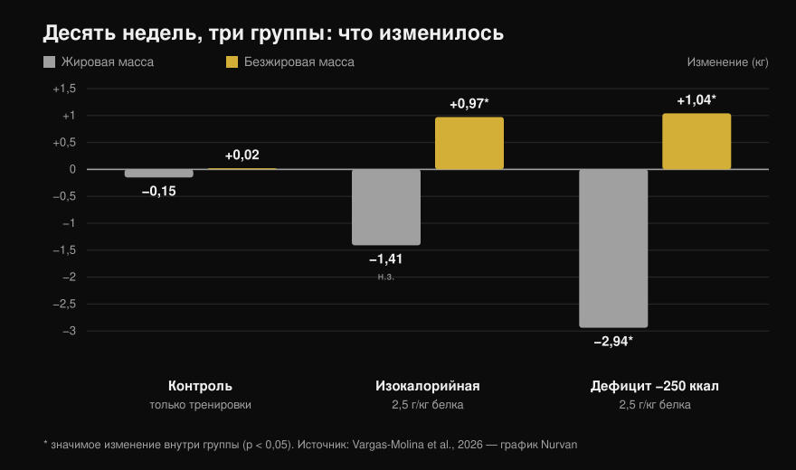
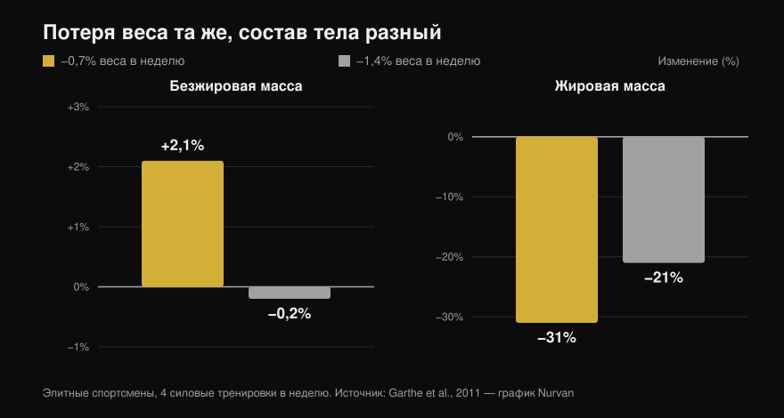

# Рекомпозиция тела: это вообще работает?

Автор: [Giammaria Loi](/autore/giammaria-loi) · обновлено 13 октября 2026

Два поста, которые разошлись по лентам, говорят об одном и том же с разных сторон: терять жир и набирать мышцы одновременно можно. Первый утверждает это с позиции тренера, второй выкладывает исследование 2026 года вместе со столбчатым графиком. По сути оба правы, но цитируемая работа говорит заметно меньше, чем кажется по слайду, — а две самые важные строчки из неё не попали ни в один из постов. Ниже — цифры, прочитанные в полном тексте, тот предел дефицита, который действительно называет литература, и портрет человека, которому такая стратегия и правда выгодна.

## Коротко

- **Рекомпозиция существует, и в ней нет ничего спорного.** Она документирована годами и прямо упомянута в позиционном документе ISSN о диетах и составе тела (Aragon et al., 2017). Фраза «наука считает это невозможным» — удобный выдуманный противник.
- **В цитируемом исследовании изокалорийная группа НЕ потеряла жир статистически значимо**: −1,41 кг при p = 0,051 (Vargas-Molina et al., 2026).
- **И дефицит не обыграл поддерживающую калорийность.** Взаимодействие времени и группы по жировой массе незначимо (p = 0,277), и ни одно парное сравнение не выдерживает статистической поправки. При десяти участниках в группе «дефицит помогает терять больше жира» — это гипотеза, а не результат.
- **Главная деталь, которой нет ни в одном посте: у участников было 24,7–24,8% жира и 1,5 года тренировочного стажа.** Авторы сами пишут, что такой процент жира достаточно высок, чтобы облегчать рекомпозицию.
- **Самый полезный ориентир измеряется не в калориях, а в проценте массы тела.** Потеря 0,7% веса в неделю дала элитным спортсменам *прирост* сухой массы на 2,1%; при 1,4% сухая масса осталась на месте (Garthe et al., 2011).

## Что на самом деле сделали в исследовании 2026 года

Работа из карусели существует, лежит в открытом доступе и читается целиком: тридцать человек в возрасте от 18 до 35 лет, разделённые на три группы по десять (Vargas-Molina et al., 2026). Все три выполняли **одну и ту же силовую программу — четыре дня в неделю на протяжении десяти недель**, три подхода по десять на упражнение с запасом в одно-два повторения (RIR — повторения, которые остались бы в запасе к концу подхода) и отдыхом по две-три минуты.

Отличалась только еда:

- **ISO**: поддерживающая калорийность, **2,5 г белка на кг** массы тела в день.
- **DEF**: **на 250 ккал ниже поддерживающей**, тот же белок.
- **Контроль**: те же тренировки, никаких указаний по питанию.

Через десять недель, по данным DXA:

*Средние изменения от начала к концу. Звёздочки отмечают статистически значимые изменения внутри каждой группы; столбцы без звёздочки — незначимые. Взаимодействие времени и группы значимо для сухой массы (p = 0,034), но НЕ для жировой (p = 0,277). Данные Vargas-Molina et al., 2026. Оригинальный график Nurvan.*

Самое интересное — контрольная группа, и о ней не говорит ни один из двух постов: **она выполняла ровно ту же программу, и не изменилось ничего** — +0,02 кг сухой массы и −0,15 кг жира. Десять недель серьёзной работы с железом четыре раза в неделю, без изменений в питании: нулевая рекомпозиция. Любопытно, что именно эта группа прибавила больше всех в силе (+4,38 кг в жиме лёжа) — результат, который сами авторы считают, скорее всего, случайным.

## Что на самом деле говорят исследования

### «Можно одновременно терять жир и набирать мышцы» — **Подтверждено**

Это не новость и не провокация. В уже классической работе сорок молодых мужчин четыре недели держали дефицит в 40% при шести тренировках в неделю — железо плюс высокоинтенсивные интервалы. Те, кто ел **2,4 г/кг белка, набрали 1,2 кг сухой массы и потеряли 4,8 кг жира**, против +0,1 кг и −3,5 кг у тех, кто ел 1,2 г/кг (Longland et al., 2016). Сухая масса вверх, жир вниз, в один и тот же месяц и на жёстком дефиците.

Позиционный документ ISSN о диетах и составе тела рассматривает это как установленный факт и лишь описывает условия, в которых рекомпозиция работает лучше всего (Aragon et al., 2017).

### «Наука говорит, что это невозможно» — **Опровергнуто**

Это риторическая завязка первого поста, и она не выдерживает проверки. Научной позиции, отрицающей рекомпозицию, не существует: существует литература, которая её измеряет и описывает её границы. Модель «калории на входе и калории на выходе» касается общего энергетического баланса — она не запрещает двум разным тканям двигаться в противоположные стороны в один и тот же период.

### «Небольшой дефицит дал дополнительную потерю жира» — **Требует уточнения**

Внутри группы DEF — да: −2,94 кг жира, p < 0,001. Но вопрос поста другой: оказался ли дефицит *лучше* поддерживающей калорийности. И вот на это данных нет: **взаимодействие время × группа по жировой массе незначимо (p = 0,277)**, а в дополнительных материалах авторы пишут, что после поправки Бонферрони ни одно парное сравнение значимым не остаётся.

К тому же в изокалорийной группе потеря жира в −1,41 кг останавливается на **p = 0,051** — чуть-чуть мимо. Слайд подаёт её как факт.

Ещё одна деталь, которой в посте нет: размер эффекта для прироста сухой массы равен 0,08, что по шкале, которой пользуются сами авторы, означает **«тривиальный»**, то есть пренебрежимо малый. Килограмм за десять недель — результат реальный, но маленький, и рассказывать о нём стоит именно так.

### «Максимум 300 ккал дефицита» — **Требует уточнения**

Диаграмма рассеяния со слайда взята из ключевого метаанализа по теме, который собрал исследования тренировок на дефиците продолжительностью не менее трёх недель. Там фигурирует другое число: **метарегрессия помещает точку, в которой прирост сухой массы обнуляется, примерно на 500 ккал в день**, и авторы рекомендуют этот порог не превышать (Murphy & Koehler, 2022). Та же работа показывает, что сила на дефиците, напротив, продолжает расти (эффект −0,31, незначимый): худея, можно становиться сильнее даже тогда, когда мышца не растёт.

Так что «не больше 300» — осторожнее источника. Как совет это не ошибка, но это не цифра из цитируемой работы.

### «У сухих людей рекомпозиция встречается реже» — **Подтверждено в принципе**

Точные проценты со слайда (мужчины ниже 15%, женщины ниже 21%) сама Examine называет очень грубыми оценками, и первичного источника, который бы их закреплял, я не нашёл. Но принцип написан прямым текстом: чем больше жира на старте, тем агрессивнее может быть дефицит; чем вы суше, тем медленнее стоит худеть, чтобы сохранить сухую массу (Aragon et al., 2017).

Обзор по тренированным спортсменам на ограничении калорий показывает это наглядно: из тринадцати групп сухая масса снизилась в девяти. Шесть групп, которые её сохранили или увеличили, были **среди самых жирных на старте, находились на более мягком дефиците или столкнулись с новым тренировочным стимулом**. Единственная сухая группа на выраженном дефиците, удержавшая сухую массу, ела 2,5–2,6 г/кг — самое высокое потребление за весь обзор (Helms et al., 2014).

Именно здесь исследование 2026 года нужно перечитать: у участников было **24,7–24,8% жира** и **1,5 года** опыта. В разделе ограничений авторы говорят об этом прямо: такой процент жира достаточно высок, чтобы облегчить рекомпозицию, и на более сухой и более тренированной выборке результаты оказались бы менее выразительными. Пост показывает результат и пропускает условие, которое делает его возможным.

## Правильный вопрос — не «сколько калорий», а «как быстро»

Назначать всем одно и то же число калорий смысла мало: 250 ккал — это крошечный дефицит для человека весом 110 кг и заметный кусок для того, кто весит 50. Считать в проценте массы тела за неделю работает лучше, и есть исследование, которое проверило это напрямую.

Двадцать четыре элитных спортсмена, все с четырьмя силовыми тренировками в неделю, были случайно распределены на потерю **0,7% веса в неделю или 1,4%**. Общее похудение оказалось одинаковым (−5,6% против −5,5%), а состав тела — нет (Garthe et al., 2011):

*Общее похудение в двух группах одинаковое, состав тела — совершенно разный. Разница по сухой массе между группами статистически значима (p < 0,01). Данные Garthe et al., 2011. Оригинальный график Nurvan.*

Медленная группа **прибавила 2,1% сухой массы**, потеряв при этом почти треть жира. Быстрая потеряла столько же веса за вдвое меньший срок, но сухая масса осталась на месте, а жира ушло меньше. Это рекомпозиция на одном графике: вес на весах тот же, тело другое.

И дефицит, кстати, редко возникает там, где его ждут. Жидкие калории, масло на сковороде и соусы сдвигают баланс быстрее, чем любое распределение макронутриентов, — мы разобрали это по числам в материале [полнят ли углеводы и где прячется скрытый жир](/ru/blog/uglevody-polnyat-skrytyy-zhir).

## Как это применить

1. **Выбирайте скорость, а не калории.** Ориентир — **0,7% массы тела в неделю**: 0,5 кг в неделю при весе 70 кг, 0,6 кг при 85 кг. Именно на этой скорости у спортсменов росла сухая масса (Garthe et al., 2011).
2. **Не опускайтесь ниже, но главное — не уходите выше.** За пределами примерно 500 ккал дефицита в день прирост сухой массы обнуляется (Murphy & Koehler, 2022). Если вес уходит быстрее запланированного, добавляйте еду, а не убирайте её.
3. **Белка много, но не обязательно 2,5 г/кг.** На поддерживающей калорийности выше **1,62 г/кг** дополнительный белок сухой массы не добавляет (Morton et al., 2018). На дефиците потребность растёт: 2,3–3,1 г на кг **сухой массы**, ближе к верхней границе по мере того, как вы суше и глубже в дефиците (Helms et al., 2014).
4. **Тренируйте силу по-настоящему и измеряйте её.** В исследовании группа, которая тренировалась без контроля питания, не получила никакой рекомпозиции — но без растущих весов нет и стимула, который направляет калории в мышцу. Записывайте вес, повторения и RIR от тренировки к тренировке и встройте их в неделю, подходящую вашему уровню: [какой сплит подходит новичку и продвинутому](/ru/blog/split-trenirovok-novichok-prodvinutyy).
5. **Перестаньте смотреть только на вес.** Рекомпозиция — ровно тот случай, когда весы почти не двигаются, а тело меняется. Опирайтесь на обхваты, фотографии с интервалом в четыре недели и поднятые веса, а не на утреннюю цифру.
6. **Выбирайте подходящий момент.** Если за вами годы тренировок и вы уже сухой, рекомпозиция будет медленной и нервной: тогда выгоднее делать что-то одно за раз. Если вы возвращаетесь после паузы или вам есть что сбросить — это как раз то окно, в котором она работает лучше всего.

> ### 💡 С Nurvan
> **Рекомпозицию видно только тогда, когда вы измеряете две вещи сразу.** В Nurvan дневник питания работает на базе данных CREA по итальянским продуктам, поэтому суточная сумма белка — это реальная величина, а не прикидка; рядом тренировочный журнал держит веса, повторения и RIR от тренировки к тренировке, а замеры тела остаются в том же профиле. Вес стоит, веса на штанге растут, обхваты уменьшаются: это и есть рекомпозиция, и её нужно видеть в одном месте, чтобы вообще заметить. [Попробуй Nurvan](https://nurvan.app)

## Частые вопросы

**Сколько мышц можно набрать, теряя жир?**
В доступных исследованиях — около **1 кг сухой массы за 10 недель** у людей с одним-двумя годами тренировок и процентом жира около 25 (Vargas-Molina et al., 2026), и до 1,2 кг за четыре недели у нетренированных на очень жёстком протоколе (Longland et al., 2016). Это небольшие цифры: рекомпозиция — медленный процесс, а не преображение за два месяца.

**Нужен ли дефицит калорий для рекомпозиции?**
Не обязательно. В исследовании 2026 года сухую массу набрала и группа на поддерживающей калорийности, а разница в потере жира по сравнению с группой на дефиците статистической значимости не достигла (Vargas-Molina et al., 2026). Если вы где-то посередине, поддерживающая калорийность с высоким белком — разумный вариант.

**Сколько белка нужно, чтобы терять жир и не терять мышцы?**
Тренированным на ограничении калорий — 2,3–3,1 г на кг сухой массы, причём верхняя часть диапазона для тех, кто суше и находится в более жёстком дефиците (Helms et al., 2014; Aragon et al., 2017). В обычных условиях выше 1,62 г на кг массы тела сухой массы больше не прибавляется (Morton et al., 2018).

**Работает ли рекомпозиция у тех, кто тренируется годами?**
Работает хуже. Авторы исследования 2026 года пишут, что способность к рекомпозиции снижается по мере приближения к собственному потенциалу и к низкому проценту жира, и что продвинутому сухому спортсмену лучше преследовать одну цель за раз. Новичок или тот, кто возвращается после перерыва, — в самом выгодном положении.

## Читайте также

- [Полнят ли углеводы? Скрытый жир](/ru/blog/uglevody-polnyat-skrytyy-zhir) — где на самом деле появляется дефицит.
- [Сплит тренировок: новичок против продвинутого](/ru/blog/split-trenirovok-novichok-prodvinutyy) — как уложить силовые в неделю.

## Источники

1. Vargas-Molina S, García-Palumbo A, García-Sillero M, Bonilla DA, Petro JL, Aragon AA, Schoenfeld BJ, Benítez-Porres J, 2026. *Comparison of two nutritional protocols in body re-composition of resistance-trained participants.* Eur J Appl Physiol 126(7):4019–4030. PMID 41940947 — [doi:10.1007/s00421-026-06209-6](https://doi.org/10.1007/s00421-026-06209-6)
2. Murphy C, Koehler K, 2022. *Energy deficiency impairs resistance training gains in lean mass but not strength: A meta-analysis and meta-regression.* Scand J Med Sci Sports 32(1):125–137. PMID 34623696 — [doi:10.1111/sms.14075](https://doi.org/10.1111/sms.14075)
3. Garthe I, Raastad T, Refsnes PE, Koivisto A, Sundgot-Borgen J, 2011. *Effect of two different weight-loss rates on body composition and strength and power-related performance in elite athletes.* Int J Sport Nutr Exerc Metab 21(2):97–104. PMID 21558571 — [doi:10.1123/ijsnem.21.2.97](https://doi.org/10.1123/ijsnem.21.2.97)
4. Longland TM, Oikawa SY, Mitchell CJ, Devries MC, Phillips SM, 2016. *Higher compared with lower dietary protein during an energy deficit combined with intense exercise promotes greater lean mass gain and fat mass loss: a randomized trial.* Am J Clin Nutr 103(3):738–746. PMID 26817506 — [doi:10.3945/ajcn.115.119339](https://doi.org/10.3945/ajcn.115.119339)
5. Morton RW, Murphy KT, McKellar SR, Schoenfeld BJ, Henselmans M, Helms E, Aragon AA, Devries MC, Banfield L, Krieger JW, Phillips SM, 2018. *A systematic review, meta-analysis and meta-regression of the effect of protein supplementation on resistance training-induced gains in muscle mass and strength in healthy adults.* Br J Sports Med 52(6):376–384. PMID 28698222 — [doi:10.1136/bjsports-2017-097608](https://doi.org/10.1136/bjsports-2017-097608)
6. Helms ER, Zinn C, Rowlands DS, Brown SR, 2014. *A systematic review of dietary protein during caloric restriction in resistance trained lean athletes: a case for higher intakes.* Int J Sport Nutr Exerc Metab 24(2):127–138. PMID 24092765 — [doi:10.1123/ijsnem.2013-0054](https://doi.org/10.1123/ijsnem.2013-0054)
7. Aragon AA, Schoenfeld BJ, Wildman R, Kleiner S, VanDusseldorp T, Taylor L, Earnest CP, Arciero PJ, Wilborn C, Kalman DS, Stout JR, Willoughby DS, Campbell B, Arent SM, Bannock L, Smith-Ryan AE, Antonio J, 2017. *International Society of Sports Nutrition position stand: diets and body composition.* J Int Soc Sports Nutr 14:16. PMID 28630601 — [doi:10.1186/s12970-017-0174-y](https://doi.org/10.1186/s12970-017-0174-y)

*Библиографические данные проверены в PubMed. Отправная точка: пост [John Rusin](https://www.instagram.com/p/DdL-SJoEZYg/) и карусель [Examine.com](https://www.instagram.com/p/Dd6tyK2F2HD/). Ни текст, ни изображения из этих постов не воспроизводились: тема и утверждения переписаны и проверены по первоисточникам.*

---

**Giammaria Loi** — основатель Nurvan. Тренируется с отягощениями с 2012 года, работает персональным тренером и коучем с сертификацией FIPE с 2013 года и выступает в пауэрлифтинге на национальном уровне с 2018 года. Каждая его статья начинается с научных работ и заканчивается тем, что действительно работает в зале. [Страница автора](/autore/giammaria-loi)

> Примечание: материал информационный, он не заменяет консультацию врача или профильного специалиста. Если у вас есть заболевания, расстройства пищевого поведения или вы проходите лечение, обсудите изменения в питании с врачом.
