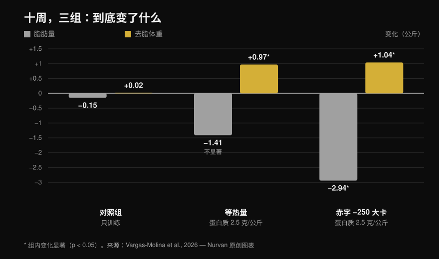
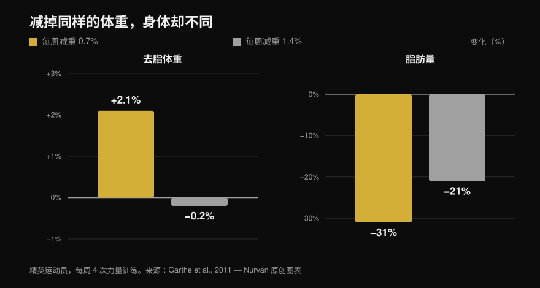

# 身体重组：减脂和增肌真的能同时发生吗

作者：[Giammaria Loi](/autore/giammaria-loi) · 更新于 2026 年 10 月 13 日

两个被大量转发的帖子，从不同角度说了同一件事：减脂和增肌可以同时发生。一个从教练的经验出发，另一个搬出一项 2026 年的研究，还配了柱状图。两者都没说错，但那项研究讲的内容比幻灯片暗示的要少得多——而最关键的两行数据，恰恰是两个帖子都没提的。下面是从论文全文里读出的真实数字、文献真正指出的热量缺口上限，以及这套策略究竟对哪类人划算。

## 重点速览

- **身体重组是真实存在的，而且毫无争议。** 它被记录了多年，也写进了 ISSN 关于饮食与身体成分的立场声明（Aragon 等，2017）。说“科学认为这不可能”，是在打一个自己立起来的靶子。
- **在帖子引用的那项研究里，等热量组的减脂在统计上并不显著**：−1.41 kg，p = 0.051（Vargas-Molina 等，2026）。
- **而且热量缺口并没有赢过维持热量。** 脂肪质量上的时间 × 组别交互作用不显著（p = 0.277），任何两两比较都撑不过统计校正。每组只有 10 人，“有缺口掉脂更多”是一个假设，不是一个结果。
- **真正决定一切、却在两个帖子里消失的数据：受试者起点体脂 24.7%–24.8%，训练年限 1.5 年。** 作者自己写道，这个体脂水平高到足以让身体重组更容易发生。
- **最有用的缺口阈值不是用千卡算的，而是用体重百分比算的。** 每周掉体重的 0.7%，让精英运动员的去脂体重**增加了 2.1%**；每周掉 1.4% 时，去脂体重原地不动（Garthe 等，2011）。

## 那项 2026 年的研究到底做了什么

轮播图引用的论文确实存在，而且是开放获取、可以通读的：三十名 18 至 35 岁的受试者，分成三组，每组十人（Vargas-Molina 等，2026）。三组都执行**同一套力量训练方案，每周四天，共十周**，每个动作三组十次，保留 1–2 次储备次数（RIR，即一组做完后你还能再做几次），组间休息 2–3 分钟。

唯一不同的是吃法：

- **ISO 组**：维持热量，每天每公斤体重 **2.5 g 蛋白质**。
- **DEF 组**：**低于维持热量 250 kcal**，蛋白质相同。
- **对照组**：同样的训练，不给任何饮食指导。

十周后用 DXA 测量的结果：

*前后测的平均变化。星号表示该组内部统计显著的变化，没有星号的柱子则不显著。时间 × 组别交互作用在去脂体重上显著（p = 0.034），在脂肪质量上**不**显著（p = 0.277）。数据来自 Vargas-Molina 等，2026。Nurvan 原创图表。*

对照组是最有意思的部分，而两个帖子一个字都没提：**它做了完全相同的训练，结果什么都没变**，去脂体重 +0.02 kg，脂肪 −0.15 kg。十周认真举铁，每周四次，饮食不动：零重组。有意思的是，它反而是力量涨得最多的一组（卧推 +4.38 kg），而作者自己认为这个结果很可能是偶然的。

## 研究究竟怎么说

### “可以一边减脂一边增肌” —— **确认**

这既不是新闻，也不是挑衅。在一项已成经典的研究里，四十名年轻男性被放进 40% 的热量缺口中四周，每周六次训练，包括举铁和高强度间歇：吃 **2.4 g/kg 蛋白质的人增加了 1.2 kg 去脂体重、减掉了 4.8 kg 脂肪**，而吃 1.2 g/kg 的人只有 +0.1 kg 和 −3.5 kg（Longland 等，2016）。同一个月里，去脂体重上升、脂肪下降，而且是在很深的缺口中。

ISSN 关于饮食与身体成分的立场声明把这件事当成定论，只去界定它在什么条件下效果最好（Aragon 等，2017）。

### “科学说这不可能” —— **不成立**

这是第一个帖子的修辞前提，但它站不住脚。没有任何科学立场否认身体重组：存在的是一批测量它、并解释它边界的研究。热量进出模型说的是总能量平衡，它并不禁止两种不同的组织在同一段时间里朝相反方向移动。

### “轻微的热量缺口带来了额外的脂肪流失” —— **需修正**

在 DEF 组内部确实如此：脂肪 −2.94 kg，p < 0.001。但帖子问的是另一个问题，即缺口是否**优于**维持热量。而这个答案并不存在：**脂肪质量上的时间 × 组别交互作用不显著（p = 0.277）**，补充材料里作者也写明，经 Bonferroni 校正后没有任何两两比较仍然显著。

再看等热量组，−1.41 kg 的脂肪流失停在 **p = 0.051**：刚好在门槛外。幻灯片却把它当成既定事实。

还有一件帖子没说的事：去脂体重增益的效应量是 0.08，按作者自己使用的标尺属于 **“trivial”**，也就是可以忽略不计。十周一公斤是真实的结果，但很小，就该照它本来的样子讲。

### “缺口最多 300 kcal” —— **需修正**

幻灯片里的散点图出自这个主题的参考性荟萃分析，它汇总了所有在热量缺口中进行、至少持续三周的训练研究。那里的数字是另一个：**荟萃回归把去脂体重增益归零的位置定在每天约 500 kcal**，作者的建议是不要越过这条线（Murphy & Koehler，2022）。同一篇论文还显示，力量反而在缺口中继续上升（效应量 −0.31，不显著）：减脂期间肌肉不长，你照样可以变强。

所以“不超过 300”比它的出处更保守。作为建议不算错，但它不是被引用的那项研究给出的数字。

### “已经很瘦的人更难做到身体重组” —— **原则上确认**

幻灯片上的具体百分比（男性低于 15%、女性低于 21%）被 Examine 自己定义为非常粗略的估计，我也没找到把它们固定下来的一手文献。但原则本身成立，而且写得明明白白：起点体脂越高，缺口就可以越激进；越瘦，就越应该慢慢减，以保住去脂体重（Aragon 等，2017）。

一篇关于热量限制期训练者的综述把这点展示得很清楚：十三个组当中，有九个组的去脂体重下降了。保住或增加去脂体重的那六个组，**要么起点最胖，要么缺口更轻，要么正在接受一个全新的训练刺激**（Helms 等，2014）。唯一一个又瘦、缺口又深却守住去脂体重的组，吃到 2.5–2.6 g/kg，是整篇综述里最高的摄入量。而饮食上的落差往往不在主食，而在那些你没算进去的地方——[碳水化合物会让人变胖吗？被忽略的隐藏脂肪](/zh/blog/tanshui-huahewu-bianpang-yincang-zhifang)里拆得更细。

正是在这里，那项 2026 年的研究需要被重读一遍：受试者起点体脂 **24.7%–24.8%**，训练经验 **1.5 年**。作者在局限性里说得很直接——这个体脂水平高到足以让身体重组更容易发生，如果换一批更瘦、更有训练经验的人，结果会模糊得多。帖子展示了结果，却跳过了让结果成立的那个前提。

## 正确的问题不是“多少热量”，而是“掉多快”

给所有人定同一个热量数字意义不大：250 kcal 对 110 kg 的人是个微不足道的缺口，对 50 kg 的人却是一大块。按每周掉体重的百分比来思考要好用得多，而且有一项研究直接检验过这件事。

二十四名精英运动员，全都每周进行四次力量训练，被随机分配到**每周掉体重的 0.7% 或 1.4%**。总的体重下降完全一样（−5.6% 对 −5.5%），但身体成分不一样（Garthe 等，2011）：

*两组的总减重完全相同，身体成分却差别很大。两组之间去脂体重的差异具有统计显著性（p < 0.01）。数据来自 Garthe 等，2011。Nurvan 原创图表。*

慢速组在掉掉将近三分之一脂肪的同时，**去脂体重增加了 2.1%**。快速组用一半的时间掉了同样的体重，但去脂体重原地不动，掉的脂肪还更少。这就是一张图里的身体重组：体重秤上一样，身体不一样。

## 怎么用

1. **先定速度，不是先定热量。** 目标是**每周掉体重的 0.7%**：70 kg 的人每周 0.5 kg，85 kg 的人 0.6 kg。这正是在运动员身上让去脂体重上升的速度（Garthe 等，2011）。
2. **不要更低，更重要的是不要更狠。** 每天缺口超过约 500 kcal，去脂体重的增益就会归零（Murphy & Koehler，2022）。如果体重掉得比计划快，加食物，而不是再减。
3. **蛋白质要高，但不一定非得 2.5 g/kg。** 在维持热量下，超过 **1.62 g/kg** 再加蛋白质也不会多长去脂体重（Morton 等，2018）。在缺口中需求上升：按**去脂体重**计算 2.3–3.1 g/kg，越瘦、缺口越深就越往上取（Helms 等，2014）。
4. **认真训练力量，并且记录它。** 研究里那个只训练、不管饮食的组一点都没重组——但没有稳步上升的负荷，就没有把热量引向肌肉的那个刺激。每次训练都记下负荷、次数和 RIR。一周里怎么安排这些训练，可以看[训练分化：新手与高阶](/zh/blog/xunlian-fenhua-xinshou-gaoji)。
5. **别再只看体重。** 身体重组恰恰是体重几乎不动、身体却在变的那种情况。用围度、间隔四周的照片和举起的重量来判断，而不是早上秤出来的数字。
6. **挑对时机。** 如果你已经练了好几年、本来就很清晰，身体重组会变得缓慢又让人憋屈：那种情况下，一次只做一件事更划算。而如果你是停训后重新开始，或者本来就有脂肪要减，这正是它最管用的那个窗口。

> ### 💡 用 Nurvan
> **身体重组只有在你同时测两件事时才看得见。** 在 Nurvan 里，饮食日记基于意大利食物成分数据库 CREA，所以每天的蛋白质总量是一个真实的数据，而不是一个估计；旁边，训练记录逐次保存负荷、次数和 RIR，身体围度也留在同一个档案里。体重不动、负荷上升、围度下降：这就是身体重组，而你需要在同一个地方看到它，才会察觉它正在发生。[试用 Nurvan](https://nurvan.app)

## 常见问题

**减脂的同时能增多少肌肉？**
在现有研究里，训练年限 1–2 年、体脂约 25% 的人大约是**十周 1 kg 去脂体重**（Vargas-Molina 等，2026）；在接受极严苛方案的无训练经验者身上，四周可达 1.2 kg（Longland 等，2016）。这些数字都很小：身体重组是一个缓慢的过程，不是两个月的蜕变。

**身体重组一定需要热量缺口吗？**
不一定。在那项 2026 年的研究里，维持热量组同样增加了去脂体重，而它与缺口组在脂肪流失上的差距并未达到统计显著性（Vargas-Molina 等，2026）。如果你处在中间状态，维持热量加高蛋白是一个合理的选择。

**减脂不掉肌肉需要多少蛋白质？**
对有训练经验、处于热量限制中的人，按去脂体重 2.3–3.1 g/kg，越瘦、缺口越深就取区间的上端（Helms 等，2014；Aragon 等，2017）。在正常热量下，超过每公斤体重 1.62 g 就不会再多长去脂体重了（Morton 等，2018）。

**练了很多年的人也能身体重组吗？**
效果会差一些。那项 2026 年研究的作者写道，随着越来越接近自己的潜力上限和很低的体脂水平，重组的能力会下降，又瘦又进阶的运动员更适合一次只追一个目标。新手，以及停训后重新开始的人，处在最有利的位置。

## 延伸阅读

- [碳水化合物会让人变胖吗？被忽略的隐藏脂肪](/zh/blog/tanshui-huahewu-bianpang-yincang-zhifang) —— 热量到底藏在哪里。
- [训练分化：新手与高阶](/zh/blog/xunlian-fenhua-xinshou-gaoji) —— 一周里怎么安排力量训练。

## 参考文献

1. Vargas-Molina S, García-Palumbo A, García-Sillero M, Bonilla DA, Petro JL, Aragon AA, Schoenfeld BJ, Benítez-Porres J, 2026. *Comparison of two nutritional protocols in body re-composition of resistance-trained participants.* Eur J Appl Physiol 126(7):4019–4030. PMID 41940947 — [doi:10.1007/s00421-026-06209-6](https://doi.org/10.1007/s00421-026-06209-6)
2. Murphy C, Koehler K, 2022. *Energy deficiency impairs resistance training gains in lean mass but not strength: A meta-analysis and meta-regression.* Scand J Med Sci Sports 32(1):125–137. PMID 34623696 — [doi:10.1111/sms.14075](https://doi.org/10.1111/sms.14075)
3. Garthe I, Raastad T, Refsnes PE, Koivisto A, Sundgot-Borgen J, 2011. *Effect of two different weight-loss rates on body composition and strength and power-related performance in elite athletes.* Int J Sport Nutr Exerc Metab 21(2):97–104. PMID 21558571 — [doi:10.1123/ijsnem.21.2.97](https://doi.org/10.1123/ijsnem.21.2.97)
4. Longland TM, Oikawa SY, Mitchell CJ, Devries MC, Phillips SM, 2016. *Higher compared with lower dietary protein during an energy deficit combined with intense exercise promotes greater lean mass gain and fat mass loss: a randomized trial.* Am J Clin Nutr 103(3):738–746. PMID 26817506 — [doi:10.3945/ajcn.115.119339](https://doi.org/10.3945/ajcn.115.119339)
5. Morton RW, Murphy KT, McKellar SR, Schoenfeld BJ, Henselmans M, Helms E, Aragon AA, Devries MC, Banfield L, Krieger JW, Phillips SM, 2018. *A systematic review, meta-analysis and meta-regression of the effect of protein supplementation on resistance training-induced gains in muscle mass and strength in healthy adults.* Br J Sports Med 52(6):376–384. PMID 28698222 — [doi:10.1136/bjsports-2017-097608](https://doi.org/10.1136/bjsports-2017-097608)
6. Helms ER, Zinn C, Rowlands DS, Brown SR, 2014. *A systematic review of dietary protein during caloric restriction in resistance trained lean athletes: a case for higher intakes.* Int J Sport Nutr Exerc Metab 24(2):127–138. PMID 24092765 — [doi:10.1123/ijsnem.2013-0054](https://doi.org/10.1123/ijsnem.2013-0054)
7. Aragon AA, Schoenfeld BJ, Wildman R, Kleiner S, VanDusseldorp T, Taylor L, Earnest CP, Arciero PJ, Wilborn C, Kalman DS, Stout JR, Willoughby DS, Campbell B, Arent SM, Bannock L, Smith-Ryan AE, Antonio J, 2017. *International Society of Sports Nutrition position stand: diets and body composition.* J Int Soc Sports Nutr 14:16. PMID 28630601 — [doi:10.1186/s12970-017-0174-y](https://doi.org/10.1186/s12970-017-0174-y)

*文献元数据已在 PubMed 上核对。最初的灵感来自 [John Rusin](https://www.instagram.com/p/DdL-SJoEZYg/) 的帖子与 [Examine.com](https://www.instagram.com/p/Dd6tyK2F2HD/) 的轮播图。两则帖子的文字与图片均未被复制：主题与说法都经过重写，并在一手文献上做了核对。*

---

**Giammaria Loi** 是 Nurvan 的创始人。他自 2012 年开始力量训练，2013 年起担任 FIPE 认证私人教练与教练，2018 年起在国家级 powerlifting 赛事中参赛。他署名的每篇文章都从科学研究出发，落到健身房里真正有效的做法。[作者页面](/autore/giammaria-loi)

> 说明：本文为科普内容，不能替代医生或专业人士的意见。如果你有疾病、进食行为障碍，或正在接受治疗，请在改变饮食之前先与你的医生沟通。
