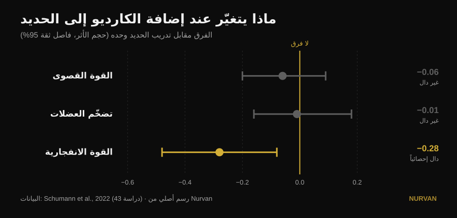
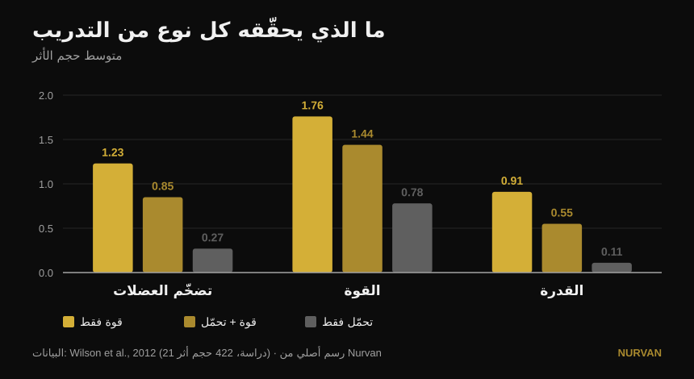

# أن تدرّب كل شيء معاً أم أن تتخصّص في صفة واحدة؟

بقلم [Giammaria Loi](/autore/giammaria-loi) · حُدّث في 14 أكتوبر 2026

منشور واسع الانتشار يقول إنّ التخصّص في صفة بدنية واحدة يعطي نتائج أسوأ، وإنّ كل برنامج ينبغي أن يضمّ ستّ صفات معاً: القدرة، القوة، التضخّم، اللياقة، المرونة والأداء الرياضي. تحت المنشور يسأل ثلاثة قرّاء مختلفين السؤال نفسه: أين الدراسة؟ لا توجد. هذه هي المصادر — وهي تروي قصة أدقّ، تتضرّر فيها فعلاً واحدة من الصفات الستّ، لكنها ليست التي تتوقّعها.

## باختصار

- **إضافة العمل الهوائي لا تكلّفك قوة قصوى ولا كتلة عضلية.** عبر 43 دراسة، الفارق مقابل من يرفع الحديد فقط يكاد يكون صفراً: −0.06 في القوة القصوى و−0.01 في التضخّم، وكلاهما غير دال إحصائياً (Schumann et al., 2022).
- **لكنها تكلّفك القدرة.** القوة الانفجارية تنخفض بشكل دالّ إحصائياً (−0.28، p = 0.007). وهي الصفة الوحيدة في قائمة المنشور التي تدفع ثمناً حقيقياً.
- **والثمن مرتبط بالجدول الزمني لا بالحماس.** يكون تراجع القدرة واضحاً حين يجتمع الحديد والكارديو في الحصة نفسها، ويختفي حين تفصل بينهما 3 ساعات على الأقل (Schumann et al., 2022).
- **والأمر ليس واحداً للجميع.** يظهر التداخل في قوة الطرفين السفليين لدى الرجال (−0.43) ولا يظهر لدى النساء (0.08)، والفارق بين المجموعتين دالّ إحصائياً (Huiberts et al., 2024).
- **السؤال الصحيح ليس «كل شيء معاً أم شيء واحد في كل مرة».** تبقى القوة والكتلة محفوظتين حتى 32 أسبوعاً بـ**حصة واحدة أسبوعياً ومجموعة واحدة لكل تمرين**، ما دام الحمل النسبي مرتفعاً (Spiering et al., 2021). تدفع صفة واحدة وتحافظ على البقية بالقليل جداً.

## المعضلة مطروحة بشكل خاطئ

فكرة المنشور بسيطة: تدريب صفة واحدة في كل مرة يعطي مكاسب «ضئيلة وضيّقة»، وتدريبها كلها معاً يعطي أكثر. حدس لطيف، لكن لم تقارن أي دراسة قطّ بشكل مباشر برنامجاً متخصّصاً ببرنامج متعدد الأنماط وتجمع الحصيلة. ما تقارنه الأبحاث فعلاً أكثر فائدة: ماذا يحدث للقوة والكتلة والقدرة **حين تضيف عملاً هوائياً إلى برنامج حديد مطابق تماماً**.

لهذا السؤال إجابة متينة، مبنية على 43 دراسة محكومة كان فيها برنامج القوة متطابقاً بين المجموعات ولا يتغيّر سوى إضافة التحمّل (Schumann et al., 2022):

*فروق متوسطة معيارية مقابل من اكتفى بالحديد، مع فاصل ثقة 95%. الفاصل الذي يعبر الصفر يعني أنه لا فرق مثبت. بيانات من Schumann et al., 2022 (43 دراسة). رسم أصلي من Nurvan.*

اثنان من ثلاثة يعبران الصفر: **في القوة القصوى وفي التضخّم لا يأخذ الكارديو شيئاً**. الثالث لا. القوة الانفجارية — القفز والرمي والتسارع — تتراجع فعلاً.

مراجعة من 2026 جمعت سبع عشرة دراسة تحليلية تصل إلى النقطة نفسها من زاوية أخرى: من يدرّب القوة والتحمّل معاً يحصل على **قدرة هوائية أكبر** ممّن يكتفي بالحديد (0.77، p = 0.02)، وعلى نتائج **مماثلة** لا متفوّقة في القوة والقدرة والتضخّم (Held et al., 2026). ويحذّر المؤلفون أنفسهم من ندرة البيانات لدى رياضيي النخبة: وهناك بالضبط يكون للتخصّص أكبر وزن، ويكون لدى البحث أقلّ ما يقوله.

## ماذا تقول الأبحاث فعلاً

### «التخصّص في صفة واحدة يعطي نتائج أسوأ» — **بحاجة إلى تدقيق**

تُظهر الأبحاث *تكافؤاً* لا دونية. من يضيف الكارديو لا يحصل على قوة أو كتلة أكثر ممّن يركّز على الحديد وحده: يحصل على القدر نفسه، زائد قدرة هوائية مجاناً. هذه حجة ممتازة لعدم الخوف من اللياقة. لكنها ليست حجة ضد من يختار، في مرحلة واحدة، أن يدفع شيئاً واحداً.

### «تدريب كل شيء معاً يعطي أكثر» — **بحاجة إلى تدقيق**

أكثر في عدد الصفات، لا أكثر في كل صفة. تتّسع الحصيلة الإجمالية، وتبقى النتائج الفردية كما هي. يصبح هذا الفارق مهماً حين تكون أمامك بطولة أو فئة وزن أو موعد نهائي.

### «اللياقة لا تكلّفك شيئاً» — **مُفنَّد، بالنسبة للقدرة**

هنا يخطئ المنشور الهدف، ويخطئ تحديداً في الصفة التي يضعها أولاً. القوة الانفجارية تدفع: −0.28، بفاصل ثقة لا يلمس الصفر (Schumann et al., 2022). والمثير هو السبب: **التراجع واضح حين تكون الحصتان داخل تمرين واحد (p = 0.043)، ولا يعود يظهر حين تفصل بينهما ثلاث ساعات على الأقل**. ليست حتمية بيولوجية، بل مسألة جدولة.

الصورة الأقدم والأكثر تفصيلاً تقول الشيء نفسه بأحجام الأثر الخام (Wilson et al., 2012):

*متوسط أحجام الأثر عبر 21 دراسة و422 مقارنة. في القدرة تكون الفروق بين المجموعات الثلاث دالّة إحصائياً؛ وفي التضخّم والقوة يتخلّف التحمّل المنفرد وحده. بيانات من Wilson et al., 2012. رسم أصلي من Nurvan.*

وفي العمل نفسه يظهر المعدِّلان اللذان لا يذكرهما المنشور: **الجري يخفض التضخّم والقوة، أمّا الدرّاجة فلا**، وحجم التداخل يزداد مع تواتر حصص التحمّل (ارتباطات من −0.26 إلى −0.35) وخصوصاً مع مدّتها (من −0.29 إلى −0.75). المسألة ليست «الكارديو»: المسألة كم، وأيّ نوع، ومتى.

### «هذا ينطبق على الجميع» — **بحاجة إلى تدقيق**

يسأل أحد المعلّقين تحت المنشور: أين نتائج النساء؟ سؤال ممتاز وله إجابة. عبر 59 دراسة و1346 شخصاً، يظهر التداخل في قوة الطرفين السفليين **لدى الرجال (−0.43) ولا يظهر لدى النساء (0.08)**، بفارق دالّ إحصائياً بين المجموعتين (p = 0.03). أمّا في قوة الطرفين العلويين والقدرة والحد الأقصى لاستهلاك الأكسجين فلا فرق بين الجنسين إطلاقاً (Huiberts et al., 2024).

### «المرونة كتلة إلزامية منفصلة» — **بحاجة إلى تدقيق**

إن درّبت القوة على كامل المدى الحركي، فجزء من عمل المرونة منجَز أصلاً. عبر 11 تجربة محكومة و452 شخصاً، لا يختلف تدريب القوة عن الإطالة في مكاسب المدى الحركي (−0.22، p = 0.206)، ويصمد ذلك في كل المجموعات الفرعية التي حُلّلت (Afonso et al., 2021). ويشدّد المؤلفون على التباين الكبير بين الدراسات، فهذه ليست رخصة للتوقّف عن الإطالة إن كان لديك قيد محدّد — لكن أحد المربّعات الستّة يملأ نفسه جزئياً.

### «صفة واحدة في كل مرة تعني مكاسب ضئيلة» — **مُفنَّد في الاتجاه المعاكس**

تبديل التركيز عبر الزمن ليس عيباً: هذا تعريف التدوير التدريبي، وهو في القوة القصوى أفضل من غيابه. مع تساوي الحجم، وعبر 35 دراسة، تتفوّق البرامج المدوَّرة على غير المدوَّرة في أقصى تكرار واحد (0.31، p = 0.02)، بينما **لا يتغيّر شيء في التضخّم** (0.13، p = 0.27). وبين التدوير الخطّي والمتموّج، لا توجد أفضلية المتموّج في أقصى تكرار واحد إلا لدى المتدرّبين (0.61) وتختفي لدى المبتدئين (0.06) (Moesgaard et al., 2022).

بعبارة أخرى: إن أردت الكتلة فالترتيب قليل الأهمية ويمكنك فعل كل شيء معاً دون ندم. وإن أردت رقماً أقصى فأنت بحاجة إلى تنظيم عبر الزمن — و«كل شيء معاً دائماً» ليس تنظيماً.

## السؤال الذي لا يطرحه المنشور

لمعضلة «الصفات الستّ معاً أم واحدة تلو الأخرى» حدٌّ ثالث لا يسمّيه أيّ من الطرفين: **كم القليل الذي يكفي كي لا تخسر ما بنيته**. جُمعت الإجابة دراسةً بعد دراسة، وهي منخفضة إلى حدّ مدهش (Spiering et al., 2021):

| الصفة | أقل جرعة للحفاظ عليها | لكم من الوقت | الشرط |
|---|---|---|---|
| القوة والكتلة (دون 40 سنة) | حصة واحدة أسبوعياً، مجموعة واحدة لكل تمرين | حتى 32 أسبوعاً | بقاء الحمل النسبي مرتفعاً |
| الكتلة العضلية (كبار السن) | حصتان أسبوعياً، 2-3 مجموعات | — | بقاء الحمل النسبي مرتفعاً |
| القدرة الهوائية | حصتان أسبوعياً، أو حجم مخفَّض 33-66% (حتى 13-26 دقيقة) | حتى 15 أسبوعاً | بقاء نبض العمل مرتفعاً |

المتغيّر الذي لا يمكن قصّه هو نفسه دائماً: **الشدّة**. الحجم والتواتر يمكن خفضهما كثيراً، أمّا الحمل أو الوتيرة فلا.

هذا يغيّر النقاش كله. أنت لا تختار بين ستّ صفات تُدرَّب بسوء وصفة واحدة تُدرَّب جيداً. تدفع صفة واحدة ستة إلى ثمانية أسابيع وتضع البقية في **وضع المحافظة** بحصة واحدة أو مجموعة واحدة. هكذا يبني المدرّبون رياضياً متكاملاً دون أن يحرقوه، وهذا بالضبط الطريق الوسط الذي يصفه المنشور بأنه مستحيل.

## كيف تطبّق ذلك

1. **اختر أولوية واحدة للأسابيع 6-8 القادمة.** واحدة فقط: الرقم الأقصى، أو الكتلة، أو اللياقة. البقية لا تُترك، بل تُبطَّأ.
2. **أبقِ البقية حيّة بأقل جرعة.** حصة أسبوعية واحدة بمجموعتين ثقيلتين تحفظ القوة والكتلة لأشهر (Spiering et al., 2021). المهم أن يبقى الحمل قريباً ممّا كنت تستخدمه، لا أن يبقى الحجم مرتفعاً.
3. **افصل الحديد عن اللياقة بثلاث ساعات على الأقل**، أو ضعهما في يومين مختلفين، إن كانت القدرة تهمّك (Schumann et al., 2022). وإن اضطررت إلى دمجهما فابدأ بالحديد: هذا هو الاتجاه الذي تُظهره أحدث مراجعة (Held et al., 2026).
4. **اختر نوع الكارديو بعناية.** الدرّاجة لا تتداخل، والجري يتداخل — خصوصاً الطويل والمتكرر (Wilson et al., 2012). إن كان لا بدّ من الجري وأردت بناء الرجلين أيضاً، فأبقِ الحصص قصيرة.
5. **لا تحتسب المرونة ككتلة إضافية تلقائياً.** درّب القوة على كامل المدى الحركي وأضف عملاً موجّهاً فقط حيث يوجد قيد حقيقي (Afonso et al., 2021). تحليلنا حول [كيف تختار المجموعات والتكرارات](/ar/blog/kam-takrar-lilkutla-aladalia) يساعدك في ضبط جزء القوة.
6. **قِس ولا تتخيّل.** التداخل لا يُحسّ، بل يُرى في الأرقام. إن انخفضت قفزتك أو سرعة البار بعد أربعة أسابيع من اللياقة بينما ثبتت أحمالك، فقد وجدت تماماً الثمن الذي تتحدّث عنه الأبحاث.

> ### 💡 مع Nurvan
> **تدريب عدة صفات معاً لا ينجح إلا إذا استطعت أن ترى أيّها يتراجع.** في Nurvan تحتفظ ببرامج وتخصّصات مختلفة في السجل نفسه — قوة، تضخّم، فنكشنال، HYROX — مع تسجيل الحمل والتكرارات وRIR مجموعةً بمجموعة، والتاريخ دائماً أمامك للمقارنة. هكذا يصبح «وضع المحافظة» شيئاً تتحقّق منه فعلاً بدل أن تتمنّاه: إذا هبط رقمك الأقصى بينما ترتفع لياقتك، ستلاحظ ذلك خلال أسبوعين لا خلال شهرين. [جرّب Nurvan](https://nurvan.app)

## أسئلة شائعة

**هل يفقدك الكارديو العضل؟**
لا. عبر 43 دراسة محكومة، إضافة العمل الهوائي إلى برنامج حديد مطابق لا تغيّر التضخّم (−0.01، p = 0.919) ولا القوة القصوى (−0.06، p = 0.446) (Schumann et al., 2022). الصفة الوحيدة المتأثرة هي القوة الانفجارية.

**الكارديو والحديد في اليوم نفسه أم في يومين مختلفين؟**
إن كانت القدرة تهمّك فافصل بينهما: يكون تراجع القوة الانفجارية واضحاً حين يكونان في الحصة نفسها، ولا يعود يظهر مع فاصل ثلاث ساعات على الأقل (Schumann et al., 2022). وإن كانت القوة والكتلة فقط ما يهمّك، فوزن الجدولة أقل بكثير.

**كم تدريباً يلزم كي لا أخسر القوة التي بنيتها؟**
لدى البالغين دون 40 سنة، حافظت حصة أسبوعية واحدة بمجموعة واحدة لكل تمرين على القوة والكتلة حتى 32 أسبوعاً، شرط بقاء الحمل النسبي مرتفعاً (Spiering et al., 2021). يُقصّ الحجم، ولا تُقصّ الشدّة أبداً.

**هل عليّ تدريب ستّ صفات كما يقول المنشور؟**
لا يوجد مصدر يحدّد عدداً إلزامياً من الصفات، ولا مصدر يثبت «تآزراً» بينها. ما تثبته المصادر هو أنّ بإمكانك تدريب عدة صفات معاً دون خسارة قوة أو كتلة، وأنّ الصفات التي لا تدفعها حالياً تُحفظ بعمل قليل جداً. العدد الصحيح يتوقّف على هدفك، لا على قاعدة.

## اقرأ أيضاً

- [تقسيم التمرين: مبتدئ أم متقدم؟](/ar/blog/taqsim-altadrib-mubtadi-mutaqaddim)
- [كم تكرار لبناء العضلات؟ خرافة الـ 8-12](/ar/blog/kam-takrar-lilkutla-aladalia)
- [تمديد الساقين أم دفع الأرجل: ما الذي ينمو فعلاً](/ar/blog/tamdid-alsaqayn-am-dafe-alarjul-alfakhidh-almustaqim)

## المصادر

1. Schumann M, Feuerbacher JF, Sünkeler M, Freitag N, Rønnestad BR, Doma K, Lundberg TR, 2022. *Compatibility of Concurrent Aerobic and Strength Training for Skeletal Muscle Size and Function: An Updated Systematic Review and Meta-Analysis.* Sports Med 52(3):601–612. PMID 34757594 — [doi:10.1007/s40279-021-01587-7](https://doi.org/10.1007/s40279-021-01587-7)
2. Held S, Wolf L, Rappelt L, Bloch W, Donath L, Micke F, Geisler S, Isenmann E, 2026. *Maximizing Adaptations in Concurrent Training: An Umbrella Review of Meta-analyses.* Sports Med 56(6):1489–1512. PMID 41762427 — [doi:10.1007/s40279-026-02401-y](https://doi.org/10.1007/s40279-026-02401-y)
3. Wilson JM, Marin PJ, Rhea MR, Wilson SMC, Loenneke JP, Anderson JC, 2012. *Concurrent training: a meta-analysis examining interference of aerobic and resistance exercises.* J Strength Cond Res 26(8):2293–2307. PMID 22002517 — [doi:10.1519/JSC.0b013e31823a3e2d](https://doi.org/10.1519/JSC.0b013e31823a3e2d)
4. Huiberts RO, Wüst RCI, van der Zwaard S, 2024. *Concurrent Strength and Endurance Training: A Systematic Review and Meta-Analysis on the Impact of Sex and Training Status.* Sports Med 54(2):485–503. PMID 37847373 — [doi:10.1007/s40279-023-01943-9](https://doi.org/10.1007/s40279-023-01943-9)
5. Spiering BA, Mujika I, Sharp MA, Foulis SA, 2021. *Maintaining Physical Performance: The Minimal Dose of Exercise Needed to Preserve Endurance and Strength Over Time.* J Strength Cond Res 35(5):1449–1458. PMID 33629972 — [doi:10.1519/JSC.0000000000003964](https://doi.org/10.1519/JSC.0000000000003964)
6. Moesgaard L, Beck MM, Christiansen L, Aagaard P, Lundbye-Jensen J, 2022. *Effects of Periodization on Strength and Muscle Hypertrophy in Volume-Equated Resistance Training Programs: A Systematic Review and Meta-analysis.* Sports Med 52(7):1647–1666. PMID 35044672 — [doi:10.1007/s40279-021-01636-1](https://doi.org/10.1007/s40279-021-01636-1)
7. Afonso J, Ramirez-Campillo R, Moscão J, Rocha T, Zacca R, Martins A, Milheiro AA, Ferreira J, Sarmento H, Clemente FM, 2021. *Strength Training versus Stretching for Improving Range of Motion: A Systematic Review and Meta-Analysis.* Healthcare (Basel) 9(4):427. PMID 33917036 — [doi:10.3390/healthcare9040427](https://doi.org/10.3390/healthcare9040427)

*جرى التحقّق من البيانات الببليوغرافية على PubMed. نقطة الانطلاق: منشور [John Rusin](https://www.instagram.com/p/Ddv-zwDkZ0F/) الذي لا يذكر أي مصدر. لم يُنسخ أي نص أو صورة من المنشور: أُعيدت كتابة الموضوع والادعاءات والتحقّق منها في المصادر الأولية.*

---

**Giammaria Loi** هو مؤسّس Nurvan. يتدرّب بالأثقال منذ 2012، ويعمل مدرّباً شخصياً وكوتشاً معتمداً من FIPE منذ 2013، وينافس في رفع الأثقال القوة على المستوى الوطني منذ 2018. كل مقال يوقّعه ينطلق من الدراسات العلمية وينتهي إلى ما ينفع فعلاً في الصالة. [صفحة الكاتب](/autore/giammaria-loi)

> ملاحظة: محتوى تثقيفي لا يغني عن رأي الطبيب أو المختص. إن كانت لديك أمراض أو تتبع علاجاً، تحدّث مع طبيبك قبل تغيير برنامجك التدريبي.
