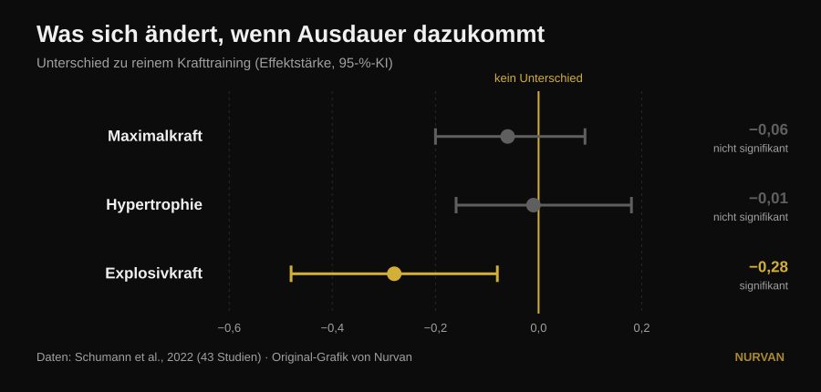
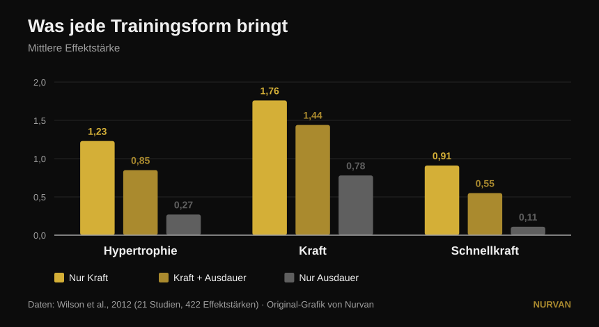

# Alles gleichzeitig trainieren oder sich spezialisieren?

Von [Giammaria Loi](/autore/giammaria-loi) · aktualisiert am 14. Oktober 2026

Ein vielgeteilter Post behauptet, dass die Spezialisierung auf eine einzige körperliche Fähigkeit schlechtere Ergebnisse bringt, und dass jeder Plan sechs davon gleichzeitig enthalten sollte: Schnellkraft, Kraft, Hypertrophie, Kondition, Mobilität und Athletik. Unter dem Post fragen drei verschiedene Leser dasselbe: Wo ist die Studie? Es gibt keine. Hier sind die Quellen — und sie erzählen eine genauere Geschichte, in der eine der sechs Fähigkeiten tatsächlich leidet, nur eben nicht die, die man erwartet.

## Kurz gefasst

- **Zusätzliches Ausdauertraining kostet weder Maximalkraft noch Muskelmasse.** Über 43 Studien ist der Unterschied zu reinen Kraftgruppen praktisch null: −0,06 bei der Maximalkraft und −0,01 bei der Hypertrophie, beides nicht signifikant (Schumann et al., 2022).
- **Schnellkraft kostet es aber sehr wohl.** Die Explosivkraft sinkt statistisch signifikant (−0,28, p = 0,007). Sie ist die einzige Fähigkeit aus der Liste des Posts, die wirklich einen Preis zahlt.
- **Und dieser Preis hängt vom Kalender ab, nicht von der Motivation.** Die Abschwächung der Schnellkraft ist ausgeprägt, wenn Kraft und Ausdauer in derselben Einheit liegen, und verschwindet, wenn beide mindestens 3 Stunden auseinanderliegen (Schumann et al., 2022).
- **Es gilt nicht für alle gleich.** Die Interferenz bei der Kraft der unteren Extremitäten zeigt sich bei Männern (−0,43) und nicht bei Frauen (0,08), mit signifikantem Unterschied zwischen den Gruppen (Huiberts et al., 2024).
- **Die richtige Frage lautet nicht „alles zugleich oder eins nach dem anderen".** Kraft und Masse bleiben bis zu 32 Wochen erhalten mit **einer Einheit pro Woche und einem Satz pro Übung**, solange die relative Last hoch bleibt (Spiering et al., 2021). Man schiebt eine Fähigkeit an und hält die übrigen mit sehr wenig.

## Das Dilemma ist falsch gestellt

Die Idee des Posts ist einfach: eine Fähigkeit nach der anderen zu trainieren bringe „minimale und enge" Fortschritte, alle zusammen zu trainieren bringe mehr. Eine sympathische Intuition — nur hat keine Studie je direkt ein spezialisiertes mit einem multimodalen Programm verglichen und die Gesamtsumme gemessen. Was die Literatur wirklich vergleicht, ist deutlich nützlicher: was mit Kraft, Masse und Schnellkraft passiert, **wenn man einem identischen Kraftprogramm Ausdauerarbeit hinzufügt**.

Auf diese Frage gibt es eine belastbare Antwort aus 43 kontrollierten Studien, in denen das Kraftprogramm zwischen den Gruppen identisch war und sich nur die Ausdauer unterschied (Schumann et al., 2022):

*Standardisierte Mittelwertdifferenzen gegenüber reinem Krafttraining, mit 95-%-Konfidenzintervall. Ein Intervall, das die Null kreuzt, bedeutet: kein nachgewiesener Unterschied. Daten aus Schumann et al., 2022 (43 Studien). Original-Grafik von Nurvan.*

Zwei von drei Intervallen kreuzen die Null: **bei Maximalkraft und Hypertrophie nimmt Ausdauertraining nichts weg**. Das dritte nicht. Die Explosivkraft — springen, werfen, beschleunigen — geht tatsächlich zurück.

Eine Übersichtsarbeit von 2026, die siebzehn Meta-Analysen zusammenführt, kommt aus einer anderen Richtung zum selben Punkt: Wer Kraft und Ausdauer zusammen trainiert, erzielt **mehr aerobe Kapazität** als reine Kraftgruppen (0,77, p = 0,02) und **vergleichbare**, nicht bessere Ergebnisse bei Kraft, Schnellkraft und Hypertrophie (Held et al., 2026). Dieselben Autoren warnen, dass Daten zu Spitzenathleten rar sind — und genau dort zählt Spezialisierung am meisten und die Forschung hat am wenigsten zu sagen.

## Was die Forschung wirklich sagt

### „Spezialisierung auf eine Fähigkeit bringt schlechtere Ergebnisse" — **Zu präzisieren**

Die Forschung zeigt *Gleichwertigkeit*, nicht Unterlegenheit. Wer Ausdauer ergänzt, bekommt nicht mehr Kraft oder Masse als jemand, der sich auf das Eisen konzentriert: er bekommt genauso viel, plus aerobe Kapazität obendrauf. Das ist ein hervorragendes Argument gegen die Angst vor Kondition. Es ist kein Argument gegen jemanden, der für einen Block bewusst eine Sache anschiebt.

### „Alles zusammen zu trainieren bringt mehr" — **Zu präzisieren**

Mehr in der Zahl der Fähigkeiten, nicht mehr in jeder einzelnen. Die Gesamtbreite wächst, die einzelnen Resultate bleiben gleich. Dieser Unterschied zählt, wenn ein Wettkampf, eine Gewichtsklasse oder ein Termin ansteht.

### „Kondition kostet nichts" — **Widerlegt, für die Schnellkraft**

Hier zielt der Post daneben — und zwar ausgerechnet bei der Fähigkeit, die er an erste Stelle setzt. Die Explosivkraft zahlt: −0,28, mit einem Konfidenzintervall, das die Null nicht berührt (Schumann et al., 2022). Interessant ist das Warum: **Die Abschwächung ist ausgeprägt, wenn beide Einheiten in einem Training liegen (p = 0,043), und zeigt sich nicht mehr bei mindestens drei Stunden Abstand**. Das ist kein biologisches Schicksal, sondern Terminplanung.

Das ältere und feinere Bild sagt dasselbe über die rohen Effektstärken (Wilson et al., 2012):

*Mittlere Effektstärken aus 21 Studien und 422 Vergleichen. Bei der Schnellkraft sind die Unterschiede zwischen allen drei Gruppen statistisch signifikant; bei Hypertrophie und Kraft fällt nur reine Ausdauer ab. Daten aus Wilson et al., 2012. Original-Grafik von Nurvan.*

In derselben Arbeit tauchen die beiden Moderatoren auf, die der Post nicht nennt: **Laufen senkt Hypertrophie und Kraft, Radfahren nicht**, und das Ausmaß der Interferenz wächst mit der Häufigkeit der Ausdauereinheiten (Korrelationen von −0,26 bis −0,35) und vor allem mit ihrer Dauer (−0,29 bis −0,75). Es ist nicht „das Cardio": es ist wie viel, welcher Art und wann.

### „Das gilt für jeden" — **Zu präzisieren**

Ein Kommentator unter dem Post fragt, wo die Ergebnisse für Frauen bleiben. Eine ausgezeichnete Frage, und sie hat eine Antwort. Über 59 Studien und 1.346 Personen zeigt sich die Interferenz bei der Beinkraft **bei Männern (−0,43) und nicht bei Frauen (0,08)**, mit statistisch signifikantem Unterschied zwischen beiden Gruppen (p = 0,03). Bei Oberkörperkraft, Schnellkraft und maximaler Sauerstoffaufnahme gibt es keinen Geschlechtsunterschied (Huiberts et al., 2024).

### „Mobilität ist ein eigener Pflichtblock" — **Zu präzisieren**

Wer Kraft über den vollen Bewegungsumfang trainiert, erledigt einen Teil der Mobilitätsarbeit bereits. Über 11 kontrollierte Studien und 452 Personen unterscheiden sich Krafttraining und Dehnen **nicht** in den Zugewinnen an Bewegungsumfang (−0,22, p = 0,206), und das hält in allen untersuchten Untergruppen (Afonso et al., 2021). Die Autoren betonen die große Heterogenität der Studien — also kein Freibrief, bei einer konkreten Einschränkung auf Dehnen zu verzichten. Aber eines der sechs Kästchen füllt sich teilweise von selbst.

### „Eine Fähigkeit nach der anderen bringt minimale Fortschritte" — **Umgekehrt widerlegt**

Den Schwerpunkt über die Zeit zu wechseln ist kein Fehler: es ist die Definition von Periodisierung, und bei der Maximalkraft funktioniert sie besser als keine. Bei angeglichenem Volumen schlagen periodisierte Programme in 35 Studien die nicht periodisierten im 1RM (0,31, p = 0,02), während sich **bei der Hypertrophie nichts ändert** (0,13, p = 0,27). Und zwischen linearer und wellenförmiger Periodisierung besteht der Vorteil der wellenförmigen im 1RM nur bei Trainierten (0,61) und verschwindet bei Anfängern (0,06) (Moesgaard et al., 2022).

Übersetzt: Wer Masse will, dem ist die Reihenfolge weitgehend egal und kann alles zusammen machen. Wer ein Maximum will, braucht eine Struktur über die Zeit — und „immer alles zugleich" ist keine Struktur.

## Die Frage, die der Post nicht stellt

Das Dilemma „sechs Fähigkeiten zugleich oder eine nach der anderen" hat einen dritten Begriff, den keines der beiden Lager nennt: **wie wenig genügt, um das bereits Aufgebaute nicht zu verlieren**. Die Antwort wurde Studie für Studie zusammengetragen und ist erstaunlich niedrig (Spiering et al., 2021):

| Fähigkeit | Mindestdosis zum Erhalt | Wie lange | Bedingung |
|---|---|---|---|
| Kraft und Masse (unter 40) | 1 Einheit pro Woche, 1 Satz pro Übung | bis zu 32 Wochen | die relative Last bleibt hoch |
| Muskelmasse (höheres Alter) | 2 Einheiten pro Woche, 2-3 Sätze | — | die relative Last bleibt hoch |
| Aerobe Kapazität | 2 Einheiten pro Woche oder Volumen um 33-66 % gekürzt (auch 13-26 Minuten) | bis zu 15 Wochen | die Arbeitsherzfrequenz bleibt hoch |

Die eine Variable, die man nicht kürzen darf, ist immer dieselbe: **die Intensität**. Volumen und Häufigkeit lassen sich massiv senken, Last und Tempo nicht.

Das verändert die ganze Debatte. Man wählt nicht zwischen sechs schlecht trainierten Fähigkeiten und einer gut trainierten. Man schiebt sechs bis acht Wochen lang eine Fähigkeit an und setzt die übrigen in den **Erhaltungsmodus** mit einer Einheit oder einem Satz. So bauen Trainer einen kompletten Athleten auf, ohne ihn zu verheizen — genau der Mittelweg, den der Post für unmöglich erklärt.

## So setzt du es um

1. **Wähle eine Priorität für die nächsten 6-8 Wochen.** Nur eine: Maximalkraft, Masse oder Kondition. Die übrigen gibst du nicht auf, du bremst sie.
2. **Halte den Rest mit der Mindestdosis am Leben.** Eine Einheit pro Woche mit ein paar schweren Sätzen erhält Kraft und Masse über Monate (Spiering et al., 2021). Entscheidend ist, dass die Last nahe an der bisherigen bleibt, nicht dass das Volumen hoch bleibt.
3. **Trenne Krafttraining und Kondition um mindestens 3 Stunden** oder lege sie auf verschiedene Tage, wenn dir Schnellkraft wichtig ist (Schumann et al., 2022). Musst du beides zusammenlegen, kommt das Eisen zuerst: das ist die Tendenz aus der aktuellsten Übersichtsarbeit (Held et al., 2026).
4. **Wähle die Ausdauerform bewusst.** Rad stört nicht, Laufen schon — vor allem lang und häufig (Wilson et al., 2012). Wenn du laufen musst und trotzdem Beine aufbauen willst, halte die Einheiten kurz.
5. **Zähle Mobilität nicht automatisch als zusätzlichen Block.** Trainiere Kraft über den vollen Bewegungsumfang und ergänze gezielte Arbeit nur dort, wo eine echte Einschränkung besteht (Afonso et al., 2021). Unsere Analyse dazu, [wie man Sätze und Wiederholungen wählt](/de/blog/wie-viele-wiederholungen-muskelaufbau), hilft beim Kraftteil.
6. **Miss, statt zu raten.** Interferenz spürt man nicht, man sieht sie in den Zahlen. Wenn nach vier Wochen Kondition dein Sprung oder deine Hantelgeschwindigkeit sinkt, während die Lasten halten, hast du genau den Preis gefunden, von dem die Forschung spricht.

> ### 💡 Mit Nurvan
> **Mehrere Fähigkeiten gleichzeitig zu trainieren funktioniert nur, wenn du siehst, welche gerade absinkt.** In Nurvan führst du verschiedene Programme und Disziplinen im selben Logbuch — Kraft, Hypertrophie, Functional, HYROX — mit Last, Wiederholungen und RIR Satz für Satz erfasst und der Historie immer im Vergleich. So wird aus dem „Erhaltungsmodus" etwas, das du wirklich überprüfst, statt es nur zu hoffen: Sinkt das Maximum, während die Kondition steigt, merkst du es nach zwei Wochen statt nach zwei Monaten. [Nurvan ausprobieren](https://nurvan.app)

## Häufige Fragen

**Kostet Ausdauertraining Muskeln?**
Nein. Über 43 kontrollierte Studien verändert zusätzliche Ausdauerarbeit bei identischem Kraftprogramm weder die Hypertrophie (−0,01, p = 0,919) noch die Maximalkraft (−0,06, p = 0,446) (Schumann et al., 2022). Betroffen ist nur die Explosivkraft.

**Cardio und Krafttraining am selben Tag oder an verschiedenen Tagen?**
Wenn dir Schnellkraft wichtig ist, trenne sie: die Abschwächung der Explosivkraft ist ausgeprägt, wenn beides in einer Einheit liegt, und zeigt sich bei mindestens drei Stunden Abstand nicht mehr (Schumann et al., 2022). Geht es dir nur um Kraft und Masse, fällt die Planung deutlich weniger ins Gewicht.

**Wie wenig Training erhält die vorhandene Kraft?**
Bei Erwachsenen unter 40 erhielt eine Einheit pro Woche mit einem Satz pro Übung Kraft und Masse bis zu 32 Wochen, sofern die relative Last hoch blieb (Spiering et al., 2021). Das Volumen kürzt man, die Intensität nie.

**Muss ich sechs Fähigkeiten trainieren, wie der Post sagt?**
Keine Quelle legt eine Pflichtzahl an Fähigkeiten fest, und keine belegt eine „Synergie" zwischen ihnen. Belegt ist, dass man mehrere zusammen trainieren kann, ohne Kraft oder Masse zu verlieren, und dass die gerade nicht geförderten Fähigkeiten mit sehr wenig Arbeit erhalten bleiben. Die richtige Zahl hängt von deinem Ziel ab, nicht von einer Regel.

## Weiterlesen

- [Trainingssplit: Anfänger oder Fortgeschrittene?](/de/blog/trainingssplit-anfaenger-fortgeschrittene)
- [Wie viele Wiederholungen für Muskelaufbau? Der 8-12-Mythos](/de/blog/wie-viele-wiederholungen-muskelaufbau)
- [Beinstrecker oder Beinpresse: Was wirklich wächst](/de/blog/beinstrecker-oder-beinpresse-rectus-femoris)

## Quellen

1. Schumann M, Feuerbacher JF, Sünkeler M, Freitag N, Rønnestad BR, Doma K, Lundberg TR, 2022. *Compatibility of Concurrent Aerobic and Strength Training for Skeletal Muscle Size and Function: An Updated Systematic Review and Meta-Analysis.* Sports Med 52(3):601–612. PMID 34757594 — [doi:10.1007/s40279-021-01587-7](https://doi.org/10.1007/s40279-021-01587-7)
2. Held S, Wolf L, Rappelt L, Bloch W, Donath L, Micke F, Geisler S, Isenmann E, 2026. *Maximizing Adaptations in Concurrent Training: An Umbrella Review of Meta-analyses.* Sports Med 56(6):1489–1512. PMID 41762427 — [doi:10.1007/s40279-026-02401-y](https://doi.org/10.1007/s40279-026-02401-y)
3. Wilson JM, Marin PJ, Rhea MR, Wilson SMC, Loenneke JP, Anderson JC, 2012. *Concurrent training: a meta-analysis examining interference of aerobic and resistance exercises.* J Strength Cond Res 26(8):2293–2307. PMID 22002517 — [doi:10.1519/JSC.0b013e31823a3e2d](https://doi.org/10.1519/JSC.0b013e31823a3e2d)
4. Huiberts RO, Wüst RCI, van der Zwaard S, 2024. *Concurrent Strength and Endurance Training: A Systematic Review and Meta-Analysis on the Impact of Sex and Training Status.* Sports Med 54(2):485–503. PMID 37847373 — [doi:10.1007/s40279-023-01943-9](https://doi.org/10.1007/s40279-023-01943-9)
5. Spiering BA, Mujika I, Sharp MA, Foulis SA, 2021. *Maintaining Physical Performance: The Minimal Dose of Exercise Needed to Preserve Endurance and Strength Over Time.* J Strength Cond Res 35(5):1449–1458. PMID 33629972 — [doi:10.1519/JSC.0000000000003964](https://doi.org/10.1519/JSC.0000000000003964)
6. Moesgaard L, Beck MM, Christiansen L, Aagaard P, Lundbye-Jensen J, 2022. *Effects of Periodization on Strength and Muscle Hypertrophy in Volume-Equated Resistance Training Programs: A Systematic Review and Meta-analysis.* Sports Med 52(7):1647–1666. PMID 35044672 — [doi:10.1007/s40279-021-01636-1](https://doi.org/10.1007/s40279-021-01636-1)
7. Afonso J, Ramirez-Campillo R, Moscão J, Rocha T, Zacca R, Martins A, Milheiro AA, Ferreira J, Sarmento H, Clemente FM, 2021. *Strength Training versus Stretching for Improving Range of Motion: A Systematic Review and Meta-Analysis.* Healthcare (Basel) 9(4):427. PMID 33917036 — [doi:10.3390/healthcare9040427](https://doi.org/10.3390/healthcare9040427)

*Bibliografische Angaben auf PubMed geprüft. Ausgangspunkt: der Post von [John Rusin](https://www.instagram.com/p/Ddv-zwDkZ0F/), der keine Quellen nennt. Kein Text und kein Bild des Posts wurde reproduziert: Thema und Aussagen wurden neu geschrieben und an den Primärquellen überprüft.*

---

**Giammaria Loi** ist der Gründer von Nurvan. Er trainiert seit 2012 mit Gewichten, arbeitet seit 2013 als FIPE-zertifizierter Personal Trainer und Coach und startet seit 2018 im Powerlifting auf nationalem Niveau. Jeder Artikel, den er zeichnet, beginnt bei den Studien und endet bei dem, was im Gym wirklich funktioniert. [Autorenseite](/autore/giammaria-loi)

> Hinweis: informativer Inhalt, der die Beurteilung durch eine Ärztin, einen Arzt oder eine Fachkraft nicht ersetzt. Bei Vorerkrankungen oder laufender Therapie sprich mit deiner Ärztin oder deinem Arzt, bevor du dein Trainingsprogramm änderst.
