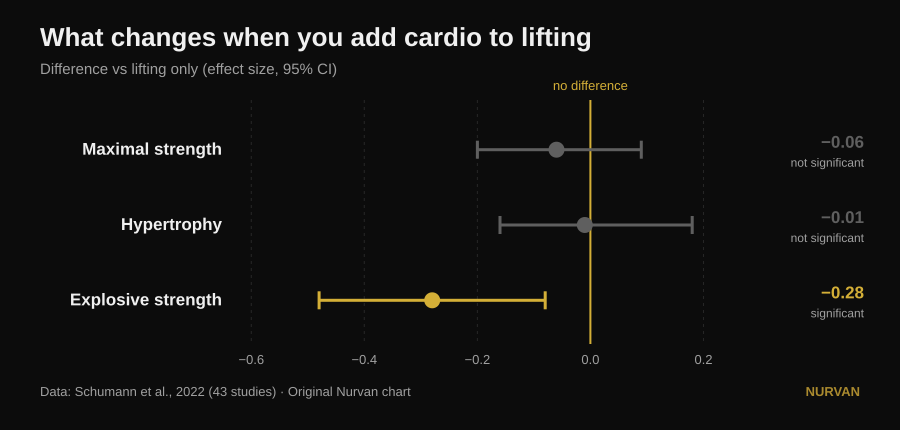
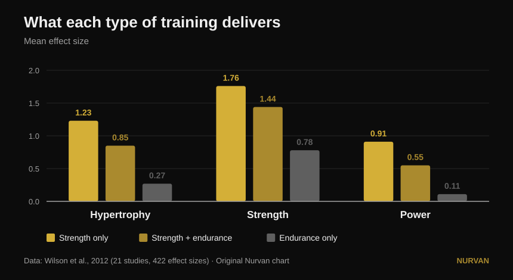

# Train everything at once, or specialise in one quality?

By [Giammaria Loi](/autore/giammaria-loi) · updated 14 October 2026

A widely shared post argues that specialising in a single physical quality gets you worse results, and that every programme should contain six of them at once: power, strength, hypertrophy, conditioning, mobility and athleticism. Under the post, three different readers ask the same thing: where's the study? There isn't one. Here are the sources — and they tell a sharper story, in which one of the six qualities really does get hurt, just not the one you'd expect.

## The short version

- **Adding aerobic work costs you no maximal strength and no muscle.** Across 43 studies the difference against lifting-only groups is essentially nil: −0.06 for maximal strength and −0.01 for hypertrophy, neither statistically significant (Schumann et al., 2022).
- **It does cost you power.** Explosive strength drops significantly (−0.28, p = 0.007). It is the only quality on the post's list that pays a real price.
- **And the price depends on your calendar, not your willpower.** The blunting of power is pronounced when lifting and cardio share one session, and disappears when the two are separated by at least 3 hours (Schumann et al., 2022).
- **It isn't the same for everyone.** Lower-body strength interference shows up in men (−0.43) and not in women (0.08), and the difference between the groups is statistically significant (Huiberts et al., 2024).
- **The real question isn't "all at once or one at a time".** Strength and muscle hold for up to 32 weeks on **one session a week and one set per exercise**, as long as the relative load stays heavy (Spiering et al., 2021). Push one quality, maintain the rest on almost nothing.

## The dilemma is badly framed

The post's idea is simple: training one quality at a time produces "minimal and narrow" gains, while training them all together produces more. It is a likeable intuition, but no study has ever directly compared a specialised programme with a multi-modal one and added up the totals. What the literature actually compares is something more useful: what happens to strength, size and power **when you bolt aerobic work onto an identical lifting programme**.

That question has a solid answer, built on 43 controlled studies in which the strength programme was identical across groups and only the endurance work differed (Schumann et al., 2022):

*Standardised mean differences against lifting-only groups, with 95% confidence intervals. An interval crossing zero means no demonstrated difference. Data from Schumann et al., 2022 (43 studies). Original Nurvan chart.*

Two of the three intervals cross zero: **on maximal strength and on hypertrophy, cardio takes nothing away**. The third one doesn't. Explosive strength — jumping, throwing, accelerating — genuinely shrinks.

A 2026 review pooling seventeen meta-analyses reaches the same place from another angle: people who train strength and endurance together get **more aerobic capacity** than lifting-only groups (0.77, p = 0.02) and **comparable**, not superior, strength, power and hypertrophy (Held et al., 2026). Those authors warn that data on elite athletes is scarce — and that is exactly where specialisation matters most and the research has least to say.

## What the research actually says

### "Specialising in one quality gets you worse results" — **Needs qualifying**

The research shows *equivalence*, not inferiority. Adding cardio does not get you more strength or more muscle than focusing on lifting alone: it gets you just as much, plus aerobic capacity for free. That is an excellent argument for not fearing conditioning. It is not an argument against anyone who, for a block, chooses to push one thing.

### "Training everything together gets you more" — **Needs qualifying**

More in how many qualities, not more in each one. The total gets wider; the individual results stay the same. That difference matters when you have a meet, a weight class or a deadline.

### "Conditioning costs you nothing" — **Busted, for power**

Here the post misses, and it misses on the very quality it lists first. Explosive strength pays: −0.28, with a confidence interval that never touches zero (Schumann et al., 2022). The interesting part is why: **the blunting is pronounced when both sessions sit inside one workout (p = 0.043) and no longer shows when they are at least three hours apart**. It isn't biological fate, it's scheduling.

The older and more granular picture says the same thing in raw effect sizes (Wilson et al., 2012):

*Mean effect sizes across 21 studies and 422 comparisons. For power, the differences between all three groups are statistically significant; for hypertrophy and strength only endurance-alone lags behind. Data from Wilson et al., 2012. Original Nurvan chart.*

The same paper surfaces the two moderators the post never mentions: **running blunts hypertrophy and strength, cycling does not**, and the size of the interference grows with endurance frequency (correlations from −0.26 to −0.35) and above all with session duration (−0.29 to −0.75). It isn't "cardio": it's how much, what kind, and when.

### "This applies to anyone" — **Needs qualifying**

One commenter under the post asks where the results on women are. It is an excellent question and it has an answer. Across 59 studies and 1,346 people, lower-body strength interference appears **in men (−0.43) and not in women (0.08)**, with a statistically significant difference between the two groups (p = 0.03). For upper-body strength, power and maximal oxygen uptake there is no sex difference at all (Huiberts et al., 2024).

### "Mobility is a separate mandatory block" — **Needs qualifying**

If you train strength through a full range of motion, part of the mobility work is already done. Across 11 controlled trials and 452 people, strength training and stretching produce **no different** range-of-motion gains (−0.22, p = 0.206), and that holds in every subgroup analysed (Afonso et al., 2021). The authors stress that the studies are highly heterogeneous, so this is no licence to drop stretching if you have a specific restriction — but one of the six boxes partly ticks itself.

### "One quality at a time means minimal gains" — **Busted the other way round**

Rotating the emphasis over time is not a flaw: it is the definition of periodisation, and for maximal strength it beats not periodising. With volume equated, across 35 studies, periodised programmes beat non-periodised ones on 1RM (0.31, p = 0.02), while **hypertrophy doesn't budge** (0.13, p = 0.27). And between linear and undulating periodisation, the undulating edge on 1RM exists only in trained lifters (0.61) and vanishes in beginners (0.06) (Moesgaard et al., 2022).

Translated: if you want size, the ordering barely matters and you can do it all at once without regrets. If you want a maximal lift, you need some structure over time — and "everything at once, always" is not structure.

## The question the post never asks

The "all six at once or one at a time" dilemma has a third term that neither camp names: **how little it takes to keep what you have already built**. The answer has been collected study by study, and it is surprisingly small (Spiering et al., 2021):

| Quality | Minimum dose to maintain it | For how long | Condition |
|---|---|---|---|
| Strength and size (under 40) | 1 session a week, 1 set per exercise | up to 32 weeks | relative load stays heavy |
| Muscle size (older adults) | 2 sessions a week, 2–3 sets | — | relative load stays heavy |
| Aerobic capacity | 2 sessions a week, or volume cut by 33–66% (as little as 13–26 minutes) | up to 15 weeks | working heart rate stays high |

The one variable you cannot cut is always the same: **intensity**. Volume and frequency can drop enormously; load and pace cannot.

That changes the whole conversation. You are not choosing between six qualities trained badly and one trained well. You push one quality for six to eight weeks and put the rest into **maintenance mode** on a single session or a single set. That is how coaches build a complete athlete without burning them out, and it is exactly the middle path the post describes as impossible.

## How to apply it

1. **Pick one priority for the next 6–8 weeks.** One: the big lift, size, or conditioning. You don't drop the others, you slow them down.
2. **Keep the rest alive on the minimum dose.** One weekly session with a couple of heavy sets holds strength and muscle for months (Spiering et al., 2021). What matters is that the load stays near what you were using, not that the volume stays high.
3. **Separate lifting from conditioning by at least 3 hours,** or put them on different days, if power matters to you (Schumann et al., 2022). If you must combine them, lift first: that is the trend emerging from the most recent umbrella review (Held et al., 2026).
4. **Choose your cardio.** Cycling doesn't interfere, running does — especially long and frequent running (Wilson et al., 2012). If you have to run and you also want to build legs, keep the sessions short.
5. **Don't count mobility work as an extra block by default.** Train strength through a full range of motion and add targeted work only where you have a real restriction (Afonso et al., 2021). Our breakdown of [how to pick sets and reps](/en/blog/how-many-reps-build-muscle) helps you set the strength side up.
6. **Measure, don't guess.** Interference isn't something you feel: it's something you see in the numbers. If four weeks of conditioning leave your jump or your bar speed down while your loads hold, you have found exactly the price the research describes.

> ### 💡 With Nurvan
> **Training several qualities at once only works if you can see which one is slipping.** Nurvan keeps different programmes and disciplines in one log — strength, hypertrophy, functional, HYROX — with load, reps and RIR recorded set by set and the history always side by side. That turns "maintenance mode" into something you actually verify instead of hope for: if your top end drops while your conditioning climbs, you notice in two weeks rather than two months. [Try Nurvan](https://nurvan.app)

## Frequently asked questions

**Does cardio kill your gains?**
No. Across 43 controlled studies, adding aerobic work to an identical lifting programme changes neither hypertrophy (−0.01, p = 0.919) nor maximal strength (−0.06, p = 0.446) (Schumann et al., 2022). The only quality affected is explosive strength.

**Should I do cardio and lifting on the same day or different days?**
If power matters to you, separate them: the blunting of explosive strength is pronounced when the two sit in one session and no longer shows when they are at least three hours apart (Schumann et al., 2022). If you only care about strength and size, the scheduling matters far less.

**How little training keeps the strength I already have?**
In adults under 40, one session a week with one set per exercise maintained strength and muscle for up to 32 weeks, provided the relative load stayed heavy (Spiering et al., 2021). Cut the volume, never the intensity.

**Do I have to train six qualities like the post says?**
No source sets a mandatory number of qualities, and none demonstrates "synergy" between them. What the sources do show is that you can train several together without losing strength or size, and that the qualities you aren't pushing survive on very little work. The right number depends on your goal, not on a rule.

## Read next

- [Training split: beginner vs advanced lifter](/en/blog/training-split-beginner-vs-advanced)
- [How many reps build muscle? The 8-12 myth](/en/blog/how-many-reps-build-muscle)
- [Leg extension vs leg press: what actually grows](/en/blog/leg-extension-vs-leg-press-rectus-femoris)

## Sources

1. Schumann M, Feuerbacher JF, Sünkeler M, Freitag N, Rønnestad BR, Doma K, Lundberg TR, 2022. *Compatibility of Concurrent Aerobic and Strength Training for Skeletal Muscle Size and Function: An Updated Systematic Review and Meta-Analysis.* Sports Med 52(3):601–612. PMID 34757594 — [doi:10.1007/s40279-021-01587-7](https://doi.org/10.1007/s40279-021-01587-7)
2. Held S, Wolf L, Rappelt L, Bloch W, Donath L, Micke F, Geisler S, Isenmann E, 2026. *Maximizing Adaptations in Concurrent Training: An Umbrella Review of Meta-analyses.* Sports Med 56(6):1489–1512. PMID 41762427 — [doi:10.1007/s40279-026-02401-y](https://doi.org/10.1007/s40279-026-02401-y)
3. Wilson JM, Marin PJ, Rhea MR, Wilson SMC, Loenneke JP, Anderson JC, 2012. *Concurrent training: a meta-analysis examining interference of aerobic and resistance exercises.* J Strength Cond Res 26(8):2293–2307. PMID 22002517 — [doi:10.1519/JSC.0b013e31823a3e2d](https://doi.org/10.1519/JSC.0b013e31823a3e2d)
4. Huiberts RO, Wüst RCI, van der Zwaard S, 2024. *Concurrent Strength and Endurance Training: A Systematic Review and Meta-Analysis on the Impact of Sex and Training Status.* Sports Med 54(2):485–503. PMID 37847373 — [doi:10.1007/s40279-023-01943-9](https://doi.org/10.1007/s40279-023-01943-9)
5. Spiering BA, Mujika I, Sharp MA, Foulis SA, 2021. *Maintaining Physical Performance: The Minimal Dose of Exercise Needed to Preserve Endurance and Strength Over Time.* J Strength Cond Res 35(5):1449–1458. PMID 33629972 — [doi:10.1519/JSC.0000000000003964](https://doi.org/10.1519/JSC.0000000000003964)
6. Moesgaard L, Beck MM, Christiansen L, Aagaard P, Lundbye-Jensen J, 2022. *Effects of Periodization on Strength and Muscle Hypertrophy in Volume-Equated Resistance Training Programs: A Systematic Review and Meta-analysis.* Sports Med 52(7):1647–1666. PMID 35044672 — [doi:10.1007/s40279-021-01636-1](https://doi.org/10.1007/s40279-021-01636-1)
7. Afonso J, Ramirez-Campillo R, Moscão J, Rocha T, Zacca R, Martins A, Milheiro AA, Ferreira J, Sarmento H, Clemente FM, 2021. *Strength Training versus Stretching for Improving Range of Motion: A Systematic Review and Meta-Analysis.* Healthcare (Basel) 9(4):427. PMID 33917036 — [doi:10.3390/healthcare9040427](https://doi.org/10.3390/healthcare9040427)

*Bibliographic data verified on PubMed. Starting point: the post by [John Rusin](https://www.instagram.com/p/Ddv-zwDkZ0F/), which cites no sources. No text or image from the post has been reproduced: the topic and its claims were rewritten and checked against primary sources.*

---

**Giammaria Loi** is the founder of Nurvan. He has been lifting since 2012, has worked as a FIPE-certified personal trainer and coach since 2013, and has competed in powerlifting at national level since 2018. Every article he writes starts from the research and ends with what actually works in the gym. [Author page](/autore/giammaria-loi)

> Note: this is educational content and does not replace advice from a doctor or qualified professional. If you have a medical condition or are following treatment, talk to your doctor before changing your training programme.
