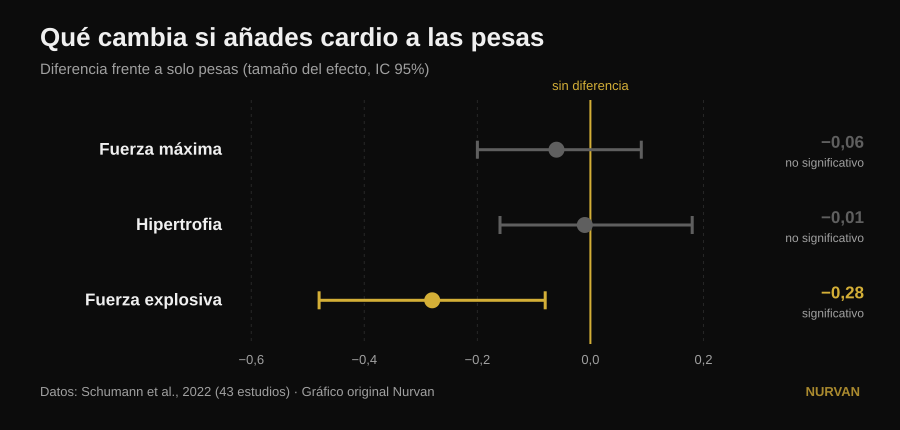
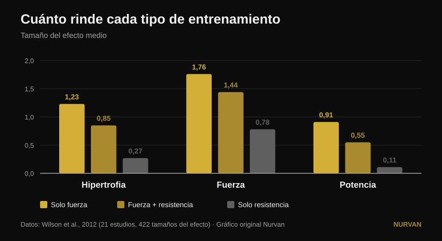

# ¿Entrenarlo todo a la vez o especializarse en una cualidad?

Por [Giammaria Loi](/autore/giammaria-loi) · actualizado el 14 de octubre de 2026

Un post muy compartido sostiene que especializarse en una sola cualidad física da peores resultados y que todo programa debería incluir seis a la vez: potencia, fuerza, hipertrofia, acondicionamiento, movilidad y atletismo. Debajo del post, tres lectores distintos preguntan lo mismo: ¿dónde está el estudio? No hay ninguno. Aquí están las fuentes, y cuentan una historia más precisa, en la que una de las seis cualidades sí sale perjudicada, pero no la que esperarías.

## En resumen

- **Añadir trabajo aeróbico no te quita fuerza máxima ni masa muscular.** En 43 estudios la diferencia frente a quien solo levanta pesas es prácticamente cero: −0,06 en fuerza máxima y −0,01 en hipertrofia, ninguna significativa (Schumann et al., 2022).
- **Lo que sí te quita es potencia.** La fuerza explosiva baja de forma estadísticamente significativa (−0,28, p = 0,007). Es la única cualidad de la lista del post que paga un precio real.
- **Y ese precio depende del calendario, no de las ganas.** La pérdida de potencia es marcada cuando pesas y cardio van en la misma sesión, y desaparece cuando las dos se separan al menos 3 horas (Schumann et al., 2022).
- **No es igual para todo el mundo.** La interferencia en la fuerza del tren inferior aparece en hombres (−0,43) y no en mujeres (0,08), con diferencia significativa entre grupos (Huiberts et al., 2024).
- **La pregunta correcta no es "todo junto o de uno en uno".** La fuerza y la masa se mantienen hasta 32 semanas con **una sesión semanal y una serie por ejercicio**, siempre que la carga relativa siga alta (Spiering et al., 2021). Se empuja una cualidad y las demás se mantienen con muy poco.

## El dilema está mal planteado

La idea del post es sencilla: entrenar una cualidad por vez produce ganancias "mínimas y estrechas", entrenarlas todas juntas produce más. Es una intuición simpática, pero ningún estudio ha comparado nunca de forma directa un programa especializado con uno multimodal sumando los totales. Lo que la literatura compara de verdad es algo mucho más útil: qué le pasa a la fuerza, a la masa y a la potencia **cuando añades trabajo aeróbico a un programa de pesas idéntico**.

Esa pregunta tiene una respuesta sólida, construida sobre 43 estudios controlados en los que el programa de fuerza era idéntico entre grupos y solo cambiaba la adición de resistencia (Schumann et al., 2022):

*Diferencias medias estandarizadas frente a quien solo hacía pesas, con intervalo de confianza del 95%. Un intervalo que cruza el cero significa que no hay diferencia demostrada. Datos de Schumann et al., 2022 (43 estudios). Gráfico original Nurvan.*

Dos de las tres barras cruzan el cero: **en fuerza máxima y en hipertrofia el cardio no quita nada**. La tercera no. La fuerza explosiva —saltar, lanzar, acelerar— sí se reduce de verdad.

Una revisión de 2026 que reunió diecisiete metaanálisis llega al mismo punto desde otro ángulo: quien entrena fuerza y resistencia a la vez obtiene **más capacidad aeróbica** que quien solo levanta (0,77, p = 0,02) y resultados **comparables**, no superiores, en fuerza, potencia e hipertrofia (Held et al., 2026). Esos mismos autores avisan de que los datos en atletas de élite son escasos: y es justo ahí donde la especialización pesa más y la investigación tiene menos que decir.

## Lo que dice de verdad la investigación

### "Especializarse en una cualidad da peores resultados" — **Matizable**

La investigación muestra *equivalencia*, no inferioridad. Quien añade cardio no consigue más fuerza ni más masa que quien se centra solo en las pesas: consigue lo mismo, más la capacidad aeróbica de regalo. Es un argumento excelente para no tener miedo al acondicionamiento. No es un argumento contra quien, durante un bloque, decide empujar una sola cosa.

### "Entrenarlo todo junto da más" — **Matizable**

Más en cuántas cualidades, no más en cada una. El total se ensancha; los resultados individuales se quedan igual. La diferencia importa cuando tienes una competición, una categoría de peso o una fecha límite.

### "El acondicionamiento no te cuesta nada" — **Desmentido, para la potencia**

Aquí el post falla, y falla justo en la cualidad que pone primera. La fuerza explosiva paga: −0,28, con un intervalo de confianza que no toca el cero (Schumann et al., 2022). Lo interesante es el porqué: **la pérdida es marcada cuando las dos sesiones están dentro del mismo entrenamiento (p = 0,043) y deja de aparecer cuando se separan al menos tres horas**. No es fatalidad biológica, es organización.

El cuadro más antiguo y más detallado dice lo mismo con los tamaños del efecto en bruto (Wilson et al., 2012):

*Tamaños del efecto medios en 21 estudios y 422 comparaciones. En potencia las diferencias entre los tres grupos son estadísticamente significativas; en hipertrofia y fuerza solo la resistencia aislada se queda atrás. Datos de Wilson et al., 2012. Gráfico original Nurvan.*

En ese mismo trabajo aparecen los dos moderadores que el post no nombra: **correr reduce hipertrofia y fuerza, pedalear no**, y la magnitud de la interferencia crece con la frecuencia de las sesiones de resistencia (correlaciones de −0,26 a −0,35) y sobre todo con su duración (de −0,29 a −0,75). No es "el cardio": es cuánto, de qué tipo y cuándo.

### "Vale para cualquiera" — **Matizable**

Un comentarista bajo el post pregunta dónde están los resultados en mujeres. Es una gran pregunta y tiene respuesta. En 59 estudios y 1.346 personas, la interferencia en la fuerza del tren inferior aparece **en hombres (−0,43) y no en mujeres (0,08)**, con diferencia estadísticamente significativa entre ambos grupos (p = 0,03). En fuerza del tren superior, potencia y consumo máximo de oxígeno no hay ninguna diferencia por sexo (Huiberts et al., 2024).

### "La movilidad es un bloque obligatorio aparte" — **Matizable**

Si entrenas la fuerza en todo el recorrido articular, parte del trabajo de movilidad ya está hecho. En 11 ensayos controlados y 452 personas, entrenamiento de fuerza y estiramientos **no se diferencian** en las ganancias de rango de movimiento (−0,22, p = 0,206), y la cosa se sostiene en todos los subgrupos analizados (Afonso et al., 2021). Los autores insisten en que los estudios son muy heterogéneos, así que no es una licencia para dejar de estirar si tienes una limitación concreta, pero una de las seis casillas se rellena en parte sola.

### "Una cualidad por vez da ganancias mínimas" — **Desmentido al revés**

Rotar el énfasis en el tiempo no es un defecto: es la definición de periodización, y en fuerza máxima funciona mejor que no periodizar. Con el volumen igualado, en 35 estudios, los programas periodizados superan a los no periodizados en 1RM (0,31, p = 0,02), mientras que **en hipertrofia no cambia nada** (0,13, p = 0,27). Y entre periodización lineal y ondulante, la ventaja de la ondulante en 1RM solo existe en entrenados (0,61) y desaparece en principiantes (0,06) (Moesgaard et al., 2022).

Traducido: si buscas masa, el orden importa poco y puedes hacerlo todo junto sin remordimientos. Si buscas un máximo, necesitas una organización temporal, y "todo junto siempre" no es una organización.

## La pregunta que el post no se hace

El dilema "las seis cualidades juntas o de una en una" tiene un tercer término que ninguno de los dos bandos nombra: **cuán poco hace falta para no perder lo que ya has construido**. La respuesta se ha reunido estudio a estudio y es sorprendentemente baja (Spiering et al., 2021):

| Cualidad | Dosis mínima para mantenerla | Durante cuánto | Condición |
|---|---|---|---|
| Fuerza y masa (menores de 40) | 1 sesión semanal, 1 serie por ejercicio | hasta 32 semanas | la carga relativa sigue alta |
| Masa muscular (edad avanzada) | 2 sesiones semanales, 2-3 series | — | la carga relativa sigue alta |
| Capacidad aeróbica | 2 sesiones semanales, o volumen reducido un 33-66% (incluso 13-26 minutos) | hasta 15 semanas | la frecuencia cardíaca de trabajo sigue alta |

La variable que no se puede recortar es siempre la misma: **la intensidad**. El volumen y la frecuencia se pueden reducir muchísimo; la carga o el ritmo no.

Esto cambia todo el debate. No eliges entre seis cualidades entrenadas mal y una entrenada bien. Empujas una cualidad durante seis u ocho semanas y pones las demás en **modo mantenimiento** con una sesión o una serie. Así construyen los preparadores a un atleta completo sin quemarlo, y es exactamente el término medio que el post describe como imposible.

## Cómo aplicarlo

1. **Elige una prioridad para las próximas 6-8 semanas.** Una sola: el máximo, la masa o el acondicionamiento. Las demás no se abandonan, se frenan.
2. **Mantén el resto con la dosis mínima.** Una sesión semanal con un par de series pesadas conserva fuerza y masa durante meses (Spiering et al., 2021). Lo importante es que la carga siga cerca de la que usabas, no que el volumen siga alto.
3. **Separa las pesas del acondicionamiento al menos 3 horas,** o ponlos en días distintos, si te interesa la potencia (Schumann et al., 2022). Si tienes que juntarlos, pon las pesas primero: es la tendencia que señala la revisión más reciente (Held et al., 2026).
4. **Elige bien el tipo de cardio.** La bici no interfiere, correr sí, sobre todo si es largo y frecuente (Wilson et al., 2012). Si tienes que correr y además quieres piernas, mantén las sesiones cortas.
5. **No cuentes la movilidad como un bloque extra por defecto.** Entrena la fuerza en todo el recorrido articular y añade trabajo específico solo donde tengas una limitación real (Afonso et al., 2021). Nuestro análisis sobre [cómo elegir series y repeticiones](/es/blog/cuantas-repeticiones-masa-muscular) te ayuda a montar la parte de fuerza.
6. **Mide, no imagines.** La interferencia no se siente: se ve en los números. Si tras cuatro semanas de acondicionamiento tu salto o la velocidad de la barra bajan mientras las cargas aguantan, has encontrado el precio del que habla la investigación.

> ### 💡 Con Nurvan
> **Entrenar varias cualidades a la vez solo funciona si puedes ver cuál está bajando.** En Nurvan mantienes programas y disciplinas distintas en el mismo diario —fuerza, hipertrofia, functional, HYROX— con carga, repeticiones y RIR registrados serie a serie y el histórico siempre a la vista. Así el "modo mantenimiento" es algo que compruebas de verdad, en vez de una esperanza: si el máximo baja mientras el acondicionamiento sube, te enteras en dos semanas y no en dos meses. [Prueba Nurvan](https://nurvan.app)

## Preguntas frecuentes

**¿El cardio quita masa muscular?**
No. En 43 estudios controlados, añadir trabajo aeróbico a un programa de pesas idéntico no cambia la hipertrofia (−0,01, p = 0,919) ni la fuerza máxima (−0,06, p = 0,446) (Schumann et al., 2022). La única cualidad afectada es la fuerza explosiva.

**¿Mejor cardio y pesas el mismo día o en días distintos?**
Si te importa la potencia, sepáralos: la pérdida de fuerza explosiva es marcada cuando ambas cosas están en la misma sesión y deja de aparecer con al menos tres horas de separación (Schumann et al., 2022). Si solo te importan fuerza y masa, la organización pesa mucho menos.

**¿Cuánto entrenamiento hace falta para no perder la fuerza que tengo?**
En adultos menores de 40 años, una sesión semanal con una serie por ejercicio mantuvo fuerza y masa hasta 32 semanas, siempre que la carga relativa siguiera alta (Spiering et al., 2021). Se recorta el volumen, nunca la intensidad.

**¿Tengo que entrenar seis cualidades como dice el post?**
No hay ninguna fuente que fije un número obligatorio de cualidades ni que demuestre una "sinergia" entre ellas. Lo que las fuentes sí demuestran es que puedes entrenar varias juntas sin perder fuerza ni masa, y que las que no estás empujando se conservan con muy poco trabajo. El número correcto depende de tu objetivo, no de una regla.

## Lee también

- [Rutina de entrenamiento: principiante o avanzado](/es/blog/rutina-entrenamiento-principiante-avanzado)
- [Cuántas repeticiones para masa muscular: el mito del 8-12](/es/blog/cuantas-repeticiones-masa-muscular)
- [Extensión de piernas o prensa: qué crece de verdad](/es/blog/extension-de-piernas-o-prensa-recto-femoral)

## Fuentes

1. Schumann M, Feuerbacher JF, Sünkeler M, Freitag N, Rønnestad BR, Doma K, Lundberg TR, 2022. *Compatibility of Concurrent Aerobic and Strength Training for Skeletal Muscle Size and Function: An Updated Systematic Review and Meta-Analysis.* Sports Med 52(3):601–612. PMID 34757594 — [doi:10.1007/s40279-021-01587-7](https://doi.org/10.1007/s40279-021-01587-7)
2. Held S, Wolf L, Rappelt L, Bloch W, Donath L, Micke F, Geisler S, Isenmann E, 2026. *Maximizing Adaptations in Concurrent Training: An Umbrella Review of Meta-analyses.* Sports Med 56(6):1489–1512. PMID 41762427 — [doi:10.1007/s40279-026-02401-y](https://doi.org/10.1007/s40279-026-02401-y)
3. Wilson JM, Marin PJ, Rhea MR, Wilson SMC, Loenneke JP, Anderson JC, 2012. *Concurrent training: a meta-analysis examining interference of aerobic and resistance exercises.* J Strength Cond Res 26(8):2293–2307. PMID 22002517 — [doi:10.1519/JSC.0b013e31823a3e2d](https://doi.org/10.1519/JSC.0b013e31823a3e2d)
4. Huiberts RO, Wüst RCI, van der Zwaard S, 2024. *Concurrent Strength and Endurance Training: A Systematic Review and Meta-Analysis on the Impact of Sex and Training Status.* Sports Med 54(2):485–503. PMID 37847373 — [doi:10.1007/s40279-023-01943-9](https://doi.org/10.1007/s40279-023-01943-9)
5. Spiering BA, Mujika I, Sharp MA, Foulis SA, 2021. *Maintaining Physical Performance: The Minimal Dose of Exercise Needed to Preserve Endurance and Strength Over Time.* J Strength Cond Res 35(5):1449–1458. PMID 33629972 — [doi:10.1519/JSC.0000000000003964](https://doi.org/10.1519/JSC.0000000000003964)
6. Moesgaard L, Beck MM, Christiansen L, Aagaard P, Lundbye-Jensen J, 2022. *Effects of Periodization on Strength and Muscle Hypertrophy in Volume-Equated Resistance Training Programs: A Systematic Review and Meta-analysis.* Sports Med 52(7):1647–1666. PMID 35044672 — [doi:10.1007/s40279-021-01636-1](https://doi.org/10.1007/s40279-021-01636-1)
7. Afonso J, Ramirez-Campillo R, Moscão J, Rocha T, Zacca R, Martins A, Milheiro AA, Ferreira J, Sarmento H, Clemente FM, 2021. *Strength Training versus Stretching for Improving Range of Motion: A Systematic Review and Meta-Analysis.* Healthcare (Basel) 9(4):427. PMID 33917036 — [doi:10.3390/healthcare9040427](https://doi.org/10.3390/healthcare9040427)

*Datos bibliográficos verificados en PubMed. Punto de partida: el post de [John Rusin](https://www.instagram.com/p/Ddv-zwDkZ0F/), que no cita fuentes. No se ha reproducido ningún texto ni imagen del post: el tema y sus afirmaciones se han reescrito y verificado en las fuentes primarias.*

---

**Giammaria Loi** es el fundador de Nurvan. Entrena con pesas desde 2012, trabaja como entrenador personal y coach certificado FIPE desde 2013 y compite en powerlifting a nivel nacional desde 2018. Cada artículo que firma parte de los estudios científicos y llega a lo que funciona de verdad en el gimnasio. [Página del autor](/autore/giammaria-loi)

> Nota: contenido informativo, no sustituye la opinión de un médico o un profesional. Si tienes patologías o sigues un tratamiento, consulta con tu médico antes de modificar tu programa de entrenamiento.
