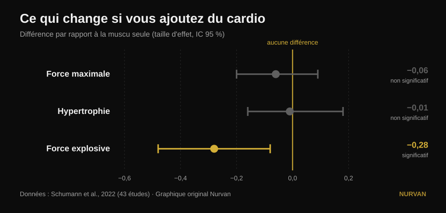
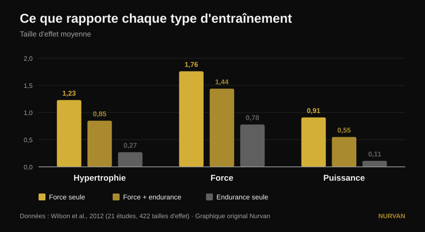

# Tout entraîner en même temps ou se spécialiser ?

Par [Giammaria Loi](/autore/giammaria-loi) · mis à jour le 14 octobre 2026

Un post très partagé affirme que se spécialiser dans une seule qualité physique donne de moins bons résultats, et que tout programme devrait contenir six qualités à la fois : puissance, force, hypertrophie, condition physique, mobilité et athlétisme. Sous le post, trois lecteurs différents posent la même question : où est l'étude ? Il n'y en a pas. Voici les sources — et elles racontent une histoire plus précise, dans laquelle une des six qualités est bel et bien pénalisée, mais pas celle que vous croyez.

## L'essentiel

- **Ajouter du travail aérobie ne vous coûte ni force maximale ni masse musculaire.** Sur 43 études, l'écart avec ceux qui ne font que de la muscu est quasi nul : −0,06 sur la force maximale et −0,01 sur l'hypertrophie, aucun des deux significatif (Schumann et al., 2022).
- **En revanche, ça vous coûte de la puissance.** La force explosive baisse de façon statistiquement significative (−0,28, p = 0,007). C'est la seule qualité de la liste du post à payer un vrai prix.
- **Et ce prix dépend de votre agenda, pas de votre motivation.** La perte de puissance est marquée quand muscu et cardio sont dans la même séance, et disparaît quand les deux sont séparées d'au moins 3 heures (Schumann et al., 2022).
- **Ce n'est pas pareil pour tout le monde.** L'interférence sur la force du bas du corps apparaît chez les hommes (−0,43) et pas chez les femmes (0,08), avec une différence significative entre les groupes (Huiberts et al., 2024).
- **La vraie question n'est pas « tout en même temps ou une chose à la fois ».** Force et masse se maintiennent jusqu'à 32 semaines avec **une séance par semaine et une série par exercice**, tant que la charge relative reste élevée (Spiering et al., 2021). On pousse une qualité et on maintient les autres avec très peu.

## Le dilemme est mal posé

L'idée du post est simple : entraîner une qualité à la fois produit des gains « minimes et étroits », les entraîner toutes ensemble produit davantage. L'intuition est sympathique, mais aucune étude n'a jamais comparé directement un programme spécialisé à un programme multimodal en additionnant les totaux. Ce que la littérature compare vraiment est bien plus utile : ce qui arrive à la force, à la masse et à la puissance **quand on ajoute du travail aérobie à un programme de muscu identique**.

Cette question a une réponse solide, bâtie sur 43 études contrôlées dans lesquelles le programme de force était identique entre les groupes et où seul l'ajout d'endurance changeait (Schumann et al., 2022) :

*Différences moyennes standardisées par rapport à ceux qui ne faisaient que de la muscu, avec intervalle de confiance à 95 %. Un intervalle qui traverse zéro signifie qu'aucune différence n'est démontrée. Données de Schumann et al., 2022 (43 études). Graphique original Nurvan.*

Deux barres sur trois traversent le zéro : **sur la force maximale et sur l'hypertrophie, le cardio n'enlève rien**. La troisième non. La force explosive — sauter, lancer, accélérer — diminue réellement.

Une revue de 2026 qui a regroupé dix-sept méta-analyses arrive au même point par un autre chemin : ceux qui entraînent force et endurance ensemble obtiennent **plus de capacité aérobie** que ceux qui ne font que de la muscu (0,77, p = 0,02) et des résultats **comparables**, pas supérieurs, en force, puissance et hypertrophie (Held et al., 2026). Ces mêmes auteurs préviennent que les données sur les athlètes de haut niveau sont rares : c'est précisément là que la spécialisation compte le plus et que la recherche a le moins à dire.

## Ce que dit vraiment la recherche

### « Se spécialiser dans une qualité donne de moins bons résultats » — **À nuancer**

La recherche montre une *équivalence*, pas une infériorité. Ajouter du cardio ne donne ni plus de force ni plus de masse que de se concentrer sur la muscu : cela en donne autant, plus la capacité aérobie en prime. C'est un excellent argument pour ne pas craindre le travail de condition physique. Ce n'est pas un argument contre celui qui, pendant un bloc, choisit de pousser une seule chose.

### « Tout entraîner ensemble rapporte plus » — **À nuancer**

Plus en nombre de qualités, pas plus dans chacune. Le total s'élargit, les résultats individuels restent les mêmes. La différence compte quand vous avez une compétition, une catégorie de poids ou une échéance.

### « La condition physique ne coûte rien » — **Démenti, pour la puissance**

Ici le post se trompe de cible, et il se trompe précisément sur la qualité qu'il place en premier. La force explosive paie : −0,28, avec un intervalle de confiance qui ne touche pas zéro (Schumann et al., 2022). Le détail intéressant est le pourquoi : **la perte est marquée quand les deux séances sont dans la même session (p = 0,043) et n'apparaît plus quand elles sont séparées d'au moins trois heures**. Ce n'est pas une fatalité biologique, c'est un problème de planning.

Le tableau plus ancien et plus détaillé dit la même chose avec les tailles d'effet brutes (Wilson et al., 2012) :

*Tailles d'effet moyennes sur 21 études et 422 comparaisons. Sur la puissance, les différences entre les trois groupes sont statistiquement significatives ; sur l'hypertrophie et la force, seule l'endurance isolée reste en retrait. Données de Wilson et al., 2012. Graphique original Nurvan.*

Dans ce même travail apparaissent les deux modérateurs que le post ne cite pas : **courir réduit hypertrophie et force, pédaler non**, et l'ampleur de l'interférence croît avec la fréquence des séances d'endurance (corrélations de −0,26 à −0,35) et surtout avec leur durée (de −0,29 à −0,75). Ce n'est pas « le cardio » : c'est combien, de quel type, et quand.

### « Cela vaut pour tout le monde » — **À nuancer**

Un commentateur sous le post demande où sont les résultats chez les femmes. Excellente question, et elle a une réponse. Sur 59 études et 1 346 personnes, l'interférence sur la force du bas du corps apparaît **chez les hommes (−0,43) et pas chez les femmes (0,08)**, avec une différence statistiquement significative entre les deux groupes (p = 0,03). Sur la force du haut du corps, la puissance et la consommation maximale d'oxygène, aucune différence entre les sexes (Huiberts et al., 2024).

### « La mobilité est un bloc obligatoire à part » — **À nuancer**

Si vous entraînez la force sur toute l'amplitude articulaire, une partie du travail de mobilité est déjà faite. Sur 11 essais contrôlés et 452 personnes, entraînement de force et étirements **ne diffèrent pas** sur les gains d'amplitude (−0,22, p = 0,206), et cela tient dans tous les sous-groupes analysés (Afonso et al., 2021). Les auteurs soulignent que les études sont très hétérogènes : ce n'est donc pas un permis d'arrêter de s'étirer si vous avez une limitation précise — mais l'une des six cases se remplit en partie toute seule.

### « Une qualité à la fois donne des gains minimes » — **Démenti dans l'autre sens**

Alterner l'accent dans le temps n'est pas un défaut : c'est la définition de la périodisation, et sur le maximal elle fonctionne mieux que l'absence de périodisation. À volume égalisé, sur 35 études, les programmes périodisés battent les non périodisés sur le 1RM (0,31, p = 0,02), tandis que **sur l'hypertrophie rien ne change** (0,13, p = 0,27). Et entre périodisation linéaire et ondulatoire, l'avantage de l'ondulatoire sur le 1RM n'existe que chez les pratiquants entraînés (0,61) et disparaît chez les débutants (0,06) (Moesgaard et al., 2022).

Traduction : si vous voulez de la masse, l'ordre compte peu et vous pouvez tout faire ensemble sans regret. Si vous voulez un maximal, il vous faut une organisation dans le temps — et « tout ensemble, toujours » n'est pas une organisation.

## La question que le post ne pose pas

Le dilemme « les six qualités ensemble ou une à la fois » a un troisième terme qu'aucun des deux camps ne nomme : **le très peu qu'il faut pour ne pas perdre ce que vous avez déjà construit**. La réponse a été rassemblée étude après étude, et elle est étonnamment basse (Spiering et al., 2021) :

| Qualité | Dose minimale pour la maintenir | Pendant combien de temps | Condition |
|---|---|---|---|
| Force et masse (moins de 40 ans) | 1 séance par semaine, 1 série par exercice | jusqu'à 32 semaines | la charge relative reste élevée |
| Masse musculaire (âge avancé) | 2 séances par semaine, 2-3 séries | — | la charge relative reste élevée |
| Capacité aérobie | 2 séances par semaine, ou volume réduit de 33-66 % (même 13-26 minutes) | jusqu'à 15 semaines | la fréquence cardiaque de travail reste élevée |

La variable qu'on ne peut pas couper est toujours la même : **l'intensité**. Le volume et la fréquence peuvent baisser énormément, la charge ou l'allure non.

Cela change tout le débat. Vous ne choisissez pas entre six qualités mal entraînées et une bien entraînée. Vous poussez une qualité pendant six à huit semaines et vous mettez les autres en **mode maintien**, sur une séance ou une série. C'est ainsi que les préparateurs construisent un athlète complet sans le griller, et c'est exactement la voie médiane que le post décrit comme impossible.

## Comment l'appliquer

1. **Choisissez une priorité pour les 6-8 prochaines semaines.** Une seule : le maximal, la masse ou la condition physique. Les autres, vous ne les abandonnez pas, vous les ralentissez.
2. **Gardez le reste en vie avec la dose minimale.** Une séance hebdomadaire avec deux séries lourdes suffit à conserver force et masse pendant des mois (Spiering et al., 2021). L'important est que la charge reste proche de celle que vous utilisiez, pas que le volume reste élevé.
3. **Séparez la muscu de la condition physique d'au moins 3 heures,** ou mettez-les des jours différents, si la puissance vous intéresse (Schumann et al., 2022). Si vous devez les regrouper, mettez la muscu en premier : c'est la tendance qui ressort de la revue la plus récente (Held et al., 2026).
4. **Choisissez bien le type de cardio.** Le vélo n'interfère pas, la course oui — surtout longue et fréquente (Wilson et al., 2012). Si vous devez courir et que vous voulez aussi des jambes, gardez les séances courtes.
5. **Ne comptez pas la mobilité comme un bloc de plus par défaut.** Entraînez la force sur toute l'amplitude et n'ajoutez du travail ciblé que là où vous avez une vraie limitation (Afonso et al., 2021). Notre analyse sur [comment choisir séries et répétitions](/fr/blog/combien-de-repetitions-masse-musculaire) vous aide à poser la partie force.
6. **Mesurez, n'imaginez pas.** L'interférence ne se sent pas : elle se voit dans les chiffres. Si après quatre semaines de condition physique votre détente ou la vitesse de la barre baissent alors que vos charges tiennent, vous avez trouvé le prix dont parle la recherche.

> ### 💡 Avec Nurvan
> **Entraîner plusieurs qualités en même temps ne marche que si vous voyez laquelle décroche.** Dans Nurvan vous gardez programmes et disciplines différents dans le même journal — force, hypertrophie, functional, HYROX — avec charge, répétitions et RIR enregistrés série par série et l'historique toujours comparable. Le « mode maintien » devient alors une chose que vous vérifiez vraiment, au lieu d'un espoir : si le maximal baisse pendant que la condition physique monte, vous le voyez au bout de deux semaines et non de deux mois. [Essayer Nurvan](https://nurvan.app)

## Questions fréquentes

**Le cardio fait-il perdre du muscle ?**
Non. Sur 43 études contrôlées, ajouter du travail aérobie à un programme de muscu identique ne change ni l'hypertrophie (−0,01, p = 0,919) ni la force maximale (−0,06, p = 0,446) (Schumann et al., 2022). La seule qualité touchée est la force explosive.

**Cardio et muscu le même jour ou des jours différents ?**
Si la puissance vous intéresse, séparez-les : la perte de force explosive est marquée quand les deux sont dans la même séance et n'apparaît plus avec au moins trois heures d'écart (Schumann et al., 2022). Si seules la force et la masse vous intéressent, l'organisation pèse beaucoup moins.

**Combien d'entraînement faut-il pour ne pas perdre la force acquise ?**
Chez les adultes de moins de 40 ans, une séance par semaine avec une série par exercice a maintenu force et masse jusqu'à 32 semaines, à condition que la charge relative reste élevée (Spiering et al., 2021). On coupe le volume, jamais l'intensité.

**Dois-je entraîner six qualités comme le dit le post ?**
Aucune source ne fixe un nombre obligatoire de qualités, ni ne démontre une « synergie » entre elles. Ce que les sources démontrent, c'est qu'on peut en entraîner plusieurs ensemble sans perdre ni force ni masse, et que celles qu'on ne pousse pas se conservent avec très peu de travail. Le bon nombre dépend de votre objectif, pas d'une règle.

## À lire aussi

- [Split d'entraînement : débutant ou avancé ?](/fr/blog/split-entrainement-debutant-avance)
- [Combien de répétitions pour la masse : le mythe du 8-12](/fr/blog/combien-de-repetitions-masse-musculaire)
- [Leg extension ou presse : qu'est-ce qui grossit](/fr/blog/leg-extension-ou-presse-a-cuisses-droit-femoral)

## Sources

1. Schumann M, Feuerbacher JF, Sünkeler M, Freitag N, Rønnestad BR, Doma K, Lundberg TR, 2022. *Compatibility of Concurrent Aerobic and Strength Training for Skeletal Muscle Size and Function: An Updated Systematic Review and Meta-Analysis.* Sports Med 52(3):601–612. PMID 34757594 — [doi:10.1007/s40279-021-01587-7](https://doi.org/10.1007/s40279-021-01587-7)
2. Held S, Wolf L, Rappelt L, Bloch W, Donath L, Micke F, Geisler S, Isenmann E, 2026. *Maximizing Adaptations in Concurrent Training: An Umbrella Review of Meta-analyses.* Sports Med 56(6):1489–1512. PMID 41762427 — [doi:10.1007/s40279-026-02401-y](https://doi.org/10.1007/s40279-026-02401-y)
3. Wilson JM, Marin PJ, Rhea MR, Wilson SMC, Loenneke JP, Anderson JC, 2012. *Concurrent training: a meta-analysis examining interference of aerobic and resistance exercises.* J Strength Cond Res 26(8):2293–2307. PMID 22002517 — [doi:10.1519/JSC.0b013e31823a3e2d](https://doi.org/10.1519/JSC.0b013e31823a3e2d)
4. Huiberts RO, Wüst RCI, van der Zwaard S, 2024. *Concurrent Strength and Endurance Training: A Systematic Review and Meta-Analysis on the Impact of Sex and Training Status.* Sports Med 54(2):485–503. PMID 37847373 — [doi:10.1007/s40279-023-01943-9](https://doi.org/10.1007/s40279-023-01943-9)
5. Spiering BA, Mujika I, Sharp MA, Foulis SA, 2021. *Maintaining Physical Performance: The Minimal Dose of Exercise Needed to Preserve Endurance and Strength Over Time.* J Strength Cond Res 35(5):1449–1458. PMID 33629972 — [doi:10.1519/JSC.0000000000003964](https://doi.org/10.1519/JSC.0000000000003964)
6. Moesgaard L, Beck MM, Christiansen L, Aagaard P, Lundbye-Jensen J, 2022. *Effects of Periodization on Strength and Muscle Hypertrophy in Volume-Equated Resistance Training Programs: A Systematic Review and Meta-analysis.* Sports Med 52(7):1647–1666. PMID 35044672 — [doi:10.1007/s40279-021-01636-1](https://doi.org/10.1007/s40279-021-01636-1)
7. Afonso J, Ramirez-Campillo R, Moscão J, Rocha T, Zacca R, Martins A, Milheiro AA, Ferreira J, Sarmento H, Clemente FM, 2021. *Strength Training versus Stretching for Improving Range of Motion: A Systematic Review and Meta-Analysis.* Healthcare (Basel) 9(4):427. PMID 33917036 — [doi:10.3390/healthcare9040427](https://doi.org/10.3390/healthcare9040427)

*Données bibliographiques vérifiées sur PubMed. Point de départ : le post de [John Rusin](https://www.instagram.com/p/Ddv-zwDkZ0F/), qui ne cite aucune source. Aucun texte ni image du post n'a été reproduit : le sujet et ses affirmations ont été réécrits et vérifiés sur les sources primaires.*

---

**Giammaria Loi** est le fondateur de Nurvan. Il s'entraîne avec les poids depuis 2012, exerce comme préparateur personnel et coach certifié FIPE depuis 2013 et compète en powerlifting au niveau national depuis 2018. Chaque article qu'il signe part des études scientifiques et aboutit à ce qui marche vraiment en salle. [Page auteur](/autore/giammaria-loi)

> Note : contenu informatif, qui ne remplace pas l'avis d'un médecin ou d'un professionnel. Si vous avez une pathologie ou suivez un traitement, parlez-en à votre médecin avant de modifier votre programme d'entraînement.
