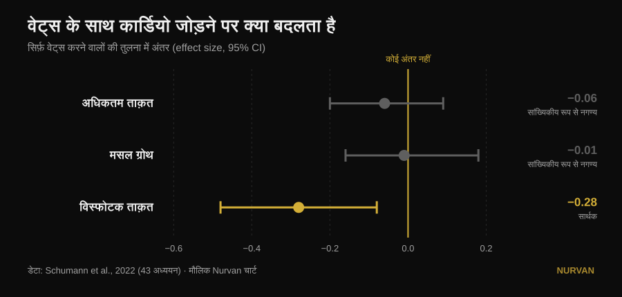
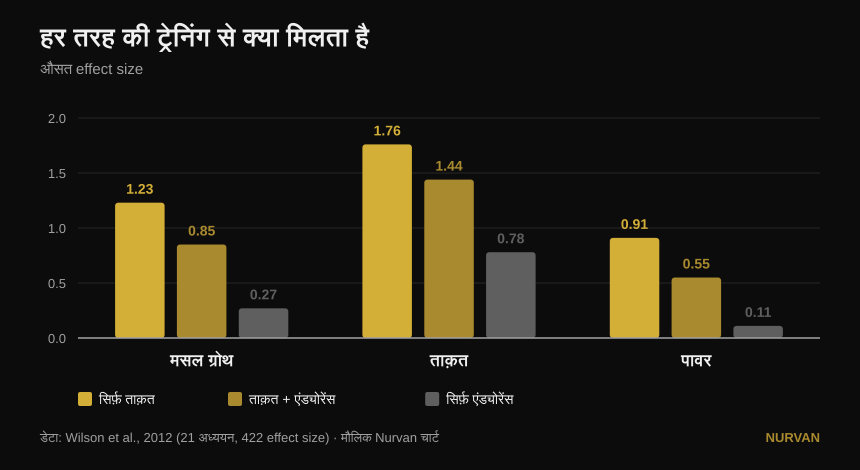

# सब कुछ एक साथ ट्रेन करें या एक ही क्वालिटी पर फोकस?

लेखक: [Giammaria Loi](/autore/giammaria-loi) · अपडेट 14 अक्टूबर 2026

एक ख़ूब शेयर हुई पोस्ट कहती है कि किसी एक फिज़िकल क्वालिटी में स्पेशलाइज़ करने से नतीजे ख़राब आते हैं, और हर प्रोग्राम में छह चीज़ें एक साथ होनी चाहिए: पावर, ताक़त, हाइपरट्रॉफ़ी, कंडीशनिंग, मोबिलिटी और एथलेटिसिज़्म। पोस्ट के नीचे तीन अलग-अलग पाठक एक ही सवाल पूछते हैं: स्टडी कहाँ है? कोई नहीं है। यहाँ वही सोर्स हैं — और वे ज़्यादा सटीक कहानी बताते हैं, जिसमें छह में से एक क्वालिटी को सचमुच नुकसान होता है, पर वह नहीं जिसकी आप उम्मीद करेंगे।

## एक नज़र में

- **एरोबिक काम जोड़ने से न अधिकतम ताक़त जाती है, न मसल।** 43 स्टडीज़ में सिर्फ़ वेट्स करने वालों से फ़र्क़ लगभग शून्य है: अधिकतम ताक़त में −0.06 और हाइपरट्रॉफ़ी में −0.01, दोनों ही सांख्यिकीय रूप से नगण्य (Schumann et al., 2022)।
- **पर पावर ज़रूर जाती है।** विस्फोटक ताक़त में गिरावट सार्थक है (−0.28, p = 0.007)। पोस्ट की सूची में यही एकमात्र क्वालिटी है जो असली क़ीमत चुकाती है।
- **और यह क़ीमत आपके कैलेंडर पर निर्भर है, मेहनत पर नहीं।** पावर की यह गिरावट तब साफ़ दिखती है जब वेट्स और कार्डियो एक ही सेशन में हों, और तब ग़ायब हो जाती है जब दोनों के बीच कम से कम 3 घंटे का फ़ासला हो (Schumann et al., 2022)।
- **सबके लिए एक जैसा भी नहीं है।** निचले शरीर की ताक़त में हस्तक्षेप पुरुषों में दिखता है (−0.43) और महिलाओं में नहीं (0.08), और दोनों समूहों का अंतर सार्थक है (Huiberts et al., 2024)।
- **असली सवाल "सब साथ या एक-एक करके" नहीं है।** जब तक सापेक्ष वज़न भारी रहे, **हफ़्ते में एक सेशन और हर एक्सरसाइज़ का एक सेट** ताक़त और मसल को 32 हफ़्ते तक बनाए रखता है (Spiering et al., 2021)। एक क्वालिटी को आगे बढ़ाइए, बाक़ी को बहुत कम से संभालिए।

## सवाल ही ग़लत ढंग से रखा गया है

पोस्ट का विचार सीधा है: एक बार में एक क्वालिटी ट्रेन करने से "मामूली और संकरा" फ़ायदा मिलता है, सब एक साथ करने से ज़्यादा। सोच अच्छी लगती है, पर किसी स्टडी ने कभी सीधे एक स्पेशलाइज़्ड प्रोग्राम की तुलना मल्टी-मोडल प्रोग्राम से करके कुल जोड़ नहीं नापा। रिसर्च जो सचमुच तुलना करती है वह कहीं ज़्यादा काम की है: **एक जैसे वेट ट्रेनिंग प्रोग्राम पर एरोबिक काम जोड़ने पर** ताक़त, मसल और पावर का क्या होता है।

इस सवाल का ठोस जवाब है, 43 कंट्रोल्ड स्टडीज़ पर बना, जिनमें ताक़त का प्रोग्राम सभी समूहों में एक जैसा था और सिर्फ़ एंड्योरेंस का जुड़ना बदलता था (Schumann et al., 2022):

*सिर्फ़ वेट्स करने वालों की तुलना में स्टैंडर्डाइज़्ड मीन डिफरेंस, 95% कॉन्फिडेंस इंटरवल के साथ। शून्य को काटता इंटरवल मतलब कोई सिद्ध अंतर नहीं। डेटा: Schumann et al., 2022 (43 स्टडीज़)। मौलिक Nurvan चार्ट।*

तीन में से दो शून्य को काटते हैं: **अधिकतम ताक़त और हाइपरट्रॉफ़ी में कार्डियो कुछ नहीं छीनता**। तीसरा नहीं काटता। विस्फोटक ताक़त — कूदना, फेंकना, तेज़ी पकड़ना — सचमुच घटती है।

2026 की एक समीक्षा, जिसने सत्रह मेटा-एनालिसिस जोड़े, दूसरी तरफ़ से उसी नतीजे पर पहुँचती है: जो ताक़त और एंड्योरेंस साथ ट्रेन करते हैं उन्हें **ज़्यादा एरोबिक क्षमता** मिलती है (0.77, p = 0.02), और ताक़त, पावर व हाइपरट्रॉफ़ी में नतीजे **बराबर** रहते हैं, बेहतर नहीं (Held et al., 2026)। वही लेखक चेताते हैं कि एलीट एथलीट्स का डेटा बहुत कम है — और स्पेशलाइज़ेशन का सबसे ज़्यादा महत्व वहीं है, जहाँ रिसर्च के पास कहने को सबसे कम है।

## रिसर्च असल में क्या कहती है

### "एक क्वालिटी में स्पेशलाइज़ करना ख़राब नतीजे देता है" — **स्पष्टीकरण ज़रूरी**

रिसर्च *बराबरी* दिखाती है, कमतरी नहीं। कार्डियो जोड़ने वाले को सिर्फ़ वेट्स करने वाले से ज़्यादा ताक़त या मसल नहीं मिलती: उतनी ही मिलती है, ऊपर से एरोबिक क्षमता मुफ़्त। कंडीशनिंग से न डरने के लिए यह बढ़िया तर्क है। पर यह उस व्यक्ति के ख़िलाफ़ तर्क नहीं है जो एक ब्लॉक के लिए एक ही चीज़ पर ज़ोर देना चुनता है।

### "सब साथ ट्रेन करने से ज़्यादा मिलता है" — **स्पष्टीकरण ज़रूरी**

ज़्यादा क्वालिटीज़ में, हर एक में ज़्यादा नहीं। कुल दायरा चौड़ा होता है, अलग-अलग नतीजे वही रहते हैं। यह फ़र्क़ तब मायने रखता है जब सामने कोई मुक़ाबला, वेट कैटेगरी या डेडलाइन हो।

### "कंडीशनिंग की कोई क़ीमत नहीं" — **ग़लत, पावर के मामले में**

यहाँ पोस्ट चूक जाती है, और ठीक उसी क्वालिटी पर चूकती है जिसे वह पहले नंबर पर रखती है। विस्फोटक ताक़त क़ीमत चुकाती है: −0.28, और कॉन्फिडेंस इंटरवल शून्य को छूता तक नहीं (Schumann et al., 2022)। दिलचस्प बात वजह है: **गिरावट तब साफ़ है जब दोनों हिस्से एक ही वर्कआउट में हों (p = 0.043), और कम से कम तीन घंटे के फ़ासले पर यह दिखती ही नहीं**। यह जैविक मजबूरी नहीं, शेड्यूलिंग की बात है।

पुरानी और ज़्यादा बारीक तस्वीर कच्चे effect size में वही कहती है (Wilson et al., 2012):

*21 स्टडीज़ और 422 तुलनाओं का औसत effect size। पावर में तीनों समूहों के बीच अंतर सांख्यिकीय रूप से सार्थक हैं; हाइपरट्रॉफ़ी और ताक़त में सिर्फ़ अकेला एंड्योरेंस पीछे रहता है। डेटा: Wilson et al., 2012। मौलिक Nurvan चार्ट।*

उसी काम में वे दो कारक सामने आते हैं जिनका पोस्ट ज़िक्र नहीं करती: **दौड़ना हाइपरट्रॉफ़ी और ताक़त घटाता है, साइकिल नहीं**, और हस्तक्षेप एंड्योरेंस सेशनों की फ्रीक्वेंसी (सहसंबंध −0.26 से −0.35) और ख़ासकर उनकी अवधि (−0.29 से −0.75) के साथ बढ़ता है। मामला "कार्डियो" का नहीं है: मामला कितना, किस तरह का और कब का है।

### "यह सबके लिए सच है" — **स्पष्टीकरण ज़रूरी**

पोस्ट के नीचे एक टिप्पणी पूछती है: महिलाओं के नतीजे कहाँ हैं? बहुत अच्छा सवाल, और इसका जवाब मौजूद है। 59 स्टडीज़ और 1,346 लोगों में निचले शरीर की ताक़त का हस्तक्षेप **पुरुषों में दिखता है (−0.43) और महिलाओं में नहीं (0.08)**, और दोनों समूहों के बीच अंतर सांख्यिकीय रूप से सार्थक है (p = 0.03)। ऊपरी शरीर की ताक़त, पावर और अधिकतम ऑक्सीजन खपत में लिंग के हिसाब से कोई अंतर नहीं (Huiberts et al., 2024)।

### "मोबिलिटी एक अलग अनिवार्य ब्लॉक है" — **स्पष्टीकरण ज़रूरी**

अगर आप पूरी रेंज ऑफ़ मोशन में ताक़त ट्रेन करते हैं, तो मोबिलिटी का कुछ काम पहले ही हो चुका है। 11 कंट्रोल्ड ट्रायल और 452 लोगों में, स्ट्रेंथ ट्रेनिंग और स्ट्रेचिंग के बीच रेंज ऑफ़ मोशन के फ़ायदे में **कोई फ़र्क़ नहीं** मिला (−0.22, p = 0.206), और यह हर विश्लेषित उपसमूह में टिकता है (Afonso et al., 2021)। लेखक ज़ोर देते हैं कि स्टडीज़ बहुत भिन्न हैं, इसलिए अगर आपकी कोई ख़ास सीमितता है तो यह स्ट्रेचिंग छोड़ने का लाइसेंस नहीं — पर छह में से एक ख़ाना आंशिक रूप से अपने आप भर जाता है।

### "एक बार में एक क्वालिटी यानी मामूली फ़ायदा" — **उल्टी दिशा में ग़लत**

समय के साथ ज़ोर बदलना ख़ामी नहीं: यही पीरियडाइज़ेशन की परिभाषा है, और अधिकतम ताक़त में यह बिना पीरियडाइज़ेशन से बेहतर काम करती है। वॉल्यूम बराबर रखने पर, 35 स्टडीज़ में पीरियडाइज़्ड प्रोग्राम 1RM में ग़ैर-पीरियडाइज़्ड से आगे रहे (0.31, p = 0.02), जबकि **हाइपरट्रॉफ़ी में कुछ नहीं बदला** (0.13, p = 0.27)। और लीनियर बनाम अंड्यूलेटिंग में, 1RM पर अंड्यूलेटिंग की बढ़त सिर्फ़ ट्रेंड लोगों में है (0.61) और शुरुआती लोगों में ग़ायब हो जाती है (0.06) (Moesgaard et al., 2022)।

मतलब: अगर मसल चाहिए तो क्रम से ज़्यादा फ़र्क़ नहीं पड़ता, सब साथ कर सकते हैं। अगर अधिकतम वज़न चाहिए तो समय के साथ एक ढाँचा चाहिए — और "हमेशा सब एक साथ" कोई ढाँचा नहीं है।

## वह सवाल जो पोस्ट नहीं पूछती

"छह क्वालिटी साथ या एक-एक करके" वाली दुविधा में एक तीसरा पक्ष है जिसका नाम दोनों खेमे नहीं लेते: **जो बना लिया है उसे न खोने के लिए कितना कम काफ़ी है**। यह जवाब स्टडी-दर-स्टडी जोड़ा गया है और हैरान करने वाला कम है (Spiering et al., 2021):

| क्वालिटी | बनाए रखने की न्यूनतम डोज़ | कब तक | शर्त |
|---|---|---|---|
| ताक़त और मसल (40 से कम उम्र) | हफ़्ते में 1 सेशन, हर एक्सरसाइज़ का 1 सेट | 32 हफ़्ते तक | सापेक्ष वज़न भारी बना रहे |
| मसल मास (अधिक उम्र) | हफ़्ते में 2 सेशन, 2-3 सेट | — | सापेक्ष वज़न भारी बना रहे |
| एरोबिक क्षमता | हफ़्ते में 2 सेशन, या वॉल्यूम 33-66% कम (13-26 मिनट तक भी) | 15 हफ़्ते तक | वर्किंग हार्ट रेट ऊँचा बना रहे |

जो चीज़ कभी नहीं काटी जा सकती वह हमेशा वही है: **इंटेंसिटी**। वॉल्यूम और फ्रीक्वेंसी बहुत घटाई जा सकती है, वज़न या रफ़्तार नहीं।

इससे पूरी बहस बदल जाती है। चुनाव छह ख़राब ट्रेन की गई क्वालिटीज़ और एक अच्छी ट्रेन की गई क्वालिटी के बीच नहीं है। आप छह से आठ हफ़्ते एक क्वालिटी को आगे बढ़ाते हैं और बाक़ी को **मेंटेनेंस मोड** में डाल देते हैं — एक सेशन या एक सेट। कोच इसी तरह एक संपूर्ण एथलीट बनाते हैं बिना उसे जलाए, और यही वह बीच का रास्ता है जिसे पोस्ट असंभव बताती है।

## इसे कैसे लागू करें

1. **अगले 6-8 हफ़्तों के लिए एक प्राथमिकता चुनें।** सिर्फ़ एक: अधिकतम ताक़त, मसल, या कंडीशनिंग। बाक़ी छोड़ते नहीं, धीमा करते हैं।
2. **बाक़ी को न्यूनतम डोज़ पर ज़िंदा रखें।** हफ़्ते में एक सेशन और दो भारी सेट महीनों तक ताक़त और मसल बचाए रखते हैं (Spiering et al., 2021)। ज़रूरी यह है कि वज़न आपके पुराने वज़न के आसपास रहे, न कि वॉल्यूम ऊँचा रहे।
3. **अगर पावर मायने रखती है, वेट्स और कंडीशनिंग के बीच कम से कम 3 घंटे रखें** या उन्हें अलग दिनों में डालें (Schumann et al., 2022)। अगर जोड़ना ही पड़े तो वेट्स पहले: सबसे नई समीक्षा में यही रुझान है (Held et al., 2026)।
4. **कार्डियो का तरीक़ा सोच-समझकर चुनें।** साइकिल हस्तक्षेप नहीं करती, दौड़ करती है — ख़ासकर लंबी और बार-बार (Wilson et al., 2012)। अगर दौड़ना ज़रूरी है और टाँगें भी बनानी हैं, तो सेशन छोटे रखें।
5. **मोबिलिटी को डिफ़ॉल्ट रूप से एक अतिरिक्त ब्लॉक न गिनें।** पूरी रेंज में ताक़त ट्रेन करें और लक्षित काम सिर्फ़ वहाँ जोड़ें जहाँ सचमुच सीमितता है (Afonso et al., 2021)। [सेट और रेप्स कैसे चुनें](/hi/blog/kitne-reps-muscle-ke-liye) वाला हमारा विश्लेषण ताक़त वाले हिस्से को सेट करने में मदद करेगा।
6. **नापिए, अंदाज़ा मत लगाइए।** हस्तक्षेप महसूस नहीं होता: वह आँकड़ों में दिखता है। अगर चार हफ़्ते की कंडीशनिंग के बाद आपकी जंप या बार स्पीड गिरे जबकि वज़न टिके रहें, तो आपने ठीक वही क़ीमत पकड़ ली जिसकी रिसर्च बात करती है।

> ### 💡 Nurvan के साथ
> **कई क्वालिटीज़ साथ ट्रेन करना तभी काम करता है जब आप देख सकें कि कौन-सी नीचे जा रही है।** Nurvan में अलग-अलग प्रोग्राम और डिसिप्लिन एक ही लॉग में रहते हैं — ताक़त, हाइपरट्रॉफ़ी, फंक्शनल, HYROX — वज़न, रेप्स और RIR हर सेट के साथ दर्ज, और पूरा इतिहास हमेशा तुलना के लिए सामने। इससे "मेंटेनेंस मोड" एक ऐसी चीज़ बन जाती है जिसे आप सचमुच जाँचते हैं, उम्मीद नहीं करते: अगर आपका अधिकतम गिर रहा है जबकि कंडीशनिंग चढ़ रही है, तो आपको दो हफ़्ते में पता चलेगा, दो महीने में नहीं। [Nurvan आज़माएँ](https://nurvan.app)

## अक्सर पूछे जाने वाले सवाल

**क्या कार्डियो से मसल चली जाती है?**
नहीं। 43 कंट्रोल्ड स्टडीज़ में, एक जैसे वेट प्रोग्राम पर एरोबिक काम जोड़ने से न हाइपरट्रॉफ़ी बदलती है (−0.01, p = 0.919), न अधिकतम ताक़त (−0.06, p = 0.446) (Schumann et al., 2022)। सिर्फ़ विस्फोटक ताक़त पर असर पड़ता है।

**कार्डियो और वेट्स एक ही दिन या अलग दिन?**
अगर पावर मायने रखती है तो अलग करें: विस्फोटक ताक़त की गिरावट तब साफ़ है जब दोनों एक ही सेशन में हों, और कम से कम तीन घंटे के फ़ासले पर दिखती ही नहीं (Schumann et al., 2022)। अगर सिर्फ़ ताक़त और मसल चाहिए तो शेड्यूलिंग का वज़न बहुत कम है।

**अपनी मौजूदा ताक़त बनाए रखने के लिए कितनी ट्रेनिंग चाहिए?**
40 से कम उम्र के वयस्कों में, हफ़्ते में एक सेशन और हर एक्सरसाइज़ का एक सेट 32 हफ़्ते तक ताक़त और मसल बनाए रखता है, बशर्ते सापेक्ष वज़न भारी रहे (Spiering et al., 2021)। वॉल्यूम काटिए, इंटेंसिटी कभी नहीं।

**क्या मुझे पोस्ट की तरह छह क्वालिटीज़ ट्रेन करनी चाहिए?**
कोई सोर्स क्वालिटीज़ की अनिवार्य संख्या तय नहीं करता, न ही उनके बीच किसी "सिनर्जी" को सिद्ध करता है। सोर्स यह ज़रूर दिखाते हैं कि आप कई क्वालिटीज़ साथ ट्रेन कर सकते हैं बिना ताक़त या मसल खोए, और जिन पर आप अभी ज़ोर नहीं दे रहे वे बहुत कम काम से बची रहती हैं। सही संख्या आपके लक्ष्य पर निर्भर है, किसी नियम पर नहीं।

## यह भी पढ़ें

- [ट्रेनिंग स्प्लिट: बिगिनर बनाम एडवांस्ड](/hi/blog/training-split-beginner-advanced)
- [मसल्स के लिए कितने रेप्स? 8-12 का मिथक](/hi/blog/kitne-reps-muscle-ke-liye)
- [लेग एक्सटेंशन या लेग प्रेस: असल में क्या बढ़ता है](/hi/blog/leg-extension-vs-leg-press-rectus-femoris-hindi)

## स्रोत

1. Schumann M, Feuerbacher JF, Sünkeler M, Freitag N, Rønnestad BR, Doma K, Lundberg TR, 2022. *Compatibility of Concurrent Aerobic and Strength Training for Skeletal Muscle Size and Function: An Updated Systematic Review and Meta-Analysis.* Sports Med 52(3):601–612. PMID 34757594 — [doi:10.1007/s40279-021-01587-7](https://doi.org/10.1007/s40279-021-01587-7)
2. Held S, Wolf L, Rappelt L, Bloch W, Donath L, Micke F, Geisler S, Isenmann E, 2026. *Maximizing Adaptations in Concurrent Training: An Umbrella Review of Meta-analyses.* Sports Med 56(6):1489–1512. PMID 41762427 — [doi:10.1007/s40279-026-02401-y](https://doi.org/10.1007/s40279-026-02401-y)
3. Wilson JM, Marin PJ, Rhea MR, Wilson SMC, Loenneke JP, Anderson JC, 2012. *Concurrent training: a meta-analysis examining interference of aerobic and resistance exercises.* J Strength Cond Res 26(8):2293–2307. PMID 22002517 — [doi:10.1519/JSC.0b013e31823a3e2d](https://doi.org/10.1519/JSC.0b013e31823a3e2d)
4. Huiberts RO, Wüst RCI, van der Zwaard S, 2024. *Concurrent Strength and Endurance Training: A Systematic Review and Meta-Analysis on the Impact of Sex and Training Status.* Sports Med 54(2):485–503. PMID 37847373 — [doi:10.1007/s40279-023-01943-9](https://doi.org/10.1007/s40279-023-01943-9)
5. Spiering BA, Mujika I, Sharp MA, Foulis SA, 2021. *Maintaining Physical Performance: The Minimal Dose of Exercise Needed to Preserve Endurance and Strength Over Time.* J Strength Cond Res 35(5):1449–1458. PMID 33629972 — [doi:10.1519/JSC.0000000000003964](https://doi.org/10.1519/JSC.0000000000003964)
6. Moesgaard L, Beck MM, Christiansen L, Aagaard P, Lundbye-Jensen J, 2022. *Effects of Periodization on Strength and Muscle Hypertrophy in Volume-Equated Resistance Training Programs: A Systematic Review and Meta-analysis.* Sports Med 52(7):1647–1666. PMID 35044672 — [doi:10.1007/s40279-021-01636-1](https://doi.org/10.1007/s40279-021-01636-1)
7. Afonso J, Ramirez-Campillo R, Moscão J, Rocha T, Zacca R, Martins A, Milheiro AA, Ferreira J, Sarmento H, Clemente FM, 2021. *Strength Training versus Stretching for Improving Range of Motion: A Systematic Review and Meta-Analysis.* Healthcare (Basel) 9(4):427. PMID 33917036 — [doi:10.3390/healthcare9040427](https://doi.org/10.3390/healthcare9040427)

*ग्रंथसूची PubMed पर सत्यापित। शुरुआती प्रेरणा: [John Rusin](https://www.instagram.com/p/Ddv-zwDkZ0F/) की पोस्ट, जो कोई सोर्स नहीं देती। पोस्ट का कोई टेक्स्ट या इमेज दोहराई नहीं गई है: विषय और दावे नए सिरे से लिखे और प्राथमिक स्रोतों पर जाँचे गए हैं।*

---

**Giammaria Loi** Nurvan के संस्थापक हैं। वे 2012 से वेट ट्रेनिंग करते हैं, 2013 से FIPE-प्रमाणित पर्सनल ट्रेनर और कोच के रूप में काम करते हैं, और 2018 से राष्ट्रीय स्तर पर पावरलिफ्टिंग में भाग लेते हैं। उनके हर लेख की शुरुआत वैज्ञानिक अध्ययनों से होती है और अंत उस चीज़ पर जो जिम में सचमुच काम करती है। [लेखक पेज](/autore/giammaria-loi)

> नोट: यह जानकारीपरक सामग्री है, जो डॉक्टर या पेशेवर की सलाह का विकल्प नहीं है। अगर आपको कोई बीमारी है या आप किसी इलाज पर हैं, तो ट्रेनिंग प्रोग्राम बदलने से पहले अपने डॉक्टर से बात करें।
