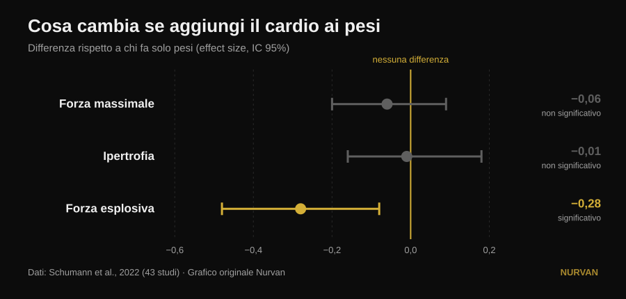
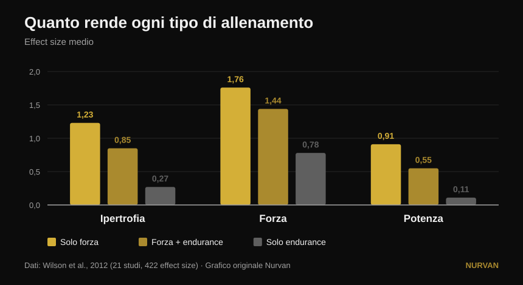

# Allenare tutto insieme o specializzarsi in una qualità?

Di [Giammaria Loi](/autore/giammaria-loi) · aggiornato il 14 ottobre 2026

Un post molto condiviso sostiene che specializzarsi in una sola qualità fisica porta risultati peggiori, e che ogni programma dovrebbe contenere sei qualità insieme: potenza, forza, ipertrofia, condizionamento, mobilità e atletismo. Sotto al post, tre lettori diversi chiedono la stessa cosa: dov'è lo studio? Non c'è. Qui ci sono le fonti — e raccontano una storia più precisa, in cui una delle sei qualità viene davvero penalizzata, ma non quella che ti aspetti.

## In breve

- **Aggiungere lavoro aerobico non ti costa forza massimale né massa muscolare.** Su 43 studi la differenza rispetto a chi fa solo pesi è praticamente zero: −0,06 sul massimale e −0,01 sull'ipertrofia, entrambi non significativi (Schumann et al., 2022).
- **Ti costa potenza, però.** La forza esplosiva cala in modo statisticamente significativo (−0,28, p = 0,007). È l'unica delle qualità elencate nel post che paga davvero un prezzo.
- **Il prezzo dipende da quando alleni, non da quanto sei motivato.** L'attenuazione della potenza è marcata quando pesi e cardio stanno nella stessa seduta, e sparisce quando le due sedute distano almeno 3 ore (Schumann et al., 2022).
- **Non vale uguale per tutti.** L'interferenza sulla forza delle gambe compare negli uomini (−0,43) e non nelle donne (0,08), con differenza fra i gruppi significativa (Huiberts et al., 2024).
- **La domanda giusta non è "tutto insieme o una cosa alla volta".** Forza e massa si mantengono fino a 32 settimane con **una seduta a settimana e una serie per esercizio**, a patto di tenere alta l'intensità (Spiering et al., 2021). Si spinge una qualità e si mantengono le altre con pochissimo.

## Il dilemma è mal posto

L'idea del post è semplice: allenare una qualità per volta produce guadagni "minimi e stretti", allenarle tutte insieme produce di più. È un'intuizione simpatica, ma nessuno studio ha mai confrontato direttamente "un programma specializzato" con "un programma multimodale" e misurato il totale. Quello che la letteratura confronta davvero è un'altra cosa, molto più utile: cosa succede alla forza, alla massa e alla potenza **quando aggiungi lavoro aerobico a un programma di pesi identico**.

Questa domanda ha una risposta solida, su 43 studi controllati in cui il programma di forza era identico fra i gruppi e cambiava solo l'aggiunta dell'endurance (Schumann et al., 2022):

*Differenze medie standardizzate rispetto a chi faceva solo pesi, con intervallo di confidenza al 95%. Un intervallo che attraversa lo zero significa nessuna differenza dimostrata. Dati da Schumann et al., 2022 (43 studi). Grafico originale Nurvan.*

Due barre su tre attraversano lo zero: **sulla forza massimale e sull'ipertrofia il cardio non toglie niente**. La terza no: la forza esplosiva — saltare, lanciare, accelerare — si riduce in modo reale.

Una revisione del 2026 che ha messo insieme diciassette meta-analisi arriva allo stesso punto da un'altra angolazione: chi allena forza e resistenza insieme ottiene **più capacità aerobica** di chi fa solo pesi (0,77, p = 0,02) e risultati **comparabili**, non superiori, su forza, potenza e ipertrofia (Held et al., 2026). Gli stessi autori avvertono che i dati su atleti d'élite sono scarsi: è proprio lì, ai livelli alti, che la specializzazione conta di più e la ricerca ha meno da dire.

## Cosa dice davvero la ricerca

### "Specializzarsi in una qualità dà risultati peggiori" — **Da precisare**

La ricerca dice *equivalenza*, non inferiorità. Chi aggiunge il cardio non ottiene più forza o più massa di chi si concentra solo sui pesi: ne ottiene altrettanta, più la capacità aerobica in regalo. È un ottimo argomento per non avere paura del condizionamento. Non è un argomento contro chi, per un periodo, sceglie di spingere una cosa sola.

### "Allenare tutto insieme fa guadagnare di più" — **Da precisare**

Di più in quante qualità, non di più in ciascuna. Il totale si allarga, i singoli risultati restano gli stessi. La differenza è sostanziale quando hai una gara, una classe di peso o un obiettivo con una scadenza.

### "Il condizionamento non ti costa nulla" — **Smentito, per la potenza**

Qui il post sbaglia bersaglio, e sbaglia proprio sulla qualità che mette al primo posto. La forza esplosiva paga: −0,28, con intervallo di confidenza che non tocca lo zero (Schumann et al., 2022). Il dato interessante è il perché: **l'attenuazione è marcata quando le due sedute sono nella stessa sessione (p = 0,043) e non lo è più quando sono separate da almeno tre ore**. Non è una fatalità biologica, è un problema di calendario.

Il quadro più vecchio e più dettagliato dice la stessa cosa guardando le dimensioni dell'effetto grezze (Wilson et al., 2012):

*Effect size medi su 21 studi e 422 confronti. Sulla potenza le differenze fra tutti e tre i gruppi sono statisticamente significative; su ipertrofia e forza solo l'endurance isolata resta indietro. Dati da Wilson et al., 2012. Grafico originale Nurvan.*

Nello stesso lavoro emergono i due moderatori che il post non nomina: **correre riduce ipertrofia e forza, pedalare no**, e l'entità dell'interferenza cresce con la frequenza (correlazioni da −0,26 a −0,35) e soprattutto con la durata delle sedute di endurance (da −0,29 a −0,75). Non è "il cardio": è quanto cardio, di che tipo e quando.

### "Vale per chiunque" — **Da precisare**

Un commentatore sotto al post chiede dove siano i risultati sulle donne. È una domanda ottima e ha una risposta. Su 59 studi e 1.346 persone, l'interferenza sulla forza degli arti inferiori compare **negli uomini (−0,43) e non nelle donne (0,08)**, con una differenza fra i due gruppi statisticamente significativa (p = 0,03). Su forza degli arti superiori, potenza e massimo consumo di ossigeno nessuna differenza fra i sessi (Huiberts et al., 2024).

### "La mobilità è un blocco obbligatorio a parte" — **Da precisare**

Se alleni la forza su tutta l'escursione articolare, una parte del lavoro di mobilità la stai già facendo. Su 11 studi controllati e 452 persone, allenamento di forza e stretching **non differiscono** nei guadagni di escursione articolare (−0,22, p = 0,206), e la cosa regge in tutti i sottogruppi analizzati (Afonso et al., 2021). Gli autori sottolineano che gli studi sono molto eterogenei, quindi non è una licenza per smettere di allungarsi se hai una limitazione specifica — ma una delle sei caselle si riempie in parte da sola.

### "Una qualità alla volta produce guadagni minimi" — **Smentito nel verso opposto**

Alternare l'enfasi nel tempo non è un difetto: è la definizione di periodizzazione, e sul massimale funziona meglio del non periodizzare. A volume pareggiato, su 35 studi, programmi periodizzati battono quelli non periodizzati sul massimale (0,31, p = 0,02), mentre **sull'ipertrofia non cambia nulla** (0,13, p = 0,27). E fra periodizzazione lineare e ondulata, il vantaggio dell'ondulata sul massimale esiste solo negli allenati (0,61) e sparisce nei principianti (0,06) (Moesgaard et al., 2022).

Tradotto: se vuoi massa, l'ordine conta poco e puoi fare tutto insieme senza rimpianti. Se vuoi il massimale, un'organizzazione nel tempo ti serve — e "tutto insieme sempre" non è un'organizzazione.

## La domanda che il post non si pone

Il dilemma "tutte le qualità insieme oppure una alla volta" ha un terzo termine che nessuno dei due campi nomina: **quanto poco basta per non perdere ciò che hai già costruito**. La risposta è stata raccolta studio per studio ed è sorprendentemente bassa (Spiering et al., 2021):

| Qualità | Dose minima per mantenerla | Per quanto | Condizione |
|---|---|---|---|
| Forza e massa (under 40) | 1 seduta a settimana, 1 serie per esercizio | fino a 32 settimane | il carico relativo resta alto |
| Massa (età avanzata) | 2 sedute a settimana, 2-3 serie | — | il carico relativo resta alto |
| Capacità aerobica | 2 sedute a settimana, oppure volume ridotto del 33-66% (anche 13-26 minuti) | fino a 15 settimane | la frequenza cardiaca di lavoro resta alta |

La variabile che non si può tagliare è sempre la stessa: **l'intensità**. Volume e frequenza si possono ridurre moltissimo, il carico o il ritmo no.

Questo cambia tutto il discorso. Non devi scegliere fra sei qualità allenate male e una allenata bene. Spingi una qualità alla volta per sei-otto settimane e metti le altre in **modalità mantenimento** con una seduta o una serie. È così che i preparatori costruiscono un atleta completo senza bruciarlo, ed è esattamente la via di mezzo che il post descrive come impossibile.

## Come applicarlo

1. **Scegli una priorità per le prossime 6-8 settimane.** Una sola: il massimale, la massa, il condizionamento. Sulle altre non smetti, rallenti.
2. **Tieni in vita il resto con la dose minima.** Una seduta settimanale con un paio di serie pesanti basta a conservare forza e massa per mesi (Spiering et al., 2021). L'importante è che il carico resti vicino a quello che usavi, non che il volume resti alto.
3. **Separa i pesi dal condizionamento di almeno 3 ore,** o mettili in giorni diversi, se la potenza ti interessa (Schumann et al., 2022). Se devi accorparli, metti prima i pesi: è la tendenza che emerge dall'umbrella review più recente (Held et al., 2026).
4. **Scegli bene il tipo di cardio.** La bici non interferisce, la corsa sì — soprattutto se è lunga e frequente (Wilson et al., 2012). Se devi correre e vuoi anche costruire gambe, tieni le sedute brevi.
5. **Non confondere mobilità e stretching con un blocco in più.** Allena la forza su tutta l'escursione articolare e aggiungi lavoro mirato solo dove hai una limitazione reale (Afonso et al., 2021). Il nostro approfondimento su [come scegliere serie e ripetizioni](/blog/ripetizioni-serie-recupero-ipertrofia) ti aiuta a impostare la parte di forza.
6. **Misura, non immaginare.** L'interferenza non si sente: si vede sui numeri. Se dopo quattro settimane di condizionamento il tuo salto o la velocità del bilanciere calano mentre i carichi tengono, hai trovato il prezzo di cui parla la ricerca.

> ### 💡 Con Nurvan
> **Allenare più qualità insieme funziona solo se puoi vedere quale sta scendendo.** In Nurvan tieni programmi e discipline diverse nello stesso diario — forza, ipertrofia, functional, HYROX — con carico, ripetizioni e RIR registrati seduta per seduta e lo storico sempre a confronto. Così la "modalità mantenimento" diventa una cosa che controlli davvero, invece di una speranza: se il massimale scende mentre il condizionamento sale, te ne accorgi dopo due settimane e non dopo due mesi. [Prova Nurvan](https://nurvan.app)

## Domande frequenti

**Il cardio fa perdere i muscoli?**
No. Su 43 studi controllati, aggiungere lavoro aerobico a un identico programma di pesi non cambia l'ipertrofia (−0,01, p = 0,919) né la forza massimale (−0,06, p = 0,446) (Schumann et al., 2022). L'unica qualità che ne risente è la forza esplosiva.

**Meglio fare cardio e pesi nello stesso giorno o in giorni diversi?**
Se ti interessa la potenza, separali: l'attenuazione della forza esplosiva è marcata quando le due sedute sono nella stessa sessione e non lo è più quando sono separate da almeno tre ore (Schumann et al., 2022). Se ti interessano solo forza e massa, l'organizzazione pesa molto meno.

**Quanto allenamento serve per non perdere la forza che ho?**
Negli adulti sotto i 40 anni, una seduta a settimana con una serie per esercizio ha mantenuto forza e massa fino a 32 settimane, purché il carico relativo restasse alto (Spiering et al., 2021). Il volume si taglia, l'intensità no.

**Devo allenare sei qualità come dice il post?**
Non c'è una fonte che stabilisca un numero obbligatorio di qualità, né che dimostri una "sinergia" fra di esse. Quello che le fonti dimostrano è che puoi allenarne diverse insieme senza perdere forza né massa, e che le qualità che non stai spingendo si conservano con pochissimo lavoro. Il numero giusto dipende dal tuo obiettivo, non da una regola.

## Leggi anche

- [Split di allenamento: principiante o avanzato](/blog/split-allenamento-principiante-avanzato)
- [Quante ripetizioni servono per la massa: il mito dell'8-12](/blog/ripetizioni-serie-recupero-ipertrofia)
- [Leg extension o leg press: cosa cresce davvero](/blog/leg-extension-o-leg-press-retto-femorale)

## Fonti

1. Schumann M, Feuerbacher JF, Sünkeler M, Freitag N, Rønnestad BR, Doma K, Lundberg TR, 2022. *Compatibility of Concurrent Aerobic and Strength Training for Skeletal Muscle Size and Function: An Updated Systematic Review and Meta-Analysis.* Sports Med 52(3):601–612. PMID 34757594 — [doi:10.1007/s40279-021-01587-7](https://doi.org/10.1007/s40279-021-01587-7)
2. Held S, Wolf L, Rappelt L, Bloch W, Donath L, Micke F, Geisler S, Isenmann E, 2026. *Maximizing Adaptations in Concurrent Training: An Umbrella Review of Meta-analyses.* Sports Med 56(6):1489–1512. PMID 41762427 — [doi:10.1007/s40279-026-02401-y](https://doi.org/10.1007/s40279-026-02401-y)
3. Wilson JM, Marin PJ, Rhea MR, Wilson SMC, Loenneke JP, Anderson JC, 2012. *Concurrent training: a meta-analysis examining interference of aerobic and resistance exercises.* J Strength Cond Res 26(8):2293–2307. PMID 22002517 — [doi:10.1519/JSC.0b013e31823a3e2d](https://doi.org/10.1519/JSC.0b013e31823a3e2d)
4. Huiberts RO, Wüst RCI, van der Zwaard S, 2024. *Concurrent Strength and Endurance Training: A Systematic Review and Meta-Analysis on the Impact of Sex and Training Status.* Sports Med 54(2):485–503. PMID 37847373 — [doi:10.1007/s40279-023-01943-9](https://doi.org/10.1007/s40279-023-01943-9)
5. Spiering BA, Mujika I, Sharp MA, Foulis SA, 2021. *Maintaining Physical Performance: The Minimal Dose of Exercise Needed to Preserve Endurance and Strength Over Time.* J Strength Cond Res 35(5):1449–1458. PMID 33629972 — [doi:10.1519/JSC.0000000000003964](https://doi.org/10.1519/JSC.0000000000003964)
6. Moesgaard L, Beck MM, Christiansen L, Aagaard P, Lundbye-Jensen J, 2022. *Effects of Periodization on Strength and Muscle Hypertrophy in Volume-Equated Resistance Training Programs: A Systematic Review and Meta-analysis.* Sports Med 52(7):1647–1666. PMID 35044672 — [doi:10.1007/s40279-021-01636-1](https://doi.org/10.1007/s40279-021-01636-1)
7. Afonso J, Ramirez-Campillo R, Moscão J, Rocha T, Zacca R, Martins A, Milheiro AA, Ferreira J, Sarmento H, Clemente FM, 2021. *Strength Training versus Stretching for Improving Range of Motion: A Systematic Review and Meta-Analysis.* Healthcare (Basel) 9(4):427. PMID 33917036 — [doi:10.3390/healthcare9040427](https://doi.org/10.3390/healthcare9040427)

*Dati bibliografici verificati su PubMed. Spunto iniziale: il post di [John Rusin](https://www.instagram.com/p/Ddv-zwDkZ0F/), che non riporta fonti. Nessun testo o immagine del post è stato riprodotto: tema e affermazioni sono stati riscritti e verificati sulle fonti primarie.*

---

**Giammaria Loi** è il fondatore di Nurvan. Si allena con i pesi dal 2012, lavora come personal trainer e coach certificato FIPE dal 2013 e gareggia nel powerlifting a livello nazionale dal 2018. Ogni articolo che firma parte dagli studi scientifici e arriva a ciò che funziona davvero in palestra. [Pagina autore](/autore/giammaria-loi)

> Nota: contenuto informativo, non sostituisce il parere di un medico o di un professionista. Se hai patologie o segui una terapia, parlane con il tuo medico prima di modificare il tuo programma di allenamento.
