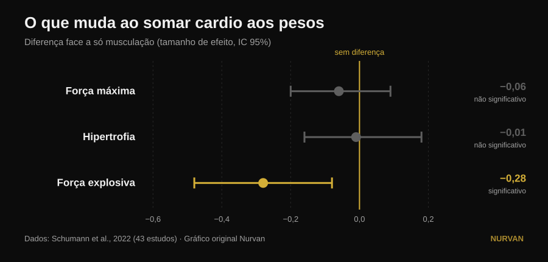
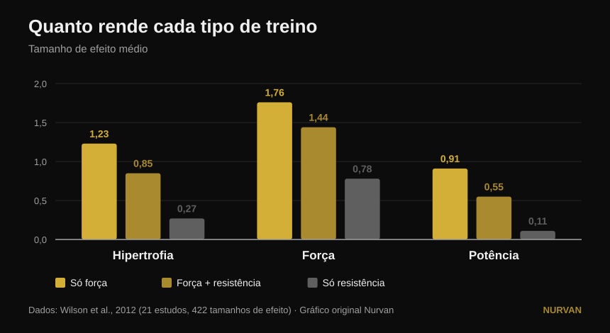

# Treinar tudo junto ou especializar-se numa qualidade?

Por [Giammaria Loi](/autore/giammaria-loi) · atualizado a 14 de outubro de 2026

Um post muito partilhado defende que especializar-se numa única qualidade física dá piores resultados e que todo o programa deveria conter seis ao mesmo tempo: potência, força, hipertrofia, condicionamento, mobilidade e atletismo. Por baixo do post, três leitores diferentes perguntam o mesmo: onde está o estudo? Não há nenhum. Aqui estão as fontes — e contam uma história mais precisa, em que uma das seis qualidades é mesmo prejudicada, mas não a que se esperaria.

## Em resumo

- **Acrescentar trabalho aeróbio não custa força máxima nem massa muscular.** Em 43 estudos, a diferença face a quem só faz pesos é praticamente nula: −0,06 na força máxima e −0,01 na hipertrofia, nenhuma significativa (Schumann et al., 2022).
- **Custa potência, isso sim.** A força explosiva cai de forma estatisticamente significativa (−0,28, p = 0,007). É a única qualidade da lista do post que paga um preço real.
- **E o preço depende do calendário, não da vontade.** A perda de potência é marcada quando pesos e cardio ficam na mesma sessão e desaparece quando as duas são separadas por pelo menos 3 horas (Schumann et al., 2022).
- **Não vale igual para toda a gente.** A interferência na força dos membros inferiores aparece nos homens (−0,43) e não nas mulheres (0,08), com diferença significativa entre os grupos (Huiberts et al., 2024).
- **A pergunta certa não é "tudo junto ou uma coisa de cada vez".** Força e massa mantêm-se até 32 semanas com **uma sessão por semana e uma série por exercício**, desde que a carga relativa continue alta (Spiering et al., 2021). Empurra-se uma qualidade e mantêm-se as outras com muito pouco.

## O dilema está mal colocado

A ideia do post é simples: treinar uma qualidade de cada vez produz ganhos "mínimos e estreitos", treiná-las todas juntas produz mais. É uma intuição simpática, mas nenhum estudo comparou alguma vez de forma direta um programa especializado com um multimodal somando os totais. O que a literatura compara de facto é bem mais útil: o que acontece à força, à massa e à potência **quando se acrescenta trabalho aeróbio a um programa de pesos idêntico**.

Essa pergunta tem resposta sólida, construída sobre 43 estudos controlados em que o programa de força era idêntico entre grupos e só mudava a adição de resistência (Schumann et al., 2022):

*Diferenças médias padronizadas face a quem só fazia pesos, com intervalo de confiança de 95%. Um intervalo que cruza o zero significa que não há diferença demonstrada. Dados de Schumann et al., 2022 (43 estudos). Gráfico original Nurvan.*

Duas das três barras cruzam o zero: **na força máxima e na hipertrofia o cardio não tira nada**. A terceira não. A força explosiva — saltar, lançar, acelerar — reduz-se mesmo.

Uma revisão de 2026 que juntou dezassete meta-análises chega ao mesmo ponto por outro caminho: quem treina força e resistência em conjunto obtém **mais capacidade aeróbia** do que quem só faz pesos (0,77, p = 0,02) e resultados **comparáveis**, não superiores, em força, potência e hipertrofia (Held et al., 2026). Os mesmos autores avisam que os dados em atletas de elite são escassos: e é precisamente aí que a especialização mais pesa e a investigação menos tem a dizer.

## O que a investigação diz de facto

### "Especializar-se numa qualidade dá piores resultados" — **A precisar**

A investigação mostra *equivalência*, não inferioridade. Quem acrescenta cardio não obtém mais força nem mais massa do que quem se concentra só nos pesos: obtém o mesmo, mais a capacidade aeróbia de oferta. É um excelente argumento para não ter medo do condicionamento. Não é um argumento contra quem, durante um bloco, escolhe empurrar uma coisa só.

### "Treinar tudo junto rende mais" — **A precisar**

Mais em quantas qualidades, não mais em cada uma. O total alarga-se; os resultados individuais ficam iguais. A diferença conta quando há uma competição, uma categoria de peso ou um prazo.

### "O condicionamento não custa nada" — **Desmentido, para a potência**

Aqui o post falha o alvo, e falha justamente na qualidade que coloca em primeiro lugar. A força explosiva paga: −0,28, com intervalo de confiança que não toca o zero (Schumann et al., 2022). O interessante é o porquê: **a perda é marcada quando as duas sessões estão dentro do mesmo treino (p = 0,043) e deixa de aparecer quando são separadas por pelo menos três horas**. Não é fatalidade biológica, é planeamento.

O quadro mais antigo e mais detalhado diz o mesmo com os tamanhos de efeito em bruto (Wilson et al., 2012):

*Tamanhos de efeito médios em 21 estudos e 422 comparações. Na potência as diferenças entre os três grupos são estatisticamente significativas; na hipertrofia e na força só a resistência isolada fica para trás. Dados de Wilson et al., 2012. Gráfico original Nurvan.*

No mesmo trabalho surgem os dois moderadores que o post não nomeia: **correr reduz hipertrofia e força, pedalar não**, e a dimensão da interferência cresce com a frequência das sessões de resistência (correlações de −0,26 a −0,35) e sobretudo com a sua duração (de −0,29 a −0,75). Não é "o cardio": é quanto, de que tipo e quando.

### "Vale para qualquer pessoa" — **A precisar**

Um comentador por baixo do post pergunta onde estão os resultados nas mulheres. É uma excelente pergunta e tem resposta. Em 59 estudos e 1.346 pessoas, a interferência na força dos membros inferiores aparece **nos homens (−0,43) e não nas mulheres (0,08)**, com diferença estatisticamente significativa entre os dois grupos (p = 0,03). Em força dos membros superiores, potência e consumo máximo de oxigénio não há qualquer diferença entre sexos (Huiberts et al., 2024).

### "A mobilidade é um bloco obrigatório à parte" — **A precisar**

Se treinares a força em toda a amplitude articular, parte do trabalho de mobilidade já está feito. Em 11 ensaios controlados e 452 pessoas, treino de força e alongamentos **não diferem** nos ganhos de amplitude (−0,22, p = 0,206), e isso mantém-se em todos os subgrupos analisados (Afonso et al., 2021). Os autores sublinham que os estudos são muito heterogéneos, por isso não é licença para deixar de alongar se tiveres uma limitação concreta — mas uma das seis caixas preenche-se em parte sozinha.

### "Uma qualidade de cada vez dá ganhos mínimos" — **Desmentido ao contrário**

Alternar a ênfase no tempo não é um defeito: é a definição de periodização, e na força máxima funciona melhor do que não periodizar. Com o volume igualado, em 35 estudos, os programas periodizados batem os não periodizados em 1RM (0,31, p = 0,02), enquanto **na hipertrofia nada muda** (0,13, p = 0,27). E entre periodização linear e ondulatória, a vantagem da ondulatória em 1RM só existe em treinados (0,61) e desaparece em principiantes (0,06) (Moesgaard et al., 2022).

Traduzindo: se queres massa, a ordem importa pouco e podes fazer tudo junto sem remorsos. Se queres um máximo, precisas de uma organização no tempo — e "tudo junto sempre" não é uma organização.

## A pergunta que o post não faz

O dilema "as seis qualidades juntas ou uma de cada vez" tem um terceiro termo que nenhum dos dois lados nomeia: **quão pouco basta para não perder o que já construíste**. A resposta foi reunida estudo a estudo e é surpreendentemente baixa (Spiering et al., 2021):

| Qualidade | Dose mínima para manter | Durante quanto tempo | Condição |
|---|---|---|---|
| Força e massa (abaixo dos 40) | 1 sessão por semana, 1 série por exercício | até 32 semanas | a carga relativa continua alta |
| Massa muscular (idade avançada) | 2 sessões por semana, 2-3 séries | — | a carga relativa continua alta |
| Capacidade aeróbia | 2 sessões por semana, ou volume reduzido em 33-66% (mesmo 13-26 minutos) | até 15 semanas | a frequência cardíaca de trabalho continua alta |

A variável que não se pode cortar é sempre a mesma: **a intensidade**. O volume e a frequência podem descer muito; a carga ou o ritmo não.

Isto muda todo o debate. Não escolhes entre seis qualidades mal treinadas e uma bem treinada. Empurras uma qualidade durante seis a oito semanas e pões as restantes em **modo manutenção**, com uma sessão ou uma série. É assim que os preparadores constroem um atleta completo sem o queimar, e é exatamente o meio-termo que o post descreve como impossível.

## Como aplicar

1. **Escolhe uma prioridade para as próximas 6-8 semanas.** Uma só: o máximo, a massa ou o condicionamento. As outras não se abandonam, abrandam-se.
2. **Mantém o resto com a dose mínima.** Uma sessão semanal com duas séries pesadas conserva força e massa durante meses (Spiering et al., 2021). O importante é que a carga fique perto da que usavas, não que o volume continue alto.
3. **Separa os pesos do condicionamento por pelo menos 3 horas,** ou põe-nos em dias diferentes, se te interessa a potência (Schumann et al., 2022). Se tiveres de juntá-los, põe os pesos primeiro: é a tendência que emerge da revisão mais recente (Held et al., 2026).
4. **Escolhe bem o tipo de cardio.** A bicicleta não interfere, a corrida sim — sobretudo longa e frequente (Wilson et al., 2012). Se tens de correr e também queres pernas, mantém as sessões curtas.
5. **Não contes a mobilidade como um bloco extra por omissão.** Treina a força em toda a amplitude articular e acrescenta trabalho específico só onde tiveres uma limitação real (Afonso et al., 2021). A nossa análise sobre [como escolher séries e repetições](/pt/blog/quantas-repeticoes-massa-muscular) ajuda a montar a parte de força.
6. **Mede, não imagines.** A interferência não se sente: vê-se nos números. Se depois de quatro semanas de condicionamento o teu salto ou a velocidade da barra descerem enquanto as cargas aguentam, encontraste o preço de que fala a investigação.

> ### 💡 Com a Nurvan
> **Treinar várias qualidades ao mesmo tempo só funciona se conseguires ver qual está a descer.** Na Nurvan manténs programas e disciplinas diferentes no mesmo diário — força, hipertrofia, functional, HYROX — com carga, repetições e RIR registados série a série e o histórico sempre em comparação. Assim o "modo manutenção" passa a ser algo que verificas mesmo, em vez de uma esperança: se o máximo desce enquanto o condicionamento sobe, dás por isso em duas semanas e não em dois meses. [Experimenta a Nurvan](https://nurvan.app)

## Perguntas frequentes

**O cardio faz perder músculo?**
Não. Em 43 estudos controlados, acrescentar trabalho aeróbio a um programa de pesos idêntico não altera a hipertrofia (−0,01, p = 0,919) nem a força máxima (−0,06, p = 0,446) (Schumann et al., 2022). A única qualidade afetada é a força explosiva.

**Cardio e pesos no mesmo dia ou em dias diferentes?**
Se te interessa a potência, separa-os: a perda de força explosiva é marcada quando ambos estão na mesma sessão e deixa de aparecer com pelo menos três horas de intervalo (Schumann et al., 2022). Se só te interessam força e massa, o planeamento pesa muito menos.

**Quanto treino é preciso para não perder a força que tenho?**
Em adultos abaixo dos 40 anos, uma sessão por semana com uma série por exercício manteve força e massa até 32 semanas, desde que a carga relativa continuasse alta (Spiering et al., 2021). Corta-se o volume, nunca a intensidade.

**Tenho de treinar seis qualidades como diz o post?**
Não há fonte que fixe um número obrigatório de qualidades, nem que demonstre uma "sinergia" entre elas. O que as fontes demonstram é que podes treinar várias juntas sem perder força nem massa, e que as que não estás a empurrar se conservam com muito pouco trabalho. O número certo depende do teu objetivo, não de uma regra.

## Lê também

- [Divisão de treino: iniciante ou avançado?](/pt/blog/divisao-treino-iniciante-avancado)
- [Quantas repetições para massa muscular? O mito do 8-12](/pt/blog/quantas-repeticoes-massa-muscular)
- [Cadeira extensora ou leg press: o que cresce](/pt/blog/cadeira-extensora-ou-leg-press-reto-femoral)

## Fontes

1. Schumann M, Feuerbacher JF, Sünkeler M, Freitag N, Rønnestad BR, Doma K, Lundberg TR, 2022. *Compatibility of Concurrent Aerobic and Strength Training for Skeletal Muscle Size and Function: An Updated Systematic Review and Meta-Analysis.* Sports Med 52(3):601–612. PMID 34757594 — [doi:10.1007/s40279-021-01587-7](https://doi.org/10.1007/s40279-021-01587-7)
2. Held S, Wolf L, Rappelt L, Bloch W, Donath L, Micke F, Geisler S, Isenmann E, 2026. *Maximizing Adaptations in Concurrent Training: An Umbrella Review of Meta-analyses.* Sports Med 56(6):1489–1512. PMID 41762427 — [doi:10.1007/s40279-026-02401-y](https://doi.org/10.1007/s40279-026-02401-y)
3. Wilson JM, Marin PJ, Rhea MR, Wilson SMC, Loenneke JP, Anderson JC, 2012. *Concurrent training: a meta-analysis examining interference of aerobic and resistance exercises.* J Strength Cond Res 26(8):2293–2307. PMID 22002517 — [doi:10.1519/JSC.0b013e31823a3e2d](https://doi.org/10.1519/JSC.0b013e31823a3e2d)
4. Huiberts RO, Wüst RCI, van der Zwaard S, 2024. *Concurrent Strength and Endurance Training: A Systematic Review and Meta-Analysis on the Impact of Sex and Training Status.* Sports Med 54(2):485–503. PMID 37847373 — [doi:10.1007/s40279-023-01943-9](https://doi.org/10.1007/s40279-023-01943-9)
5. Spiering BA, Mujika I, Sharp MA, Foulis SA, 2021. *Maintaining Physical Performance: The Minimal Dose of Exercise Needed to Preserve Endurance and Strength Over Time.* J Strength Cond Res 35(5):1449–1458. PMID 33629972 — [doi:10.1519/JSC.0000000000003964](https://doi.org/10.1519/JSC.0000000000003964)
6. Moesgaard L, Beck MM, Christiansen L, Aagaard P, Lundbye-Jensen J, 2022. *Effects of Periodization on Strength and Muscle Hypertrophy in Volume-Equated Resistance Training Programs: A Systematic Review and Meta-analysis.* Sports Med 52(7):1647–1666. PMID 35044672 — [doi:10.1007/s40279-021-01636-1](https://doi.org/10.1007/s40279-021-01636-1)
7. Afonso J, Ramirez-Campillo R, Moscão J, Rocha T, Zacca R, Martins A, Milheiro AA, Ferreira J, Sarmento H, Clemente FM, 2021. *Strength Training versus Stretching for Improving Range of Motion: A Systematic Review and Meta-Analysis.* Healthcare (Basel) 9(4):427. PMID 33917036 — [doi:10.3390/healthcare9040427](https://doi.org/10.3390/healthcare9040427)

*Dados bibliográficos verificados no PubMed. Ponto de partida: o post de [John Rusin](https://www.instagram.com/p/Ddv-zwDkZ0F/), que não cita fontes. Nenhum texto ou imagem do post foi reproduzido: o tema e as afirmações foram reescritos e verificados nas fontes primárias.*

---

**Giammaria Loi** é o fundador da Nurvan. Treina com pesos desde 2012, trabalha como personal trainer e coach certificado FIPE desde 2013 e compete em powerlifting a nível nacional desde 2018. Cada artigo que assina parte dos estudos científicos e chega ao que funciona mesmo no ginásio. [Página do autor](/autore/giammaria-loi)

> Nota: conteúdo informativo, não substitui a opinião de um médico ou de um profissional. Se tens patologias ou segues um tratamento, fala com o teu médico antes de alterar o teu programa de treino.
