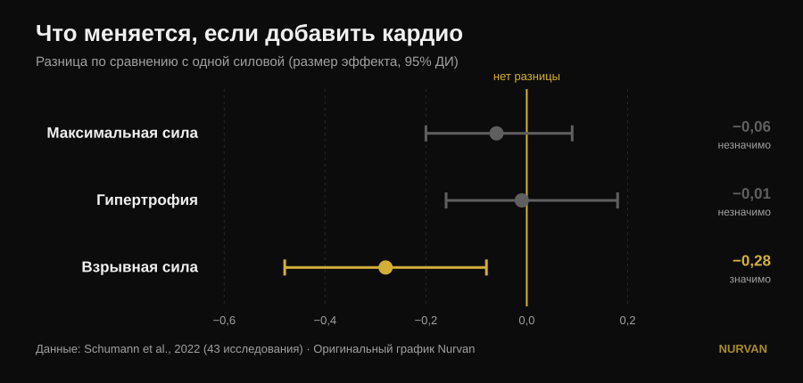
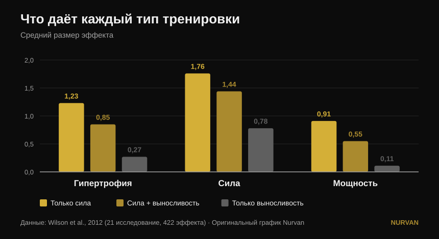

# Тренировать всё сразу или специализироваться на одном?

Автор: [Giammaria Loi](/autore/giammaria-loi) · обновлено 14 октября 2026

Популярный пост утверждает, что специализация на одном физическом качестве даёт худший результат и что в любой программе должны быть сразу шесть качеств: мощность, сила, гипертрофия, выносливость, подвижность и атлетизм. Под постом трое разных читателей спрашивают одно и то же: а где исследование? Его нет. Вот источники — и они рассказывают более точную историю, в которой одно из шести качеств действительно страдает, но не то, которое вы ожидаете.

## Коротко

- **Добавленная аэробная работа не стоит вам ни максимальной силы, ни мышечной массы.** В 43 исследованиях разница с теми, кто занимался только с железом, практически нулевая: −0,06 по максимальной силе и −0,01 по гипертрофии, оба показателя незначимы (Schumann et al., 2022).
- **А вот мощность она отнимает.** Взрывная сила снижается статистически значимо (−0,28, p = 0,007). Это единственное качество из списка поста, которое платит реальную цену.
- **И цена зависит от расписания, а не от мотивации.** Падение мощности выражено, когда железо и кардио стоят в одной тренировке, и исчезает, когда их разделяют хотя бы 3 часа (Schumann et al., 2022).
- **Это работает не для всех одинаково.** Интерференция по силе ног проявляется у мужчин (−0,43) и не проявляется у женщин (0,08), различие между группами значимо (Huiberts et al., 2024).
- **Правильный вопрос — не «всё сразу или по очереди».** Сила и масса сохраняются до 32 недель при **одной тренировке в неделю и одном подходе на упражнение**, если относительная нагрузка остаётся высокой (Spiering et al., 2021). Одно качество продвигаем, остальные держим на минимуме.

## Дилемма поставлена неверно

Мысль поста проста: тренировать по одному качеству за раз — это «минимальный и узкий» прогресс, тренировать всё вместе — больший. Интуиция симпатичная, но ни одно исследование никогда не сравнивало напрямую специализированную программу с мультимодальной, суммируя итоги. Литература сравнивает другое, куда более полезное: что происходит с силой, массой и мощностью, **когда к одинаковой силовой программе добавляют аэробную работу**.

На этот вопрос есть надёжный ответ, построенный на 43 контролируемых исследованиях, где силовая программа у групп была идентичной и менялось только добавление выносливости (Schumann et al., 2022):

*Стандартизованные средние разности относительно тех, кто занимался только силовой, с 95-процентным доверительным интервалом. Интервал, пересекающий ноль, означает, что разница не доказана. Данные Schumann et al., 2022 (43 исследования). Оригинальный график Nurvan.*

Два интервала из трёх пересекают ноль: **по максимальной силе и по гипертрофии кардио не отнимает ничего**. Третий — нет. Взрывная сила — прыжок, бросок, ускорение — действительно снижается.

Обзор 2026 года, объединивший семнадцать метаанализов, приходит к тому же с другой стороны: кто тренирует силу и выносливость вместе, получает **больше аэробных возможностей**, чем те, кто занимается только с железом (0,77, p = 0,02), и **сопоставимые**, а не лучшие результаты по силе, мощности и гипертрофии (Held et al., 2026). Те же авторы предупреждают: данных по элитным спортсменам мало — а ведь именно там специализация весит больше всего, и именно там науке есть что сказать меньше всего.

## Что на самом деле говорят исследования

### «Специализация на одном качестве даёт худший результат» — **Требует уточнения**

Исследования показывают *равенство*, а не превосходство одного над другим. Тот, кто добавляет кардио, не получает больше силы или массы, чем тот, кто сосредоточен только на железе: он получает столько же плюс аэробные возможности в подарок. Это отличный аргумент против страха перед кондиционной работой. Но это не аргумент против того, кто на один блок решил продвигать что-то одно.

### «Тренируя всё вместе, получаешь больше» — **Требует уточнения**

Больше по числу качеств, а не больше в каждом. Общий охват расширяется, отдельные результаты остаются теми же. Эта разница важна, когда впереди соревнование, весовая категория или срок.

### «Кондиционная работа ничего не стоит» — **Опровергнуто, для мощности**

Здесь пост промахивается, и промахивается ровно по тому качеству, которое ставит на первое место. Взрывная сила платит: −0,28, доверительный интервал не касается нуля (Schumann et al., 2022). Самое интересное — почему: **падение выражено, когда обе части стоят в одной тренировке (p = 0,043), и больше не проявляется, если их разделяют хотя бы три часа**. Это не биологическая неизбежность, а вопрос расписания.

Более старая и более подробная картина говорит то же самое «сырыми» размерами эффекта (Wilson et al., 2012):

*Средние размеры эффекта по 21 исследованию и 422 сравнениям. По мощности различия между всеми тремя группами статистически значимы; по гипертрофии и силе отстаёт только чистая выносливость. Данные Wilson et al., 2012. Оригинальный график Nurvan.*

В той же работе видны два модератора, которых пост не называет: **бег снижает гипертрофию и силу, велосипед — нет**, а величина интерференции растёт с частотой аэробных занятий (корреляции от −0,26 до −0,35) и особенно с их продолжительностью (от −0,29 до −0,75). Дело не в «кардио», а в том, сколько, какого вида и когда.

### «Это касается всех» — **Требует уточнения**

Один из комментаторов под постом спрашивает, где результаты по женщинам. Отличный вопрос, и ответ есть. По 59 исследованиям и 1346 участникам интерференция по силе ног проявляется **у мужчин (−0,43) и не проявляется у женщин (0,08)**, различие между группами статистически значимо (p = 0,03). По силе верха тела, мощности и максимальному потреблению кислорода различий между полами нет (Huiberts et al., 2024).

### «Подвижность — отдельный обязательный блок» — **Требует уточнения**

Если тренировать силу в полной амплитуде, часть работы над подвижностью уже сделана. По 11 контролируемым исследованиям и 452 участникам силовая тренировка и растяжка **не различаются** по приросту амплитуды (−0,22, p = 0,206), и это держится во всех проанализированных подгруппах (Afonso et al., 2021). Авторы подчёркивают высокую разнородность исследований, так что это не разрешение бросить растяжку при конкретном ограничении — но одна из шести клеток частично заполняется сама.

### «По одному качеству за раз — минимальный прогресс» — **Опровергнуто в обратную сторону**

Чередовать акцент во времени — не недостаток, а определение периодизации, и для максимальной силы она работает лучше, чем её отсутствие. При выровненном объёме, по 35 исследованиям, периодизированные программы превосходят непериодизированные в 1ПМ (0,31, p = 0,02), тогда как **по гипертрофии не меняется ничего** (0,13, p = 0,27). А между линейной и волновой периодизацией преимущество волновой в 1ПМ есть только у тренированных (0,61) и исчезает у новичков (0,06) (Moesgaard et al., 2022).

Перевод: если нужна масса, порядок почти не важен и можно делать всё вместе без сожалений. Если нужен максимум, нужна организация во времени — а «всегда всё сразу» организацией не является.

## Вопрос, который пост не задаёт

У дилеммы «шесть качеств вместе или по одному» есть третий член, которого не называет ни одна из сторон: **как мало нужно, чтобы не потерять уже построенное**. Ответ собирали исследование за исследованием, и он удивительно мал (Spiering et al., 2021):

| Качество | Минимальная доза для поддержания | Как долго | Условие |
|---|---|---|---|
| Сила и масса (до 40 лет) | 1 тренировка в неделю, 1 подход на упражнение | до 32 недель | относительная нагрузка остаётся высокой |
| Мышечная масса (пожилой возраст) | 2 тренировки в неделю, 2-3 подхода | — | относительная нагрузка остаётся высокой |
| Аэробные возможности | 2 занятия в неделю или объём, урезанный на 33-66% (даже 13-26 минут) | до 15 недель | рабочий пульс остаётся высоким |

Переменная, которую нельзя урезать, всегда одна и та же: **интенсивность**. Объём и частоту можно снижать очень сильно, вес или темп — нет.

Это меняет весь разговор. Вы не выбираете между шестью плохо тренированными качествами и одним хорошо тренированным. Вы продвигаете одно качество шесть-восемь недель, а остальные ставите в **режим поддержания** — одна тренировка или один подход. Именно так тренеры строят разностороннего атлета, не сжигая его, и это ровно та середина, которую пост объявляет невозможной.

## Как это применить

1. **Выберите один приоритет на ближайшие 6-8 недель.** Один: максимум, масса или кондиция. Остальное не бросаем, а замедляем.
2. **Остальное держите на минимальной дозе.** Одной тренировки в неделю с парой тяжёлых подходов хватает, чтобы месяцами сохранять силу и массу (Spiering et al., 2021). Важно, чтобы вес оставался близким к рабочему, а не чтобы объём оставался большим.
3. **Разводите железо и кондицию минимум на 3 часа** или по разным дням, если вам важна мощность (Schumann et al., 2022). Если объединять приходится, ставьте железо первым: такова тенденция в самом свежем обзоре (Held et al., 2026).
4. **Выбирайте вид кардио.** Велосипед не мешает, бег мешает — особенно долгий и частый (Wilson et al., 2012). Если бегать нужно, а ноги всё же хочется построить, держите пробежки короткими.
5. **Не записывайте подвижность в отдельный блок по умолчанию.** Тренируйте силу в полной амплитуде и добавляйте точечную работу только там, где есть реальное ограничение (Afonso et al., 2021). Наш разбор [как выбирать подходы и повторения](/ru/blog/skolko-povtoreniy-dlya-massy) поможет собрать силовую часть.
6. **Измеряйте, а не угадывайте.** Интерференцию не чувствуют — её видят в цифрах. Если после четырёх недель кондиционной работы прыжок или скорость штанги просели, а рабочие веса держатся, вы нашли ровно ту цену, о которой пишут исследования.

> ### 💡 С Nurvan
> **Тренировать несколько качеств сразу имеет смысл, только если видно, какое из них проседает.** В Nurvan разные программы и дисциплины живут в одном дневнике — сила, гипертрофия, functional, HYROX — с весом, повторениями и RIR, записанными подход за подходом, и с историей всегда рядом для сравнения. Так «режим поддержания» становится тем, что вы действительно проверяете, а не тем, на что надеетесь: если максимум падает, пока кондиция растёт, вы заметите это через две недели, а не через два месяца. [Попробовать Nurvan](https://nurvan.app)

## Частые вопросы

**Кардио «съедает» мышцы?**
Нет. По 43 контролируемым исследованиям добавление аэробной работы к идентичной силовой программе не меняет ни гипертрофию (−0,01, p = 0,919), ни максимальную силу (−0,06, p = 0,446) (Schumann et al., 2022). Страдает только взрывная сила.

**Кардио и силовую в один день или в разные?**
Если важна мощность — разводите: падение взрывной силы выражено, когда обе части в одной тренировке, и больше не проявляется при интервале хотя бы в три часа (Schumann et al., 2022). Если важны только сила и масса, расписание значит гораздо меньше.

**Сколько нужно тренироваться, чтобы не растерять набранную силу?**
У взрослых до 40 лет одна тренировка в неделю с одним подходом на упражнение сохраняла силу и массу до 32 недель при условии, что относительная нагрузка оставалась высокой (Spiering et al., 2021). Режут объём, но не интенсивность.

**Обязательно ли тренировать шесть качеств, как говорит пост?**
Нет источника, который устанавливал бы обязательное число качеств или доказывал «синергию» между ними. Источники показывают другое: несколько качеств можно тренировать вместе, не теряя ни силы, ни массы, а те, которые вы сейчас не продвигаете, сохраняются очень малой работой. Правильное число зависит от вашей цели, а не от правила.

## Читайте также

- [Сплит: новичок и продвинутый — в чём разница](/ru/blog/split-trenirovok-novichok-prodvinutyy)
- [Сколько повторений нужно для роста мышц: миф 8-12](/ru/blog/skolko-povtoreniy-dlya-massy)
- [Разгибания ног или жим ногами: что растёт](/ru/blog/razgibaniya-nog-ili-zhim-nogami-pryamaya-myshtsa-bedra)

## Источники

1. Schumann M, Feuerbacher JF, Sünkeler M, Freitag N, Rønnestad BR, Doma K, Lundberg TR, 2022. *Compatibility of Concurrent Aerobic and Strength Training for Skeletal Muscle Size and Function: An Updated Systematic Review and Meta-Analysis.* Sports Med 52(3):601–612. PMID 34757594 — [doi:10.1007/s40279-021-01587-7](https://doi.org/10.1007/s40279-021-01587-7)
2. Held S, Wolf L, Rappelt L, Bloch W, Donath L, Micke F, Geisler S, Isenmann E, 2026. *Maximizing Adaptations in Concurrent Training: An Umbrella Review of Meta-analyses.* Sports Med 56(6):1489–1512. PMID 41762427 — [doi:10.1007/s40279-026-02401-y](https://doi.org/10.1007/s40279-026-02401-y)
3. Wilson JM, Marin PJ, Rhea MR, Wilson SMC, Loenneke JP, Anderson JC, 2012. *Concurrent training: a meta-analysis examining interference of aerobic and resistance exercises.* J Strength Cond Res 26(8):2293–2307. PMID 22002517 — [doi:10.1519/JSC.0b013e31823a3e2d](https://doi.org/10.1519/JSC.0b013e31823a3e2d)
4. Huiberts RO, Wüst RCI, van der Zwaard S, 2024. *Concurrent Strength and Endurance Training: A Systematic Review and Meta-Analysis on the Impact of Sex and Training Status.* Sports Med 54(2):485–503. PMID 37847373 — [doi:10.1007/s40279-023-01943-9](https://doi.org/10.1007/s40279-023-01943-9)
5. Spiering BA, Mujika I, Sharp MA, Foulis SA, 2021. *Maintaining Physical Performance: The Minimal Dose of Exercise Needed to Preserve Endurance and Strength Over Time.* J Strength Cond Res 35(5):1449–1458. PMID 33629972 — [doi:10.1519/JSC.0000000000003964](https://doi.org/10.1519/JSC.0000000000003964)
6. Moesgaard L, Beck MM, Christiansen L, Aagaard P, Lundbye-Jensen J, 2022. *Effects of Periodization on Strength and Muscle Hypertrophy in Volume-Equated Resistance Training Programs: A Systematic Review and Meta-analysis.* Sports Med 52(7):1647–1666. PMID 35044672 — [doi:10.1007/s40279-021-01636-1](https://doi.org/10.1007/s40279-021-01636-1)
7. Afonso J, Ramirez-Campillo R, Moscão J, Rocha T, Zacca R, Martins A, Milheiro AA, Ferreira J, Sarmento H, Clemente FM, 2021. *Strength Training versus Stretching for Improving Range of Motion: A Systematic Review and Meta-Analysis.* Healthcare (Basel) 9(4):427. PMID 33917036 — [doi:10.3390/healthcare9040427](https://doi.org/10.3390/healthcare9040427)

*Библиографические данные проверены в PubMed. Отправная точка: пост [John Rusin](https://www.instagram.com/p/Ddv-zwDkZ0F/), в котором нет ссылок на источники. Ни текст, ни изображения поста не воспроизводились: тема и утверждения переписаны заново и проверены по первоисточникам.*

---

**Giammaria Loi** — основатель Nurvan. Тренируется с отягощениями с 2012 года, работает персональным тренером и коучем с сертификацией FIPE с 2013 года и выступает в пауэрлифтинге на национальном уровне с 2018 года. Каждая его статья начинается с научных работ и заканчивается тем, что действительно работает в зале. [Страница автора](/autore/giammaria-loi)

> Примечание: информационный материал, не заменяющий консультацию врача или профильного специалиста. При наличии заболеваний или назначенного лечения обсудите изменения тренировочной программы с врачом.
