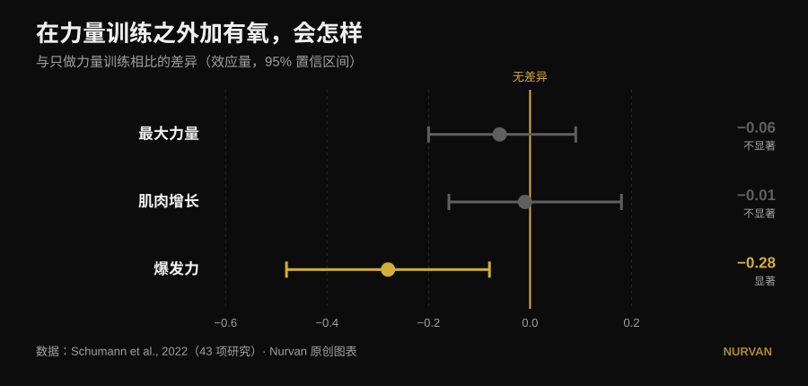
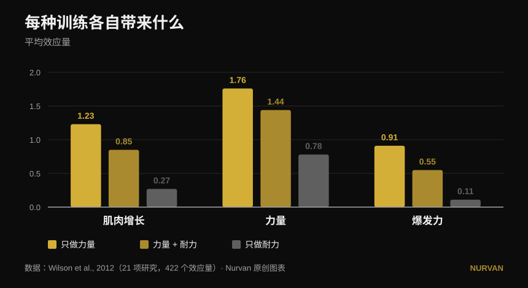

# 所有素质一起练，还是专精一项？

作者 [Giammaria Loi](/autore/giammaria-loi) · 更新于 2026 年 10 月 14 日

一条被大量转发的帖子说：只专精一项身体素质，结果反而更差；任何计划都应该同时包含六项——爆发力、力量、肌肥大、体能、灵活性和运动能力。帖子底下，三位不同的读者问了同一句话：研究在哪里？没有。下面就是这些来源，而它们讲出的故事更精确：六项里确实有一项真的被拖累了，只是不是你以为的那一项。

## 快速要点

- **加入有氧训练，不会让你少练出力量，也不会少长肌肉。** 43 项研究中，与只练力量的人相比差距几乎为零：最大力量 −0.06、肌肥大 −0.01，两者都不显著（Schumann et al., 2022）。
- **但它确实会削弱爆发力。** 爆发力的下降具有统计学显著性（−0.28，p = 0.007）。这是帖子所列素质中唯一真正付出代价的一项。
- **而这个代价取决于日程，不取决于努力程度。** 当力量和有氧放在同一次训练里时，爆发力的削弱很明显；当两者间隔至少 3 小时，这种削弱就消失了（Schumann et al., 2022）。
- **而且并非人人相同。** 下肢力量的干扰出现在男性身上（−0.43），女性则没有（0.08），组间差异具有显著性（Huiberts et al., 2024）。
- **真正该问的不是"一起练还是一项一项练"。** 只要相对负荷保持够重，**每周一次训练、每个动作一组**就能把力量和肌肉维持长达 32 周（Spiering et al., 2021）。推进一项素质，其余用极少的量维持。

## 这个两难问题本身就问错了

帖子的想法很简单：一次只练一项素质，收益"既小又窄"；全部一起练，收益更多。这个直觉很讨喜，但从来没有研究直接把"专精计划"和"多模式计划"放在一起比总分。文献真正比较的是另一件更有用的事：**在完全相同的力量计划上加入有氧训练后**，力量、肌肉和爆发力会怎样。

这个问题有扎实的答案，来自 43 项对照研究——各组的力量计划完全相同，只有是否加入耐力训练不同（Schumann et al., 2022）：

*相对于只练力量者的标准化均数差，附 95% 置信区间。区间跨过零，意味着没有证据表明存在差异。数据来自 Schumann et al., 2022（43 项研究）。Nurvan 原创图表。*

三条里有两条跨过了零：**在最大力量和肌肥大上，有氧什么也没拿走**。第三条没有。爆发力——跳、投、加速——是真的下降了。

2026 年一篇汇总了十七项荟萃分析的综述，从另一个角度得出同样的结论：同时练力量和耐力的人，**有氧能力更好**（0.77，p = 0.02），而力量、爆发力和肌肥大则是**相当**，而非更优（Held et al., 2026）。这些作者也提醒：精英运动员的数据很少——而专精恰恰在那个层级最重要，研究能说的却最少。

## 研究到底说了什么

### "专精一项素质结果更差" —— **需要修正**

研究显示的是*相当*，不是更差。加入有氧的人，并没有比只练力量的人获得更多力量或肌肉：他获得的一样多，外加白送的有氧能力。这是个很好的理由，让你不必害怕体能训练。但它不是反对某人在一个周期里专心推进一件事的理由。

### "全部一起练收获更多" —— **需要修正**

是练到的素质更多，不是每一项都更多。总的覆盖面更广，单项成绩还是那样。当你有比赛、有体重级别、有截止日期时，这个差别就很重要。

### "体能训练不花你任何代价" —— **被推翻（就爆发力而言）**

帖子在这里打偏了，而且偏在它排在第一位的那项素质上。爆发力要付代价：−0.28，置信区间完全不碰零（Schumann et al., 2022）。有意思的是原因：**当两部分放进同一次训练时削弱明显（p = 0.043），而间隔至少三小时后就不再出现**。这不是生理上的宿命，而是排期问题。

更早、更细的那幅图景，用原始效应量说了同样的话（Wilson et al., 2012）：

*21 项研究、422 次比较的平均效应量。在爆发力上，三组之间的差异都具有统计学显著性；在肌肥大和力量上，只有单纯耐力明显落后。数据来自 Wilson et al., 2012。Nurvan 原创图表。*

同一篇研究里还有两个帖子没提到的调节因素：**跑步会削弱肌肥大和力量，骑车不会**；干扰的幅度随耐力训练的频率（相关系数 −0.26 至 −0.35）、尤其是单次时长（−0.29 至 −0.75）而增大。问题不在"有氧"，而在于量多少、哪一种、什么时候做。

### "这对谁都适用" —— **需要修正**

帖子下有人问：女性的结果在哪里？问得很好，而且有答案。在 59 项研究、1346 名受试者中，下肢力量的干扰**出现在男性（−0.43），不出现在女性（0.08）**，两组差异具有统计学显著性（p = 0.03）。在上肢力量、爆发力和最大摄氧量上，男女之间没有任何差别（Huiberts et al., 2024）。

### "灵活性是另一个必做模块" —— **需要修正**

如果你在完整活动范围内练力量，一部分灵活性训练其实已经做了。在 11 项对照试验、452 名受试者中，力量训练与拉伸在活动度增益上**没有差别**（−0.22，p = 0.206），而且在所有分析过的亚组中都成立（Afonso et al., 2021）。作者强调这些研究异质性很高，所以如果你有具体的活动受限，这并不是停止拉伸的许可——但六个格子里，有一个会部分自己填上。

### "一次练一项，收益最小" —— **反方向被推翻**

随时间轮换重点不是缺点：这正是周期化的定义，而且在最大力量上，它比不做周期化更有效。在训练量对齐的前提下，35 项研究显示周期化计划在 1RM 上优于非周期化（0.31，p = 0.02），而**肌肥大毫无变化**（0.13，p = 0.27）。在线性与波动周期化之间，波动式在 1RM 上的优势只存在于训练有素者（0.61），在新手身上消失（0.06）（Moesgaard et al., 2022）。

翻译一下：要肌肉，顺序影响不大，全部一起练也无妨；要最大重量，就需要时间上的组织——而"永远什么都一起练"并不是一种组织。

## 帖子没有问的那个问题

"六项一起练还是一项一项练"这个两难，有一个双方都没提的第三项：**要不丢掉已经练出来的东西，需要的量有多小**。答案是一项研究一项研究累积起来的，而且低得惊人（Spiering et al., 2021）：

| 素质 | 维持所需的最小量 | 能维持多久 | 条件 |
|---|---|---|---|
| 力量与肌肉（40 岁以下） | 每周 1 次训练，每个动作 1 组 | 长达 32 周 | 相对负荷保持够重 |
| 肌肉量（年长者） | 每周 2 次训练，2-3 组 | — | 相对负荷保持够重 |
| 有氧能力 | 每周 2 次，或把训练量砍掉 33-66%（低至 13-26 分钟） | 长达 15 周 | 工作心率保持够高 |

唯一不能削减的变量始终是同一个：**强度**。训练量和频率可以大幅下调，负重或配速不行。

这就把整场讨论都改变了。你不是在"六项都练不好"和"只练好一项"之间二选一。你用六到八周推进一项素质，把其余的放进**维持模式**——一次训练或一组就够。教练就是这样打造全面运动员而不把人练垮的，而这恰恰是帖子宣称不可能的那条中间道路。

## 怎么执行

1. **为接下来的 6-8 周选定一个优先项。** 只选一个：最大力量、肌肉，或体能。其他的不是放弃，只是放慢。
2. **其余的用最小量养着。** 每周一次、几组大重量，就能把力量和肌肉保住好几个月（Spiering et al., 2021）。关键是重量仍接近你原来用的，而不是训练量仍然很大。
3. **若你在意爆发力，把力量训练和体能训练至少隔开 3 小时**，或者放在不同的日子（Schumann et al., 2022）。如果必须合并，先练力量：这是最新综述呈现的倾向（Held et al., 2026）。
4. **挑对有氧方式。** 骑车不干扰，跑步会——尤其是又长又频繁的跑（Wilson et al., 2012）。如果非跑不可又想练腿，就把单次时长压短。
5. **别默认把灵活性算成额外模块。** 在完整活动范围内练力量，只在真正有受限的地方加针对性训练（Afonso et al., 2021）。我们关于[如何选择组数和次数](/zh/blog/duoshao-cishu-zengji)的分析，能帮你搭好力量那一块。
6. **去测量，别靠感觉。** 干扰是感觉不到的，只能在数字里看到。如果四周体能训练之后，你的弹跳或杠铃速度掉了，而负重还顶得住，那你就找到了研究所说的那个代价。

> ### 💡 用 Nurvan
> **同时练多项素质，只有在你能看出哪一项正在下滑时才行得通。** 在 Nurvan 里，不同的计划和项目都在同一本训练日志中——力量、肌肥大、功能性、HYROX——负重、次数和 RIR 一组一组记录，历史数据随时可以对照。于是"维持模式"变成你真正能验证的东西，而不是一种指望：如果最大重量在掉、体能在涨，你两周就会发现，而不是两个月。[试用 Nurvan](https://nurvan.app)

## 常见问题

**做有氧会掉肌肉吗？**
不会。43 项对照研究显示，在完全相同的力量计划上加入有氧训练，既不改变肌肥大（−0.01，p = 0.919），也不改变最大力量（−0.06，p = 0.446）（Schumann et al., 2022）。唯一受影响的是爆发力。

**有氧和力量该同一天还是不同天？**
如果你在意爆发力，就分开：当两者在同一次训练里时，爆发力的削弱很明显；间隔至少三小时后就不再出现（Schumann et al., 2022）。如果你只关心力量和肌肉，排期的影响要小得多。

**要练多少才能不丢掉已有的力量？**
在 40 岁以下的成年人中，只要相对负荷保持够重，每周一次训练、每个动作一组，就把力量和肌肉维持了长达 32 周（Spiering et al., 2021）。可以砍量，绝不能砍强度。

**我必须像帖子说的那样练六项素质吗？**
没有任何来源规定了必须练几项素质，也没有任何来源证明它们之间存在"协同"。来源证明的是：你可以同时练好几项而不损失力量和肌肉，而且你暂时没在推进的那些素质，用极少的训练就能保住。合适的数量取决于你的目标，而不是某条规则。

## 延伸阅读

- [训练分化：新手和高手该一样吗](/zh/blog/xunlian-fenhua-xinshou-gaoji)
- [增肌每组做多少次？8-12 次的迷思](/zh/blog/duoshao-cishu-zengji)
- [腿屈伸还是倒蹬机：到底哪块肌肉在长](/zh/blog/tuibu-shenzhan-vs-dengtui-gusizhiji)

## 参考文献

1. Schumann M, Feuerbacher JF, Sünkeler M, Freitag N, Rønnestad BR, Doma K, Lundberg TR, 2022. *Compatibility of Concurrent Aerobic and Strength Training for Skeletal Muscle Size and Function: An Updated Systematic Review and Meta-Analysis.* Sports Med 52(3):601–612. PMID 34757594 — [doi:10.1007/s40279-021-01587-7](https://doi.org/10.1007/s40279-021-01587-7)
2. Held S, Wolf L, Rappelt L, Bloch W, Donath L, Micke F, Geisler S, Isenmann E, 2026. *Maximizing Adaptations in Concurrent Training: An Umbrella Review of Meta-analyses.* Sports Med 56(6):1489–1512. PMID 41762427 — [doi:10.1007/s40279-026-02401-y](https://doi.org/10.1007/s40279-026-02401-y)
3. Wilson JM, Marin PJ, Rhea MR, Wilson SMC, Loenneke JP, Anderson JC, 2012. *Concurrent training: a meta-analysis examining interference of aerobic and resistance exercises.* J Strength Cond Res 26(8):2293–2307. PMID 22002517 — [doi:10.1519/JSC.0b013e31823a3e2d](https://doi.org/10.1519/JSC.0b013e31823a3e2d)
4. Huiberts RO, Wüst RCI, van der Zwaard S, 2024. *Concurrent Strength and Endurance Training: A Systematic Review and Meta-Analysis on the Impact of Sex and Training Status.* Sports Med 54(2):485–503. PMID 37847373 — [doi:10.1007/s40279-023-01943-9](https://doi.org/10.1007/s40279-023-01943-9)
5. Spiering BA, Mujika I, Sharp MA, Foulis SA, 2021. *Maintaining Physical Performance: The Minimal Dose of Exercise Needed to Preserve Endurance and Strength Over Time.* J Strength Cond Res 35(5):1449–1458. PMID 33629972 — [doi:10.1519/JSC.0000000000003964](https://doi.org/10.1519/JSC.0000000000003964)
6. Moesgaard L, Beck MM, Christiansen L, Aagaard P, Lundbye-Jensen J, 2022. *Effects of Periodization on Strength and Muscle Hypertrophy in Volume-Equated Resistance Training Programs: A Systematic Review and Meta-analysis.* Sports Med 52(7):1647–1666. PMID 35044672 — [doi:10.1007/s40279-021-01636-1](https://doi.org/10.1007/s40279-021-01636-1)
7. Afonso J, Ramirez-Campillo R, Moscão J, Rocha T, Zacca R, Martins A, Milheiro AA, Ferreira J, Sarmento H, Clemente FM, 2021. *Strength Training versus Stretching for Improving Range of Motion: A Systematic Review and Meta-Analysis.* Healthcare (Basel) 9(4):427. PMID 33917036 — [doi:10.3390/healthcare9040427](https://doi.org/10.3390/healthcare9040427)

*文献信息已在 PubMed 上核对。起点：[John Rusin](https://www.instagram.com/p/Ddv-zwDkZ0F/) 的帖子，该帖未提供任何来源。本文未复制该帖的任何文字或图片：主题与说法均重新撰写，并以一手文献核实。*

---

**Giammaria Loi** 是 Nurvan 的创始人。他自 2012 年开始进行力量训练，自 2013 年起担任 FIPE 认证私人教练，并自 2018 年起参加全国级别的力量举比赛。他署名的每篇文章都从科学研究出发，落到健身房里真正有效的做法。[作者页面](/autore/giammaria-loi)

> 提示：本文为科普内容，不能替代医生或专业人士的意见。如果你有疾病或正在接受治疗，请在调整训练计划前咨询医生。
