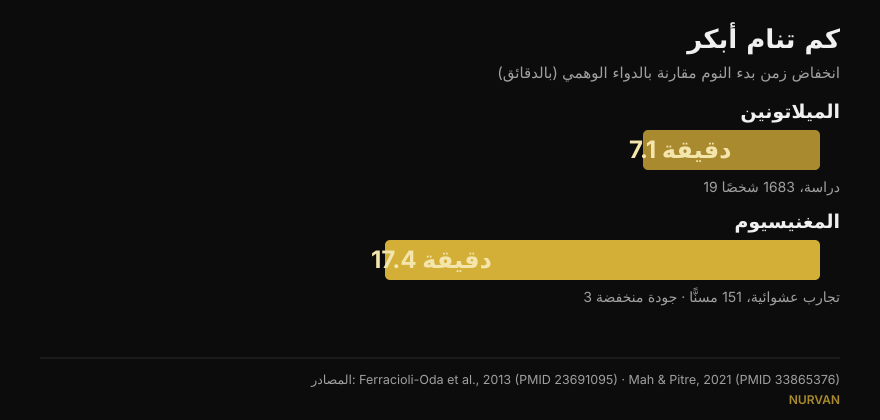
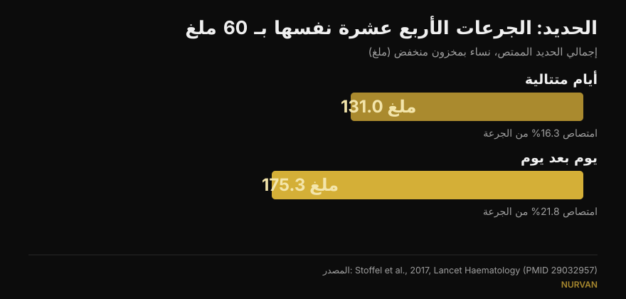

# متى تتناول المكملات: هل التوقيت مهم فعلاً؟

بقلم [جياماريا لوي](/autore/giammaria-loi) · تحديث 15 أكتوبر 2026

يأتي كل مكمل تقريباً ومعه قاعدة عن موعد تناوله: الميلاتونين قبل النوم بنصف ساعة، الحديد على معدة فارغة، الكرياتين مباشرة بعد التمرين. منشور أثار نقاشاً واسعاً يقول إن هذه القاعدة لا تغيّر شيئاً تقريباً في معظم الحالات، ويستند إلى ثماني مراجع. قرأتها كلها: موجودة فعلاً وفي صلب الموضوع، وهذا في محتوى اللياقة على وسائل التواصل خبر بحد ذاته. لكن في ثلاث حالات يخفي الرقم المذكور تفصيلاً يغيّر طريقة استخدامك له، كما أن أكثر المعلومات فائدة لمن يتدرّب غائبة تماماً.

## باختصار

- **يحرّك الميلاتونين الساعة البيولوجية في وقت متأخر من بعد الظهر أساساً، ولا يكاد يحرّكها في النصف الأول من الليل.** مؤكَّد: لدى 27 بالغاً بلغ أقصى تقديم 1.8 ساعة، مع «منطقة ميتة» في بداية النوم (Burgess et al., 2008).
- **لكن من يتناوله قبل النوم لا يريد تحريك ساعة: يريد أن ينام.** هذا الأثر، الذي يمرّ عليه المنشور مروراً سريعاً، يساوي نحو **7 دقائق** من زمن بدء النوم (Ferracioli-Oda et al., 2013).
- **الحديد هو الحالة التي يحسم فيها التوقيت فعلاً**، لكن المتغيّر ليس الساعة بل الفاصل الزمني. عند التناول يوماً بعد يوم امتُصّ **175 ملغ مقابل 131 ملغ** بالجرعات نفسها (Stoffel et al., 2017). لدى نساء بمخزون منخفض، لا لدى الجميع.
- **رقم «+57%» الخاص بفيتامين د جاء من 17 مريضاً دون مجموعة ضابطة**، وبتباين هائل (±36.7%). المبدأ — تناوله مع أدسم وجبة — صحيح؛ أما الرقم فلا.
- **ما ينقص المنشور**: التوقيت المهم فعلاً في الصالة لا يخصّ الحبوب بل البروتين، وهناك يقول التحليل البعدي إن الأثر يختفي بمجرد أخذ إجمالي البروتين اليومي في الحسبان (Schoenfeld et al., 2013).

## منشور متنازع عليه، لكن مراجعه في مكانها الصحيح

في التعليقات يُتَّهم المنشور بأنه من إنتاج ذكاء اصطناعي: قارئ يقول إن الرسم البياني للميلاتونين خاطئ، وآخر إن شريحة الحديد تناقض نفسها، وثالث يطلب ببساطة شرحاً أوضح. انتقادات مشروعة للشكل. أما في المضمون فجميع أرقام PMID الثمانية موجودة، وتخصّ فعلاً الموضوعات المرتبطة بها، وتذكر في معظمها الأرقام المنسوبة إليها. هذه نتيجة أفضل من متوسط ما نتحقق منه هنا.

المشكلة ليست في المراجع، بل فيما بينها: رقم صحيح، إذا انتُزع من السياق الذي قيس فيه، يتحول إلى قاعدة قد لا تنطبق عليك.

## الميلاتونين: تحريك الساعة والنوم شيئان مختلفان

هذه النقطة أربكت أغلب القراء، والارتباك له ما يبرره: الميلاتونين يؤدي مهمتين منفصلتين.

الأولى هي **تحريك الساعة البيولوجية**. الدراسة المذكورة متينة: أعطى بورغس وزملاؤه 3 ملغ من الميلاتونين لـ 27 بالغاً يعيشون بلا قيود زمنية، وبنوا منحنى يبيّن مقدار إزاحة الإيقاع بحسب ساعة التناول. أقصى تقديم يحدث في وقت متأخر من بعد الظهر، قبل نحو 5 ساعات من بدء إفراز الميلاتونين الطبيعي، ويبلغ **1.8 ساعة**. وفي النصف الأول من النوم المعتاد توجد منطقة يكاد الأثر فيها أن يكون معدوماً. ويخلص المؤلفون أنفسهم إلى أن استخدامه ليلاً كمنوّم أثره ضئيل جداً على إزاحة الطور. كل هذا ينقله المنشور بدقة.

المهمة الثانية هي **مساعدتك على النوم أسرع**. هذه آلية أخرى، والمنشور يتخلص منها بعبارة «قد يسبب النعاس على أي حال». كم؟ التحليل البعدي الأكثر استشهاداً — 19 دراسة و1683 شخصاً باضطرابات نوم أولية — يقيس انخفاضاً في زمن بدء النوم قدره **7.06 دقيقة** (فاصل ثقة 95%: 4.37-9.75) وزيادة 8.25 دقيقة في إجمالي النوم. متين إحصائياً، صغير سريرياً. هذا الرقم يغيّر توقعات أي شخص يشتري الميلاتونين، وهو غائب عن المنشور.

*رقمان لا يضعهما المنشور جنباً إلى جنب أبداً. انتبه لجودة الأدلة: رقم الميلاتونين من 19 دراسة، ورقم المغنيسيوم من 3 تجارب على مسنّين صنّفها المؤلفون أنفسهم بأنها منخفضة الجودة.*

## الحديد: هنا التوقيت مهم، لكن المتغيّر هو الفاصل

هنا المنشور محقّ تماماً، وهي أكثر الحالات الثماني إثارة للاهتمام. يرفع الحديد هرمون الهيبسيدين الذي يغلق الامتصاص، ويبقى الهيبسيدين مرتفعاً مدة كافية للإضرار بجرعة اليوم التالي.

في تجربة شتوفل وزملائها المنشورة في *Lancet Haematology*، تناولت نساء ذوات فيريتين منخفض 60 ملغ من الحديد لمدة 14 يوماً متتالياً، أو الجرعات الأربع عشرة نفسها يوماً بعد يوم على مدى 28 يوماً. النتيجة: **امتصاص 131.0 ملغ مقابل 175.3 ملغ**، أي 16.3% من الجرعة مقابل 21.8% (p = 0.0010). وتقسيم الجرعة اليومية إلى جرعتين لم يفد (p = 0.33) بل رفع الهيبسيدين أكثر.

*الجرعات نفسها ونتيجة مختلفة: يوماً بعد يوم يُمتَصّ نحو الثلث أكثر. تجربة على نساء بين 18 و40 عاماً بفيريتين ≤ 25 ميكروغرام/لتر.*

**ما لا يقوله المنشور**: المشاركات كنّ نساء استُنزف مخزون الحديد لديهنّ أصلاً. ليست نتيجة تخصّ عامة الناس، وتناول الحديد علاج يُضبط بناءً على تحاليل الدم، لا شيء يبدأه المرء لأنه يشعر بالتعب. ونظام «يوماً بعد يوم» موضوع تناقشه مع من وصف لك الحديد.

وعن القهوة المنشور دقيق: في دراسة مورك وزملائه عام 1983، القهوة المشروبة **قبل الوجبة بساعة** لم تخفض الامتصاص، في حين أن القهوة نفسها **بعد الوجبة بساعة** خفضته من نحو 5.9% إلى نحو 1.6%. لكن يجب التوضيح أن الحديث هناك عن حديد غير هيمي من وجبة طعام، لا عن قرص حديد، وأن مخزون المشاركين كان طبيعياً.

## فيتامين د وأوميغا-3: ليست الساعة، بل الوجبة

الآلية معروضة جيداً — كلاهما ذائب في الدهون، فالمهم هو دهن الوجبة التي يصل معها — لكن الأرقام تستحق قراءة أدق.

**فيتامين د، +57%.** الرقم منقول بدقة (56.7%)، لكنه من دراسة على **17 مريضاً بلا مجموعة ضابطة**: أشخاص لم يستجيبوا للعلاج وطُلب منهم نقل المكمل إلى أكبر وجبة. الانحراف المعياري ±36.7%، أي أن الزيادة تفاوتت تفاوتاً هائلاً بين شخص وآخر، والجرعات تراوحت بين 1000 و50000 وحدة دولية. تبقى النصيحة العملية معقولة ومجانية؛ أما «+57%» فليست وعداً.

**أوميغا-3، 3 أشخاص من 50.** صحيح أيضاً: مع وجبة قليلة الدهون، حافظ 3 فقط من 50 مشاركاً يتناولون صيغة الإستر الإيثيلي على نصف الامتصاص الذي حققوه مع وجبة دسمة على الأقل. والسياق الناقص مهم: تقارن الدراسة منتجاً بوصفة طبية بجرعة 4 غرامات مع منتج منافس، وهي موقّعة وممولة من الشركة التي تصنع ذلك المنافس — أي الفائز. هذا لا يجعلها خاطئة، لكنه تضارب مصالح ينبغي لشريحة أن تعلنه. ولمن يتناول زيت سمك عادياً من الصيدلية، الترجمة العملية بسيطة: مع وجبة، لا على معدة فارغة.

## الكرياتين والمغنيسيوم: أين يصيب المنشور وأين يتوقف باكراً

**الكرياتين.** قارنت التجربة المذكورة 5 غرامات قبل التمرين مقابل 5 غرامات بعده لدى 19 من هواة كمال الأجسام على مدى 4 أسابيع: لا فرق ذا دلالة إحصائية. والطريف أن المنشور أكثر حذراً من المؤلفين، إذ يخلصون إلى أن ما بعد التمرين «ربما كان أفضل» استناداً إلى *magnitude-based inference*، وهو منهج يُنتقد اليوم على نطاق واسع. وفي الاختبارات القياسية لا وجود للفرق. المهم في الكرياتين هو الانتظام لا الساعة: وضعناه في قمة [تصنيف مكملات القوة](/ar/blog/tasnif-mukammilat-alquwa).

**المغنيسيوم.** يقول المنشور إن من راجعوا دراسات النوم وصفوا الأدلة بأنها «دون المستوى». صحيح، والكلمة في المراجعة هي هذه بالضبط. لكن المراجعة نفسها، بجمع 3 تجارب عشوائية على 151 مسنّاً، تجد انخفاضاً في زمن بدء النوم قدره **17.36 دقيقة** (p = 0.0006): أكثر من ضعف الميلاتونين. بيقين أقل بكثير، وفي فئة سكانية مختلفة، وبعدد قليل جداً من الأشخاص. والتخلص منه بعبارة «أدلة دون المستوى» يدفن أغرب رقم في المنشور كله.

**الكافيين.** هنا المنشور مصيب: 400 ملغ قبل النوم بست ساعات تشوّش النوم بشكل قابل للقياس مقارنة بالدواء الوهمي. لكن ترجمة ذلك إلى «أربعة أكواب» هي نقطة الضعف، وقد أشار إليها أحد القراء: كمية الكافيين في الكوب تتفاوت تفاوتاً كبيراً. كتبنا عن ذلك بالتفصيل في [متى تتوقف عن القهوة](/ar/blog/alkafayin-walnawm-mata-tatawaqaf-an-alqahwa).

## ماذا تقول الأبحاث فعلاً

| ادّعاء المنشور | الحكم | السبب |
|---|---|---|
| الميلاتونين لا يكاد يحرّك الساعة إذا تُناول قبل النوم | **مؤكَّد** | منطقة ميتة في بداية النوم؛ أقصى تقديم 1.8 ساعة في آخر النهار (Burgess 2008) |
| «قد يسبب النعاس على أي حال» | **يحتاج توضيحاً** | الأثر موجود لكنه يساوي 7.06 دقيقة أقل من زمن بدء النوم (Ferracioli-Oda 2013) |
| الكافيين قبل النوم بست ساعات يشوّش النوم | **مؤكَّد** | 400 ملغ عند 0 و3 و6 ساعات: الثلاثة ذات دلالة مقابل الدواء الوهمي (Drake 2013) |
| الحديد يوماً بعد يوم: 175 ملغ مقابل 131 ملغ | **مؤكَّد** | لكن لدى نساء بفيريتين ≤ 25 ميكروغرام/لتر، لا لدى عامة الناس (Stoffel 2017) |
| القهوة قبل ساعة غير ضارة وبعد ساعة ضارة | **مؤكَّد** | من 5.88% إلى 1.64%؛ تخصّ حديد الوجبة لا القرص (Morck 1983) |
| فيتامين د مع أكبر وجبة: +57% | **يحتاج توضيحاً** | 17 مريضاً، بلا مجموعة ضابطة، تباين ±36.7% (Mulligan 2010) |
| أوميغا-3: 3 من 50 مع وجبة قليلة الدهون | **يحتاج توضيحاً** | دراسة من شركة المنتج الفائز، جرعة 4 غرامات بوصفة (Davidson 2012) |
| الكرياتين: قبل أو بعد لا فرق | **مؤكَّد** | لا فرق في الاختبارات القياسية؛ المؤلفون يخلصون للعكس بمنهج منتقد (Antonio 2013) |
| المغنيسيوم: أدلة دون المستوى | **يحتاج توضيحاً** | صحيح من حيث الجودة، لكن الأثر المقيس −17.36 دقيقة من زمن بدء النوم (Mah 2021) |

## التوقيت المهم فعلاً، والغائب عن المنشور

إذا كنت تتدرّب، فسؤال التوقيت الذي تطرحه على نفسك حقاً لا يخصّ الميلاتونين: يخصّ البروتين، أي «النافذة الابتنائية» الشهيرة.

جمع تحليل الانحدار البعدي لشونفيلد وأراغون وكريغر 23 دراسة عن تضخم العضلات و20 عن القوة. في تحليل بسيط بدا تناول البروتين حول التمرين وكأنه يمنح ميزة صغيرة إلى متوسطة في التضخم. لكن حين ضبط المؤلفون المتغيرات المصاحبة اختفى هذا الأثر: أقوى مؤشر على نمو العضلة كان **إجمالي البروتين اليومي**، لا ساعة تناوله. ففي تلك الدراسات كان من يهتم بالتوقيت يأكل ببساطة بروتيناً أكثر.

وهو المبدأ نفسه الذي ينطبق على كل مكملات القائمة تقريباً: الجرعة اليومية والانتظام هما ما يحسم النتيجة، والساعة لا تحسم شيئاً تقريباً. وينطبق الأمر على تركيب الجسم أيضاً: الروافع الكبيرة تقع في إجمالي اليوم، كما رأينا عند الحديث عن [إعادة تركيب الجسم](/ar/blog/iadat-tarkib-aljisd-khasarat-aldohun-binaa-alazalat).

## كيف تطبّق ذلك

1. **اسأل نفسك هل يقع مكملك في إحدى الفئات الثلاث التي لها توقيت.** الحديد (الفاصل بين الجرعات)، الذائبات في الدهون مثل فيتامين د وأوميغا-3 (الوجبة)، وما يؤثر في النوم أو اليقظة مثل الكافيين والميلاتونين (الساعات قبل النوم). أما الباقي فتناوله حين تتذكّر.
2. **اربط المكمل بعادة قائمة لديك**، لا بساعة محددة. فيتامين د وأوميغا-3 مع الوجبة الرئيسية: الدهن موجود أصلاً والعادة تثبت وحدها.
3. **في الكرياتين اختر الوقت الأسهل ولا تغيّره**: الانتظام على مدى شهور يزن أكثر بكثير من نصف ساعة قبل الحصة أو بعدها.
4. **إذا استخدمت الميلاتونين للنوم فتوقّع فرقاً من بضع دقائق.** أما إذا كانت المشكلة في المواعيد — عمل بالنوبات أو فارق توقيت — فالتوقيت مهم فعلاً، وهذا شأن طبيب لا شأن سلسلة شرائح.
5. **الحديد بإرشاد طبي وبناءً على التحاليل فقط.** نظام «يوماً بعد يوم» سؤال لمن وصفه لك، لا قرار تتخذه وحدك.

> ### مع Nurvan يتحول المكمل من قائمة مواعيد إلى بيانات
> يسجّل قسم المكملات في Nurvan ما تتناوله وكميته وتواتره، ويحتفظ بذلك إلى جانب التدريب ومفكرة الطعام والتحاليل. وهكذا حين تسأل نفسك «هل ينفع هذا؟» تنظر إلى أسابيع من الانتظام الحقيقي بدل انطباع ليلة أمس. **[جرّب Nurvan](https://nurvan.app)**

## أسئلة شائعة

**في أي ساعة يُتناول الميلاتونين؟**
يعتمد على هدفك. لتقديم الساعة البيولوجية يكون الأثر أقصى ما يكون في آخر النهار، قبل النوم بساعات طويلة، ويكاد ينعدم في النصف الأول من الليل (Burgess et al., 2008). ولتنام أبكر قليلاً يُتناول مساءً، لكن متوسط الأثر المقيس نحو 7 دقائق. وإذا كانت المشكلة اضطراب نوم حقيقياً فاستشر طبيباً.

**هل يُتناول الكرياتين قبل التمرين أم بعده؟**
التجربة التي تقارن الخيارين لا تجد فرقاً ذا دلالة إحصائية خلال 4 أسابيع (Antonio و Ciccone، 2013). الأهم بكثير أن تتناوله كل يوم، بما في ذلك أيام الراحة.

**هل يجب تناول فيتامين د مع الطعام؟**
هو ذائب في الدهون، لذا يُمتصّ أفضل مع وجبة تحتوي دهناً. في الدراسة على 17 مريضاً رفع نقله إلى أكبر وجبة قيم الدم بنحو 57% وسطياً، لكنها كانت سلسلة صغيرة بلا مجموعة ضابطة وبتفاوت فردي كبير.

**هل تمنع القهوة امتصاص الحديد؟**
تقلّل امتصاص الحديد غير الهيمي إذا شُربت مع الوجبة أو خلال ساعة بعدها؛ وقبل الوجبة بساعة لم يظهر أثر قابل للقياس (Morck et al., 1983). وإذا كنت على علاج بالحديد فالخطوة العملية أن تباعد بين القهوة وموعد الجرعة وفق تعليمات طبيبك.

## اقرأ أيضاً

- [تصنيف مكملات القوة: ماذا تقول الأبحاث](/ar/blog/tasnif-mukammilat-alquwa) — أي المواد ترفع رقمك الأقصى فعلاً، من الكرياتين إلى HMB.
- [الكافيين والنوم: متى تتوقف عن القهوة](/ar/blog/alkafayin-walnawm-mata-tatawaqaf-an-alqahwa) — لماذا «الكوب» ليس جرعة، وكم ساعة تحتاج فعلاً.
- [إعادة تركيب الجسم: خسارة الدهون وبناء العضلات](/ar/blog/iadat-tarkib-aljisd-khasarat-aldohun-binaa-alazalat) — ما الذي يحسم النتيجة حين يسير النظام الغذائي والتدريب معاً.

## المصادر

1. Burgess HJ, Revell VL, Eastman CI, 2008. *A three pulse phase response curve to three milligrams of melatonin in humans.* The Journal of Physiology 586(2):639-47. PMID [18006583](https://pubmed.ncbi.nlm.nih.gov/18006583/) · DOI [10.1113/jphysiol.2007.143180](https://doi.org/10.1113/jphysiol.2007.143180)
2. Ferracioli-Oda E, Qawasmi A, Bloch MH, 2013. *Meta-analysis: melatonin for the treatment of primary sleep disorders.* PLoS One 8(5):e63773. PMID [23691095](https://pubmed.ncbi.nlm.nih.gov/23691095/) · DOI [10.1371/journal.pone.0063773](https://doi.org/10.1371/journal.pone.0063773)
3. Drake C, Roehrs T, Shambroom J, Roth T, 2013. *Caffeine effects on sleep taken 0, 3, or 6 hours before going to bed.* Journal of Clinical Sleep Medicine 9(11):1195-200. PMID [24235903](https://pubmed.ncbi.nlm.nih.gov/24235903/) · DOI [10.5664/jcsm.3170](https://doi.org/10.5664/jcsm.3170)
4. Stoffel NU, Cercamondi CI, Brittenham G, et al., 2017. *Iron absorption from oral iron supplements given on consecutive versus alternate days...* The Lancet Haematology 4(11):e524-e533. PMID [29032957](https://pubmed.ncbi.nlm.nih.gov/29032957/) · DOI [10.1016/S2352-3026(17)30182-5](https://doi.org/10.1016/S2352-3026(17)30182-5)
5. Morck TA, Lynch SR, Cook JD, 1983. *Inhibition of food iron absorption by coffee.* The American Journal of Clinical Nutrition 37(3):416-20. PMID [6402915](https://pubmed.ncbi.nlm.nih.gov/6402915/) · DOI [10.1093/ajcn/37.3.416](https://doi.org/10.1093/ajcn/37.3.416)
6. Mulligan GB, Licata A, 2010. *Taking vitamin D with the largest meal improves absorption and results in higher serum levels of 25-hydroxyvitamin D.* Journal of Bone and Mineral Research 25(4):928-30. PMID [20200983](https://pubmed.ncbi.nlm.nih.gov/20200983/) · DOI [10.1002/jbmr.67](https://doi.org/10.1002/jbmr.67)
7. Davidson MH, Johnson J, Rooney MW, Kyle ML, Kling DF, 2012. *A novel omega-3 free fatty acid formulation has dramatically improved bioavailability during a low-fat diet compared with omega-3-acid ethyl esters: the ECLIPSE study.* Journal of Clinical Lipidology 6(6):573-84. PMID [23312053](https://pubmed.ncbi.nlm.nih.gov/23312053/) · DOI [10.1016/j.jacl.2012.01.002](https://doi.org/10.1016/j.jacl.2012.01.002)
8. Antonio J, Ciccone V, 2013. *The effects of pre versus post workout supplementation of creatine monohydrate on body composition and strength.* Journal of the International Society of Sports Nutrition 10:36. PMID [23919405](https://pubmed.ncbi.nlm.nih.gov/23919405/) · DOI [10.1186/1550-2783-10-36](https://doi.org/10.1186/1550-2783-10-36)
9. Mah J, Pitre T, 2021. *Oral magnesium supplementation for insomnia in older adults: a Systematic Review & Meta-Analysis.* BMC Complementary Medicine and Therapies 21(1):125. PMID [33865376](https://pubmed.ncbi.nlm.nih.gov/33865376/) · DOI [10.1186/s12906-021-03297-z](https://doi.org/10.1186/s12906-021-03297-z)
10. Schoenfeld BJ, Aragon AA, Krieger JW, 2013. *The effect of protein timing on muscle strength and hypertrophy: a meta-analysis.* Journal of the International Society of Sports Nutrition 10(1):53. PMID [24299050](https://pubmed.ncbi.nlm.nih.gov/24299050/) · DOI [10.1186/1550-2783-10-53](https://doi.org/10.1186/1550-2783-10-53)

أُجري البحث الببليوغرافي على PubMed. نقطة الانطلاق: منشور ويليام والاس ([@dr.williamwallace](https://www.instagram.com/p/Dc_e9fmkc1z/)، 7 سبتمبر 2026). لم يُستنسخ أي نص أو صورة من المنشور: أُعيدت قراءة مراجعه في مصادرها الأصلية.

---

جياماريا لوي هو مؤسس Nurvan. يتدرّب بالأثقال منذ 2012، ويعمل مدرباً شخصياً ومدرّباً معتمداً من FIPE منذ 2013، ويشارك في منافسات رفع القوة على المستوى الوطني منذ 2018. كل مقال يوقّعه ينطلق من الدراسات العلمية وينتهي إلى ما ينفع فعلاً في الصالة. [صفحة الكاتب](/autore/giammaria-loi)

> ملاحظة: محتوى تثقيفي لا يغني عن رأي الطبيب أو المختص. يتطلب تناول الحديد واضطرابات النوم تقييماً طبياً فردياً.
