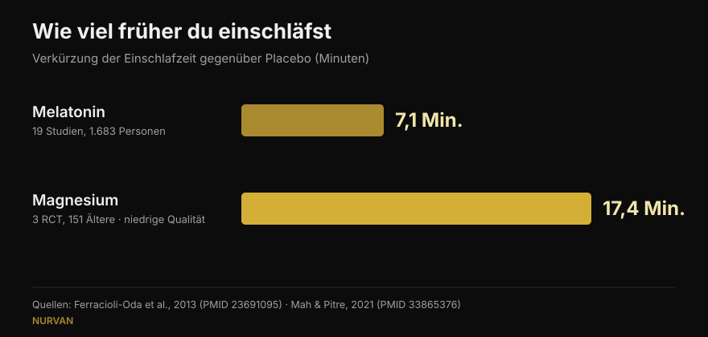
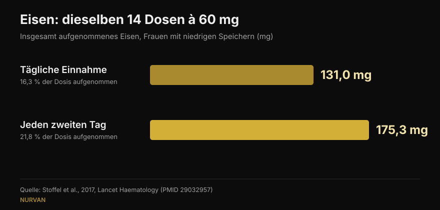

# Wann Supplemente einnehmen: zählt die Uhrzeit wirklich?

Von [Giammaria Loi](/autore/giammaria-loi) · aktualisiert am 15. Oktober 2026

Fast jedes Supplement kommt mit einer Regel zum Zeitpunkt: Melatonin eine halbe Stunde vor dem Schlafen, Eisen nüchtern, Kreatin direkt nach dem Training. Ein viel diskutierter Beitrag behauptet, dass diese Regel bei den meisten nichts bewirkt, und stützt das auf acht Quellenangaben. Ich habe alle acht gelesen: Sie existieren und sind einschlägig — was in der Fitness-Welt der sozialen Netzwerke schon eine Nachricht ist. Aber in drei Fällen verbirgt die genannte Zahl ein Detail, das die praktische Anwendung verändert, und die nützlichste Information für alle, die trainieren, fehlt ganz.

## Kurz gefasst

- **Melatonin verschiebt die innere Uhr vor allem am späten Nachmittag und kaum in der ersten Hälfte der Nacht.** Bestätigt: Bei 27 Erwachsenen betrug die maximale Vorverlagerung 1,8 Stunden, mit einer „toten Zone" im frühen Schlaf (Burgess et al., 2008).
- **Wer es vor dem Schlafen nimmt, will aber keine Uhr verschieben, sondern einschlafen.** Dieser Effekt, im Beitrag nur gestreift, ist rund **7 Minuten** Einschlafzeit wert (Ferracioli-Oda et al., 2013).
- **Bei Eisen entscheidet der Zeitpunkt tatsächlich** — nicht die Uhrzeit, sondern der Abstand. Jeden zweiten Tag wurden **175 mg statt 131 mg** aufgenommen, bei identischen Dosen (Stoffel et al., 2017). Bei Frauen mit niedrigen Speichern, nicht bei jedem.
- **Die „+57 %" bei Vitamin D stammen von 17 Patienten ohne Kontrollgruppe**, mit enormer Streuung (±36,7 %). Das Prinzip — zur fettreichsten Mahlzeit — hält; die Zahl nicht.
- **Was im Beitrag fehlt**: Der Zeitpunkt, der im Training wirklich zählt, betrifft nicht Kapseln, sondern Protein — und dort zeigt die Meta-Analyse, dass der Effekt verschwindet, sobald man die Gesamtproteinzufuhr des Tages berücksichtigt (Schoenfeld et al., 2013).

## Ein umstrittener Beitrag, dessen Quellen aber sitzen

In den Kommentaren wird dem Beitrag vorgeworfen, von einer künstlichen Intelligenz erzeugt zu sein: Ein Leser sagt, die Melatonin-Grafik sei falsch, ein anderer, die Eisen-Folie widerspreche sich selbst, ein dritter bittet schlicht um eine Erklärung. Berechtigte Kritik an der Form. Inhaltlich existieren jedoch alle acht PMID, sie behandeln tatsächlich das jeweils zugeordnete Thema und nennen überwiegend die Zahlen, die ihnen zugeschrieben werden. Das ist besser als der Durchschnitt der Karussells, die wir hier prüfen.

Das Problem sind nicht die Quellen, sondern das, was dazwischen steht: Eine korrekte Zahl, aus dem Kontext ihrer Messung gelöst, wird zu einer Regel, die auf dich womöglich nicht zutrifft.

## Melatonin: die Uhr verschieben und einschlafen sind zwei Dinge

Das ist der Punkt, der die meisten Leser verwirrt hat, und die Verwirrung hat einen Grund: Melatonin leistet zwei verschiedene Dinge.

Das erste ist **die innere Uhr verschieben**. Die zitierte Studie ist solide: Burgess und Kollegen gaben 27 Erwachsenen ohne feste Zeitvorgaben 3 mg Melatonin und erstellten eine Kurve, die zeigt, wie stark das Hormon den Rhythmus je nach Einnahmezeitpunkt verschiebt. Die größte Vorverlagerung ergibt sich am späten Nachmittag, etwa 5 Stunden vor Beginn der körpereigenen Melatoninproduktion, und beträgt **1,8 Stunden**. In der ersten Hälfte des gewohnten Schlafs gibt es eine Zone, in der der Effekt praktisch null ist. Die Autoren schließen selbst, dass die nächtliche Einnahme als Schlafmittel kaum phasenverschiebend wirkt. All das gibt der Beitrag korrekt wieder.

Die zweite Aufgabe ist, **dir beim schnelleren Einschlafen zu helfen**. Das ist ein anderer Mechanismus, und der Beitrag erledigt ihn mit einem „es kann trotzdem müde machen". Wie müde? Die meistzitierte Meta-Analyse — 19 Studien, 1.683 Personen mit primären Schlafstörungen — misst eine Verkürzung der Einschlafzeit um **7,06 Minuten** (95 % KI 4,37-9,75) und 8,25 Minuten mehr Gesamtschlaf. Statistisch belastbar, klinisch klein. Diese Zahl verändert die Erwartung jeder Person, die Melatonin kauft, und sie steht nirgends im Beitrag.

*Zwei Zahlen, die der Beitrag nie nebeneinanderstellt. Auf die Evidenzqualität achten: Der Melatonin-Wert stammt aus 19 Studien, der Magnesium-Wert aus 3 Studien an älteren Menschen, die die Autoren selbst als von niedriger Qualität einstufen.*

## Eisen: hier zählt der Zeitpunkt, aber die Variable ist der Abstand

Hier hat der Beitrag vollkommen recht, und es ist der interessanteste der acht Fälle. Eisen erhöht Hepcidin, das Hormon, das die Aufnahme drosselt, und Hepcidin bleibt lange genug erhöht, um die Dosis des Folgetages zu benachteiligen.

In der Studie von Stoffel und Kollegen in *Lancet Haematology* nahmen Frauen mit niedrigem Ferritin 60 mg Eisen an 14 aufeinanderfolgenden Tagen oder dieselben 14 Dosen jeden zweiten Tag über 28 Tage. Ergebnis: **131,0 mg aufgenommen gegenüber 175,3 mg**, also 16,3 % der Dosis gegenüber 21,8 % (p = 0,0010). Die Tagesdosis auf zwei Gaben aufzuteilen half nicht (p = 0,33) und erhöhte das Hepcidin zusätzlich.

*Gleiche Dosen, anderes Ergebnis: jeden zweiten Tag wird rund ein Drittel mehr aufgenommen. Studie an Frauen zwischen 18 und 40 Jahren mit Ferritin ≤ 25 µg/l.*

**Was der Beitrag nicht sagt**: Die Teilnehmerinnen waren Frauen mit bereits erschöpften Eisenspeichern. Das ist kein Befund für die Allgemeinbevölkerung, und Eisensupplementierung ist eine Therapie, die anhand von Blutwerten eingestellt wird — nichts, womit man beginnt, weil man sich müde fühlt. Das Schema jeden zweiten Tag gehört in das Gespräch mit der Person, die das Eisen verordnet hat.

Beim Kaffee ist der Beitrag präzise: In der Studie von Morck und Kollegen aus dem Jahr 1983 senkte Kaffee **eine Stunde vor** der Mahlzeit die Aufnahme nicht, während derselbe Kaffee **eine Stunde danach** sie von etwa 5,9 % auf etwa 1,6 % drückte. Zu präzisieren ist allerdings: Es ging um Nicht-Häm-Eisen aus einer Mahlzeit, nicht um eine Eisentablette, und die Teilnehmer hatten normale Speicher.

## Vitamin D und Omega-3: nicht die Uhrzeit, die Mahlzeit

Der Mechanismus ist gut dargestellt — beide sind fettlöslich, es zählt also das Fett der Mahlzeit —, aber die Zahlen verdienen einen genaueren Blick.

**Vitamin D, +57 %.** Die Zahl ist korrekt wiedergegeben (56,7 %), stammt aber aus einer Studie mit **17 Patienten ohne Kontrollgruppe**: Menschen, die auf die Therapie nicht ansprachen und gebeten wurden, ihr Präparat zur größten Mahlzeit zu verlegen. Die Standardabweichung beträgt ±36,7 %, der Anstieg schwankte also enorm von Person zu Person, und die Dosen reichten von 1.000 bis 50.000 IE. Der praktische Rat bleibt sinnvoll und kostenlos; die „+57 %" sind kein Versprechen.

**Omega-3, 3 von 50 Personen.** Auch das stimmt: Bei einer fettarmen Mahlzeit behielten nur 3 von 50 Probanden mit der Ethylester-Form mindestens die Hälfte der Aufnahme, die sie mit einer fettreichen Mahlzeit erreichten. Der fehlende Kontext ist relevant: Die Studie vergleicht ein verschreibungspflichtiges 4-Gramm-Produkt mit einem Konkurrenzprodukt und ist von dem Unternehmen verfasst und finanziert, das den Gewinner herstellt. Das macht sie nicht falsch, aber es ist ein Interessenkonflikt, den eine Folie offenlegen sollte. Wer ein normales Fischöl aus der Drogerie nimmt, übersetzt es einfach: zu einer Mahlzeit, nicht nüchtern.

## Kreatin und Magnesium: wo der Beitrag recht hat und wo er zu früh aufhört

**Kreatin.** Die zitierte Studie verglich 5 g vor und 5 g nach dem Training bei 19 Freizeit-Bodybuildern über 4 Wochen: kein statistisch signifikanter Unterschied. Kurioserweise ist der Beitrag vorsichtiger als die Autoren, die in ihrem Fazit schreiben, nach dem Training sei „möglicherweise besser" — auf Basis der *magnitude-based inference*, einer heute weithin kritisierten Methode. In den Standardtests gibt es den Unterschied nicht. Bei Kreatin zählt die Konstanz, nicht die Uhr: Wir haben es in unserer [Tier-List der Supplemente für Kraft](/de/blog/kraftsport-supplemente-tier-list) ganz nach oben gesetzt.

**Magnesium.** Der Beitrag sagt, die Autoren der Übersichtsarbeit zum Schlaf hätten die Evidenz als „minderwertig" bezeichnet. Das stimmt, genau dieses Wort steht dort. Doch dieselbe Übersichtsarbeit findet, wenn sie 3 randomisierte Studien mit 151 älteren Menschen zusammenfasst, eine Verkürzung der Einschlafzeit um **17,36 Minuten** (p = 0,0006): mehr als das Doppelte des Melatonin-Werts. Mit weit geringerer Sicherheit, in einer anderen Population und bei sehr wenigen Personen. Es mit „minderwertiger Evidenz" abzutun, begräbt die kurioseste Zahl des gesamten Beitrags.

**Koffein.** Hier liegt der Beitrag richtig: 400 mg sechs Stunden vor dem Zubettgehen stören den Schlaf messbar gegenüber Placebo. Die Übersetzung in „vier Tassen" ist die Schwachstelle, und ein Leser weist darauf hin: Der Koffeingehalt einer Tasse schwankt gewaltig. Ausführlich steht das in [wann der letzte Kaffee](/de/blog/koffein-schlaf-wann-letzter-kaffee).

## Was die Forschung wirklich sagt

| Aussage im Beitrag | Urteil | Warum |
|---|---|---|
| Melatonin verschiebt die Uhr kaum, wenn es vor dem Schlafen genommen wird | **Bestätigt** | Tote Zone im frühen Schlaf; maximale Vorverlagerung 1,8 h am späten Nachmittag (Burgess 2008) |
| „Es kann trotzdem müde machen" | **Zu präzisieren** | Der Effekt besteht, ist aber 7,06 Minuten kürzere Einschlafzeit wert (Ferracioli-Oda 2013) |
| Koffein 6 Stunden vorher stört den Schlaf | **Bestätigt** | 400 mg nach 0, 3 und 6 Stunden: alle drei signifikant gegenüber Placebo (Drake 2013) |
| Eisen jeden zweiten Tag: 175 mg statt 131 mg | **Bestätigt** | Aber bei Frauen mit Ferritin ≤ 25 µg/l, nicht in der Allgemeinbevölkerung (Stoffel 2017) |
| Kaffee eine Stunde vorher harmlos, eine Stunde danach schädlich | **Bestätigt** | Von 5,88 % auf 1,64 %; betrifft das Eisen der Mahlzeit, nicht die Tablette (Morck 1983) |
| Vitamin D zur größten Mahlzeit: +57 % | **Zu präzisieren** | 17 Patienten, keine Kontrollgruppe, ±36,7 % Streuung (Mulligan 2010) |
| Omega-3: 3 von 50 bei fettarmer Mahlzeit | **Zu präzisieren** | Studie des Herstellers des Gewinnerprodukts, 4-g-Dosis auf Rezept (Davidson 2012) |
| Kreatin: vorher oder nachher macht keinen Unterschied | **Bestätigt** | Kein Unterschied in Standardtests; die Autoren schließen mit einer kritisierten Methode das Gegenteil (Antonio 2013) |
| Magnesium: minderwertige Evidenz | **Zu präzisieren** | Richtig bei der Qualität, aber der gemessene Effekt beträgt −17,36 Minuten Einschlafzeit (Mah 2021) |

## Der Zeitpunkt, der wirklich zählt, und der im Beitrag fehlt

Wer trainiert, stellt sich die eigentliche Zeitpunktfrage nicht beim Melatonin, sondern beim Protein: das berühmte anabole Fenster.

Die Meta-Regression von Schoenfeld, Aragon und Krieger fasste 23 Studien zur Hypertrophie und 20 zur Kraft zusammen. In einer einfachen Auswertung sah Protein rund um das Training nach einem kleinen bis mittleren Vorteil für die Hypertrophie aus. Sobald die Autoren die Kovariaten kontrollierten, verschwand dieser Effekt: Der stärkste Prädiktor für Muskelwachstum war **die gesamte Proteinzufuhr des Tages**, nicht die Uhrzeit der Einnahme. Wer in diesen Studien auf Timing achtete, aß schlicht mehr Protein.

Dasselbe Prinzip gilt für fast jedes Supplement der Liste: Tagesdosis und Konstanz entscheiden über das Ergebnis, die Uhr fast nie. Für die Körperzusammensetzung gilt es ebenso — die großen Hebel liegen in der Tagessumme, wie wir bei der [Körperrekomposition](/de/blog/koerperrekomposition-fett-verlieren-muskeln-aufbauen) gesehen haben.

## So setzt du es um

1. **Frag dich, ob dein Supplement in eine der drei Kategorien mit Uhrzeit fällt.** Eisen (der Abstand zwischen den Dosen), Fettlösliches wie Vitamin D und Omega-3 (die Mahlzeit) und alles, was auf Schlaf oder Wachheit wirkt, wie Koffein und Melatonin (die Stunden vor dem Bett). Alles andere: nimm es, wenn du daran denkst.
2. **Koppel das Supplement an eine Gewohnheit, die du schon hast**, nicht an eine genaue Uhrzeit. Vitamin D und Omega-3 zur Hauptmahlzeit: Das Fett ist ohnehin da, und die Routine trägt sich selbst.
3. **Bei Kreatin nimm den bequemsten Zeitpunkt und bleib dabei**: Konstanz über Monate wiegt weit mehr als dreißig Minuten vor oder nach der Einheit.
4. **Wenn du Melatonin zum Einschlafen nutzt, erwarte wenige Minuten Unterschied.** Liegt das Problem an den Zeiten — Schichtarbeit, Jetlag —, dann zählt der Zeitpunkt sehr wohl, und das gehört zu einer Ärztin oder einem Arzt, nicht in ein Karussell.
5. **Eisen nur auf ärztliche Anweisung und auf Basis von Blutwerten.** Das Schema jeden zweiten Tag ist eine Frage an die verordnende Person, keine Entscheidung im Alleingang.

> ### Mit Nurvan ist Supplementierung keine Liste von Uhrzeiten mehr
> Der Supplement-Bereich von Nurvan erfasst, was du nimmst, wie viel und wie oft, und hält das zusammen mit Training, Ernährungstagebuch und Laborwerten. Wenn du dich fragst „wirkt das?", siehst du Wochen echter Konstanz statt des Eindrucks von gestern Abend. **[Nurvan ausprobieren](https://nurvan.app)**

## Häufige Fragen

**Wann nimmt man Melatonin ein?**
Das hängt vom Ziel ab. Um die innere Uhr vorzuverlegen, ist der Effekt am späten Nachmittag am größten, viele Stunden vor dem Schlafen, und in der ersten Nachthälfte fast null (Burgess et al., 2008). Um etwas schneller einzuschlafen, nimmt man es abends, aber der gemessene Durchschnittseffekt liegt bei rund 7 Minuten. Bei einer echten Schlafstörung sprich mit einer Ärztin oder einem Arzt.

**Kreatin vor oder nach dem Training?**
Die Studie, die beide Varianten vergleicht, findet über 4 Wochen keinen statistisch signifikanten Unterschied (Antonio und Ciccone, 2013). Weit wichtiger ist, es täglich zu nehmen, auch an Ruhetagen.

**Muss Vitamin D zu einer Mahlzeit eingenommen werden?**
Es ist fettlöslich und wird daher mit einer fetthaltigen Mahlzeit besser aufgenommen. In der Studie mit 17 Patienten hob die Verlegung zur größten Mahlzeit die Blutwerte um durchschnittlich 57 %, aber es war eine kleine Serie ohne Kontrollgruppe und mit großer individueller Streuung.

**Blockiert Kaffee die Eisenaufnahme?**
Er senkt die Aufnahme von Nicht-Häm-Eisen, wenn er zur Mahlzeit oder bis zu einer Stunde danach getrunken wird; eine Stunde vorher hatte er keine messbare Wirkung (Morck et al., 1983). Unter Eisentherapie ist der praktische Schritt, Kaffee und Einnahme zeitlich zu trennen, nach Anweisung deiner Ärztin oder deines Arztes.

## Lies auch

- [Tier-List der Supplemente für Kraft: was die Forschung sagt](/de/blog/kraftsport-supplemente-tier-list) — welche Substanzen dein Maximalgewicht wirklich bewegen, von Kreatin bis HMB.
- [Koffein und Schlaf: wann der letzte Kaffee](/de/blog/koffein-schlaf-wann-letzter-kaffee) — warum „eine Tasse" keine Dosis ist und wie viele Stunden es wirklich braucht.
- [Körperrekomposition: Fett verlieren und Muskeln aufbauen](/de/blog/koerperrekomposition-fett-verlieren-muskeln-aufbauen) — was das Ergebnis wirklich entscheidet, wenn Ernährung und Training zusammenlaufen.

## Quellen

1. Burgess HJ, Revell VL, Eastman CI, 2008. *A three pulse phase response curve to three milligrams of melatonin in humans.* The Journal of Physiology 586(2):639-47. PMID [18006583](https://pubmed.ncbi.nlm.nih.gov/18006583/) · DOI [10.1113/jphysiol.2007.143180](https://doi.org/10.1113/jphysiol.2007.143180)
2. Ferracioli-Oda E, Qawasmi A, Bloch MH, 2013. *Meta-analysis: melatonin for the treatment of primary sleep disorders.* PLoS One 8(5):e63773. PMID [23691095](https://pubmed.ncbi.nlm.nih.gov/23691095/) · DOI [10.1371/journal.pone.0063773](https://doi.org/10.1371/journal.pone.0063773)
3. Drake C, Roehrs T, Shambroom J, Roth T, 2013. *Caffeine effects on sleep taken 0, 3, or 6 hours before going to bed.* Journal of Clinical Sleep Medicine 9(11):1195-200. PMID [24235903](https://pubmed.ncbi.nlm.nih.gov/24235903/) · DOI [10.5664/jcsm.3170](https://doi.org/10.5664/jcsm.3170)
4. Stoffel NU, Cercamondi CI, Brittenham G, et al., 2017. *Iron absorption from oral iron supplements given on consecutive versus alternate days...* The Lancet Haematology 4(11):e524-e533. PMID [29032957](https://pubmed.ncbi.nlm.nih.gov/29032957/) · DOI [10.1016/S2352-3026(17)30182-5](https://doi.org/10.1016/S2352-3026(17)30182-5)
5. Morck TA, Lynch SR, Cook JD, 1983. *Inhibition of food iron absorption by coffee.* The American Journal of Clinical Nutrition 37(3):416-20. PMID [6402915](https://pubmed.ncbi.nlm.nih.gov/6402915/) · DOI [10.1093/ajcn/37.3.416](https://doi.org/10.1093/ajcn/37.3.416)
6. Mulligan GB, Licata A, 2010. *Taking vitamin D with the largest meal improves absorption and results in higher serum levels of 25-hydroxyvitamin D.* Journal of Bone and Mineral Research 25(4):928-30. PMID [20200983](https://pubmed.ncbi.nlm.nih.gov/20200983/) · DOI [10.1002/jbmr.67](https://doi.org/10.1002/jbmr.67)
7. Davidson MH, Johnson J, Rooney MW, Kyle ML, Kling DF, 2012. *A novel omega-3 free fatty acid formulation has dramatically improved bioavailability during a low-fat diet compared with omega-3-acid ethyl esters: the ECLIPSE study.* Journal of Clinical Lipidology 6(6):573-84. PMID [23312053](https://pubmed.ncbi.nlm.nih.gov/23312053/) · DOI [10.1016/j.jacl.2012.01.002](https://doi.org/10.1016/j.jacl.2012.01.002)
8. Antonio J, Ciccone V, 2013. *The effects of pre versus post workout supplementation of creatine monohydrate on body composition and strength.* Journal of the International Society of Sports Nutrition 10:36. PMID [23919405](https://pubmed.ncbi.nlm.nih.gov/23919405/) · DOI [10.1186/1550-2783-10-36](https://doi.org/10.1186/1550-2783-10-36)
9. Mah J, Pitre T, 2021. *Oral magnesium supplementation for insomnia in older adults: a Systematic Review & Meta-Analysis.* BMC Complementary Medicine and Therapies 21(1):125. PMID [33865376](https://pubmed.ncbi.nlm.nih.gov/33865376/) · DOI [10.1186/s12906-021-03297-z](https://doi.org/10.1186/s12906-021-03297-z)
10. Schoenfeld BJ, Aragon AA, Krieger JW, 2013. *The effect of protein timing on muscle strength and hypertrophy: a meta-analysis.* Journal of the International Society of Sports Nutrition 10(1):53. PMID [24299050](https://pubmed.ncbi.nlm.nih.gov/24299050/) · DOI [10.1186/1550-2783-10-53](https://doi.org/10.1186/1550-2783-10-53)

Literaturrecherche durchgeführt auf PubMed. Ausgangspunkt: der Beitrag von William Wallace ([@dr.williamwallace](https://www.instagram.com/p/Dc_e9fmkc1z/), 7. September 2026). Weder Text noch Bild des Beitrags wurden reproduziert: Seine Quellenangaben wurden in den Originalarbeiten nachgelesen.

---

Giammaria Loi ist der Gründer von Nurvan. Er trainiert seit 2012 mit Gewichten, arbeitet seit 2013 als FIPE-zertifizierter Personal Trainer und Coach und startet seit 2018 im Powerlifting auf nationaler Ebene. Jeder Artikel, den er zeichnet, geht von den Studien aus und endet bei dem, was im Gym wirklich funktioniert. [Autorenseite](/autore/giammaria-loi)

> Hinweis: informativer Inhalt, kein Ersatz für ärztlichen oder fachlichen Rat. Eisensupplementierung und Schlafstörungen erfordern eine individuelle medizinische Beurteilung.
