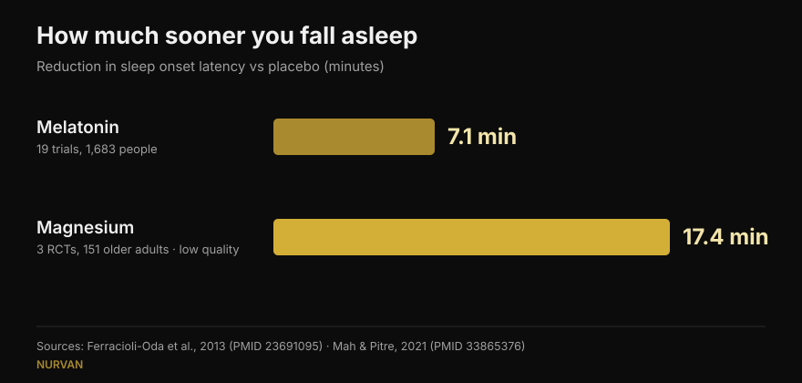
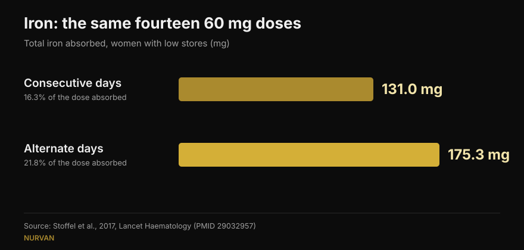

# When to take supplements: does the hour actually matter?

By [Giammaria Loi](/autore/giammaria-loi) · updated 15 October 2026

Almost every supplement arrives with a rule about when to take it: melatonin half an hour before bed, iron on an empty stomach, creatine right after training. A widely shared post argues that for most of them the rule does almost nothing, and backs it with eight citations. I read all eight. They exist and they are on topic — which, for fitness content on social media, is already news. But in three cases the number quoted hides a detail that changes how you would use it, and the most useful fact for anyone who trains is missing entirely.

## The short version

- **Melatonin shifts your body clock most in the late afternoon and barely at all during the first half of the night.** Confirmed: in 27 adults the biggest advance was 1.8 hours, with a "dead zone" across early sleep (Burgess et al., 2008).
- **But people who take it at bedtime are not trying to shift a clock — they want to fall asleep.** That effect, which the post waves at, is worth about **7 minutes** of sleep latency (Ferracioli-Oda et al., 2013).
- **Iron is where timing genuinely decides the outcome** — not the hour, the interval. Alternate days delivered **175 mg absorbed versus 131 mg**, from identical doses (Stoffel et al., 2017). In women with low stores, not in everyone.
- **The vitamin D "+57%" comes from 17 patients with no control group** and huge spread (±36.7%). The principle — take it with your fattiest meal — holds. The number doesn't.
- **What the post leaves out**: the timing question that actually matters in the gym is protein, not pills, and there the meta-analysis says the effect disappears once you account for total daily protein (Schoenfeld et al., 2013).

## A contested post with its citations in the right place

In the comments the post is accused of being AI-generated: one reader says the melatonin chart is wrong, another that the iron slide contradicts itself, a third simply asks someone to explain it. Fair criticisms of the delivery. On substance, though, all eight PMIDs exist, each one genuinely covers the topic it is attached to, and most report the numbers the post gives them. That is better than the average carousel we check here.

The citations are not the problem. The problem is what sits between them: a correct number, lifted out of the setting where it was measured, turns into a rule that may not apply to you.

## Melatonin: shifting a clock and falling asleep are two different jobs

This is the point that confused most commenters, and the confusion is real, because melatonin does two separate things.

The first is **moving your body clock**. The study cited here is solid: Burgess and colleagues gave 3 mg of melatonin to 27 free-running adults and built a curve showing how much the hormone shifts the rhythm depending on when you take it. The largest advance comes in the late afternoon, roughly 5 hours before your own melatonin production begins, and it is worth **1.8 hours**. Across the first half of habitual sleep there is a zone where the effect is essentially nil. The authors themselves conclude that using melatonin as a night-time sleep aid has minimal phase-shifting effect. The post reports all of this correctly.

The second job is **helping you fall asleep sooner**. That is a different mechanism, and the post dismisses it with "it can still make you drowsy". How drowsy? The most cited meta-analysis — 19 trials, 1,683 people with primary sleep disorders — measures a **7.06-minute** reduction in sleep onset latency (95% CI 4.37 to 9.75) and 8.25 extra minutes of total sleep. Statistically robust, clinically small. That number changes what anyone buying melatonin should expect, and it is nowhere in the post.

*Two numbers the post never places side by side. Mind the evidence quality: the melatonin figure comes from 19 trials, the magnesium one from 3 trials in older adults that the reviewers themselves rated low quality.*

## Iron: timing matters, but the variable is the gap

Here the post is right, and it is the most interesting case of the eight. Iron raises hepcidin, the hormone that shuts absorption down, and hepcidin stays up long enough to blunt tomorrow's dose.

In Stoffel and colleagues' trial in *Lancet Haematology*, women with low ferritin took 60 mg of iron either on 14 consecutive days or as the same 14 doses spread over 28 alternate days. The result: **131.0 mg absorbed versus 175.3 mg**, or 16.3% of the dose versus 21.8% (p = 0.0010). Splitting the daily dose in two did not help (p = 0.33) and raised hepcidin further.

*Same doses, different outcome: alternate-day dosing absorbed about a third more iron. Trial in women aged 18-40 with ferritin ≤ 25 µg/L.*

**What the post doesn't say**: the participants were women whose iron stores were already depleted. This is not a general-population finding, and iron supplementation is a treatment built on blood work, not something you start because you feel tired. The alternate-day schedule is a conversation to have with whoever prescribed the iron.

On coffee the post is precise. In Morck and colleagues' 1983 study, coffee drunk **an hour before** a meal did not reduce absorption, while the same coffee **an hour after** cut it from about 5.9% to about 1.6%. Worth adding: that was dietary non-heme iron from a meal, not an iron tablet, and the subjects had normal stores.

## Vitamin D and omega-3: it isn't the hour, it's the meal

The mechanism here is framed well — both are fat-soluble, so what matters is the fat in the meal they arrive with — but the numbers deserve a closer look.

**Vitamin D, +57%.** The figure is reported accurately (56.7%), but it comes from **17 patients with no control group**: people who were not responding to treatment and were asked to move their supplement to their largest meal. The standard deviation is ±36.7%, meaning the increase varied enormously between individuals, and doses ranged from 1,000 to 50,000 IU. The practical advice is sensible and free. The "+57%" is not a promise.

**Omega-3, 3 people out of 50.** Also accurate: on a low-fat meal, only 3 of 50 subjects taking the ethyl ester form kept at least half the absorption they got with a high-fat meal. The missing context matters: the study compares a 4-gram prescription product against a competitor, and it was written and funded by the company that makes the competitor — the one that won. That doesn't make it false, but it is a conflict of interest a slide should declare. For anyone taking ordinary over-the-counter fish oil, the practical translation is simple: with a meal, not on an empty stomach.

## Creatine and magnesium: where the post is right, and where it stops early

**Creatine.** The cited trial compared 5 g before versus 5 g after training in 19 recreational bodybuilders over 4 weeks, and found no statistically significant difference. Oddly, the post is more cautious than the authors: their conclusion says post-workout is "possibly more beneficial", based on magnitude-based inference, a statistical approach now widely criticised. On standard tests, the difference isn't there. For creatine what counts is consistency, not the clock — we put it at the top of our [strength supplement tier list](/en/blog/strength-supplements-tier-list-evidence).

**Magnesium.** The post says reviewers called the sleep evidence "substandard". True — that is the exact word in the review. But the same review, pooling 3 randomised trials in 151 older adults, found sleep onset latency fell by **17.36 minutes** (p = 0.0006): more than double melatonin's figure. With far lower certainty, in a different population, and in very few people. Dismissing it as "substandard evidence" buries the strangest number in the whole post.

**Caffeine.** Here the post is right: 400 mg taken 6 hours before bed measurably disturbs sleep compared with placebo. Translating that into "four cups" is the weak link, and a commenter says so: the caffeine in a cup varies wildly. We covered that in detail in [when to stop drinking coffee](/en/blog/caffeine-sleep-when-to-stop-coffee).

## What the research actually says

| Claim in the post | Verdict | Why |
|---|---|---|
| Melatonin barely shifts the clock when taken at bedtime | **Confirmed** | Dead zone across early sleep; maximum 1.8 h advance in late afternoon (Burgess 2008) |
| "It can still make you drowsy" | **Needs qualifying** | Real but worth 7.06 minutes of sleep latency (Ferracioli-Oda 2013) |
| Caffeine 6 hours before bed disturbs sleep | **Confirmed** | 400 mg at 0, 3 and 6 hours: all three significant vs placebo (Drake 2013) |
| Alternate-day iron: 175 mg vs 131 mg | **Confirmed** | But in women with ferritin ≤ 25 µg/L, not the general population (Stoffel 2017) |
| Coffee an hour before is fine, an hour after is not | **Confirmed** | 5.88% down to 1.64%; refers to dietary iron, not a tablet (Morck 1983) |
| Vitamin D with the largest meal: +57% | **Needs qualifying** | 17 patients, no control group, ±36.7% spread (Mulligan 2010) |
| Omega-3: 3 of 50 on a low-fat meal | **Needs qualifying** | Study by the maker of the winning product, 4 g prescription dose (Davidson 2012) |
| Creatine: before or after makes no difference | **Confirmed** | No difference on standard tests; authors conclude otherwise using a criticised method (Antonio 2013) |
| Magnesium: substandard evidence | **Needs qualifying** | True on quality, but the measured effect is −17.36 minutes of latency (Mah 2021) |

## The timing that does matter, and isn't in the post

If you train, the timing question you actually ask yourself has nothing to do with melatonin. It is about protein — the famous anabolic window.

Schoenfeld, Aragon and Krieger's meta-regression pooled 23 studies on hypertrophy and 20 on strength. In a simple pooled analysis, taking protein around training looked like a small-to-moderate win for hypertrophy. Once the authors controlled for covariates, that effect vanished: the strongest predictor of muscle growth was **total daily protein intake**, not the hour you ate it. In those studies, the people doing the timing were simply eating more protein.

The same principle covers almost every supplement on the list: the daily dose and your consistency decide the result, the clock almost never does. It holds for body composition too — the big levers sit in the daily total, as we saw writing about [body recomposition](/en/blog/body-recomposition-lose-fat-gain-muscle).

## How to apply it

1. **Ask whether your supplement falls into one of the three categories that have a clock.** Iron (the gap between doses), fat-soluble ones like vitamin D and omega-3 (the meal), and anything acting on sleep or alertness like caffeine and melatonin (hours relative to bed). Everything else: take it when you remember to.
2. **Anchor the supplement to a habit you already have**, not to a specific hour. Vitamin D and omega-3 with your main meal: the fat is already there and the habit holds itself up.
3. **For creatine, pick the most convenient moment and keep it.** Consistency over months matters far more than thirty minutes either side of a session.
4. **If you use melatonin to fall asleep, expect a few minutes of difference.** If the problem is a schedule problem — shift work, jet lag — then timing does matter, and that is a conversation for a doctor rather than a carousel.
5. **Iron only on medical advice and on the back of blood tests.** Alternate-day dosing is a question for whoever prescribed it, not a decision to make alone.

> ### Nurvan turns supplementation from a list of hours into data
> Nurvan's supplement section logs what you take, how much and how often, and keeps that alongside your training, food diary and lab results. So when you ask "is this working?", you are looking at weeks of real consistency instead of last night's impression. **[Try Nurvan](https://nurvan.app)**

## Frequently asked questions

**What time should I take melatonin?**
It depends what you want from it. To shift your clock earlier, the effect peaks in the late afternoon, many hours before bed, and is close to zero in the first half of the night (Burgess et al., 2008). To fall asleep a little sooner you take it in the evening, but the average measured effect is about 7 minutes. If you have a genuine sleep disorder, talk to a doctor.

**Should creatine be taken before or after training?**
The trial comparing the two found no statistically significant difference over 4 weeks (Antonio and Ciccone, 2013). Taking it every day, rest days included, matters far more.

**Does vitamin D need to be taken with food?**
It is fat-soluble, so it absorbs better with a meal containing fat. In a study of 17 patients, moving it to the largest meal raised blood levels by an average of 57% — but that was a small series with no control group and wide individual variation.

**Does coffee block iron?**
It reduces non-heme iron absorption when drunk with the meal or up to an hour afterwards; an hour beforehand had no measurable effect (Morck et al., 1983). If you are on iron therapy, the practical move is to separate your coffee from your iron, following your doctor's instructions.

## Read also

- [Strength supplement tier list: what the research says](/en/blog/strength-supplements-tier-list-evidence) — which compounds actually move your one-rep max, from creatine to HMB.
- [Caffeine and sleep: when to stop drinking coffee](/en/blog/caffeine-sleep-when-to-stop-coffee) — why "a cup" is not a dose, and how many hours you really need.
- [Body recomposition: losing fat and gaining muscle](/en/blog/body-recomposition-lose-fat-gain-muscle) — what really decides the outcome when diet and training run together.

## Sources

1. Burgess HJ, Revell VL, Eastman CI, 2008. *A three pulse phase response curve to three milligrams of melatonin in humans.* The Journal of Physiology 586(2):639-47. PMID [18006583](https://pubmed.ncbi.nlm.nih.gov/18006583/) · DOI [10.1113/jphysiol.2007.143180](https://doi.org/10.1113/jphysiol.2007.143180)
2. Ferracioli-Oda E, Qawasmi A, Bloch MH, 2013. *Meta-analysis: melatonin for the treatment of primary sleep disorders.* PLoS One 8(5):e63773. PMID [23691095](https://pubmed.ncbi.nlm.nih.gov/23691095/) · DOI [10.1371/journal.pone.0063773](https://doi.org/10.1371/journal.pone.0063773)
3. Drake C, Roehrs T, Shambroom J, Roth T, 2013. *Caffeine effects on sleep taken 0, 3, or 6 hours before going to bed.* Journal of Clinical Sleep Medicine 9(11):1195-200. PMID [24235903](https://pubmed.ncbi.nlm.nih.gov/24235903/) · DOI [10.5664/jcsm.3170](https://doi.org/10.5664/jcsm.3170)
4. Stoffel NU, Cercamondi CI, Brittenham G, et al., 2017. *Iron absorption from oral iron supplements given on consecutive versus alternate days...* The Lancet Haematology 4(11):e524-e533. PMID [29032957](https://pubmed.ncbi.nlm.nih.gov/29032957/) · DOI [10.1016/S2352-3026(17)30182-5](https://doi.org/10.1016/S2352-3026(17)30182-5)
5. Morck TA, Lynch SR, Cook JD, 1983. *Inhibition of food iron absorption by coffee.* The American Journal of Clinical Nutrition 37(3):416-20. PMID [6402915](https://pubmed.ncbi.nlm.nih.gov/6402915/) · DOI [10.1093/ajcn/37.3.416](https://doi.org/10.1093/ajcn/37.3.416)
6. Mulligan GB, Licata A, 2010. *Taking vitamin D with the largest meal improves absorption and results in higher serum levels of 25-hydroxyvitamin D.* Journal of Bone and Mineral Research 25(4):928-30. PMID [20200983](https://pubmed.ncbi.nlm.nih.gov/20200983/) · DOI [10.1002/jbmr.67](https://doi.org/10.1002/jbmr.67)
7. Davidson MH, Johnson J, Rooney MW, Kyle ML, Kling DF, 2012. *A novel omega-3 free fatty acid formulation has dramatically improved bioavailability during a low-fat diet compared with omega-3-acid ethyl esters: the ECLIPSE study.* Journal of Clinical Lipidology 6(6):573-84. PMID [23312053](https://pubmed.ncbi.nlm.nih.gov/23312053/) · DOI [10.1016/j.jacl.2012.01.002](https://doi.org/10.1016/j.jacl.2012.01.002)
8. Antonio J, Ciccone V, 2013. *The effects of pre versus post workout supplementation of creatine monohydrate on body composition and strength.* Journal of the International Society of Sports Nutrition 10:36. PMID [23919405](https://pubmed.ncbi.nlm.nih.gov/23919405/) · DOI [10.1186/1550-2783-10-36](https://doi.org/10.1186/1550-2783-10-36)
9. Mah J, Pitre T, 2021. *Oral magnesium supplementation for insomnia in older adults: a Systematic Review & Meta-Analysis.* BMC Complementary Medicine and Therapies 21(1):125. PMID [33865376](https://pubmed.ncbi.nlm.nih.gov/33865376/) · DOI [10.1186/s12906-021-03297-z](https://doi.org/10.1186/s12906-021-03297-z)
10. Schoenfeld BJ, Aragon AA, Krieger JW, 2013. *The effect of protein timing on muscle strength and hypertrophy: a meta-analysis.* Journal of the International Society of Sports Nutrition 10(1):53. PMID [24299050](https://pubmed.ncbi.nlm.nih.gov/24299050/) · DOI [10.1186/1550-2783-10-53](https://doi.org/10.1186/1550-2783-10-53)

Literature searches run on PubMed. Starting point: the post by William Wallace ([@dr.williamwallace](https://www.instagram.com/p/Dc_e9fmkc1z/), 7 September 2026). No text and no image from the post were reproduced: its references were re-read in the original sources.

---

Giammaria Loi is the founder of Nurvan. He has been lifting since 2012, has worked as a FIPE-certified personal trainer and coach since 2013, and has competed in powerlifting at national level since 2018. Every article he writes starts from the research and ends with what actually works in the gym. [Author page](/autore/giammaria-loi)

> Note: educational content, not a substitute for medical advice. Iron supplementation and sleep disorders need individual medical assessment.
