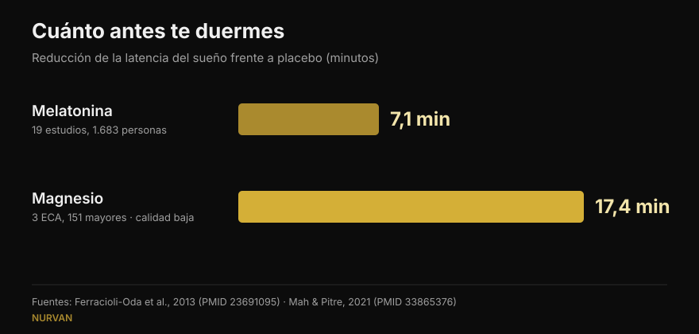
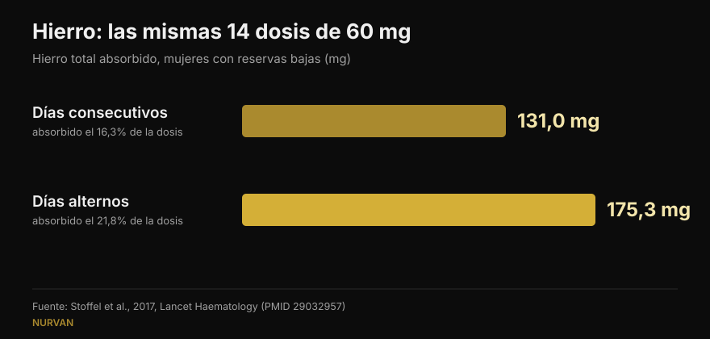

# Cuándo tomar los suplementos: ¿de verdad importa la hora?

Por [Giammaria Loi](/autore/giammaria-loi) · actualizado el 15 de octubre de 2026

Casi todos los suplementos vienen con una regla sobre el momento de tomarlos: la melatonina media hora antes de dormir, el hierro en ayunas, la creatina justo al terminar de entrenar. Una publicación muy comentada sostiene que para la mayoría esa regla no cambia nada, y lo respalda con ocho citas. Las he leído todas: existen y son pertinentes, lo que en el fitness de las redes ya es noticia. Pero en tres casos el dato citado esconde un detalle que cambia cómo lo usarías, y el dato más útil para quien entrena no aparece por ninguna parte.

## En resumen

- **La melatonina mueve el reloj biológico sobre todo a última hora de la tarde y casi nada en la primera mitad de la noche.** Confirmado: en 27 adultos el adelanto máximo fue de 1,8 horas, con una "zona muerta" durante el sueño temprano (Burgess et al., 2008).
- **Pero quien la toma antes de dormir no quiere mover un reloj: quiere dormirse.** Ese efecto, que la publicación apenas menciona, vale unos **7 minutos** de latencia (Ferracioli-Oda et al., 2013).
- **El hierro es el caso en que el horario decide de verdad**, pero la variable no es la hora: es el intervalo. En días alternos se absorbieron **175 mg frente a 131 mg**, con las mismas dosis (Stoffel et al., 2017). En mujeres con reservas bajas, no en cualquiera.
- **El "+57%" de la vitamina D sale de 17 pacientes sin grupo de control** y con una variabilidad enorme (±36,7%). El principio —tomarla con la comida más grasa— se sostiene; el número no.
- **Lo que falta en la publicación**: el horario que de verdad importa en el gimnasio no es el de las pastillas sino el de la proteína, y ahí el metaanálisis dice que el efecto desaparece al tener en cuenta la proteína total del día (Schoenfeld et al., 2013).

## Una publicación discutida, pero con las fuentes en su sitio

En los comentarios se la acusa de estar generada con inteligencia artificial: un lector dice que el gráfico de la melatonina está mal, otro que la diapositiva del hierro se contradice, un tercero simplemente pide que se lo expliquen. Son críticas razonables sobre la forma. En el fondo, sin embargo, los ocho PMID existen, tratan realmente el tema al que se asocian y en su mayoría dan los números que se les atribuyen. Es mejor que la media de los carruseles que revisamos aquí.

El problema no son las citas: es lo que hay entre ellas. Un número correcto, sacado del contexto en el que se midió, se convierte en una regla que quizá no se aplique a ti.

## Melatonina: mover el reloj y dormirse son dos cosas distintas

Es el punto que más confundió a los comentaristas, y la confusión tiene base: la melatonina hace dos trabajos diferentes.

El primero es **mover el reloj biológico**. El estudio citado es sólido: Burgess y sus colegas dieron 3 mg de melatonina a 27 adultos sin horarios impuestos y construyeron una curva que indica cuánto desplaza el ritmo según la hora de la toma. El adelanto máximo llega a última hora de la tarde, unas 5 horas antes de que empiece la producción natural de melatonina, y vale **1,8 horas**. En la primera mitad del sueño habitual hay una zona donde el efecto es prácticamente nulo. Los propios autores concluyen que usarla de noche como somnífero tiene un efecto mínimo sobre el desplazamiento de fase. Todo esto la publicación lo cuenta bien.

El segundo trabajo es **ayudarte a dormirte antes**. Es otro mecanismo, y la publicación lo despacha con un "puede darte sueño igualmente". ¿Cuánto? El metaanálisis más citado —19 estudios y 1.683 personas con trastornos primarios del sueño— mide una reducción de la latencia de **7,06 minutos** (IC 95% 4,37-9,75) y 8,25 minutos más de sueño total. Estadísticamente firme, clínicamente pequeño. Ese dato cambia las expectativas de cualquiera que compre melatonina, y no está en la publicación.

*Dos cifras que la publicación nunca pone una al lado de la otra. Ojo a la calidad de la evidencia: la de la melatonina viene de 19 estudios, la del magnesio de 3 ensayos en mayores que los propios revisores calificaron de calidad baja.*

## Hierro: aquí el horario cuenta, pero la variable es el intervalo

Aquí la publicación acierta de pleno, y es el caso más interesante de los ocho. El hierro eleva la hepcidina, la hormona que cierra la absorción, y la hepcidina se mantiene alta el tiempo suficiente para penalizar la dosis del día siguiente.

En el ensayo de Stoffel y colaboradores, publicado en *Lancet Haematology*, mujeres con ferritina baja tomaron 60 mg de hierro durante 14 días seguidos o las mismas 14 dosis en días alternos a lo largo de 28 días. Resultado: **131,0 mg absorbidos frente a 175,3 mg**, es decir el 16,3% de la dosis frente al 21,8% (p = 0,0010). Partir la dosis diaria en dos no ayudó (p = 0,33) y además subió la hepcidina.

*Las mismas dosis, distinto resultado: en días alternos se absorbe alrededor de un tercio más. Ensayo en mujeres de 18 a 40 años con ferritina ≤ 25 µg/L.*

**Lo que la publicación no dice**: las participantes eran mujeres con las reservas de hierro ya agotadas. No es un hallazgo para la población general, y la suplementación con hierro es un tratamiento que se ajusta con analíticas, no algo que se empieza porque uno se siente cansado. La pauta en días alternos es una conversación con quien te recetó el hierro.

Sobre el café la publicación es precisa: en el estudio de Morck y colaboradores de 1983, el café tomado **una hora antes** de la comida no redujo la absorción, mientras que el mismo café **una hora después** la bajó de alrededor del 5,9% a cerca del 1,6%. Conviene añadir que allí se hablaba de hierro no hemo de un alimento, no de un comprimido, y que los participantes tenían reservas normales.

## Vitamina D y omega-3: no es la hora, es la comida

El mecanismo está bien planteado —son liposolubles, así que importa la grasa de la comida con la que llegan—, pero los números merecen una lectura más fina.

**Vitamina D, +57%.** La cifra está bien recogida (56,7%), pero procede de un estudio con **17 pacientes y sin grupo de control**: personas que no respondían al tratamiento y a las que se pidió mover el suplemento a la comida más abundante. La desviación estándar es de ±36,7%, es decir que el aumento variaba enormemente de una persona a otra, y las dosis iban de 1.000 a 50.000 UI. El consejo práctico sigue siendo sensato y gratis; el "+57%" no es una promesa.

**Omega-3, 3 personas de 50.** También es exacto: con una comida baja en grasa, solo 3 de 50 sujetos que tomaban la forma éster etílico mantuvieron al menos la mitad de la absorción que tenían con una comida rica. Falta un contexto importante: el estudio compara un producto de 4 gramos con receta frente a un competidor, y está firmado y financiado por la empresa que fabrica ese competidor, el que gana. No lo invalida, pero es un conflicto de intereses que una diapositiva debería declarar. Para quien toma un aceite de pescado normal de farmacia, la traducción práctica es sencilla: con comida, no en ayunas.

## Creatina y magnesio: dónde acierta y dónde se queda corta

**Creatina.** El ensayo citado comparó 5 g antes frente a 5 g después de entrenar en 19 culturistas aficionados durante 4 semanas: ninguna diferencia estadísticamente significativa. Curiosamente, la publicación es más prudente que los autores, que concluyen que tomarla después es "posiblemente mejor" usando la *magnitude-based inference*, un método hoy muy criticado. En las pruebas estándar, la diferencia no está. En la creatina lo que cuenta es la constancia, no el reloj: la pusimos en lo más alto de nuestra [tier list de suplementos para la fuerza](/es/blog/clasificacion-suplementos-fuerza-tier-list).

**Magnesio.** La publicación dice que quienes revisaron los estudios sobre el sueño los calificaron de "deficientes". Es verdad, esa es la palabra. Pero esa misma revisión, al juntar 3 ensayos aleatorizados con 151 mayores, encuentra una reducción de la latencia de **17,36 minutos** (p = 0,0006): más del doble que la melatonina. Con mucha menos certeza, en otra población y con muy poca gente. Despacharlo como "evidencia deficiente" esconde el número más curioso de toda la publicación.

**Cafeína.** Aquí acierta: 400 mg tomados 6 horas antes de acostarse alteran el sueño de forma medible frente a placebo. Traducirlo a "cuatro tazas" es el punto débil, y un lector lo señala: la cafeína de una taza varía muchísimo. Lo contamos a fondo en [a qué hora dejar el café](/es/blog/cafeina-sueno-cuando-dejar-el-cafe).

## Lo que dice realmente la investigación

| Afirmación de la publicación | Veredicto | Por qué |
|---|---|---|
| La melatonina mueve poquísimo el reloj si se toma antes de dormir | **Confirmado** | Zona muerta en el sueño temprano; adelanto máximo de 1,8 h a última hora de la tarde (Burgess 2008) |
| "Puede darte sueño igualmente" | **Matizable** | Existe, pero vale 7,06 minutos menos de latencia (Ferracioli-Oda 2013) |
| Cafeína 6 horas antes altera el sueño | **Confirmado** | 400 mg a 0, 3 y 6 horas: las tres significativas frente a placebo (Drake 2013) |
| Hierro en días alternos: 175 mg frente a 131 mg | **Confirmado** | Pero en mujeres con ferritina ≤ 25 µg/L, no en la población general (Stoffel 2017) |
| Café una hora antes inocuo, una hora después perjudicial | **Confirmado** | Del 5,88% al 1,64%; se refiere al hierro de la comida, no al comprimido (Morck 1983) |
| Vitamina D con la comida más grande: +57% | **Matizable** | 17 pacientes, sin control, ±36,7% de variabilidad (Mulligan 2010) |
| Omega-3: 3 de 50 con comida baja en grasa | **Matizable** | Estudio de la empresa del producto ganador, dosis de 4 g con receta (Davidson 2012) |
| Creatina: antes o después da igual | **Confirmado** | Sin diferencias en las pruebas estándar; los autores concluyen lo contrario con un método criticado (Antonio 2013) |
| Magnesio: evidencia deficiente | **Matizable** | Cierto en calidad, pero el efecto medido es de −17,36 minutos de latencia (Mah 2021) |

## El horario que sí importa, y que no está en la publicación

Si entrenas, la pregunta sobre el momento que de verdad te haces no es la de la melatonina: es la de la proteína, la famosa ventana anabólica.

La metarregresión de Schoenfeld, Aragon y Krieger reunió 23 estudios sobre hipertrofia y 20 sobre fuerza. En un análisis simple, tomar proteína alrededor del entrenamiento parecía dar una ventaja pequeña o moderada en hipertrofia. Cuando los autores controlaron las covariables, ese efecto desapareció: el predictor más fuerte del crecimiento muscular era **la proteína total del día**, no la hora a la que se tomaba. En esos estudios, quien hacía timing simplemente comía más proteína.

Es el mismo principio que vale para casi todos los suplementos de la lista: la dosis diaria y la constancia deciden el resultado, el reloj casi nunca. También pasa con la composición corporal: las palancas grandes están en el total del día, como vimos al hablar de [recomposición corporal](/es/blog/recomposicion-corporal-perder-grasa-ganar-musculo).

## Cómo aplicarlo

1. **Pregúntate si tu suplemento entra en una de las tres categorías que sí tienen horario.** Hierro (el intervalo entre dosis), liposolubles como la vitamina D y el omega-3 (la comida), y lo que actúa sobre el sueño o el estado de alerta como la cafeína y la melatonina (las horas respecto a la cama). Todo lo demás: tómalo cuando te acuerdes.
2. **Ata el suplemento a un hábito que ya tengas**, no a una hora exacta. Vitamina D y omega-3 en la comida principal: la grasa ya está y la rutina se sostiene sola.
3. **Con la creatina elige el momento más cómodo y no lo cambies**: la constancia a lo largo de los meses pesa mucho más que treinta minutos antes o después.
4. **Si usas melatonina para dormir, espera unos pocos minutos de diferencia.** Si el problema es de horarios —turnos, jet lag—, entonces el momento sí importa y es un asunto para el médico, no para un carrusel.
5. **Hierro solo por indicación médica y con analítica.** La pauta en días alternos es una pregunta para quien te lo recetó, no una decisión en solitario.

> ### Con Nurvan la suplementación deja de ser una lista de horarios
> La sección de suplementación de Nurvan registra qué tomas, cuánto y con qué frecuencia, y lo mantiene junto al entrenamiento, el diario de comidas y las analíticas. Así, cuando te preguntes "¿esto funciona?", mirarás semanas de constancia real y no la sensación de anoche. **[Prueba Nurvan](https://nurvan.app)**

## Preguntas frecuentes

**¿A qué hora se toma la melatonina?**
Depende de lo que busques. Para adelantar el reloj, el efecto es máximo a última hora de la tarde, muchas horas antes de dormir, y casi nulo en la primera mitad de la noche (Burgess et al., 2008). Para dormirte un poco antes se toma por la noche, pero el efecto medio medido ronda los 7 minutos. Si el problema es un trastorno del sueño real, habla con tu médico.

**¿La creatina se toma antes o después de entrenar?**
El ensayo que compara ambas opciones no encuentra diferencias estadísticamente significativas en 4 semanas (Antonio y Ciccone, 2013). Cuenta mucho más tomarla todos los días, también los de descanso.

**¿La vitamina D hay que tomarla con comida?**
Es liposoluble, así que se absorbe mejor con una comida que contenga grasa. En el estudio con 17 pacientes, pasarla a la comida más abundante subió los valores en sangre un 57% de media, pero era una serie pequeña sin grupo de control y con mucha variación individual.

**¿El café bloquea el hierro?**
Reduce la absorción del hierro no hemo si se bebe con la comida o hasta una hora después; una hora antes no tuvo efectos medibles (Morck et al., 1983). Si estás en tratamiento con hierro, lo práctico es separar el café del momento de la toma, siguiendo las instrucciones de tu médico.

## Lee también

- [Tier list de suplementos para la fuerza: qué dice la investigación](/es/blog/clasificacion-suplementos-fuerza-tier-list) — qué sustancias mueven de verdad tu máximo, de la creatina al HMB.
- [Cafeína y sueño: a qué hora dejar el café](/es/blog/cafeina-sueno-cuando-dejar-el-cafe) — por qué "una taza" no es una dosis y cuántas horas hacen falta de verdad.
- [Recomposición corporal: perder grasa y ganar músculo](/es/blog/recomposicion-corporal-perder-grasa-ganar-musculo) — qué decide el resultado cuando dieta y entrenamiento van juntos.

## Fuentes

1. Burgess HJ, Revell VL, Eastman CI, 2008. *A three pulse phase response curve to three milligrams of melatonin in humans.* The Journal of Physiology 586(2):639-47. PMID [18006583](https://pubmed.ncbi.nlm.nih.gov/18006583/) · DOI [10.1113/jphysiol.2007.143180](https://doi.org/10.1113/jphysiol.2007.143180)
2. Ferracioli-Oda E, Qawasmi A, Bloch MH, 2013. *Meta-analysis: melatonin for the treatment of primary sleep disorders.* PLoS One 8(5):e63773. PMID [23691095](https://pubmed.ncbi.nlm.nih.gov/23691095/) · DOI [10.1371/journal.pone.0063773](https://doi.org/10.1371/journal.pone.0063773)
3. Drake C, Roehrs T, Shambroom J, Roth T, 2013. *Caffeine effects on sleep taken 0, 3, or 6 hours before going to bed.* Journal of Clinical Sleep Medicine 9(11):1195-200. PMID [24235903](https://pubmed.ncbi.nlm.nih.gov/24235903/) · DOI [10.5664/jcsm.3170](https://doi.org/10.5664/jcsm.3170)
4. Stoffel NU, Cercamondi CI, Brittenham G, et al., 2017. *Iron absorption from oral iron supplements given on consecutive versus alternate days...* The Lancet Haematology 4(11):e524-e533. PMID [29032957](https://pubmed.ncbi.nlm.nih.gov/29032957/) · DOI [10.1016/S2352-3026(17)30182-5](https://doi.org/10.1016/S2352-3026(17)30182-5)
5. Morck TA, Lynch SR, Cook JD, 1983. *Inhibition of food iron absorption by coffee.* The American Journal of Clinical Nutrition 37(3):416-20. PMID [6402915](https://pubmed.ncbi.nlm.nih.gov/6402915/) · DOI [10.1093/ajcn/37.3.416](https://doi.org/10.1093/ajcn/37.3.416)
6. Mulligan GB, Licata A, 2010. *Taking vitamin D with the largest meal improves absorption and results in higher serum levels of 25-hydroxyvitamin D.* Journal of Bone and Mineral Research 25(4):928-30. PMID [20200983](https://pubmed.ncbi.nlm.nih.gov/20200983/) · DOI [10.1002/jbmr.67](https://doi.org/10.1002/jbmr.67)
7. Davidson MH, Johnson J, Rooney MW, Kyle ML, Kling DF, 2012. *A novel omega-3 free fatty acid formulation has dramatically improved bioavailability during a low-fat diet compared with omega-3-acid ethyl esters: the ECLIPSE study.* Journal of Clinical Lipidology 6(6):573-84. PMID [23312053](https://pubmed.ncbi.nlm.nih.gov/23312053/) · DOI [10.1016/j.jacl.2012.01.002](https://doi.org/10.1016/j.jacl.2012.01.002)
8. Antonio J, Ciccone V, 2013. *The effects of pre versus post workout supplementation of creatine monohydrate on body composition and strength.* Journal of the International Society of Sports Nutrition 10:36. PMID [23919405](https://pubmed.ncbi.nlm.nih.gov/23919405/) · DOI [10.1186/1550-2783-10-36](https://doi.org/10.1186/1550-2783-10-36)
9. Mah J, Pitre T, 2021. *Oral magnesium supplementation for insomnia in older adults: a Systematic Review & Meta-Analysis.* BMC Complementary Medicine and Therapies 21(1):125. PMID [33865376](https://pubmed.ncbi.nlm.nih.gov/33865376/) · DOI [10.1186/s12906-021-03297-z](https://doi.org/10.1186/s12906-021-03297-z)
10. Schoenfeld BJ, Aragon AA, Krieger JW, 2013. *The effect of protein timing on muscle strength and hypertrophy: a meta-analysis.* Journal of the International Society of Sports Nutrition 10(1):53. PMID [24299050](https://pubmed.ncbi.nlm.nih.gov/24299050/) · DOI [10.1186/1550-2783-10-53](https://doi.org/10.1186/1550-2783-10-53)

Búsquedas bibliográficas realizadas en PubMed. Punto de partida: la publicación de William Wallace ([@dr.williamwallace](https://www.instagram.com/p/Dc_e9fmkc1z/), 7 de septiembre de 2026). No se ha reproducido ningún texto ni imagen de la publicación: sus referencias se releyeron en las fuentes originales.

---

Giammaria Loi es el fundador de Nurvan. Entrena con pesas desde 2012, trabaja como entrenador personal y coach certificado FIPE desde 2013 y compite en powerlifting a nivel nacional desde 2018. Cada artículo que firma parte de los estudios científicos y llega a lo que funciona de verdad en el gimnasio. [Página del autor](/autore/giammaria-loi)

> Nota: contenido informativo, no sustituye la opinión de un médico o profesional. La suplementación con hierro y los trastornos del sueño requieren una valoración médica individual.
