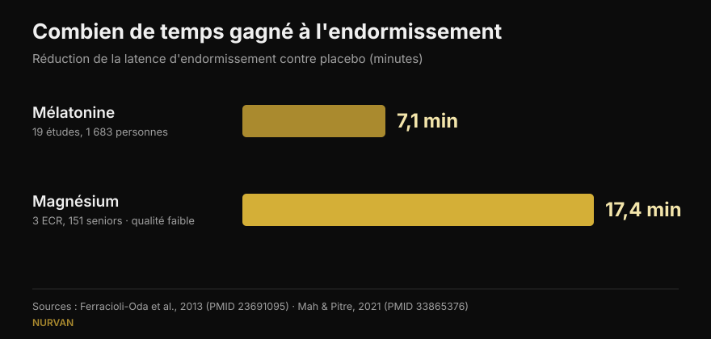
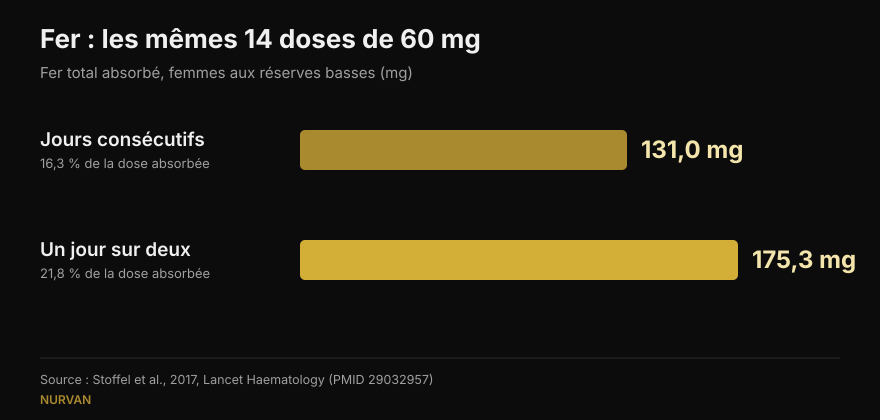

# Quand prendre ses compléments : l'heure compte-t-elle vraiment ?

Par [Giammaria Loi](/autore/giammaria-loi) · mis à jour le 15 octobre 2026

Presque chaque complément arrive avec sa règle horaire : la mélatonine une demi-heure avant le coucher, le fer à jeun, la créatine juste après la séance. Une publication très commentée affirme que pour la plupart d'entre eux cette règle ne change rien, et s'appuie sur huit références. Je les ai toutes lues : elles existent et sont pertinentes, ce qui, dans le fitness des réseaux sociaux, est déjà une nouvelle. Mais dans trois cas le chiffre cité cache un détail qui change la façon de l'utiliser — et la donnée la plus utile pour qui s'entraîne n'y figure pas du tout.

## L'essentiel

- **La mélatonine décale l'horloge biologique surtout en fin d'après-midi et presque pas durant la première moitié de la nuit.** Confirmé : chez 27 adultes, l'avance maximale est de 1,8 heure, avec une « zone morte » au début du sommeil (Burgess et al., 2008).
- **Mais celui qui la prend au coucher ne cherche pas à décaler une horloge : il veut s'endormir.** Cet effet, à peine évoqué dans la publication, vaut environ **7 minutes** de latence (Ferracioli-Oda et al., 2013).
- **Le fer est le cas où l'horaire décide vraiment** — mais la variable n'est pas l'heure, c'est l'intervalle. Un jour sur deux, **175 mg absorbés contre 131 mg**, à doses identiques (Stoffel et al., 2017). Chez des femmes aux réserves basses, pas chez tout le monde.
- **Le « +57 % » de la vitamine D vient de 17 patients sans groupe témoin**, avec une variabilité énorme (±36,7 %). Le principe — la prendre au repas le plus gras — tient ; le chiffre, non.
- **Ce qui manque à la publication** : l'horaire qui compte vraiment en salle n'est pas celui des gélules mais celui des protéines, et là, la méta-analyse montre que l'effet disparaît dès qu'on tient compte des protéines totales de la journée (Schoenfeld et al., 2013).

## Une publication contestée, mais avec ses sources à la bonne place

Dans les commentaires, on l'accuse d'avoir été générée par une intelligence artificielle : un lecteur dit que le graphique sur la mélatonine est faux, un autre que la diapositive sur le fer se contredit, un troisième demande simplement qu'on lui explique. Critiques légitimes sur la forme. Sur le fond, pourtant, les huit PMID existent, portent bien sur le sujet auquel ils sont rattachés et donnent pour l'essentiel les chiffres qu'on leur attribue. C'est mieux que la moyenne des carrousels que nous vérifions ici.

Le problème, ce ne sont pas les citations : c'est ce qu'il y a entre elles. Un chiffre exact, sorti du contexte dans lequel il a été mesuré, devient une règle qui ne s'applique peut-être pas à vous.

## Mélatonine : décaler l'horloge et s'endormir, deux choses différentes

C'est le point qui a le plus troublé les lecteurs, et la confusion est fondée : la mélatonine fait deux travaux distincts.

Le premier est **déplacer l'horloge biologique**. L'étude citée est solide : Burgess et ses collègues ont donné 3 mg de mélatonine à 27 adultes libres de contraintes horaires et construit une courbe indiquant de combien l'hormone décale le rythme selon l'heure de prise. L'avance maximale s'obtient en fin d'après-midi, environ 5 heures avant le début de la production naturelle de mélatonine, et vaut **1,8 heure**. Dans la première moitié du sommeil habituel, il existe une zone où l'effet est quasi nul. Les auteurs concluent eux-mêmes que l'usage nocturne comme somnifère a un effet minime sur le décalage de phase. Tout cela, la publication le rapporte correctement.

Le second travail est **vous aider à vous endormir plus tôt**. C'est un autre mécanisme, et la publication l'expédie d'un « ça peut quand même donner envie de dormir ». De combien ? La méta-analyse la plus citée — 19 études, 1 683 personnes souffrant de troubles primaires du sommeil — mesure une réduction de la latence de **7,06 minutes** (IC 95 % 4,37-9,75) et 8,25 minutes de sommeil total en plus. Statistiquement robuste, cliniquement faible. Cette donnée change les attentes de quiconque achète de la mélatonine, et elle est absente de la publication.

*Deux chiffres que la publication ne met jamais côte à côte. Attention à la qualité des preuves : celui de la mélatonine vient de 19 études, celui du magnésium de 3 essais chez des seniors que les auteurs jugent eux-mêmes de faible qualité.*

## Fer : ici l'horaire compte, mais la variable est l'intervalle

Sur ce point la publication a entièrement raison, et c'est le cas le plus intéressant des huit. Le fer augmente l'hepcidine, l'hormone qui ferme l'absorption, et l'hepcidine reste élevée assez longtemps pour pénaliser la dose du lendemain.

Dans l'essai de Stoffel et collègues, publié dans *Lancet Haematology*, des femmes à ferritine basse ont pris 60 mg de fer pendant 14 jours consécutifs, ou les mêmes 14 doses un jour sur deux sur 28 jours. Résultat : **131,0 mg absorbés contre 175,3 mg**, soit 16,3 % de la dose contre 21,8 % (p = 0,0010). Fractionner la dose quotidienne en deux n'a rien apporté (p = 0,33) et a fait monter l'hepcidine.

*Mêmes doses, résultat différent : un jour sur deux, on absorbe environ un tiers de plus. Essai chez des femmes de 18 à 40 ans avec une ferritine ≤ 25 µg/L.*

**Ce que la publication ne dit pas** : les participantes étaient des femmes dont les réserves en fer étaient déjà épuisées. Ce n'est pas un résultat pour la population générale, et la supplémentation en fer est un traitement que l'on règle sur des analyses, pas quelque chose que l'on commence parce qu'on se sent fatigué. Le schéma un jour sur deux est une discussion à avoir avec celui qui a prescrit le fer.

Sur le café, la publication est précise : dans l'étude de Morck et collègues de 1983, le café bu **une heure avant** le repas ne réduisait pas l'absorption, tandis que le même café **une heure après** la faisait passer d'environ 5,9 % à environ 1,6 %. À préciser toutefois : il s'agissait de fer non héminique alimentaire, pas d'un comprimé de fer, et les sujets avaient des réserves normales.

## Vitamine D et oméga-3 : ce n'est pas l'heure, c'est le repas

Le mécanisme est bien posé — ce sont des liposolubles, donc c'est le gras du repas qui compte — mais les chiffres méritent une lecture plus fine.

**Vitamine D, +57 %.** Le chiffre est repris correctement (56,7 %), mais il vient d'une étude sur **17 patients, sans groupe témoin** : des personnes qui ne répondaient pas au traitement et à qui l'on a demandé de déplacer leur complément au repas le plus copieux. L'écart-type est de ±36,7 %, autrement dit l'augmentation variait énormément d'une personne à l'autre, et les doses allaient de 1 000 à 50 000 UI. Le conseil pratique reste sensé et gratuit ; le « +57 % » n'est pas une promesse.

**Oméga-3, 3 personnes sur 50.** Exact aussi : avec un repas pauvre en graisses, seuls 3 sujets sur 50 prenant la forme ester éthylique conservaient au moins la moitié de l'absorption obtenue avec un repas riche. Le contexte manquant est important : l'étude compare un produit sur ordonnance à 4 grammes avec un concurrent, et elle est signée et financée par l'entreprise qui fabrique ce concurrent — celui qui gagne. Cela ne la rend pas fausse, mais c'est un conflit d'intérêts qu'une diapositive devrait déclarer. Pour qui prend une huile de poisson ordinaire, la traduction pratique est simple : avec un repas, pas à jeun.

## Créatine et magnésium : où la publication a raison, et où elle s'arrête trop tôt

**Créatine.** L'essai cité a comparé 5 g avant contre 5 g après l'entraînement chez 19 pratiquants amateurs pendant 4 semaines : aucune différence statistiquement significative. Curieusement, la publication est plus prudente que les auteurs, qui concluent que l'après-séance est « possiblement meilleur » en s'appuyant sur la *magnitude-based inference*, une méthode aujourd'hui largement critiquée. Sur les tests standards, la différence n'existe pas. Pour la créatine, c'est la régularité qui compte, pas l'horloge : nous l'avions placée en tête de notre [classement des compléments pour la force](/fr/blog/classement-complements-force-tier-list).

**Magnésium.** La publication dit que les auteurs de la revue sur le sommeil ont qualifié les études de « médiocres ». C'est vrai, le mot y est. Mais cette même revue, en regroupant 3 essais randomisés chez 151 seniors, trouve une réduction de la latence de **17,36 minutes** (p = 0,0006) : plus du double de la mélatonine. Avec une certitude bien moindre, dans une autre population et sur très peu de personnes. Expédier cela d'un « preuves médiocres » enterre le chiffre le plus curieux de toute la publication.

**Caféine.** Ici la publication est juste : 400 mg pris 6 heures avant le coucher perturbent le sommeil de façon mesurable par rapport au placebo. Traduire cela en « quatre tasses » est le point faible, et un lecteur le souligne : la caféine d'une tasse varie énormément. Nous l'avons détaillé dans [à quelle heure arrêter le café](/fr/blog/cafeine-sommeil-quand-arreter-le-cafe).

## Ce que dit vraiment la recherche

| Affirmation de la publication | Verdict | Pourquoi |
|---|---|---|
| La mélatonine décale très peu l'horloge si elle est prise au coucher | **Confirmé** | Zone morte au début du sommeil ; avance maximale de 1,8 h en fin d'après-midi (Burgess 2008) |
| « Ça peut quand même donner envie de dormir » | **À nuancer** | L'effet existe mais vaut 7,06 minutes de latence en moins (Ferracioli-Oda 2013) |
| Caféine 6 heures avant : sommeil perturbé | **Confirmé** | 400 mg à 0, 3 et 6 heures : les trois significatifs contre placebo (Drake 2013) |
| Fer un jour sur deux : 175 mg contre 131 mg | **Confirmé** | Mais chez des femmes à ferritine ≤ 25 µg/L, pas en population générale (Stoffel 2017) |
| Café une heure avant inoffensif, une heure après nuisible | **Confirmé** | De 5,88 % à 1,64 % ; concerne le fer du repas, pas le comprimé (Morck 1983) |
| Vitamine D au repas le plus copieux : +57 % | **À nuancer** | 17 patients, sans témoin, ±36,7 % de variabilité (Mulligan 2010) |
| Oméga-3 : 3 sur 50 avec un repas pauvre en gras | **À nuancer** | Étude de l'entreprise du produit gagnant, dose de 4 g sur ordonnance (Davidson 2012) |
| Créatine : avant ou après, aucune différence | **Confirmé** | Rien sur les tests standards ; les auteurs concluent l'inverse avec une méthode critiquée (Antonio 2013) |
| Magnésium : preuves médiocres | **À nuancer** | Vrai sur la qualité, mais l'effet mesuré est de −17,36 minutes de latence (Mah 2021) |

## L'horaire qui compte vraiment, absent de la publication

Si vous vous entraînez, la question d'horaire que vous vous posez vraiment ne concerne pas la mélatonine : elle concerne les protéines, la fameuse fenêtre anabolique.

La méta-régression de Schoenfeld, Aragon et Krieger a réuni 23 études sur l'hypertrophie et 20 sur la force. Dans une analyse simple, prendre des protéines autour de la séance semblait donner un avantage faible à modéré sur l'hypertrophie. Une fois les covariables contrôlées, cet effet a disparu : le meilleur prédicteur de la croissance musculaire était **l'apport protéique total de la journée**, pas l'heure de la prise. Dans ces études, ceux qui faisaient du timing mangeaient simplement plus de protéines.

C'est le même principe pour presque tous les compléments de la liste : la dose quotidienne et la régularité décident du résultat, l'horloge presque jamais. Cela vaut aussi pour la composition corporelle : les grands leviers sont dans le total de la journée, comme nous l'avons vu à propos de la [recomposition corporelle](/fr/blog/recomposition-corporelle-perdre-gras-gagner-muscle).

## Comment l'appliquer

1. **Demandez-vous si votre complément entre dans l'une des trois catégories qui ont un horaire.** Le fer (l'intervalle entre les prises), les liposolubles comme la vitamine D et les oméga-3 (le repas), et ce qui agit sur le sommeil ou la vigilance comme la caféine et la mélatonine (les heures par rapport au coucher). Tout le reste : prenez-le quand vous y pensez.
2. **Accrochez le complément à une habitude que vous avez déjà**, pas à une heure précise. Vitamine D et oméga-3 au repas principal : le gras est déjà là et l'habitude tient toute seule.
3. **Pour la créatine, choisissez le moment le plus pratique et n'en changez pas** : la régularité sur des mois pèse bien plus que trente minutes avant ou après.
4. **Si vous utilisez la mélatonine pour dormir, attendez-vous à quelques minutes de différence.** Si le problème est horaire — travail posté, décalage horaire — alors le moment compte, et c'est un sujet pour un médecin, pas pour un carrousel.
5. **Le fer uniquement sur avis médical et sur la base d'analyses.** Le schéma un jour sur deux est une question pour celui qui l'a prescrit, pas une décision à prendre seul.

> ### Avec Nurvan, la supplémentation cesse d'être une liste d'horaires
> La section supplémentation de Nurvan enregistre ce que vous prenez, en quelle quantité et à quelle fréquence, et garde cette donnée à côté de l'entraînement, du journal alimentaire et des analyses. Quand vous vous demandez « est-ce que ça marche ? », vous regardez des semaines de régularité réelle, pas l'impression d'hier soir. **[Essayer Nurvan](https://nurvan.app)**

## Questions fréquentes

**À quelle heure prendre la mélatonine ?**
Cela dépend de l'objectif. Pour avancer l'horloge, l'effet est maximal en fin d'après-midi, bien avant le coucher, et quasi nul durant la première moitié de la nuit (Burgess et al., 2008). Pour vous endormir un peu plus tôt, on la prend le soir, mais l'effet moyen mesuré est d'environ 7 minutes. Si le problème est un vrai trouble du sommeil, parlez-en à un médecin.

**La créatine se prend-elle avant ou après l'entraînement ?**
L'essai qui compare les deux options ne trouve aucune différence statistiquement significative sur 4 semaines (Antonio et Ciccone, 2013). La prendre tous les jours, y compris les jours de repos, compte bien davantage.

**Faut-il prendre la vitamine D avec un repas ?**
Elle est liposoluble, donc mieux absorbée avec un repas contenant des graisses. Dans l'étude sur 17 patients, la déplacer au repas le plus copieux a augmenté les taux sanguins de 57 % en moyenne, mais il s'agissait d'une petite série sans groupe témoin et avec une forte variation individuelle.

**Le café bloque-t-il le fer ?**
Il réduit l'absorption du fer non héminique s'il est bu pendant le repas ou jusqu'à une heure après ; une heure avant, aucun effet mesurable (Morck et al., 1983). Sous traitement martial, l'astuce pratique est d'espacer le café de la prise de fer, selon les consignes de votre médecin.

## À lire aussi

- [Classement des compléments pour la force : ce que dit la recherche](/fr/blog/classement-complements-force-tier-list) — quelles substances font vraiment bouger votre maximal, de la créatine au HMB.
- [Caféine et sommeil : à quelle heure arrêter le café](/fr/blog/cafeine-sommeil-quand-arreter-le-cafe) — pourquoi « une tasse » n'est pas une dose, et combien d'heures il faut vraiment.
- [Recomposition corporelle : perdre du gras et gagner du muscle](/fr/blog/recomposition-corporelle-perdre-gras-gagner-muscle) — ce qui décide vraiment du résultat quand diète et entraînement avancent ensemble.

## Sources

1. Burgess HJ, Revell VL, Eastman CI, 2008. *A three pulse phase response curve to three milligrams of melatonin in humans.* The Journal of Physiology 586(2):639-47. PMID [18006583](https://pubmed.ncbi.nlm.nih.gov/18006583/) · DOI [10.1113/jphysiol.2007.143180](https://doi.org/10.1113/jphysiol.2007.143180)
2. Ferracioli-Oda E, Qawasmi A, Bloch MH, 2013. *Meta-analysis: melatonin for the treatment of primary sleep disorders.* PLoS One 8(5):e63773. PMID [23691095](https://pubmed.ncbi.nlm.nih.gov/23691095/) · DOI [10.1371/journal.pone.0063773](https://doi.org/10.1371/journal.pone.0063773)
3. Drake C, Roehrs T, Shambroom J, Roth T, 2013. *Caffeine effects on sleep taken 0, 3, or 6 hours before going to bed.* Journal of Clinical Sleep Medicine 9(11):1195-200. PMID [24235903](https://pubmed.ncbi.nlm.nih.gov/24235903/) · DOI [10.5664/jcsm.3170](https://doi.org/10.5664/jcsm.3170)
4. Stoffel NU, Cercamondi CI, Brittenham G, et al., 2017. *Iron absorption from oral iron supplements given on consecutive versus alternate days...* The Lancet Haematology 4(11):e524-e533. PMID [29032957](https://pubmed.ncbi.nlm.nih.gov/29032957/) · DOI [10.1016/S2352-3026(17)30182-5](https://doi.org/10.1016/S2352-3026(17)30182-5)
5. Morck TA, Lynch SR, Cook JD, 1983. *Inhibition of food iron absorption by coffee.* The American Journal of Clinical Nutrition 37(3):416-20. PMID [6402915](https://pubmed.ncbi.nlm.nih.gov/6402915/) · DOI [10.1093/ajcn/37.3.416](https://doi.org/10.1093/ajcn/37.3.416)
6. Mulligan GB, Licata A, 2010. *Taking vitamin D with the largest meal improves absorption and results in higher serum levels of 25-hydroxyvitamin D.* Journal of Bone and Mineral Research 25(4):928-30. PMID [20200983](https://pubmed.ncbi.nlm.nih.gov/20200983/) · DOI [10.1002/jbmr.67](https://doi.org/10.1002/jbmr.67)
7. Davidson MH, Johnson J, Rooney MW, Kyle ML, Kling DF, 2012. *A novel omega-3 free fatty acid formulation has dramatically improved bioavailability during a low-fat diet compared with omega-3-acid ethyl esters: the ECLIPSE study.* Journal of Clinical Lipidology 6(6):573-84. PMID [23312053](https://pubmed.ncbi.nlm.nih.gov/23312053/) · DOI [10.1016/j.jacl.2012.01.002](https://doi.org/10.1016/j.jacl.2012.01.002)
8. Antonio J, Ciccone V, 2013. *The effects of pre versus post workout supplementation of creatine monohydrate on body composition and strength.* Journal of the International Society of Sports Nutrition 10:36. PMID [23919405](https://pubmed.ncbi.nlm.nih.gov/23919405/) · DOI [10.1186/1550-2783-10-36](https://doi.org/10.1186/1550-2783-10-36)
9. Mah J, Pitre T, 2021. *Oral magnesium supplementation for insomnia in older adults: a Systematic Review & Meta-Analysis.* BMC Complementary Medicine and Therapies 21(1):125. PMID [33865376](https://pubmed.ncbi.nlm.nih.gov/33865376/) · DOI [10.1186/s12906-021-03297-z](https://doi.org/10.1186/s12906-021-03297-z)
10. Schoenfeld BJ, Aragon AA, Krieger JW, 2013. *The effect of protein timing on muscle strength and hypertrophy: a meta-analysis.* Journal of the International Society of Sports Nutrition 10(1):53. PMID [24299050](https://pubmed.ncbi.nlm.nih.gov/24299050/) · DOI [10.1186/1550-2783-10-53](https://doi.org/10.1186/1550-2783-10-53)

Recherches bibliographiques effectuées sur PubMed. Point de départ : la publication de William Wallace ([@dr.williamwallace](https://www.instagram.com/p/Dc_e9fmkc1z/), 7 septembre 2026). Aucun texte ni aucune image de la publication n'ont été reproduits : ses références ont été relues dans les sources d'origine.

---

Giammaria Loi est le fondateur de Nurvan. Il s'entraîne avec des charges depuis 2012, travaille comme entraîneur personnel et coach certifié FIPE depuis 2013 et participe à des compétitions de powerlifting au niveau national depuis 2018. Chaque article qu'il signe part des études scientifiques et aboutit à ce qui fonctionne vraiment en salle. [Page de l'auteur](/autore/giammaria-loi)

> Note : contenu informatif, qui ne remplace pas l'avis d'un médecin ou d'un professionnel. La supplémentation en fer et les troubles du sommeil nécessitent une évaluation médicale individuelle.
