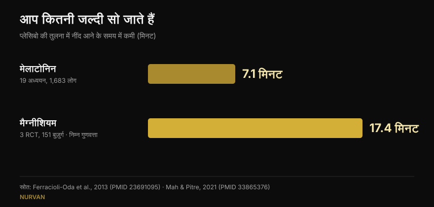
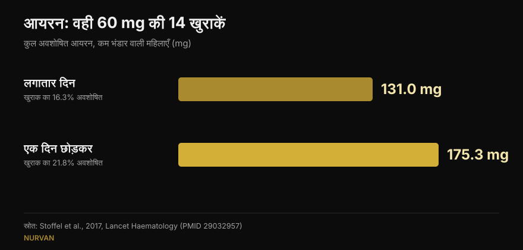

# सप्लीमेंट कब लें: क्या वाकई समय से फर्क पड़ता है?

लेखक: [जियाम्मारिया लोई](/autore/giammaria-loi) · 15 अक्टूबर 2026 को अपडेट किया गया

लगभग हर सप्लीमेंट के साथ समय का एक नियम आता है: मेलाटोनिन सोने से आधा घंटा पहले, आयरन खाली पेट, क्रिएटिन वर्कआउट के तुरंत बाद। एक चर्चित पोस्ट कहती है कि ज़्यादातर सप्लीमेंट्स के लिए यह नियम कुछ नहीं बदलता, और इसके समर्थन में आठ संदर्भ देती है। मैंने आठों पढ़े: वे मौजूद हैं और विषय से जुड़े हैं — सोशल मीडिया की फिटनेस दुनिया में यह अपने आप में खबर है। लेकिन तीन जगहों पर दिया गया आँकड़ा एक ऐसी बात छिपा लेता है जो आपके इस्तेमाल का तरीका बदल देती है — और जो डेटा ट्रेनिंग करने वालों के लिए सबसे काम का है, वह पोस्ट में है ही नहीं।

## संक्षेप में

- **मेलाटोनिन शरीर की घड़ी को मुख्य रूप से देर दोपहर में खिसकाता है, रात के पहले हिस्से में लगभग बिल्कुल नहीं।** पुष्ट: 27 वयस्कों में अधिकतम बदलाव 1.8 घंटे का था, और नींद के शुरुआती हिस्से में एक "मृत क्षेत्र" है (Burgess et al., 2008)।
- **लेकिन जो इसे सोने से पहले लेता है, वह घड़ी नहीं खिसकाना चाहता: वह सोना चाहता है।** यह असर, जिसे पोस्ट बस छू कर निकल जाती है, लगभग **7 मिनट** की नींद-विलंबता के बराबर है (Ferracioli-Oda et al., 2013)।
- **आयरन वही मामला है जहाँ समय सचमुच नतीजा तय करता है** — पर चर घंटा नहीं, अंतराल है। एक दिन छोड़कर लेने पर **175 mg बनाम 131 mg** अवशोषित हुआ, वही खुराकें होते हुए (Stoffel et al., 2017)। कम भंडार वाली महिलाओं में, हर किसी में नहीं।
- **विटामिन डी का "+57%" 17 मरीज़ों से आया है, वह भी बिना नियंत्रण समूह के**, और बहुत बड़े बिखराव के साथ (±36.7%)। सिद्धांत — सबसे चिकनाई वाले भोजन के साथ लेना — सही है; आँकड़ा नहीं।
- **पोस्ट में जो नहीं है**: जिम में जो समय सचमुच मायने रखता है वह गोलियों का नहीं, प्रोटीन का है — और वहाँ मेटा-विश्लेषण कहता है कि पूरे दिन का कुल प्रोटीन गिनते ही यह असर गायब हो जाता है (Schoenfeld et al., 2013)।

## विवादित पोस्ट, पर संदर्भ अपनी जगह सही

कमेंट्स में आरोप है कि पोस्ट एआई से बनी है: एक पाठक कहता है मेलाटोनिन का ग्राफ गलत है, दूसरा कहता है आयरन वाली स्लाइड खुद का खंडन करती है, तीसरा बस समझाने को कहता है। रूप पर ये आलोचनाएँ जायज़ हैं। लेकिन विषय-वस्तु में आठों PMID मौजूद हैं, सचमुच उन्हीं विषयों से जुड़े हैं जिनके साथ लगाए गए हैं, और ज़्यादातर वही आँकड़े देते हैं जो उन्हें सौंपे गए हैं। यह उन कैरोसेल्स के औसत से बेहतर है जिन्हें हम यहाँ जाँचते हैं।

समस्या संदर्भों में नहीं, उनके बीच की बातों में है: एक सही आँकड़ा, जिस संदर्भ में मापा गया था उससे अलग करके रख दिया जाए, तो वह ऐसा नियम बन जाता है जो शायद आप पर लागू ही न हो।

## मेलाटोनिन: घड़ी खिसकाना और नींद आना दो अलग काम हैं

यही वह बिंदु है जिसने सबसे ज़्यादा पाठकों को उलझाया, और उलझन वाजिब है: मेलाटोनिन दो अलग काम करता है।

पहला है **शरीर की घड़ी खिसकाना**। उद्धृत अध्ययन मज़बूत है: बर्गेस और साथियों ने समय की बंदिशों से मुक्त 27 वयस्कों को 3 mg मेलाटोनिन दिया और एक वक्र बनाया जो बताता है कि लेने के समय के हिसाब से हार्मोन लय को कितना खिसकाता है। सबसे बड़ा बदलाव देर दोपहर में आता है, शरीर के अपने मेलाटोनिन बनने से करीब 5 घंटे पहले, और वह **1.8 घंटे** का है। आदतन नींद के पहले आधे हिस्से में एक क्षेत्र है जहाँ असर लगभग शून्य है। लेखक खुद लिखते हैं कि रात में नींद की दवा की तरह इस्तेमाल करने पर चरण-बदलाव का असर बहुत कम है। यह सब पोस्ट सही बताती है।

दूसरा काम है **आपको जल्दी सुला देना**। यह अलग तंत्र है, और पोस्ट इसे "फिर भी नींद आ सकती है" कहकर निपटा देती है। कितनी? सबसे ज़्यादा उद्धृत मेटा-विश्लेषण — 19 अध्ययन, प्राथमिक नींद-विकार वाले 1,683 लोग — नींद आने के समय में **7.06 मिनट** की कमी मापता है (95% CI 4.37-9.75) और कुल नींद में 8.25 मिनट की बढ़त। आँकड़ों की दृष्टि से पक्का, चिकित्सकीय रूप से छोटा। यह आँकड़ा मेलाटोनिन खरीदने वाले किसी भी व्यक्ति की उम्मीद बदल देता है, और पोस्ट में कहीं नहीं है।

*दो आँकड़े जिन्हें पोस्ट कभी साथ-साथ नहीं रखती। प्रमाण की गुणवत्ता पर ध्यान दें: मेलाटोनिन वाला आँकड़ा 19 अध्ययनों से है, मैग्नीशियम वाला बुज़ुर्गों पर 3 परीक्षणों से, जिन्हें समीक्षकों ने खुद निम्न गुणवत्ता का बताया।*

## आयरन: यहाँ समय मायने रखता है, पर चर अंतराल है

यहाँ पोस्ट पूरी तरह सही है, और यह आठों में सबसे दिलचस्प मामला है। आयरन हेप्सिडिन बढ़ाता है — वही हार्मोन जो अवशोषण बंद करता है — और हेप्सिडिन इतनी देर तक ऊँचा रहता है कि अगले दिन की खुराक को नुकसान पहुँचा दे।

*Lancet Haematology* में छपे स्टोफल और साथियों के परीक्षण में, कम फेरिटिन वाली महिलाओं ने या तो लगातार 14 दिन 60 mg आयरन लिया, या वही 14 खुराकें 28 दिनों में एक दिन छोड़कर लीं। नतीजा: **131.0 mg बनाम 175.3 mg अवशोषित**, यानी खुराक का 16.3% बनाम 21.8% (p = 0.0010)। दैनिक खुराक को दो हिस्सों में बाँटने से फायदा नहीं हुआ (p = 0.33), उल्टे हेप्सिडिन और बढ़ा।

*वही खुराकें, अलग नतीजा: एक दिन छोड़कर लेने पर लगभग एक-तिहाई ज़्यादा अवशोषित होता है। परीक्षण 18 से 40 वर्ष की, फेरिटिन ≤ 25 µg/L वाली महिलाओं पर।*

**पोस्ट जो नहीं बताती**: प्रतिभागी वे महिलाएँ थीं जिनका आयरन भंडार पहले ही खत्म हो चुका था। यह आम आबादी के लिए निष्कर्ष नहीं है, और आयरन लेना एक इलाज है जो खून की जाँच के आधार पर तय होता है — ऐसा कुछ नहीं जो थकान महसूस होने पर शुरू कर दिया जाए। एक दिन छोड़कर वाली योजना उस डॉक्टर से बात करने की चीज़ है जिसने आयरन लिखा है।

कॉफी पर पोस्ट सटीक है: मोर्क और साथियों के 1983 के अध्ययन में, भोजन से **एक घंटा पहले** पी गई कॉफी ने अवशोषण नहीं घटाया, जबकि वही कॉफी **एक घंटा बाद** पीने पर उसे लगभग 5.9% से घटाकर लगभग 1.6% कर दिया। पर स्पष्ट करना ज़रूरी है: वहाँ बात भोजन के नॉन-हीम आयरन की थी, आयरन की गोली की नहीं, और प्रतिभागियों का भंडार सामान्य था।

## विटामिन डी और ओमेगा-3: घंटा नहीं, भोजन मायने रखता है

तंत्र ठीक समझाया गया है — दोनों वसा में घुलनशील हैं, इसलिए जिस भोजन के साथ पहुँचते हैं उसकी चिकनाई मायने रखती है — पर आँकड़े ज़्यादा ध्यान से पढ़ने लायक हैं।

**विटामिन डी, +57%।** आँकड़ा सही उद्धृत है (56.7%), पर यह **17 मरीज़ों के, बिना नियंत्रण समूह वाले** अध्ययन से आता है: ऐसे लोग जो इलाज पर प्रतिक्रिया नहीं दे रहे थे और जिनसे कहा गया कि सप्लीमेंट सबसे बड़े भोजन के साथ लें। मानक विचलन ±36.7% है, यानी बढ़ोतरी व्यक्ति-दर-व्यक्ति बहुत अलग थी, और खुराकें 1,000 से 50,000 IU तक थीं। व्यावहारिक सलाह समझदारी भरी और मुफ्त है; "+57%" कोई वादा नहीं।

**ओमेगा-3, 50 में से 3 लोग।** यह भी सही है: कम वसा वाले भोजन के साथ, एथिल एस्टर रूप लेने वाले 50 में से केवल 3 प्रतिभागी उस अवशोषण का कम से कम आधा बचा पाए जो उन्हें चिकनाई वाले भोजन से मिलता था। जो संदर्भ छूट गया वह अहम है: अध्ययन 4 ग्राम की प्रिस्क्रिप्शन दवा की तुलना एक प्रतिस्पर्धी उत्पाद से करता है, और यह उसी कंपनी द्वारा लिखा और वित्तपोषित है जो उस प्रतिस्पर्धी — यानी जीतने वाले — उत्पाद को बनाती है। इससे यह झूठा नहीं हो जाता, पर यह हितों का टकराव है जिसे एक स्लाइड में बताया जाना चाहिए। जो आम फिश ऑयल लेते हैं, उनके लिए व्यावहारिक अनुवाद सरल है: भोजन के साथ, खाली पेट नहीं।

## क्रिएटिन और मैग्नीशियम: कहाँ पोस्ट सही है और कहाँ जल्दी रुक जाती है

**क्रिएटिन।** उद्धृत परीक्षण ने 19 शौकिया बॉडीबिल्डरों में 4 हफ्तों तक वर्कआउट से पहले 5 ग्राम बनाम बाद में 5 ग्राम की तुलना की: कोई सांख्यिकीय रूप से सार्थक अंतर नहीं। दिलचस्प बात यह है कि पोस्ट लेखकों से ज़्यादा सावधान है: वे अपने निष्कर्ष में कहते हैं कि वर्कआउट के बाद लेना "संभवतः बेहतर" है, और इसके लिए *magnitude-based inference* का सहारा लेते हैं, एक ऐसी विधि जिसकी आज व्यापक आलोचना होती है। मानक परीक्षणों में यह अंतर है ही नहीं। क्रिएटिन में निरंतरता मायने रखती है, घड़ी नहीं: हमने इसे अपनी [ताकत के सप्लीमेंट टियर लिस्ट](/hi/blog/strength-supplements-tier-list-hindi) में सबसे ऊपर रखा था।

**मैग्नीशियम।** पोस्ट कहती है कि नींद पर अध्ययनों की समीक्षा करने वालों ने प्रमाणों को "घटिया" बताया। सच है, समीक्षा में शब्द यही है। लेकिन उसी समीक्षा ने, 151 बुज़ुर्गों पर 3 यादृच्छिक परीक्षणों को जोड़कर, नींद आने के समय में **17.36 मिनट** की कमी पाई (p = 0.0006): मेलाटोनिन से दोगुने से भी ज़्यादा। बहुत कम निश्चितता के साथ, अलग आबादी में और बहुत कम लोगों पर। इसे "घटिया प्रमाण" कहकर निपटा देना पूरी पोस्ट का सबसे दिलचस्प आँकड़ा दबा देता है।

**कैफीन।** यहाँ पोस्ट सही है: सोने से 6 घंटे पहले लिए गए 400 mg प्लेसिबो की तुलना में नींद को मापने योग्य रूप से बिगाड़ते हैं। इसे "चार कप" में बदलना कमज़ोर कड़ी है, और एक पाठक यही कहता है: एक कप में कैफीन की मात्रा बहुत बदलती है। इस पर हमने विस्तार से [कॉफी कब बंद करें](/hi/blog/caffeine-neend-kab-coffee-band-karein) में लिखा है।

## शोध वास्तव में क्या कहता है

| पोस्ट का दावा | फैसला | क्यों |
|---|---|---|
| सोने से पहले लेने पर मेलाटोनिन घड़ी को बहुत कम खिसकाता है | **पुष्ट** | नींद के शुरुआती हिस्से में मृत क्षेत्र; देर दोपहर अधिकतम 1.8 घंटे (Burgess 2008) |
| "फिर भी नींद आ सकती है" | **स्पष्ट करना ज़रूरी** | असर है, पर वह 7.06 मिनट कम विलंबता के बराबर है (Ferracioli-Oda 2013) |
| सोने से 6 घंटे पहले कैफीन नींद बिगाड़ती है | **पुष्ट** | 400 mg 0, 3 और 6 घंटे पर: तीनों प्लेसिबो से सार्थक रूप से अलग (Drake 2013) |
| एक दिन छोड़कर आयरन: 175 mg बनाम 131 mg | **पुष्ट** | पर फेरिटिन ≤ 25 µg/L वाली महिलाओं में, आम आबादी में नहीं (Stoffel 2017) |
| एक घंटा पहले कॉफी ठीक, एक घंटा बाद नुकसानदेह | **पुष्ट** | 5.88% से 1.64%; बात भोजन के आयरन की है, गोली की नहीं (Morck 1983) |
| सबसे बड़े भोजन के साथ विटामिन डी: +57% | **स्पष्ट करना ज़रूरी** | 17 मरीज़, कोई नियंत्रण नहीं, ±36.7% बिखराव (Mulligan 2010) |
| ओमेगा-3: कम वसा वाले भोजन पर 50 में से 3 | **स्पष्ट करना ज़रूरी** | जीतने वाले उत्पाद की कंपनी का अध्ययन, 4 ग्राम प्रिस्क्रिप्शन खुराक (Davidson 2012) |
| क्रिएटिन: पहले या बाद से फर्क नहीं | **पुष्ट** | मानक परीक्षणों में अंतर नहीं; लेखक आलोचित विधि से उलटा निष्कर्ष निकालते हैं (Antonio 2013) |
| मैग्नीशियम: घटिया प्रमाण | **स्पष्ट करना ज़रूरी** | गुणवत्ता के बारे में सही, पर मापा गया असर −17.36 मिनट विलंबता है (Mah 2021) |

## वह समय जो सचमुच मायने रखता है, और पोस्ट में नहीं है

अगर आप ट्रेनिंग करते हैं, तो समय को लेकर जो सवाल आप सचमुच खुद से पूछते हैं वह मेलाटोनिन का नहीं है: वह प्रोटीन का है, यानी मशहूर "एनाबॉलिक विंडो"।

शॉनफेल्ड, एरेगन और क्रीगर के मेटा-रिग्रेशन ने मांसपेशी वृद्धि पर 23 और ताकत पर 20 अध्ययन जोड़े। साधारण विश्लेषण में वर्कआउट के आसपास प्रोटीन लेना मांसपेशी वृद्धि के लिए छोटा-से-मध्यम फायदा दिखता था। पर जैसे ही लेखकों ने सह-चरों को नियंत्रित किया, वह असर गायब हो गया: मांसपेशी वृद्धि का सबसे मज़बूत संकेतक **दिन भर का कुल प्रोटीन** था, न कि लेने का समय। उन अध्ययनों में जो लोग टाइमिंग कर रहे थे, वे बस ज़्यादा प्रोटीन खा रहे थे।

यही सिद्धांत सूची के लगभग हर सप्लीमेंट पर लागू होता है: नतीजा रोज़ की खुराक और निरंतरता तय करती है, घड़ी लगभग कभी नहीं। शरीर की संरचना पर भी यही लागू है: बड़े लीवर दिन के कुल में हैं, जैसा हमने [बॉडी रीकंपोज़िशन](/hi/blog/body-recomposition-charbi-ghataye-muscle-badhaye) पर लिखते हुए देखा।

## इसे कैसे लागू करें

1. **खुद से पूछें कि आपका सप्लीमेंट उन तीन श्रेणियों में से किसी में आता है या नहीं जिनका समय होता है।** आयरन (खुराकों के बीच का अंतराल), विटामिन डी और ओमेगा-3 जैसे वसा-घुलनशील (भोजन), और कैफीन व मेलाटोनिन जैसे नींद या सतर्कता पर असर डालने वाले (सोने के सापेक्ष घंटे)। बाकी सब: जब याद आए तब ले लें।
2. **सप्लीमेंट को किसी मौजूदा आदत से जोड़ें**, किसी सटीक घंटे से नहीं। विटामिन डी और ओमेगा-3 मुख्य भोजन के साथ: चिकनाई पहले से वहाँ है और आदत अपने आप टिकती है।
3. **क्रिएटिन के लिए सबसे सुविधाजनक समय चुनें और बदलें नहीं**: महीनों की निरंतरता सेशन से तीस मिनट पहले या बाद से कहीं ज़्यादा भारी पड़ती है।
4. **अगर आप नींद के लिए मेलाटोनिन लेते हैं, तो कुछ मिनटों के फर्क की उम्मीद रखें।** अगर समस्या समय-सारणी की है — शिफ्ट, जेट लैग — तो समय सचमुच मायने रखता है, और यह डॉक्टर से बात करने की चीज़ है, किसी कैरोसेल से नहीं।
5. **आयरन सिर्फ डॉक्टर की सलाह और जाँच के आधार पर।** एक दिन छोड़कर वाली योजना उसी से पूछने का सवाल है जिसने इसे लिखा है, अकेले लिया जाने वाला फैसला नहीं।

> ### Nurvan के साथ सप्लीमेंट लेना समय-सारणी नहीं, डेटा बन जाता है
> Nurvan का सप्लीमेंट सेक्शन दर्ज करता है कि आप क्या लेते हैं, कितना और कितनी बार, और इसे ट्रेनिंग, फूड डायरी और जाँच रिपोर्ट के साथ रखता है। तो जब आप पूछें "क्या यह काम कर रहा है?", आप कल रात के एहसास की जगह हफ्तों की असली निरंतरता देखेंगे। **[Nurvan आज़माएँ](https://nurvan.app)**

## अक्सर पूछे जाने वाले सवाल

**मेलाटोनिन किस समय लेना चाहिए?**
यह इस पर निर्भर करता है कि आप क्या चाहते हैं। घड़ी को आगे खिसकाने के लिए असर देर दोपहर में सबसे ज़्यादा होता है, सोने से कई घंटे पहले, और रात के पहले हिस्से में लगभग शून्य (Burgess et al., 2008)। थोड़ा जल्दी सोने के लिए इसे शाम को लिया जाता है, पर मापा गया औसत असर करीब 7 मिनट है। अगर असली नींद-विकार है तो डॉक्टर से बात करें।

**क्रिएटिन वर्कआउट से पहले लें या बाद में?**
दोनों विकल्पों की तुलना करने वाला परीक्षण 4 हफ्तों में कोई सांख्यिकीय रूप से सार्थक अंतर नहीं पाता (Antonio और Ciccone, 2013)। इसे हर दिन लेना, आराम के दिनों सहित, कहीं ज़्यादा मायने रखता है।

**क्या विटामिन डी खाने के साथ लेना चाहिए?**
यह वसा में घुलनशील है, इसलिए चिकनाई वाले भोजन के साथ बेहतर अवशोषित होता है। 17 मरीज़ों के अध्ययन में इसे सबसे बड़े भोजन पर ले जाने से खून के स्तर औसतन 57% बढ़े, पर वह बिना नियंत्रण समूह की छोटी शृंखला थी जिसमें व्यक्तिगत भिन्नता बहुत ज़्यादा थी।

**क्या कॉफी आयरन रोक देती है?**
भोजन के साथ या उसके एक घंटे के भीतर पीने पर यह नॉन-हीम आयरन का अवशोषण घटाती है; एक घंटा पहले पीने पर कोई मापने योग्य असर नहीं हुआ (Morck et al., 1983)। अगर आप आयरन का इलाज ले रहे हैं, तो व्यावहारिक कदम है कॉफी और खुराक के बीच समय का अंतर रखना, अपने डॉक्टर के निर्देश के अनुसार।

## यह भी पढ़ें

- [ताकत के सप्लीमेंट टियर लिस्ट: शोध क्या कहता है](/hi/blog/strength-supplements-tier-list-hindi) — क्रिएटिन से HMB तक, कौन से पदार्थ आपका अधिकतम वज़न सचमुच बढ़ाते हैं।
- [कैफीन और नींद: कॉफी कब बंद करें](/hi/blog/caffeine-neend-kab-coffee-band-karein) — "एक कप" खुराक क्यों नहीं है, और वास्तव में कितने घंटे चाहिए।
- [बॉडी रीकंपोज़िशन: चर्बी घटाएँ और मसल बढ़ाएँ](/hi/blog/body-recomposition-charbi-ghataye-muscle-badhaye) — जब डाइट और ट्रेनिंग साथ चलें तो नतीजा असल में क्या तय करता है।

## स्रोत

1. Burgess HJ, Revell VL, Eastman CI, 2008. *A three pulse phase response curve to three milligrams of melatonin in humans.* The Journal of Physiology 586(2):639-47. PMID [18006583](https://pubmed.ncbi.nlm.nih.gov/18006583/) · DOI [10.1113/jphysiol.2007.143180](https://doi.org/10.1113/jphysiol.2007.143180)
2. Ferracioli-Oda E, Qawasmi A, Bloch MH, 2013. *Meta-analysis: melatonin for the treatment of primary sleep disorders.* PLoS One 8(5):e63773. PMID [23691095](https://pubmed.ncbi.nlm.nih.gov/23691095/) · DOI [10.1371/journal.pone.0063773](https://doi.org/10.1371/journal.pone.0063773)
3. Drake C, Roehrs T, Shambroom J, Roth T, 2013. *Caffeine effects on sleep taken 0, 3, or 6 hours before going to bed.* Journal of Clinical Sleep Medicine 9(11):1195-200. PMID [24235903](https://pubmed.ncbi.nlm.nih.gov/24235903/) · DOI [10.5664/jcsm.3170](https://doi.org/10.5664/jcsm.3170)
4. Stoffel NU, Cercamondi CI, Brittenham G, et al., 2017. *Iron absorption from oral iron supplements given on consecutive versus alternate days...* The Lancet Haematology 4(11):e524-e533. PMID [29032957](https://pubmed.ncbi.nlm.nih.gov/29032957/) · DOI [10.1016/S2352-3026(17)30182-5](https://doi.org/10.1016/S2352-3026(17)30182-5)
5. Morck TA, Lynch SR, Cook JD, 1983. *Inhibition of food iron absorption by coffee.* The American Journal of Clinical Nutrition 37(3):416-20. PMID [6402915](https://pubmed.ncbi.nlm.nih.gov/6402915/) · DOI [10.1093/ajcn/37.3.416](https://doi.org/10.1093/ajcn/37.3.416)
6. Mulligan GB, Licata A, 2010. *Taking vitamin D with the largest meal improves absorption and results in higher serum levels of 25-hydroxyvitamin D.* Journal of Bone and Mineral Research 25(4):928-30. PMID [20200983](https://pubmed.ncbi.nlm.nih.gov/20200983/) · DOI [10.1002/jbmr.67](https://doi.org/10.1002/jbmr.67)
7. Davidson MH, Johnson J, Rooney MW, Kyle ML, Kling DF, 2012. *A novel omega-3 free fatty acid formulation has dramatically improved bioavailability during a low-fat diet compared with omega-3-acid ethyl esters: the ECLIPSE study.* Journal of Clinical Lipidology 6(6):573-84. PMID [23312053](https://pubmed.ncbi.nlm.nih.gov/23312053/) · DOI [10.1016/j.jacl.2012.01.002](https://doi.org/10.1016/j.jacl.2012.01.002)
8. Antonio J, Ciccone V, 2013. *The effects of pre versus post workout supplementation of creatine monohydrate on body composition and strength.* Journal of the International Society of Sports Nutrition 10:36. PMID [23919405](https://pubmed.ncbi.nlm.nih.gov/23919405/) · DOI [10.1186/1550-2783-10-36](https://doi.org/10.1186/1550-2783-10-36)
9. Mah J, Pitre T, 2021. *Oral magnesium supplementation for insomnia in older adults: a Systematic Review & Meta-Analysis.* BMC Complementary Medicine and Therapies 21(1):125. PMID [33865376](https://pubmed.ncbi.nlm.nih.gov/33865376/) · DOI [10.1186/s12906-021-03297-z](https://doi.org/10.1186/s12906-021-03297-z)
10. Schoenfeld BJ, Aragon AA, Krieger JW, 2013. *The effect of protein timing on muscle strength and hypertrophy: a meta-analysis.* Journal of the International Society of Sports Nutrition 10(1):53. PMID [24299050](https://pubmed.ncbi.nlm.nih.gov/24299050/) · DOI [10.1186/1550-2783-10-53](https://doi.org/10.1186/1550-2783-10-53)

साहित्य खोज PubMed पर की गई। शुरुआती बिंदु: विलियम वालेस की पोस्ट ([@dr.williamwallace](https://www.instagram.com/p/Dc_e9fmkc1z/), 7 सितंबर 2026)। पोस्ट का कोई पाठ या चित्र दोहराया नहीं गया: उसके संदर्भ मूल स्रोतों में दोबारा पढ़े गए।

---

जियाम्मारिया लोई Nurvan के संस्थापक हैं। वे 2012 से वेट ट्रेनिंग करते हैं, 2013 से FIPE-प्रमाणित पर्सनल ट्रेनर और कोच के रूप में काम करते हैं, और 2018 से राष्ट्रीय स्तर पर पावरलिफ्टिंग में प्रतिस्पर्धा करते हैं। वे जिस भी लेख पर हस्ताक्षर करते हैं वह वैज्ञानिक अध्ययनों से शुरू होकर वहाँ पहुँचता है जो जिम में सचमुच काम करता है। [लेखक पृष्ठ](/autore/giammaria-loi)

> नोट: यह जानकारीपरक सामग्री है, डॉक्टर या पेशेवर की राय का विकल्प नहीं। आयरन लेना और नींद के विकार व्यक्तिगत चिकित्सकीय मूल्यांकन माँगते हैं।
