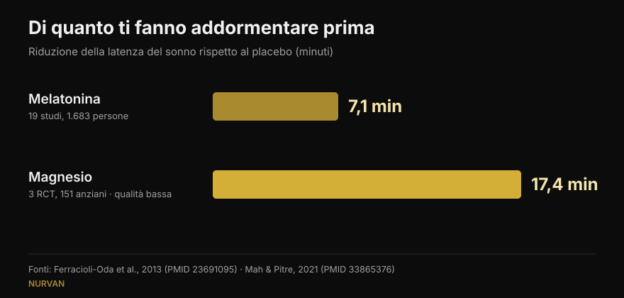
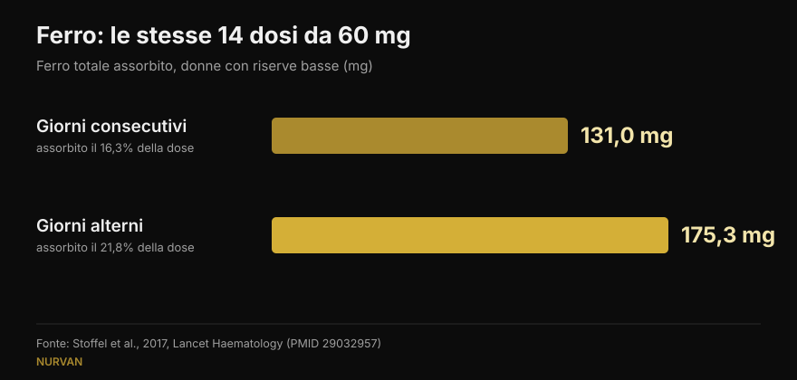

# Quando prendere gli integratori: l'ora conta davvero?

Di [Giammaria Loi](/autore/giammaria-loi) · aggiornato il 15 ottobre 2026

Quasi ogni integratore arriva con una regola sull'orario: la melatonina mezz'ora prima di dormire, il ferro a digiuno, la creatina subito dopo l'allenamento. Un post molto discusso sostiene che per quasi tutti questa regola non sposti nulla, e porta otto citazioni a sostegno. Li ho letti tutti e otto: esistono davvero e sono pertinenti, il che nel fitness sui social è già una notizia. Ma in tre casi il numero riportato nasconde un dettaglio che cambia come lo useresti — e il dato più utile, per chi si allena, nel post non c'è proprio.

## In breve

- **La melatonina sposta l'orologio biologico soprattutto nel tardo pomeriggio, quasi per niente nella prima metà della notte.** Confermato: su 27 adulti, l'anticipo massimo è 1,8 ore e nella prima parte del sonno abituale c'è una "zona morta" (Burgess et al., 2008).
- **Ma chi la prende prima di dormire di solito non vuole spostare l'orologio: vuole addormentarsi.** E quell'effetto, nel post solo accennato, vale in media **7 minuti** di latenza in meno (Ferracioli-Oda et al., 2013).
- **Il ferro è il caso in cui l'orario conta davvero**, ma non è l'orologio: è l'intervallo. A giorni alterni si assorbono **175 mg** contro i 131 mg della somministrazione quotidiana, a parità di dosi (Stoffel et al., 2017). Vale per donne con riserve basse, non per chiunque.
- **Il "+57%" della vitamina D viene da 17 pazienti senza gruppo di controllo**, con una variabilità enorme (±36,7%). Il principio — prenderla con il pasto più grasso — regge; il numero no.
- **Il dato che manca al post**: il timing che interessa davvero in palestra non è quello delle pillole ma quello delle proteine, e lì la meta-analisi dice che l'effetto sparisce quando si tiene conto delle proteine totali della giornata (Schoenfeld et al., 2013).

## Un post discusso, ma con le fonti al posto giusto

Nei commenti il post viene accusato di essere generato dall'intelligenza artificiale: un lettore scrive che il grafico sulla melatonina è sbagliato, un altro che la slide sul ferro si contraddice, un terzo chiede semplicemente di spiegare meglio. Sono critiche legittime sulla forma. Sul merito, però, gli otto PMID citati esistono tutti, riguardano davvero gli argomenti a cui sono associati e in gran parte riportano i numeri che il post attribuisce loro. È un risultato migliore della media dei caroselli che verifichiamo qui.

Il problema non sono le citazioni: è quello che sta nel mezzo. Un numero corretto, tolto dal contesto in cui è stato misurato, diventa una regola che non si applica a te.

## Melatonina: spostare l'orologio e addormentarsi sono due cose diverse

Questo è il punto che nei commenti ha confuso più persone, e la confusione nasce dal fatto che la melatonina fa due lavori distinti.

Il primo è **spostare l'orologio biologico**. Qui lo studio citato è solido: Burgess e colleghi hanno somministrato 3 mg di melatonina a 27 adulti liberi dai vincoli di orario, costruendo una curva che dice quanto l'ormone sposta il ritmo a seconda dell'ora di assunzione. Il massimo anticipo si ottiene nel tardo pomeriggio, circa 5 ore prima dell'inizio della produzione naturale di melatonina, e vale **1,8 ore**. Nella prima metà del sonno abituale c'è una zona in cui l'effetto è praticamente nullo. Gli autori stessi concludono che usarla come sonnifero di notte ha un effetto minimo sullo spostamento di fase. Il post riporta tutto questo correttamente.

Il secondo lavoro è **farti addormentare prima**. È un effetto diverso, e il post lo liquida con un "può comunque farti venire sonno". Quanto sonno? La meta-analisi più citata, 19 studi e 1.683 persone con disturbi primari del sonno, misura una riduzione della latenza di **7,06 minuti** (intervallo di confidenza 4,37–9,75) e un aumento del tempo totale di sonno di 8,25 minuti. Statisticamente solido, clinicamente piccolo. È un'informazione che cambia le aspettative di chiunque compri melatonina per dormire, e nel post non c'è.

*Due numeri che il post non mette mai uno accanto all'altro. Attenzione alla qualità delle prove: il dato sulla melatonina viene da 19 studi, quello sul magnesio da 3 studi su anziani, giudicati di qualità bassa dagli autori stessi.*

## Ferro: l'orario conta, ma la variabile è l'intervallo

Qui il post ha pienamente ragione, ed è il caso più interessante di tutti. Il ferro alza l'epcidina, l'ormone che chiude l'assorbimento, e l'epcidina resta alta abbastanza a lungo da penalizzare la dose del giorno dopo.

Nello studio di Stoffel e colleghi, pubblicato su *Lancet Haematology*, donne con ferritina bassa hanno ricevuto 60 mg di ferro per 14 giorni consecutivi oppure le stesse 14 dosi a giorni alterni, nell'arco di 28 giorni. Risultato: **131,0 mg assorbiti contro 175,3 mg**, cioè il 16,3% della dose contro il 21,8% (p = 0,0010). Dividere la dose in due prese giornaliere non ha aiutato (p = 0,33) e anzi alzava l'epcidina.

*Stesse dosi, risultato diverso: a giorni alterni si assorbe un terzo di ferro in più. Studio su donne di 18-40 anni con ferritina ≤ 25 µg/L.*

**Il dettaglio che il post non dice**: le partecipanti erano donne con riserve di ferro basse. Non è uno studio sulla popolazione generale, e l'integrazione di ferro è una terapia che si imposta su esami del sangue, non un integratore da prendere perché ci si sente stanchi. Lo schema a giorni alterni è una cosa da discutere con chi ti ha prescritto il ferro.

Sul caffè il post è preciso: nello studio del 1983 di Morck e colleghi, il caffè bevuto **un'ora prima** del pasto non riduceva l'assorbimento, mentre lo stesso caffè **un'ora dopo** lo tagliava da circa il 5,9% a circa l'1,6%. Da precisare, però, che lì si parlava di ferro alimentare da un pasto, non di una compressa di ferro, e che i soggetti avevano riserve normali.

## Vitamina D e omega-3: non è l'ora, è il pasto

Su questi due il post inquadra bene il meccanismo — sono liposolubili, quindi conta il grasso del pasto in cui arrivano — ma i numeri meritano una lettura più attenta.

**Vitamina D, +57%.** Il numero è riportato correttamente (56,7%), ma viene da uno studio su **17 pazienti, senza gruppo di controllo**, che non rispondevano alla terapia e a cui è stato chiesto di spostare l'integratore al pasto più abbondante. La deviazione standard è ±36,7%: significa che l'aumento variava enormemente da persona a persona. Le dosi andavano da 1.000 a 50.000 UI. Il consiglio pratico resta sensato e a costo zero; il "+57%" non è una promessa.

**Omega-3, 3 persone su 50.** Anche questo è esatto: con un pasto povero di grassi, solo 3 soggetti su 50 che assumevano la forma estere etilico mantenevano almeno metà dell'assorbimento che avevano con un pasto ricco. Il contesto che manca è rilevante: lo studio confronta un prodotto su prescrizione da 4 grammi con un prodotto concorrente, ed è firmato e finanziato dall'azienda che produce il concorrente, risultato vincente. Non lo rende falso, ma è un conflitto di interessi che una slide dovrebbe dichiarare. Per chi prende un comune olio di pesce da banco, la traduzione pratica è semplice: con un pasto, non a stomaco vuoto.

## Creatina e magnesio: dove il post ha ragione, e dove si ferma presto

**Creatina.** Lo studio citato ha confrontato 5 g prima contro 5 g dopo l'allenamento in 19 bodybuilder amatoriali per 4 settimane: nessuna differenza statisticamente significativa. Curiosamente, il post è più prudente degli autori: nelle conclusioni loro scrivono che il post-allenamento è "possibilmente migliore", usando un metodo statistico — la *magnitude-based inference* — oggi largamente criticato. Sui test standard, la differenza non c'è. Per la creatina quello che conta è la costanza, non l'orologio: se ti interessa il quadro completo, l'abbiamo messa in cima alla [tier list degli integratori per la forza](/blog/classifica-integratori-forza-tier-list).

**Magnesio.** Il post dice che chi ha passato in rassegna gli studi sul sonno li ha definiti "scadenti". È vero, la parola nella revisione è esattamente quella. Ma la stessa revisione, mettendo insieme 3 studi randomizzati su 151 anziani, trova una riduzione della latenza del sonno di **17,36 minuti** (p = 0,0006): più del doppio di quella della melatonina. Con una certezza molto più bassa, su una popolazione diversa e con un numero di persone molto piccolo. Liquidarlo con "evidenza scadente" nasconde il numero più curioso dell'intero post.

**Caffeina.** Qui il post è corretto: 400 mg assunti 6 ore prima di coricarsi disturbano il sonno in modo misurabile rispetto al placebo. La traduzione in "quattro tazze" è però il punto debole, e un lettore lo fa notare nei commenti: la caffeina di una tazzina varia enormemente. Ne abbiamo scritto per esteso in [a che ora smettere col caffè](/blog/caffeina-sonno-quando-smettere-caffe).

## Cosa dice davvero la ricerca

| Affermazione del post | Verdetto | Perché |
|---|---|---|
| La melatonina sposta l'orologio pochissimo se presa prima di dormire | **Confermato** | Zona morta nella prima metà del sonno; anticipo massimo 1,8 h nel tardo pomeriggio (Burgess 2008) |
| "Può comunque farti venire sonno" | **Da precisare** | L'effetto esiste ma vale 7,06 minuti di latenza in meno (Ferracioli-Oda 2013) |
| Caffeina 6 ore prima disturba il sonno | **Confermato** | 400 mg a 0, 3 e 6 ore: tutte e tre significative contro placebo (Drake 2013) |
| Ferro a giorni alterni: 175 mg contro 131 mg | **Confermato** | Ma in donne con ferritina ≤ 25 µg/L, non nella popolazione generale (Stoffel 2017) |
| Caffè un'ora prima innocuo, un'ora dopo dannoso | **Confermato** | Da 5,88% a 1,64%; riguarda il ferro del pasto, non la compressa (Morck 1983) |
| Vitamina D col pasto più grande: +57% | **Da precisare** | 17 pazienti, nessun controllo, ±36,7% di variabilità (Mulligan 2010) |
| Omega-3: 3 su 50 con pasto povero di grassi | **Da precisare** | Studio dell'azienda del prodotto vincente, dose da 4 g su prescrizione (Davidson 2012) |
| Creatina: prima o dopo non cambia | **Confermato** | Nessuna differenza sui test standard; gli autori concludono il contrario con un metodo criticato (Antonio 2013) |
| Magnesio: evidenza scadente | **Da precisare** | Vero sulla qualità, ma l'effetto misurato è −17,36 minuti di latenza (Mah 2021) |

## Il timing che conta davvero, e che nel post non c'è

Se ti alleni, la domanda sul timing che ti fai più spesso non riguarda la melatonina: riguarda le proteine, cioè la famosa "finestra anabolica".

La meta-regressione di Schoenfeld, Aragon e Krieger ha messo insieme 23 studi sull'ipertrofia e 20 sulla forza. In un'analisi semplice, assumere proteine attorno all'allenamento sembrava avere un effetto piccolo-moderato sull'ipertrofia. Quando però gli autori hanno controllato le covariate, quell'effetto è sparito: il predittore più forte della crescita muscolare era **l'apporto proteico totale della giornata**, non l'ora in cui lo assumevi. Chi faceva timing, negli studi, mangiava semplicemente più proteine.

È lo stesso principio che vale per quasi tutti gli integratori della lista: la dose quotidiana e la costanza decidono il risultato, l'orologio quasi mai. Lo stesso vale quando lavori sulla composizione corporea: le variabili grosse stanno nel totale della giornata, come abbiamo visto parlando di [ricomposizione corporea](/blog/ricomposizione-corporea-perdere-grasso-guadagnare-muscolo).

## Come applicarlo

1. **Chiediti se il tuo integratore è in una delle tre categorie che hanno un orario.** Ferro (intervallo fra le dosi), liposolubili come vitamina D e omega-3 (il pasto), sostanze che agiscono sul sonno o sulla vigilanza come caffeina e melatonina (le ore rispetto al letto). Tutto il resto: prendilo quando ti ricordi di prenderlo.
2. **Lega l'integratore a un'abitudine già esistente**, non a un orario preciso. Vitamina D e omega-3 al pasto principale: il grasso c'è già e l'abitudine regge da sola.
3. **Per la creatina scegli il momento più comodo e non cambiarlo**: la costanza nel tempo pesa molto più dei trenta minuti prima o dopo.
4. **Se usi la melatonina per dormire, aspettati pochi minuti di differenza.** Se invece hai un problema di orario — turni, fuso orario — il momento conta e l'argomento va affrontato con un medico, non con un carosello.
5. **Ferro solo su indicazione medica e sulla base degli esami.** Lo schema a giorni alterni è una domanda da fare a chi te l'ha prescritto, non una decisione da prendere da solo.

> ### Con Nurvan l'integrazione smette di essere una lista di orari
> La sezione integrazione di Nurvan ti fa registrare che cosa prendi, quanto e con quale frequenza, e tiene insieme questo dato con allenamento, diario alimentare ed esami. Così quando ti chiedi "sto migliorando?" guardi la costanza reale di settimane, non la sensazione di ieri sera. **[Prova Nurvan](https://nurvan.app)**

## Domande frequenti

**A che ora si prende la melatonina?**
Dipende da cosa vuoi ottenere. Per spostare l'orologio in avanti l'effetto è massimo nel tardo pomeriggio, molte ore prima di dormire, e quasi nullo nella prima metà della notte (Burgess et al., 2008). Per addormentarti un po' prima la si prende la sera, ma l'effetto medio misurato è di circa 7 minuti. Se il problema è un disturbo del sonno vero, parlane con il medico.

**La creatina va presa prima o dopo l'allenamento?**
Nello studio che confronta le due opzioni non emergono differenze statisticamente significative in 4 settimane (Antonio e Ciccone, 2013). Conta molto di più prenderla tutti i giorni, anche quelli di riposo.

**La vitamina D va presa a stomaco pieno?**
È liposolubile, quindi assorbe meglio con un pasto che contiene grassi. Nello studio su 17 pazienti spostarla al pasto più abbondante ha alzato i valori nel sangue in media del 57%, ma era una piccola serie senza gruppo di controllo e con grande variabilità individuale.

**Il caffè blocca il ferro?**
Riduce l'assorbimento del ferro non-eme se bevuto insieme al pasto o fino a un'ora dopo; un'ora prima non ha avuto effetti misurabili (Morck et al., 1983). Se stai facendo una terapia marziale, l'indicazione pratica è distanziare il caffè dal momento in cui prendi il ferro, seguendo le istruzioni del medico.

## Leggi anche

- [Tier list degli integratori per la forza: cosa dice la ricerca](/blog/classifica-integratori-forza-tier-list) — quali sostanze hanno davvero un effetto sul massimale, dalla creatina all'HMB.
- [Caffeina e sonno: a che ora smettere col caffè](/blog/caffeina-sonno-quando-smettere-caffe) — perché "una tazzina" non è una dose, e quante ore servono davvero prima di dormire.
- [Ricomposizione corporea: perdere grasso e guadagnare muscolo](/blog/ricomposizione-corporea-perdere-grasso-guadagnare-muscolo) — cosa decide davvero il risultato quando dieta e allenamento vanno insieme.

## Fonti

1. Burgess HJ, Revell VL, Eastman CI, 2008. *A three pulse phase response curve to three milligrams of melatonin in humans.* The Journal of Physiology 586(2):639-47. PMID [18006583](https://pubmed.ncbi.nlm.nih.gov/18006583/) · DOI [10.1113/jphysiol.2007.143180](https://doi.org/10.1113/jphysiol.2007.143180)
2. Ferracioli-Oda E, Qawasmi A, Bloch MH, 2013. *Meta-analysis: melatonin for the treatment of primary sleep disorders.* PLoS One 8(5):e63773. PMID [23691095](https://pubmed.ncbi.nlm.nih.gov/23691095/) · DOI [10.1371/journal.pone.0063773](https://doi.org/10.1371/journal.pone.0063773)
3. Drake C, Roehrs T, Shambroom J, Roth T, 2013. *Caffeine effects on sleep taken 0, 3, or 6 hours before going to bed.* Journal of Clinical Sleep Medicine 9(11):1195-200. PMID [24235903](https://pubmed.ncbi.nlm.nih.gov/24235903/) · DOI [10.5664/jcsm.3170](https://doi.org/10.5664/jcsm.3170)
4. Stoffel NU, Cercamondi CI, Brittenham G, et al., 2017. *Iron absorption from oral iron supplements given on consecutive versus alternate days...* The Lancet Haematology 4(11):e524-e533. PMID [29032957](https://pubmed.ncbi.nlm.nih.gov/29032957/) · DOI [10.1016/S2352-3026(17)30182-5](https://doi.org/10.1016/S2352-3026(17)30182-5)
5. Morck TA, Lynch SR, Cook JD, 1983. *Inhibition of food iron absorption by coffee.* The American Journal of Clinical Nutrition 37(3):416-20. PMID [6402915](https://pubmed.ncbi.nlm.nih.gov/6402915/) · DOI [10.1093/ajcn/37.3.416](https://doi.org/10.1093/ajcn/37.3.416)
6. Mulligan GB, Licata A, 2010. *Taking vitamin D with the largest meal improves absorption and results in higher serum levels of 25-hydroxyvitamin D.* Journal of Bone and Mineral Research 25(4):928-30. PMID [20200983](https://pubmed.ncbi.nlm.nih.gov/20200983/) · DOI [10.1002/jbmr.67](https://doi.org/10.1002/jbmr.67)
7. Davidson MH, Johnson J, Rooney MW, Kyle ML, Kling DF, 2012. *A novel omega-3 free fatty acid formulation has dramatically improved bioavailability during a low-fat diet compared with omega-3-acid ethyl esters: the ECLIPSE study.* Journal of Clinical Lipidology 6(6):573-84. PMID [23312053](https://pubmed.ncbi.nlm.nih.gov/23312053/) · DOI [10.1016/j.jacl.2012.01.002](https://doi.org/10.1016/j.jacl.2012.01.002)
8. Antonio J, Ciccone V, 2013. *The effects of pre versus post workout supplementation of creatine monohydrate on body composition and strength.* Journal of the International Society of Sports Nutrition 10:36. PMID [23919405](https://pubmed.ncbi.nlm.nih.gov/23919405/) · DOI [10.1186/1550-2783-10-36](https://doi.org/10.1186/1550-2783-10-36)
9. Mah J, Pitre T, 2021. *Oral magnesium supplementation for insomnia in older adults: a Systematic Review & Meta-Analysis.* BMC Complementary Medicine and Therapies 21(1):125. PMID [33865376](https://pubmed.ncbi.nlm.nih.gov/33865376/) · DOI [10.1186/s12906-021-03297-z](https://doi.org/10.1186/s12906-021-03297-z)
10. Schoenfeld BJ, Aragon AA, Krieger JW, 2013. *The effect of protein timing on muscle strength and hypertrophy: a meta-analysis.* Journal of the International Society of Sports Nutrition 10(1):53. PMID [24299050](https://pubmed.ncbi.nlm.nih.gov/24299050/) · DOI [10.1186/1550-2783-10-53](https://doi.org/10.1186/1550-2783-10-53)

Ricerche bibliografiche effettuate su PubMed. Spunto iniziale: il post di William Wallace ([@dr.williamwallace](https://www.instagram.com/p/Dc_e9fmkc1z/), 7 settembre 2026). Nessun testo e nessuna immagine del post sono stati riprodotti: i suoi riferimenti sono stati riletti sulle fonti originali.

---

Giammaria Loi è il fondatore di Nurvan. Si allena con i pesi dal 2012, lavora come personal trainer e coach certificato FIPE dal 2013 e gareggia nel powerlifting a livello nazionale dal 2018. Ogni articolo che firma parte dagli studi scientifici e arriva a ciò che funziona davvero in palestra. [Pagina autore](/autore/giammaria-loi)

> Nota: contenuto informativo, non sostituisce il parere di un medico o professionista. L'integrazione di ferro e la gestione dei disturbi del sonno richiedono una valutazione medica individuale.
