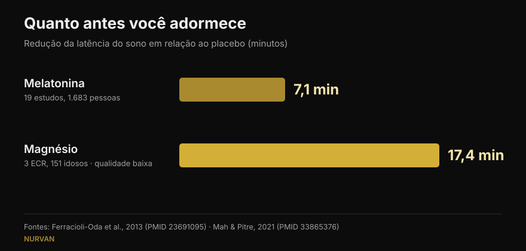
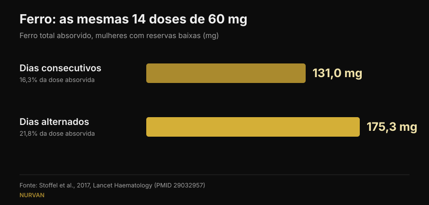

# Quando tomar os suplementos: o horário importa mesmo?

Por [Giammaria Loi](/autore/giammaria-loi) · atualizado em 15 de outubro de 2026

Quase todo suplemento vem com uma regra de horário: melatonina meia hora antes de dormir, ferro em jejum, creatina logo depois do treino. Uma publicação muito comentada sustenta que, para a maioria, essa regra não muda nada, e apoia isso em oito citações. Li todas as oito: existem e são pertinentes, o que no fitness das redes já é notícia. Mas em três casos o número citado esconde um detalhe que muda como você o usaria — e o dado mais útil para quem treina não aparece em lugar nenhum.

## Em resumo

- **A melatonina desloca o relógio biológico sobretudo no fim da tarde e quase nada na primeira metade da noite.** Confirmado: em 27 adultos o adiantamento máximo foi de 1,8 hora, com uma "zona morta" no sono inicial (Burgess et al., 2008).
- **Mas quem a toma antes de dormir não quer deslocar um relógio: quer adormecer.** Esse efeito, que a publicação apenas menciona, vale cerca de **7 minutos** de latência (Ferracioli-Oda et al., 2013).
- **O ferro é o caso em que o horário decide de verdade** — mas a variável não é a hora, é o intervalo. Em dias alternados foram absorvidos **175 mg contra 131 mg**, com as mesmas doses (Stoffel et al., 2017). Em mulheres com reservas baixas, não em qualquer pessoa.
- **O "+57%" da vitamina D vem de 17 pacientes sem grupo de controle** e com variabilidade enorme (±36,7%). O princípio — tomar na refeição mais gordurosa — se sustenta; o número não.
- **O que falta na publicação**: o horário que realmente importa na academia não é o das cápsulas, mas o da proteína — e ali a meta-análise mostra que o efeito desaparece quando se leva em conta a proteína total do dia (Schoenfeld et al., 2013).

## Uma publicação contestada, mas com as fontes no lugar certo

Nos comentários ela é acusada de ter sido gerada por inteligência artificial: um leitor diz que o gráfico da melatonina está errado, outro que o slide do ferro se contradiz, um terceiro simplesmente pede uma explicação. São críticas justas à forma. No conteúdo, porém, os oito PMID existem, tratam de fato do tema a que estão associados e, na maior parte, trazem os números que lhes são atribuídos. É melhor do que a média dos carrosséis que verificamos aqui.

O problema não são as citações: é o que está no meio delas. Um número correto, tirado do contexto em que foi medido, vira uma regra que talvez não se aplique a você.

## Melatonina: deslocar o relógio e adormecer são coisas diferentes

Este é o ponto que mais confundiu os leitores, e a confusão tem fundamento: a melatonina faz dois trabalhos distintos.

O primeiro é **deslocar o relógio biológico**. O estudo citado é sólido: Burgess e colegas deram 3 mg de melatonina a 27 adultos livres de horários impostos e construíram uma curva que mostra quanto o hormônio desloca o ritmo conforme a hora da tomada. O maior adiantamento ocorre no fim da tarde, cerca de 5 horas antes do início da produção natural de melatonina, e vale **1,8 hora**. Na primeira metade do sono habitual há uma zona em que o efeito é praticamente nulo. Os próprios autores concluem que usá-la à noite como indutor do sono tem efeito mínimo sobre o deslocamento de fase. Tudo isso a publicação relata corretamente.

O segundo trabalho é **ajudar você a adormecer antes**. É outro mecanismo, e a publicação o despacha com um "ainda pode dar sono". Quanto? A meta-análise mais citada — 19 estudos e 1.683 pessoas com distúrbios primários do sono — mede uma redução da latência de **7,06 minutos** (IC 95% 4,37-9,75) e 8,25 minutos a mais de sono total. Estatisticamente firme, clinicamente pequeno. Esse dado muda a expectativa de quem compra melatonina, e não está na publicação.

*Dois números que a publicação nunca coloca lado a lado. Atenção à qualidade das evidências: o da melatonina vem de 19 estudos, o do magnésio de 3 ensaios em idosos que os próprios revisores classificaram como de baixa qualidade.*

## Ferro: aqui o horário conta, mas a variável é o intervalo

Aqui a publicação acerta em cheio, e é o caso mais interessante dos oito. O ferro eleva a hepcidina, o hormônio que fecha a absorção, e a hepcidina permanece alta o suficiente para prejudicar a dose do dia seguinte.

No ensaio de Stoffel e colegas, publicado na *Lancet Haematology*, mulheres com ferritina baixa tomaram 60 mg de ferro por 14 dias consecutivos ou as mesmas 14 doses em dias alternados ao longo de 28 dias. Resultado: **131,0 mg absorvidos contra 175,3 mg**, ou seja, 16,3% da dose contra 21,8% (p = 0,0010). Dividir a dose diária em duas não ajudou (p = 0,33) e ainda elevou a hepcidina.

*As mesmas doses, resultado diferente: em dias alternados absorve-se cerca de um terço a mais. Ensaio em mulheres de 18 a 40 anos com ferritina ≤ 25 µg/L.*

**O que a publicação não diz**: as participantes eram mulheres com as reservas de ferro já esgotadas. Não é um achado para a população geral, e a suplementação de ferro é um tratamento ajustado por exames de sangue, não algo que se começa porque a pessoa se sente cansada. O esquema em dias alternados é uma conversa com quem prescreveu o ferro.

Sobre o café a publicação é precisa: no estudo de Morck e colegas de 1983, o café bebido **uma hora antes** da refeição não reduziu a absorção, enquanto o mesmo café **uma hora depois** a baixou de cerca de 5,9% para cerca de 1,6%. Vale precisar que ali se falava de ferro não heme de um alimento, não de um comprimido de ferro, e que os participantes tinham reservas normais.

## Vitamina D e ômega-3: não é a hora, é a refeição

O mecanismo está bem colocado — são lipossolúveis, então conta a gordura da refeição em que chegam —, mas os números merecem uma leitura mais atenta.

**Vitamina D, +57%.** O número está correto (56,7%), mas vem de um estudo com **17 pacientes e sem grupo de controle**: pessoas que não respondiam ao tratamento e a quem se pediu que mudassem o suplemento para a refeição mais farta. O desvio-padrão é de ±36,7%, ou seja, o aumento variava enormemente de pessoa para pessoa, e as doses iam de 1.000 a 50.000 UI. O conselho prático continua sensato e gratuito; o "+57%" não é uma promessa.

**Ômega-3, 3 pessoas em 50.** Também está certo: com uma refeição pobre em gordura, apenas 3 de 50 participantes que tomavam a forma éster etílico mantiveram ao menos metade da absorção obtida com uma refeição rica. Falta um contexto relevante: o estudo compara um produto de 4 gramas com receita contra um concorrente, e é assinado e financiado pela empresa que fabrica esse concorrente — o vencedor. Isso não o torna falso, mas é um conflito de interesses que um slide deveria declarar. Para quem toma um óleo de peixe comum de farmácia, a tradução prática é simples: com uma refeição, não em jejum.

## Creatina e magnésio: onde a publicação acerta e onde para cedo demais

**Creatina.** O ensaio citado comparou 5 g antes contra 5 g depois do treino em 19 praticantes amadores por 4 semanas: nenhuma diferença estatisticamente significativa. Curiosamente, a publicação é mais prudente do que os autores, que concluem que o pós-treino é "possivelmente melhor" usando a *magnitude-based inference*, um método hoje muito criticado. Nos testes padrão, a diferença não existe. Na creatina o que conta é a constância, não o relógio: nós a colocamos no topo do nosso [ranking de suplementos para a força](/pt/blog/ranking-suplementos-forca-tier-list).

**Magnésio.** A publicação diz que quem revisou os estudos sobre sono os chamou de "insuficientes". É verdade, a palavra está lá. Mas essa mesma revisão, juntando 3 ensaios randomizados com 151 idosos, encontra uma redução da latência de **17,36 minutos** (p = 0,0006): mais do que o dobro da melatonina. Com certeza muito menor, em outra população e com pouquíssimas pessoas. Despachar como "evidência insuficiente" esconde o número mais curioso de toda a publicação.

**Cafeína.** Aqui a publicação está certa: 400 mg tomados 6 horas antes de deitar perturbam o sono de forma mensurável em relação ao placebo. Traduzir isso em "quatro xícaras" é o ponto fraco, e um leitor aponta: a cafeína de uma xícara varia muitíssimo. Escrevemos sobre isso em detalhe em [a que horas parar o café](/pt/blog/cafeina-sono-quando-parar-de-tomar-cafe).

## O que a pesquisa realmente diz

| Afirmação da publicação | Veredito | Por quê |
|---|---|---|
| A melatonina desloca pouquíssimo o relógio se tomada antes de dormir | **Confirmado** | Zona morta no sono inicial; adiantamento máximo de 1,8 h no fim da tarde (Burgess 2008) |
| "Ainda pode dar sono" | **A precisar** | O efeito existe, mas vale 7,06 minutos a menos de latência (Ferracioli-Oda 2013) |
| Cafeína 6 horas antes perturba o sono | **Confirmado** | 400 mg a 0, 3 e 6 horas: as três significativas contra placebo (Drake 2013) |
| Ferro em dias alternados: 175 mg contra 131 mg | **Confirmado** | Mas em mulheres com ferritina ≤ 25 µg/L, não na população geral (Stoffel 2017) |
| Café uma hora antes é inofensivo, uma hora depois prejudica | **Confirmado** | De 5,88% para 1,64%; refere-se ao ferro da refeição, não ao comprimido (Morck 1983) |
| Vitamina D na maior refeição: +57% | **A precisar** | 17 pacientes, sem controle, ±36,7% de variabilidade (Mulligan 2010) |
| Ômega-3: 3 em 50 com refeição pobre em gordura | **A precisar** | Estudo da empresa do produto vencedor, dose de 4 g com receita (Davidson 2012) |
| Creatina: antes ou depois não muda | **Confirmado** | Sem diferença nos testes padrão; os autores concluem o contrário com um método criticado (Antonio 2013) |
| Magnésio: evidência insuficiente | **A precisar** | Verdade quanto à qualidade, mas o efeito medido é de −17,36 minutos de latência (Mah 2021) |

## O horário que importa de verdade, e que não está na publicação

Se você treina, a pergunta sobre horário que realmente se faz não é a da melatonina: é a da proteína, a famosa janela anabólica.

A meta-regressão de Schoenfeld, Aragon e Krieger reuniu 23 estudos sobre hipertrofia e 20 sobre força. Numa análise simples, tomar proteína em torno do treino parecia dar uma vantagem pequena a moderada na hipertrofia. Quando os autores controlaram as covariáveis, esse efeito desapareceu: o preditor mais forte do crescimento muscular era **a proteína total do dia**, não a hora em que era ingerida. Nesses estudos, quem fazia timing simplesmente comia mais proteína.

É o mesmo princípio que vale para quase todos os suplementos da lista: a dose diária e a constância decidem o resultado, o relógio quase nunca. O mesmo acontece na composição corporal: as alavancas grandes estão no total do dia, como vimos ao falar de [recomposição corporal](/pt/blog/recomposicao-corporal-perder-gordura-ganhar-musculo).

## Como aplicar

1. **Pergunte-se se o seu suplemento está numa das três categorias que têm horário.** Ferro (o intervalo entre as doses), lipossolúveis como vitamina D e ômega-3 (a refeição) e o que age sobre o sono ou o estado de alerta, como cafeína e melatonina (as horas em relação à cama). Todo o resto: tome quando lembrar.
2. **Amarre o suplemento a um hábito que você já tem**, não a um horário exato. Vitamina D e ômega-3 na refeição principal: a gordura já está lá e a rotina se sustenta sozinha.
3. **Na creatina escolha o momento mais cômodo e não mude**: a constância ao longo dos meses pesa muito mais do que trinta minutos antes ou depois.
4. **Se usa melatonina para dormir, espere poucos minutos de diferença.** Se o problema é de horários — turnos, fuso —, então o momento importa e isso é assunto para um médico, não para um carrossel.
5. **Ferro só por indicação médica e com exames.** O esquema em dias alternados é uma pergunta para quem prescreveu, não uma decisão solitária.

> ### Com o Nurvan a suplementação deixa de ser uma lista de horários
> A seção de suplementação do Nurvan registra o que você toma, quanto e com que frequência, e mantém esse dado junto do treino, do diário alimentar e dos exames. Assim, quando você se perguntar "isso está funcionando?", vai olhar semanas de constância real, e não a impressão de ontem à noite. **[Experimente o Nurvan](https://nurvan.app)**

## Perguntas frequentes

**A que horas se toma melatonina?**
Depende do objetivo. Para adiantar o relógio, o efeito é máximo no fim da tarde, muitas horas antes de dormir, e quase nulo na primeira metade da noite (Burgess et al., 2008). Para adormecer um pouco antes, toma-se à noite, mas o efeito médio medido é de cerca de 7 minutos. Se o problema é um distúrbio do sono real, fale com o médico.

**A creatina deve ser tomada antes ou depois do treino?**
O ensaio que compara as duas opções não encontra diferenças estatisticamente significativas em 4 semanas (Antonio e Ciccone, 2013). Conta muito mais tomá-la todos os dias, inclusive nos de descanso.

**A vitamina D precisa ser tomada com comida?**
É lipossolúvel, portanto absorve melhor com uma refeição que contenha gordura. No estudo com 17 pacientes, passá-la para a refeição mais farta elevou os valores no sangue em média 57%, mas era uma série pequena, sem grupo de controle e com grande variação individual.

**O café bloqueia o ferro?**
Reduz a absorção do ferro não heme se bebido junto da refeição ou até uma hora depois; uma hora antes não teve efeitos mensuráveis (Morck et al., 1983). Se você faz tratamento com ferro, o prático é afastar o café do momento da tomada, seguindo as orientações do médico.

## Leia também

- [Ranking de suplementos para a força: o que diz a pesquisa](/pt/blog/ranking-suplementos-forca-tier-list) — quais substâncias realmente mexem no seu máximo, da creatina ao HMB.
- [Cafeína e sono: a que horas parar o café](/pt/blog/cafeina-sono-quando-parar-de-tomar-cafe) — por que "uma xícara" não é uma dose e quantas horas são realmente necessárias.
- [Recomposição corporal: perder gordura e ganhar músculo](/pt/blog/recomposicao-corporal-perder-gordura-ganhar-musculo) — o que decide o resultado quando dieta e treino andam juntos.

## Fontes

1. Burgess HJ, Revell VL, Eastman CI, 2008. *A three pulse phase response curve to three milligrams of melatonin in humans.* The Journal of Physiology 586(2):639-47. PMID [18006583](https://pubmed.ncbi.nlm.nih.gov/18006583/) · DOI [10.1113/jphysiol.2007.143180](https://doi.org/10.1113/jphysiol.2007.143180)
2. Ferracioli-Oda E, Qawasmi A, Bloch MH, 2013. *Meta-analysis: melatonin for the treatment of primary sleep disorders.* PLoS One 8(5):e63773. PMID [23691095](https://pubmed.ncbi.nlm.nih.gov/23691095/) · DOI [10.1371/journal.pone.0063773](https://doi.org/10.1371/journal.pone.0063773)
3. Drake C, Roehrs T, Shambroom J, Roth T, 2013. *Caffeine effects on sleep taken 0, 3, or 6 hours before going to bed.* Journal of Clinical Sleep Medicine 9(11):1195-200. PMID [24235903](https://pubmed.ncbi.nlm.nih.gov/24235903/) · DOI [10.5664/jcsm.3170](https://doi.org/10.5664/jcsm.3170)
4. Stoffel NU, Cercamondi CI, Brittenham G, et al., 2017. *Iron absorption from oral iron supplements given on consecutive versus alternate days...* The Lancet Haematology 4(11):e524-e533. PMID [29032957](https://pubmed.ncbi.nlm.nih.gov/29032957/) · DOI [10.1016/S2352-3026(17)30182-5](https://doi.org/10.1016/S2352-3026(17)30182-5)
5. Morck TA, Lynch SR, Cook JD, 1983. *Inhibition of food iron absorption by coffee.* The American Journal of Clinical Nutrition 37(3):416-20. PMID [6402915](https://pubmed.ncbi.nlm.nih.gov/6402915/) · DOI [10.1093/ajcn/37.3.416](https://doi.org/10.1093/ajcn/37.3.416)
6. Mulligan GB, Licata A, 2010. *Taking vitamin D with the largest meal improves absorption and results in higher serum levels of 25-hydroxyvitamin D.* Journal of Bone and Mineral Research 25(4):928-30. PMID [20200983](https://pubmed.ncbi.nlm.nih.gov/20200983/) · DOI [10.1002/jbmr.67](https://doi.org/10.1002/jbmr.67)
7. Davidson MH, Johnson J, Rooney MW, Kyle ML, Kling DF, 2012. *A novel omega-3 free fatty acid formulation has dramatically improved bioavailability during a low-fat diet compared with omega-3-acid ethyl esters: the ECLIPSE study.* Journal of Clinical Lipidology 6(6):573-84. PMID [23312053](https://pubmed.ncbi.nlm.nih.gov/23312053/) · DOI [10.1016/j.jacl.2012.01.002](https://doi.org/10.1016/j.jacl.2012.01.002)
8. Antonio J, Ciccone V, 2013. *The effects of pre versus post workout supplementation of creatine monohydrate on body composition and strength.* Journal of the International Society of Sports Nutrition 10:36. PMID [23919405](https://pubmed.ncbi.nlm.nih.gov/23919405/) · DOI [10.1186/1550-2783-10-36](https://doi.org/10.1186/1550-2783-10-36)
9. Mah J, Pitre T, 2021. *Oral magnesium supplementation for insomnia in older adults: a Systematic Review & Meta-Analysis.* BMC Complementary Medicine and Therapies 21(1):125. PMID [33865376](https://pubmed.ncbi.nlm.nih.gov/33865376/) · DOI [10.1186/s12906-021-03297-z](https://doi.org/10.1186/s12906-021-03297-z)
10. Schoenfeld BJ, Aragon AA, Krieger JW, 2013. *The effect of protein timing on muscle strength and hypertrophy: a meta-analysis.* Journal of the International Society of Sports Nutrition 10(1):53. PMID [24299050](https://pubmed.ncbi.nlm.nih.gov/24299050/) · DOI [10.1186/1550-2783-10-53](https://doi.org/10.1186/1550-2783-10-53)

Pesquisas bibliográficas realizadas no PubMed. Ponto de partida: a publicação de William Wallace ([@dr.williamwallace](https://www.instagram.com/p/Dc_e9fmkc1z/), 7 de setembro de 2026). Nenhum texto e nenhuma imagem da publicação foram reproduzidos: as suas referências foram relidas nas fontes originais.

---

Giammaria Loi é o fundador do Nurvan. Treina com pesos desde 2012, trabalha como personal trainer e coach certificado FIPE desde 2013 e compete em powerlifting a nível nacional desde 2018. Cada artigo que assina parte dos estudos científicos e chega ao que funciona de verdade na academia. [Página do autor](/autore/giammaria-loi)

> Nota: conteúdo informativo, não substitui a opinião de um médico ou profissional. A suplementação de ferro e os distúrbios do sono exigem avaliação médica individual.
