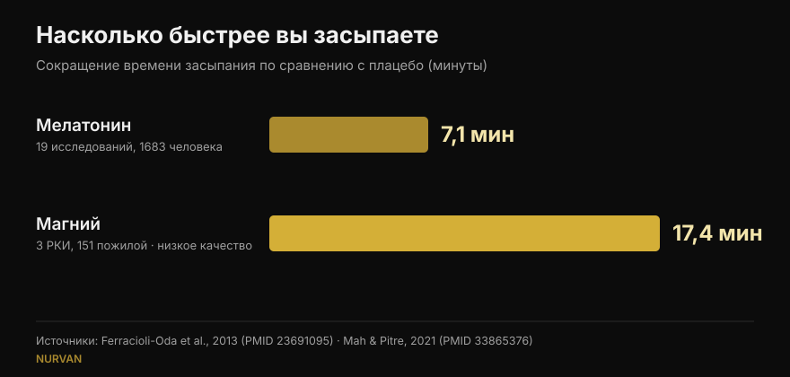
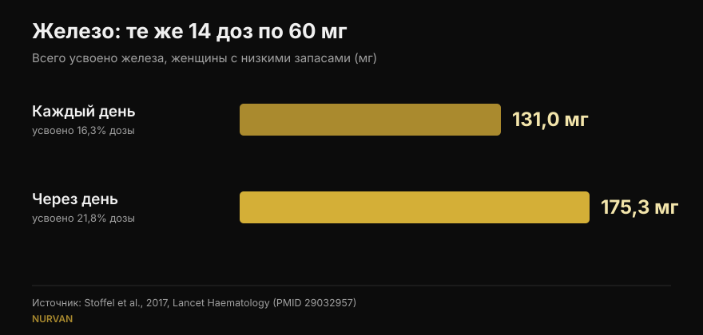

# Когда принимать добавки: действительно ли важно время?

Автор: [Джаммария Лои](/autore/giammaria-loi) · обновлено 15 октября 2026 года

Почти у каждой добавки есть своё правило приёма: мелатонин за полчаса до сна, железо натощак, креатин сразу после тренировки. В одном активно обсуждаемом посте утверждается, что для большинства добавок это правило ничего не меняет, и приводится восемь ссылок. Я прочитал все восемь: они существуют и по теме — для фитнеса в соцсетях это уже новость. Но в трёх случаях за приведённой цифрой скрывается деталь, которая меняет то, как вы бы ею воспользовались, а самого полезного для тренирующихся факта в посте нет вовсе.

## Коротко

- **Мелатонин сдвигает биологические часы прежде всего во второй половине дня и почти не сдвигает в первой половине ночи.** Подтверждено: у 27 взрослых максимальный сдвиг вперёд составил 1,8 часа, а в начале сна есть «мёртвая зона» (Burgess et al., 2008).
- **Но тот, кто пьёт его перед сном, не хочет сдвигать часы — он хочет заснуть.** Этот эффект, едва упомянутый в посте, стоит около **7 минут** времени засыпания (Ferracioli-Oda et al., 2013).
- **Железо — тот случай, где время действительно решает**, но переменная не час, а интервал. При приёме через день усвоилось **175 мг против 131 мг** при одинаковых дозах (Stoffel et al., 2017). У женщин с низкими запасами, а не у всех подряд.
- **«+57%» для витамина D получены на 17 пациентах без контрольной группы** и с огромным разбросом (±36,7%). Принцип — принимать с самым жирным приёмом пищи — верен; цифра — нет.
- **Чего в посте не хватает**: время, которое действительно важно в зале, относится не к капсулам, а к белку, и там мета-анализ показывает, что эффект исчезает, как только учтено общее количество белка за день (Schoenfeld et al., 2013).

## Спорный пост, но источники на месте

В комментариях пост обвиняют в том, что он сгенерирован искусственным интеллектом: один читатель пишет, что график по мелатонину неверен, другой — что слайд про железо противоречит сам себе, третий просто просит объяснить. Это справедливые претензии к форме. По существу же все восемь PMID существуют, действительно относятся к тем темам, к которым привязаны, и в большинстве случаев содержат приписанные им цифры. Это лучше, чем средняя карусель, которую мы здесь проверяем.

Проблема не в ссылках, а в том, что между ними: верная цифра, вырванная из условий, в которых её измерили, превращается в правило, которое к вам может не относиться.

## Мелатонин: сдвинуть часы и заснуть — разные задачи

Именно здесь запутались большинство читателей, и запутались не зря: мелатонин делает две разные вещи.

Первая — **сдвигать биологические часы**. Процитированное исследование надёжное: Бёрджесс и коллеги дали 3 мг мелатонина 27 взрослым, живущим в свободном режиме, и построили кривую, показывающую, насколько гормон сдвигает ритм в зависимости от часа приёма. Максимальный сдвиг вперёд приходится на конец дня, примерно за 5 часов до начала собственной выработки мелатонина, и составляет **1,8 часа**. В первой половине привычного сна есть зона, где эффект практически нулевой. Авторы сами заключают, что приём на ночь как снотворного почти не сдвигает фазу. Всё это пост передаёт верно.

Вторая задача — **помочь заснуть быстрее**. Это другой механизм, и пост отделывается фразой «сонливость всё равно может появиться». Насколько? Самый цитируемый мета-анализ — 19 исследований, 1683 человека с первичными расстройствами сна — фиксирует сокращение времени засыпания на **7,06 минуты** (95% ДИ 4,37-9,75) и 8,25 минуты дополнительного сна. Статистически надёжно, клинически мало. Эта цифра меняет ожидания любого, кто покупает мелатонин, и в посте её нет.

*Две цифры, которые пост ни разу не ставит рядом. Обратите внимание на качество доказательств: показатель по мелатонину взят из 19 исследований, по магнию — из 3 исследований у пожилых, которые сами авторы оценили как низкокачественные.*

## Железо: здесь время важно, но переменная — интервал

Тут пост полностью прав, и это самый интересный из восьми случаев. Железо повышает гепцидин — гормон, который перекрывает всасывание, и гепцидин держится достаточно долго, чтобы испортить дозу следующего дня.

В исследовании Штоффель и коллег в *Lancet Haematology* женщины с низким ферритином принимали 60 мг железа 14 дней подряд либо те же 14 доз через день в течение 28 дней. Результат: **усвоено 131,0 мг против 175,3 мг**, то есть 16,3% дозы против 21,8% (p = 0,0010). Деление суточной дозы на два приёма не помогло (p = 0,33) и дополнительно подняло гепцидин.

*Те же дозы, другой результат: через день усваивается примерно на треть больше. Исследование у женщин 18-40 лет с ферритином ≤ 25 мкг/л.*

**Чего пост не говорит**: участницами были женщины с уже истощёнными запасами железа. Это не вывод для населения в целом, а приём железа — это терапия, которую подбирают по анализам, а не то, что начинают, потому что чувствуют усталость. Схема «через день» — тема для разговора с тем, кто назначил железо.

Про кофе пост точен: в работе Морка и коллег 1983 года кофе, выпитый **за час до** еды, не снижал всасывание, а тот же кофе **через час после** снижал его примерно с 5,9% до 1,6%. Стоит уточнить: речь шла о негемовом железе из пищи, а не о таблетке железа, и запасы у участников были нормальными.

## Витамин D и омега-3: дело не в часе, а в еде

Механизм описан верно — оба жирорастворимы, значит важен жир в том приёме пищи, с которым они попадают, — но цифры требуют более внимательного чтения.

**Витамин D, +57%.** Цифра передана правильно (56,7%), но она получена в исследовании на **17 пациентах без контрольной группы**: это люди, не отвечавшие на лечение, которых попросили перенести добавку на самый большой приём пищи. Стандартное отклонение ±36,7%, то есть прирост колебался очень сильно от человека к человеку, а дозы составляли от 1000 до 50 000 МЕ. Практический совет остаётся разумным и бесплатным; «+57%» — не обещание.

**Омега-3, 3 человека из 50.** Тоже верно: при приёме пищи с низким содержанием жира лишь 3 из 50 участников, принимавших форму этилового эфира, сохранили хотя бы половину того всасывания, которое получали с жирной едой. Недостающий контекст существенен: исследование сравнивает рецептурный препарат в дозе 4 грамма с конкурентом и написано и профинансировано компанией, которая производит этого конкурента — победителя. Это не делает его ложным, но такой конфликт интересов слайд должен указывать. Для тех, кто принимает обычный аптечный рыбий жир, практический вывод прост: с едой, а не натощак.

## Креатин и магний: где пост прав и где останавливается слишком рано

**Креатин.** Процитированное исследование сравнивало 5 г до и 5 г после тренировки у 19 любителей бодибилдинга в течение 4 недель: статистически значимой разницы нет. Любопытно, что пост осторожнее самих авторов: в выводах они пишут, что приём после тренировки «возможно, лучше», опираясь на *magnitude-based inference* — метод, который сегодня широко критикуют. По стандартным тестам разницы нет. В креатине важна регулярность, а не часы: мы поставили его на вершину нашего [рейтинга добавок для силы](/ru/blog/reyting-sportivnykh-dobavok-dlya-sily).

**Магний.** Пост пишет, что авторы обзора по сну назвали доказательства «некачественными». Это правда, слово именно такое. Но тот же обзор, объединив 3 рандомизированных исследования со 151 пожилым участником, находит сокращение времени засыпания на **17,36 минуты** (p = 0,0006): больше чем вдвое по сравнению с мелатонином. При куда меньшей надёжности, в другой популяции и на очень малом числе людей. Отмахнуться фразой «некачественные доказательства» значит похоронить самую любопытную цифру всего поста.

**Кофеин.** Здесь пост прав: 400 мг за 6 часов до сна заметно нарушают сон по сравнению с плацебо. Перевод в «четыре чашки» — слабое место, и читатель это отмечает: кофеин в чашке варьирует очень сильно. Подробно мы писали об этом в материале [во сколько прекращать пить кофе](/ru/blog/kofein-i-son-kogda-perestat-pit-kofe).

## Что на самом деле говорят исследования

| Утверждение поста | Вердикт | Почему |
|---|---|---|
| Мелатонин почти не сдвигает часы, если принят перед сном | **Подтверждено** | «Мёртвая зона» в начале сна; максимальный сдвиг 1,8 ч во второй половине дня (Burgess 2008) |
| «Сонливость всё равно может появиться» | **Требует уточнения** | Эффект есть, но он равен 7,06 минуты сокращения засыпания (Ferracioli-Oda 2013) |
| Кофеин за 6 часов нарушает сон | **Подтверждено** | 400 мг за 0, 3 и 6 часов: все три значимы против плацебо (Drake 2013) |
| Железо через день: 175 мг против 131 мг | **Подтверждено** | Но у женщин с ферритином ≤ 25 мкг/л, а не в общей популяции (Stoffel 2017) |
| Кофе за час до — безвредно, через час после — вредно | **Подтверждено** | С 5,88% до 1,64%; речь о железе из пищи, а не о таблетке (Morck 1983) |
| Витамин D с самым большим приёмом пищи: +57% | **Требует уточнения** | 17 пациентов, без контроля, разброс ±36,7% (Mulligan 2010) |
| Омега-3: 3 из 50 при нежирной еде | **Требует уточнения** | Исследование компании-производителя победившего продукта, рецептурная доза 4 г (Davidson 2012) |
| Креатин: до или после — без разницы | **Подтверждено** | По стандартным тестам разницы нет; авторы делают обратный вывод критикуемым методом (Antonio 2013) |
| Магний: некачественные доказательства | **Требует уточнения** | Верно по качеству, но измеренный эффект — −17,36 минуты засыпания (Mah 2021) |

## Время, которое действительно важно и которого в посте нет

Если вы тренируетесь, вопрос о времени, который вы себе действительно задаёте, касается не мелатонина, а белка — знаменитого анаболического окна.

Мета-регрессия Шонфельда, Арагона и Кригера объединила 23 исследования по гипертрофии и 20 по силе. В простом анализе приём белка вокруг тренировки выглядел как небольшое или умеренное преимущество для гипертрофии. Но как только авторы учли ковариаты, эффект исчез: самым сильным предиктором роста мышц оказалось **общее суточное потребление белка**, а не час приёма. В этих исследованиях те, кто следил за таймингом, просто ели больше белка.

Тот же принцип работает почти для всех добавок из списка: результат решают суточная доза и регулярность, а часы — почти никогда. То же верно и для состава тела: крупные рычаги лежат в сумме за день, как мы разбирали в материале о [рекомпозиции тела](/ru/blog/rekompozitsiya-tela-szhech-zhir-nabrat-myshtsy).

## Как это применить

1. **Спросите себя, попадает ли ваша добавка в одну из трёх категорий, у которых есть расписание.** Железо (интервал между дозами), жирорастворимые вроде витамина D и омега-3 (приём пищи) и всё, что действует на сон или бодрость, как кофеин и мелатонин (часы относительно отхода ко сну). Всё остальное принимайте тогда, когда вспомните.
2. **Привяжите добавку к уже существующей привычке**, а не к точному часу. Витамин D и омега-3 — к основному приёму пищи: жир там уже есть, и привычка держится сама.
3. **Для креатина выберите самый удобный момент и не меняйте его**: регулярность на дистанции месяцев весит куда больше, чем полчаса до или после.
4. **Если вы пьёте мелатонин, чтобы заснуть, ждите разницы в несколько минут.** Если проблема в расписании — сменная работа, смена часовых поясов, — то время действительно важно, и это тема для врача, а не для карусели.
5. **Железо — только по назначению врача и по анализам.** Схема «через день» — вопрос к тому, кто его назначил, а не самостоятельное решение.

> ### С Nurvan приём добавок перестаёт быть списком часов
> Раздел добавок в Nurvan фиксирует, что вы принимаете, сколько и как часто, и держит эти данные рядом с тренировками, дневником питания и анализами. Когда вы спросите себя «работает ли это?», вы увидите недели реальной регулярности, а не впечатление вчерашнего вечера. **[Попробовать Nurvan](https://nurvan.app)**

## Частые вопросы

**В какое время принимать мелатонин?**
Зависит от цели. Чтобы сдвинуть часы вперёд, эффект максимален во второй половине дня, за много часов до сна, и почти нулевой в первой половине ночи (Burgess et al., 2008). Чтобы заснуть чуть быстрее, его принимают вечером, но измеренный средний эффект — около 7 минут. Если речь о настоящем расстройстве сна, обсудите это с врачом.

**Креатин принимать до или после тренировки?**
Исследование, сравнивающее оба варианта, не находит статистически значимой разницы за 4 недели (Antonio и Ciccone, 2013). Гораздо важнее принимать его каждый день, включая дни отдыха.

**Витамин D нужно принимать с едой?**
Он жирорастворим, поэтому лучше усваивается с приёмом пищи, содержащим жир. В исследовании на 17 пациентах перенос на самый плотный приём пищи поднял показатели крови в среднем на 57%, но это была небольшая серия без контрольной группы и с большим индивидуальным разбросом.

**Кофе блокирует железо?**
Он снижает усвоение негемового железа, если выпит вместе с едой или в течение часа после неё; за час до измеримого эффекта не было (Morck et al., 1983). Если вы принимаете препараты железа, практичнее развести кофе и приём по времени, следуя указаниям врача.

## Читайте также

- [Рейтинг добавок для силы: что говорят исследования](/ru/blog/reyting-sportivnykh-dobavok-dlya-sily) — какие вещества действительно двигают ваш максимум, от креатина до HMB.
- [Кофеин и сон: во сколько прекращать пить кофе](/ru/blog/kofein-i-son-kogda-perestat-pit-kofe) — почему «чашка» не является дозой и сколько часов нужно на самом деле.
- [Рекомпозиция тела: сжечь жир и набрать мышцы](/ru/blog/rekompozitsiya-tela-szhech-zhir-nabrat-myshtsy) — что на самом деле решает результат, когда диета и тренировки идут вместе.

## Источники

1. Burgess HJ, Revell VL, Eastman CI, 2008. *A three pulse phase response curve to three milligrams of melatonin in humans.* The Journal of Physiology 586(2):639-47. PMID [18006583](https://pubmed.ncbi.nlm.nih.gov/18006583/) · DOI [10.1113/jphysiol.2007.143180](https://doi.org/10.1113/jphysiol.2007.143180)
2. Ferracioli-Oda E, Qawasmi A, Bloch MH, 2013. *Meta-analysis: melatonin for the treatment of primary sleep disorders.* PLoS One 8(5):e63773. PMID [23691095](https://pubmed.ncbi.nlm.nih.gov/23691095/) · DOI [10.1371/journal.pone.0063773](https://doi.org/10.1371/journal.pone.0063773)
3. Drake C, Roehrs T, Shambroom J, Roth T, 2013. *Caffeine effects on sleep taken 0, 3, or 6 hours before going to bed.* Journal of Clinical Sleep Medicine 9(11):1195-200. PMID [24235903](https://pubmed.ncbi.nlm.nih.gov/24235903/) · DOI [10.5664/jcsm.3170](https://doi.org/10.5664/jcsm.3170)
4. Stoffel NU, Cercamondi CI, Brittenham G, et al., 2017. *Iron absorption from oral iron supplements given on consecutive versus alternate days...* The Lancet Haematology 4(11):e524-e533. PMID [29032957](https://pubmed.ncbi.nlm.nih.gov/29032957/) · DOI [10.1016/S2352-3026(17)30182-5](https://doi.org/10.1016/S2352-3026(17)30182-5)
5. Morck TA, Lynch SR, Cook JD, 1983. *Inhibition of food iron absorption by coffee.* The American Journal of Clinical Nutrition 37(3):416-20. PMID [6402915](https://pubmed.ncbi.nlm.nih.gov/6402915/) · DOI [10.1093/ajcn/37.3.416](https://doi.org/10.1093/ajcn/37.3.416)
6. Mulligan GB, Licata A, 2010. *Taking vitamin D with the largest meal improves absorption and results in higher serum levels of 25-hydroxyvitamin D.* Journal of Bone and Mineral Research 25(4):928-30. PMID [20200983](https://pubmed.ncbi.nlm.nih.gov/20200983/) · DOI [10.1002/jbmr.67](https://doi.org/10.1002/jbmr.67)
7. Davidson MH, Johnson J, Rooney MW, Kyle ML, Kling DF, 2012. *A novel omega-3 free fatty acid formulation has dramatically improved bioavailability during a low-fat diet compared with omega-3-acid ethyl esters: the ECLIPSE study.* Journal of Clinical Lipidology 6(6):573-84. PMID [23312053](https://pubmed.ncbi.nlm.nih.gov/23312053/) · DOI [10.1016/j.jacl.2012.01.002](https://doi.org/10.1016/j.jacl.2012.01.002)
8. Antonio J, Ciccone V, 2013. *The effects of pre versus post workout supplementation of creatine monohydrate on body composition and strength.* Journal of the International Society of Sports Nutrition 10:36. PMID [23919405](https://pubmed.ncbi.nlm.nih.gov/23919405/) · DOI [10.1186/1550-2783-10-36](https://doi.org/10.1186/1550-2783-10-36)
9. Mah J, Pitre T, 2021. *Oral magnesium supplementation for insomnia in older adults: a Systematic Review & Meta-Analysis.* BMC Complementary Medicine and Therapies 21(1):125. PMID [33865376](https://pubmed.ncbi.nlm.nih.gov/33865376/) · DOI [10.1186/s12906-021-03297-z](https://doi.org/10.1186/s12906-021-03297-z)
10. Schoenfeld BJ, Aragon AA, Krieger JW, 2013. *The effect of protein timing on muscle strength and hypertrophy: a meta-analysis.* Journal of the International Society of Sports Nutrition 10(1):53. PMID [24299050](https://pubmed.ncbi.nlm.nih.gov/24299050/) · DOI [10.1186/1550-2783-10-53](https://doi.org/10.1186/1550-2783-10-53)

Поиск литературы выполнен в PubMed. Отправная точка: пост Уильяма Уоллеса ([@dr.williamwallace](https://www.instagram.com/p/Dc_e9fmkc1z/), 7 сентября 2026 года). Ни текст, ни изображения поста не воспроизводились: его ссылки были перечитаны в первоисточниках.

---

Джаммария Лои — основатель Nurvan. Занимается с отягощениями с 2012 года, работает персональным тренером и коучем с сертификацией FIPE с 2013 года и выступает в пауэрлифтинге на национальном уровне с 2018 года. Каждая его статья начинается с научных работ и заканчивается тем, что действительно работает в зале. [Страница автора](/autore/giammaria-loi)

> Примечание: материал носит информационный характер и не заменяет консультацию врача или специалиста. Приём препаратов железа и нарушения сна требуют индивидуальной медицинской оценки.
