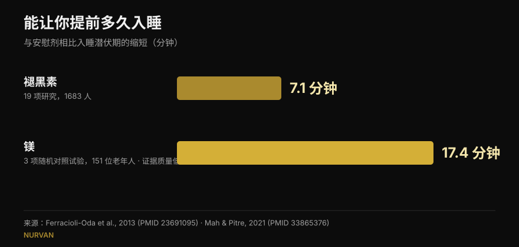
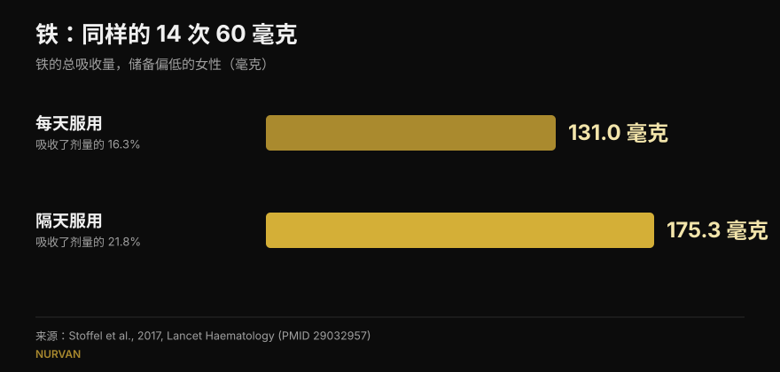

# 补剂什么时间吃：时间真的有影响吗？

作者：[Giammaria Loi](/autore/giammaria-loi) · 更新于 2026 年 10 月 15 日

几乎每种补剂都配着一条关于时间的规则：褪黑素睡前半小时、铁剂空腹、肌酸练完马上吃。一篇被大量讨论的帖子认为，对大多数补剂来说这条规则几乎不起作用，并列出了八条文献。我把八条全部读了一遍：它们确实存在，而且切题——在社交媒体的健身内容里，这本身就算新闻。但其中有三处，被引用的数字背后藏着一个会改变你用法的细节；而对训练者最有用的那个数据，帖子里完全没有。

## 要点速览

- **褪黑素主要在傍晚时段移动生物钟，在上半夜几乎不起作用。** 已证实：27 名成年人中最大提前量为 1.8 小时，入睡初期存在一个"死区"（Burgess et al., 2008）。
- **但睡前服用的人并不想移动生物钟，他们只想入睡。** 这个被帖子一笔带过的效果，大约值 **7 分钟** 的入睡时间（Ferracioli-Oda et al., 2013）。
- **铁确实是时间会决定结果的那一个**，但变量不是几点，而是间隔。隔天服用总共吸收了 **175 毫克，而每天服用是 131 毫克**，剂量完全相同（Stoffel et al., 2017）。对象是储备偏低的女性，不是所有人。
- **维生素D的"+57%"来自 17 名没有对照组的患者**，个体差异极大（±36.7%）。原则——随最油的一餐服用——成立；那个数字不成立。
- **帖子缺的那一块**：在健身房里真正重要的时间问题不是药丸，而是蛋白质，而那里的荟萃分析显示：一旦把全天蛋白质总量考虑进去，效果就消失了（Schoenfeld et al., 2013）。

## 一篇有争议的帖子，但引用放对了位置

评论区指控这篇帖子是人工智能生成的：一位读者说褪黑素的图表错了，另一位说铁的那一页自相矛盾，第三位只是请人解释清楚。这些对形式的批评是合理的。但就内容而言，八个 PMID 全部真实存在，确实对应各自的主题，而且大部分给出了帖子所说的数字。这比我们在这里核查过的平均水平要好。

问题不在引用，而在引用之间的东西：一个正确的数字，一旦脱离它被测量时的条件，就会变成一条也许并不适用于你的规则。

## 褪黑素：移动生物钟和帮你入睡是两件事

这是最让读者困惑的一点，而困惑是有道理的：褪黑素做的是两件不同的工作。

第一件是**移动生物钟**。被引用的研究很扎实：Burgess 等人给 27 名不受作息约束的成年人服用 3 毫克褪黑素，绘制出一条曲线，显示这种激素根据服用时间把节律推移多少。最大提前量出现在傍晚，大约在自身褪黑素开始分泌前 5 小时，幅度为 **1.8 小时**。在习惯睡眠的上半段存在一个区域，效果几乎为零。作者自己的结论是：夜间当作助眠药使用，对相位移动的影响极小。这些帖子都讲对了。

第二件工作是**让你更快睡着**。这是另一套机制，而帖子用一句"它仍然可能让你犯困"就带过了。犯困多少？最常被引用的荟萃分析——19 项研究、1683 名原发性睡眠障碍患者——测得入睡时间缩短 **7.06 分钟**（95% 置信区间 4.37-9.75），总睡眠时间增加 8.25 分钟。统计上稳健，临床上很小。这个数字会改变任何买褪黑素的人的预期，而帖子里没有。

*帖子从未把这两个数字并排放在一起。请注意证据质量：褪黑素的数字来自 19 项研究，镁的数字来自 3 项老年人试验，作者自己评为低质量。*

## 铁：这里时间确实重要，但变量是间隔

这一点帖子完全正确，也是八个案例中最有意思的一个。铁会升高铁调素，也就是关闭吸收的那种激素，而铁调素维持高位的时间长到足以拖累第二天的剂量。

在 Stoffel 等人发表于 *Lancet Haematology* 的试验中，铁蛋白偏低的女性连续 14 天每天服用 60 毫克铁，或者把同样的 14 次剂量分散到 28 天里隔天服用。结果：**吸收 131.0 毫克对 175.3 毫克**，即剂量的 16.3% 对 21.8%（p = 0.0010）。把每日剂量拆成两次并没有帮助（p = 0.33），反而进一步抬高了铁调素。

*同样的剂量，不同的结果：隔天服用多吸收约三分之一。试验对象为 18 至 40 岁、铁蛋白 ≤ 25 µg/L 的女性。*

**帖子没说的是**：参与者是铁储备已经耗竭的女性。这不是面向普通人群的结论，而且补铁是一项依据血液检查来调整的治疗，不是因为觉得累就开始吃的东西。隔天服用的方案，应该和给你开铁剂的人讨论。

关于咖啡，帖子很准确：在 Morck 等人 1983 年的研究中，餐前**一小时**喝的咖啡没有降低吸收，而餐后**一小时**喝的同一杯咖啡把吸收率从约 5.9% 压到约 1.6%。但需要说明：那里讲的是食物中的非血红素铁，不是铁片，而且受试者的储备正常。

## 维生素D和欧米伽-3：重点不是几点，而是那一餐

机制讲得不错——两者都是脂溶性的，所以关键是随之进入的那一餐里有多少脂肪——但数字值得更仔细地读。

**维生素D，+57%。** 数字引用无误（56.7%），但它来自一项 **17 名患者、没有对照组** 的研究：这些人对治疗反应不佳，被要求把补剂挪到一天中最丰盛的一餐。标准差是 ±36.7%，也就是说个体之间的增幅差异极大，而剂量从 1000 到 50000 IU 不等。这条实用建议依然合理，而且不花钱；但"+57%"不是承诺。

**欧米伽-3，50 人中只有 3 人。** 这也没错：在低脂餐下，服用乙酯形式的 50 名受试者中只有 3 人保住了高脂餐时至少一半的吸收量。缺失的背景很关键：该研究把一款 4 克处方产品与一款竞品比较，而论文由生产那款竞品（也就是胜出的那一款）的公司署名并资助。这不代表结论是假的，但这是一页幻灯片应当披露的利益冲突。对服用普通非处方鱼油的人来说，实用结论很简单：随餐，不要空腹。

## 肌酸和镁：帖子说对的地方，和它停得太早的地方

**肌酸。** 被引用的试验在 19 名业余健美爱好者中比较了练前 5 克与练后 5 克，持续 4 周：没有统计学显著差异。有意思的是，帖子比作者本人更谨慎：作者的结论说练后"可能更好"，依据的是 *magnitude-based inference*，一种如今被广泛批评的统计方法。按标准检验，差异并不存在。肌酸重要的是坚持而不是钟点：我们把它放在了[力量补剂等级榜](/zh/blog/liliang-buji-dengji-bang)的最高一档。

**镁。** 帖子说审阅睡眠研究的人把证据称为"不合格"。这是真的，综述里用的就是这个词。但同一篇综述汇总 3 项随机对照试验、151 位老年人后，发现入睡时间缩短 **17.36 分钟**（p = 0.0006）：是褪黑素的两倍多。只是确定性低得多、人群不同、人数极少。用一句"证据不合格"打发掉，等于埋掉了整篇帖子里最耐人寻味的数字。

**咖啡因。** 这里帖子是对的：睡前 6 小时摄入 400 毫克，相较安慰剂会明显干扰睡眠。把它换算成"四杯咖啡"才是薄弱环节，评论区也有人指出：一杯咖啡的咖啡因含量差异极大。我们在[几点该停掉咖啡](/zh/blog/kafeiyin-shuimian-jidian-jie-kafei)里详细写过。

## 研究到底怎么说

| 帖子的说法 | 结论 | 理由 |
|---|---|---|
| 睡前吃褪黑素几乎不移动生物钟 | **已证实** | 入睡初期是死区；傍晚最大提前 1.8 小时（Burgess 2008） |
| "它仍然可能让你犯困" | **需要补充** | 效果存在，但只值 7.06 分钟的入睡时间（Ferracioli-Oda 2013） |
| 睡前 6 小时的咖啡因会干扰睡眠 | **已证实** | 400 毫克分别在 0、3、6 小时：三者均显著优于安慰剂（Drake 2013） |
| 隔天补铁：175 毫克对 131 毫克 | **已证实** | 但对象是铁蛋白 ≤ 25 µg/L 的女性，不是普通人群（Stoffel 2017） |
| 餐前一小时喝咖啡无害，餐后一小时有害 | **已证实** | 从 5.88% 降到 1.64%；指的是食物中的铁，不是药片（Morck 1983） |
| 维生素D随最大一餐：+57% | **需要补充** | 17 名患者，无对照，±36.7% 的离散度（Mulligan 2010） |
| 欧米伽-3：低脂餐下 50 人中仅 3 人 | **需要补充** | 由胜出产品的厂商所做，4 克处方剂量（Davidson 2012） |
| 肌酸：练前练后没区别 | **已证实** | 标准检验无差异；作者用一种受批评的方法得出相反结论（Antonio 2013） |
| 镁：证据不合格 | **需要补充** | 就质量而言属实，但实测效果是入睡时间 −17.36 分钟（Mah 2021） |

## 真正重要、却不在帖子里的那个时间

如果你训练，你真正会问自己的时间问题跟褪黑素无关：它关于蛋白质，也就是著名的"合成代谢窗口"。

Schoenfeld、Aragon 和 Krieger 的元回归汇总了 23 项关于肌肉增长、20 项关于力量的研究。在简单汇总分析里，围绕训练摄入蛋白质看起来对肌肉增长有小到中等的好处。但当作者控制了协变量之后，这个效果消失了：预测肌肉增长最强的因素是**全天蛋白质总摄入量**，而不是摄入的时间点。在那些研究里，做"时间安排"的人只是吃了更多蛋白质。

同样的原则适用于清单上几乎所有补剂：决定结果的是每日剂量和坚持，钟点几乎从不决定什么。身体成分也一样，大的杠杆都在全天的总量里，这一点我们在[身体成分重组](/zh/blog/shenti-chengfen-chongzu-jianzhi-zengji)一文中讲过。

## 怎么落地

1. **先问问你的补剂是否属于那三类真的有时间讲究的。** 铁（两次剂量之间的间隔）、维生素D和欧米伽-3这类脂溶性的（那一餐）、以及咖啡因和褪黑素这类作用于睡眠或清醒度的（相对睡觉的小时数）。其余的：想起来的时候吃就行。
2. **把补剂挂到你已有的习惯上**，而不是挂到某个精确的钟点。维生素D和欧米伽-3放在正餐：脂肪本来就在，习惯自己就立得住。
3. **肌酸选最方便的时间，然后别再改**：几个月的坚持，远比练前练后那半小时重要。
4. **如果你用褪黑素助眠，预期只有几分钟的差别。** 如果问题出在作息上——轮班、时差——那时间确实重要，但这该找医生，不是找一组轮播图。
5. **铁只在医生指导下、依据检查结果使用。** 隔天服用的方案是问开药的人的问题，不是自己拍板的事。

> ### 有了 Nurvan，补剂不再是一张时间表
> Nurvan 的补剂板块记录你吃了什么、吃多少、多久吃一次，并把这些数据和训练、饮食日记、化验结果放在一起。于是当你问"这到底有没有用"时，你看到的是几周的真实坚持，而不是昨晚的感觉。**[试试 Nurvan](https://nurvan.app)**

## 常见问题

**褪黑素应该几点吃？**
取决于你想要什么。要把生物钟提前，效果在傍晚最强，远早于睡觉时间，而在上半夜几乎为零（Burgess et al., 2008）。要稍微早点入睡，就在晚上吃，但实测平均效果约为 7 分钟。如果是真正的睡眠障碍，请咨询医生。

**肌酸该练前吃还是练后吃？**
比较两者的试验在 4 周内没有发现统计学显著差异（Antonio 和 Ciccone, 2013）。每天都吃、包括休息日，要重要得多。

**维生素D需要随餐吃吗？**
它是脂溶性的，所以随含脂肪的一餐吸收更好。在那项 17 人的研究中，把它挪到最丰盛的一餐使血液水平平均提高了 57%，但那是一组没有对照、个体差异很大的小样本。

**咖啡会阻碍铁吸收吗？**
如果和正餐同饮或餐后一小时内饮用，会降低非血红素铁的吸收；餐前一小时则没有可测量的影响（Morck et al., 1983）。如果你在补铁治疗中，实际做法是把咖啡和服药时间错开，并遵循医生的指示。

## 延伸阅读

- [力量补剂等级榜：研究怎么说](/zh/blog/liliang-buji-dengji-bang) —— 从肌酸到 HMB，哪些物质真的能提高你的最大重量。
- [咖啡因与睡眠：几点该停掉咖啡](/zh/blog/kafeiyin-shuimian-jidian-jie-kafei) —— 为什么"一杯"不是一个剂量，以及到底需要几个小时。
- [身体成分重组：减脂同时增肌](/zh/blog/shenti-chengfen-chongzu-jianzhi-zengji) —— 当饮食和训练同时进行时，真正决定结果的是什么。

## 参考文献

1. Burgess HJ, Revell VL, Eastman CI, 2008. *A three pulse phase response curve to three milligrams of melatonin in humans.* The Journal of Physiology 586(2):639-47. PMID [18006583](https://pubmed.ncbi.nlm.nih.gov/18006583/) · DOI [10.1113/jphysiol.2007.143180](https://doi.org/10.1113/jphysiol.2007.143180)
2. Ferracioli-Oda E, Qawasmi A, Bloch MH, 2013. *Meta-analysis: melatonin for the treatment of primary sleep disorders.* PLoS One 8(5):e63773. PMID [23691095](https://pubmed.ncbi.nlm.nih.gov/23691095/) · DOI [10.1371/journal.pone.0063773](https://doi.org/10.1371/journal.pone.0063773)
3. Drake C, Roehrs T, Shambroom J, Roth T, 2013. *Caffeine effects on sleep taken 0, 3, or 6 hours before going to bed.* Journal of Clinical Sleep Medicine 9(11):1195-200. PMID [24235903](https://pubmed.ncbi.nlm.nih.gov/24235903/) · DOI [10.5664/jcsm.3170](https://doi.org/10.5664/jcsm.3170)
4. Stoffel NU, Cercamondi CI, Brittenham G, et al., 2017. *Iron absorption from oral iron supplements given on consecutive versus alternate days...* The Lancet Haematology 4(11):e524-e533. PMID [29032957](https://pubmed.ncbi.nlm.nih.gov/29032957/) · DOI [10.1016/S2352-3026(17)30182-5](https://doi.org/10.1016/S2352-3026(17)30182-5)
5. Morck TA, Lynch SR, Cook JD, 1983. *Inhibition of food iron absorption by coffee.* The American Journal of Clinical Nutrition 37(3):416-20. PMID [6402915](https://pubmed.ncbi.nlm.nih.gov/6402915/) · DOI [10.1093/ajcn/37.3.416](https://doi.org/10.1093/ajcn/37.3.416)
6. Mulligan GB, Licata A, 2010. *Taking vitamin D with the largest meal improves absorption and results in higher serum levels of 25-hydroxyvitamin D.* Journal of Bone and Mineral Research 25(4):928-30. PMID [20200983](https://pubmed.ncbi.nlm.nih.gov/20200983/) · DOI [10.1002/jbmr.67](https://doi.org/10.1002/jbmr.67)
7. Davidson MH, Johnson J, Rooney MW, Kyle ML, Kling DF, 2012. *A novel omega-3 free fatty acid formulation has dramatically improved bioavailability during a low-fat diet compared with omega-3-acid ethyl esters: the ECLIPSE study.* Journal of Clinical Lipidology 6(6):573-84. PMID [23312053](https://pubmed.ncbi.nlm.nih.gov/23312053/) · DOI [10.1016/j.jacl.2012.01.002](https://doi.org/10.1016/j.jacl.2012.01.002)
8. Antonio J, Ciccone V, 2013. *The effects of pre versus post workout supplementation of creatine monohydrate on body composition and strength.* Journal of the International Society of Sports Nutrition 10:36. PMID [23919405](https://pubmed.ncbi.nlm.nih.gov/23919405/) · DOI [10.1186/1550-2783-10-36](https://doi.org/10.1186/1550-2783-10-36)
9. Mah J, Pitre T, 2021. *Oral magnesium supplementation for insomnia in older adults: a Systematic Review & Meta-Analysis.* BMC Complementary Medicine and Therapies 21(1):125. PMID [33865376](https://pubmed.ncbi.nlm.nih.gov/33865376/) · DOI [10.1186/s12906-021-03297-z](https://doi.org/10.1186/s12906-021-03297-z)
10. Schoenfeld BJ, Aragon AA, Krieger JW, 2013. *The effect of protein timing on muscle strength and hypertrophy: a meta-analysis.* Journal of the International Society of Sports Nutrition 10(1):53. PMID [24299050](https://pubmed.ncbi.nlm.nih.gov/24299050/) · DOI [10.1186/1550-2783-10-53](https://doi.org/10.1186/1550-2783-10-53)

文献检索在 PubMed 上完成。出发点：William Wallace 的帖子（[@dr.williamwallace](https://www.instagram.com/p/Dc_e9fmkc1z/)，2026 年 9 月 7 日）。该帖子的文字和图片均未被复制：其引用的文献已在原始来源中重新阅读。

---

Giammaria Loi 是 Nurvan 的创始人。他自 2012 年开始力量训练，自 2013 年起担任持有 FIPE 认证的私人教练，并自 2018 年起在全国级别的力量举比赛中参赛。他署名的每一篇文章都从科学研究出发，落到健身房里真正有效的做法。[作者页面](/autore/giammaria-loi)

> 提示：本文为科普内容，不能替代医生或专业人士的意见。补铁和睡眠障碍需要个体化的医学评估。
